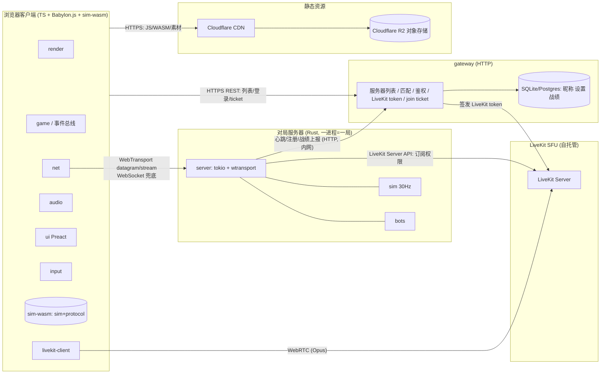
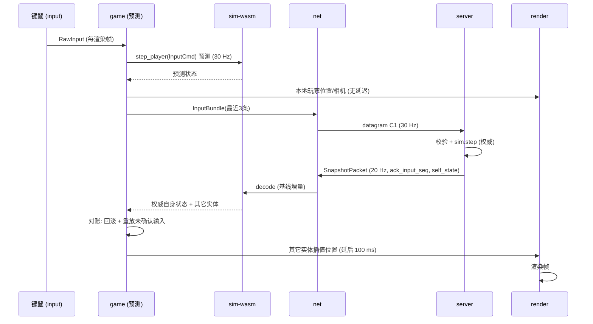
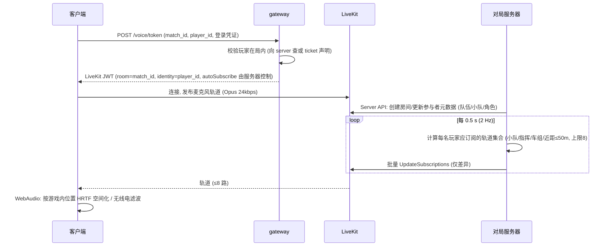
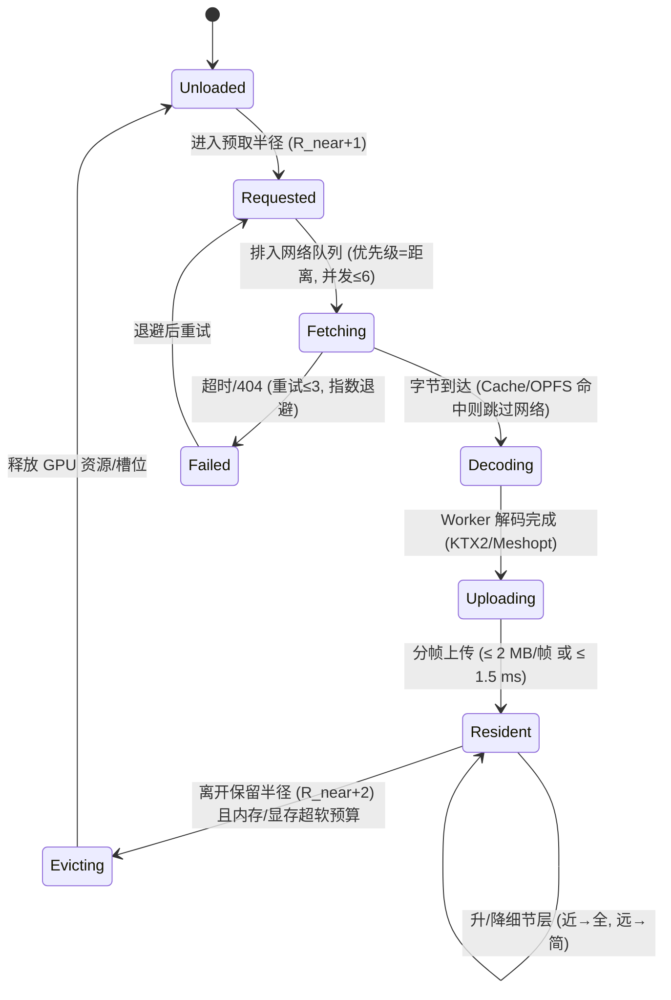
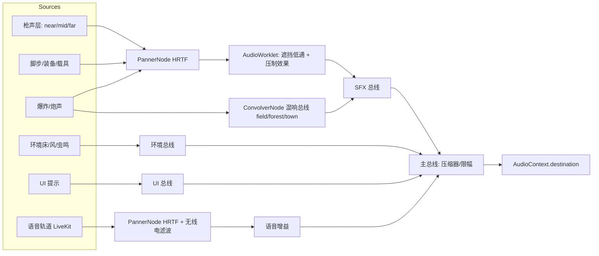

# Frontline 技术架构（ARCHITECTURE.md）

> 版本：v1.0（规划阶段）　日期：2026-11-17　状态：约束性文档，任务文件按 "ARCHITECTURE.md §x.y" 引用本文章节，**章节编号不得重排**。
> 读者：没有上下文的执行工程师（AI）。本文只含架构、接口签名草案、数据结构示例与伪代码，**不含实现代码**。
> 约定：数值带单位；游戏性初值标 `【待调参】`；需黑盒测量校准的标 `【待测 → REFERENCE_MEASUREMENTS §x】`；外部事实未核实的标"未核实"。

---

## 1. 概述与设计原则

### 1.1 项目定位

"Frontline" 是浏览器原生（WebGPU 优先、WebGL2 兜底）的二战战术 FPS：50v50、服务器权威、大规模高致死率、小队/指挥链/补给/重生网络驱动。玩法类型对标 Hell Let Loose 这一品类（下称"参考作品"）。首发地图：Carentan、Omaha Beach、Foy；首发阵营：US / GER。

### 1.2 知识产权边界（硬约束）

1. 参考作品只能**黑盒观测**：公开视频、自录视频、官方开发日志、玩家 wiki 上公开描述的规则。禁止反编译、拆包、内存读取、协议解析、素材提取。
2. 规则、流程、信息架构可以对标；**一切表达层必须原创**：名称、图标、配色、字体、版式、文案、地图关卡布局、能力命名。
3. 本文及其它文档不得照抄参考作品或 wiki 的文字与数值表格排版。数值第一来源是真实史料（武器真实射速/弹容量/初速）；游戏性数值（伤害、冷却、资源消耗）一律"初值 + 待调参"，校准来源是 `docs/REFERENCE_MEASUREMENTS.md` 的黑盒测量。
4. 游戏内任何对外名称不得出现参考作品名称/商标。统一原创命名见 §1.5。

### 1.3 设计原则（按冲突时的优先级排序）

| # | 原则 | 含义与落地 |
|---|---|---|
| P1 | 服务器权威，客户端不可信 | 一切影响胜负的状态由服务器裁决；客户端只上报"输入"，从不上报"结果"。 |
| P2 | 单一真源，单一实现 | 移动/武器/弹道/规则只有一份 Rust 代码（`crates/sim`），服务器原生跑、客户端编译成 WASM 做预测；数值只在 `/data`。 |
| P3 | 确定性优先于性能 | `sim` 不得读墙钟、不得用不受控随机、不得依赖哈希表遍历顺序、不得多线程（§4.2）。 |
| P4 | 带宽与 CPU 是预算而非愿望 | 每个子系统有写死的毫秒/字节预算（§6.9–6.10、§13.5），超预算即缺陷。 |
| P5 | 先 WebGL2 可玩，再 WebGPU 增强 | 任何仅 WebGPU 的特效必须有降级路径（§10.3）。游戏性不得依赖渲染路径。 |
| P6 | 渲染/音频/UI 可替换，模拟不可替换 | 客户端子系统通过事件总线解耦（§8.4）；`sim` 不依赖任何渲染概念。 |
| P7 | 诚实 | 网页端有物理上限（§20），不承诺做不到的画质与反作弊能力。 |
| P8 | 素材零自制 | 无专职美术/音频，只用许可证允许"商用 + 网页分发"的现成素材，来源登记在 `LICENSES.md`。 |
| P9 | 跨文档冲突的裁决归属 | 规则/数值/计时/权限冲突以 `GAMEDESIGN.md` 为准；呈现/配色/键位/布局冲突以 `UI_SPEC.md` 为准；网络/性能预算/接口冲突以 `ARCHITECTURE.md` 为准。 |

### 1.4 非目标

不做手机/平板/手柄；首发不做付费内容与库存；不做跨区域合服；不做内核级反作弊；不做 Skirmish 之外的额外模式（M4 前）。

### 1.5 统一原创命名（全项目）

- 模式：**Frontline**（5 条战线拉锯）、**Assault**（逐段推进）、**Skirmish**。
- 重生点：**Garrison**、**Outpost**、**Airhead**、侦察组 **Observation Post (OP)**。资源：**Manpower / Munitions / Fuel**。
- 指挥官能力：Supply Drop、Ammo Drop、Bombing Run、Strafing Run、Precision Strike、Recon Flight、Rally、Airhead。
- 兵种：Commander、Officer、Rifleman、Assault、Automatic Rifleman、Medic、Support、Machine Gunner、Anti-Tank、Engineer、Tank Commander、Crewman、Spotter、Sniper。

### 1.6 里程碑（固定）

| 里程碑 | 内容 | 对架构的约束 |
|---|---|---|
| M0 | 单块地形、10 bot、步枪射击、网络同步、帧率达标 | `sim`/`protocol`/`server`/`client` 最小闭环；WebTransport 与 WS 兜底均可用 |
| M1 | Carentan 1/3、20 真人、5 兵种、1 辆坦克、Garrison + 补给、完整部署流程 | 部署流程、载具、AOI v1 |
| M2 | 完整 Frontline 模式、Carentan 完整、100 人压测 | 带宽/CPU 预算全部达标，LiveKit 接入 |
| M3 | 全兵种、全载具、Assault、指挥官能力、火炮 | 指挥官能力、间接火力、LLM 指挥官 |
| M4 | Omaha Beach、Foy、Skirmish、画质与优化、公开测试 | 画质四档、反作弊统计、运维 |

任务编号：`tasks/M{n}-{三位序号}-{slug}.md`。

---

## 2. Assumptions（默认答案，人未回复前按此执行）

| 编号 | 假设 | 架构影响 |
|---|---|---|
| A1 | 商业模式：免费游玩、接受捐赠、无付费内容 | 所有素材/库许可证必须允许商用 + 网页分发；`LICENSES.md` 为准入闸门（§11.7）。 |
| A2 | 团队：1 名人类负责人 + AI 执行者（Sonnet）；无专职美术/音频 | 不自制、不 AI 生成模型/动画/音效；只用现成正规素材；工具链必须能被脚本化、无需 DCC 手工步骤。 |
| A3 | 首批 3 张地图：Carentan（1944-06）、Omaha Beach（1944-06-06）、Foy（1945-01），全部美军 vs 德军 | 首发仅 US / GER；苏军/英军（Stalingrad、Kursk 等）为 M4 后 Backlog；数据 schema 必须允许加阵营而不改代码。 |
| A4 | 目标平台：桌面 Chrome/Edge（WebGPU）一等公民；Firefox/Safari 尽力（WebGPU 可用则用，否则 WebGL2）；不支持手机/平板；键鼠，不做手柄 | 无触控输入层；Pointer Lock + Keyboard API 为输入基线；CI 视觉回归以 Chromium 为准。 |
| A5 | 单区域（欧洲或北美，待人定）、起步 1–2 个 100 人对局服务器；真人不足由 bot 填充 | 无全球匹配；bot 是容量常态而非例外，bot 须与真人同路径输入（§16）。 |
| A6 | 预算：以"标准"档为计划基线，同时给"精简""极致"两档 | §13 为 Medium/High 做详细预算，Low/Ultra 给出差异；§18.1 给三档成本区间。 |
| A7 | UI 首发英文 + 简体中文，文案全走 i18n key | UI 中禁止硬编码字符串；字体需覆盖 CJK 子集；`/data` 中名称字段存 key。 |
| A8 | 账号：首发匿名游客 + 可选 OAuth（Discord/Google，待人定），无付费、无库存；只存昵称、设置、基础战绩 | gateway 只需一张小表（player、stats、settings）；JWT 无状态；隐私面最小（§19）。 |

### 2.1 补充技术假设（本文新增）

| 编号 | 假设 | 若不成立的后果 / 对策 |
|---|---|---|
| T1 | 客户端 WASM 与服务器原生在**同一 Rust 源码 + 同一 `/data` 哈希**下，对预测所需的角色移动结果"近似一致"即可（对账容差：位置误差 > 0.05 m 才触发回滚重放，R5），**不要求**与原生逐比特一致 | 逐比特一致只在"同构建 WASM vs WASM"（回放、CI）保证；预测误差靠对账平滑消化（§6.4）。不能因此把"必须比特一致"写进任何验收标准。 |
| T2 | 玩家平均 RTT ≤ 80 ms，P95 ≤ 150 ms（单区域内） | 超过 250 ms 的玩家不享受延迟补偿上限之外的回溯（§6.7），并在 HUD 显示延迟警告。 |
| T3 | 对局服务器主机提供 ≥ 4 个高频物理核心（≥ 3.5 GHz 级）与 ≥ 1 Gbps 出口 | 见 §6.10 CPU 预算与 §18.1 容量规划。 |
| T4 | 玩家桌面机器有 ≥ 8 GB 系统内存、WebGPU 可用时驱动较新；Low 档以 Iris Xe 级核显为底线 | Low 以下不保证；启动时做能力探测与基准（§13.6）。 |
| T5 | 浏览器单标签页可稳定使用 ≤ 1.5 GB JS 堆 + WASM；WASM 使用 wasm32（4 GB 理论上限，计划上限 1.5 GB） | 不使用 wasm64；纹理走 GPU 上传后释放 CPU 副本。 |
| T6 | WebTransport 在所有目标浏览器可用（见 §5.6 核实表）；但企业代理/部分网络会阻断 UDP/HTTP3 | 必须有 WebSocket 兜底；兜底路径体验降级但可玩（§6.6）。 |
| T7 | 所有网络消息 MTU 目标 ≤ 1200 B 载荷（QUIC datagram 实际可用上限需运行时查询 `maxDatagramSize`） | 超限消息拆分为多包，不依赖 IP 分片。 |
| T8 | LiveKit 自托管 SFU 与对局服务器同机房、RTT < 5 ms | 订阅权限更新延迟视为 < 300 ms（估计值，未核实，M2 实测）。 |
| T9 | Opus 24 kbps/路、同时下行最多 8 路，语音带宽**不计入** §6.9 的 256 kbps | 总下行 = 游戏 ≤ 256 + 语音 ≤ 352 kbps（8 路 × 约 44 kbps/路 线上速率，含 RTP/UDP/IP 头开销，ptime 20 ms；DTX 实际均值约 1/3）。 |
| T10 | 对局时长 40–90 分钟；单局 bot 补位后总实体数 ≤ 100 玩家 + ≤ 40 载具 + ≤ 400 活动弹体/投射物 | AOI、预算与压测均按此上限。 |
| T11 | Babylon.js 8.x 的 `WebGPUEngine`、`ComputeShader`、`RenderTargetTexture` 足以搭自定义帧图；其 FrameGraph 功能成熟度**未核实**，不作为依赖 | 自行组织 pass 顺序（§10.1），M0 做可行性验证。 |

---

## 3. 系统架构与部署视图

### 3.1 系统架构图



### 3.2 进程与部署视图

| 进程 | 数量（起步） | 形态 | 端口/协议 | 状态 | 说明 |
|---|---|---|---|---|---|
| `gateway` | 1（可横向扩展） | Docker，小型云主机（2 vCPU/2 GB） | 443/TCP HTTPS | 无状态 + 小库 | 服务器浏览器、匹配、鉴权、join ticket、LiveKit token |
| `server`（对局） | 1–2 台主机，每机若干进程 | Docker，Hetzner/OVH 专用或高频云（≥ 4 物理核） | 443/UDP(QUIC) + 443/TCP(WS 兜底)，每局一个端口 | 内存态，局结束即销毁 | 一进程 = 一局（100 人） |
| LiveKit Server | 1（与对局服务器同机房） | Docker | 7880/TCP、7881/TCP、50000–60000/UDP 或 TURN（具体按 LiveKit 官方部署文档，未核实） | 内存态 | 单房间 = 一局 |
| 静态资源 | — | Cloudflare R2 + CDN | 443 | 不可变对象（内容哈希命名） | 客户端 JS/WASM/素材 |
| 监控 | 1 | Prometheus + Grafana + Loki（§18.3） | 内网 | 持久 | — |

### 3.3 一局的生命周期

1. gateway 判断需要新局（人数不足/无空位）→ 调用某台对局主机上的 `matchd`（轻量守护，或简化为 gateway 通过 Docker API/systemd 启动进程）启动 `server --map carentan --mode frontline --match-id <uuid>`。
2. `server` 加载 `/data` 与地图碰撞/导航数据，向 gateway 注册（`POST /internal/matches/register`，含公钥指纹、端口、`data_hash`）。
3. 玩家经 gateway 获取 join ticket（§19.2），客户端用 ticket 连 `server`。
4. 局终 → `server` 上报战绩 → 关闭连接 → 进程退出；gateway 回收端口。
5. 崩溃：gateway 心跳 5 s 丢失 → 标记局失效，玩家回到服务器浏览器。**首发不做对局迁移/断线续局到新进程**。

---

## 4. 模块边界

### 4.1 仓库布局与总览

```
/client                 TS + Vite + Babylon.js（渲染、UI、音频、输入）
  /src/render /src/ui /src/audio /src/input /src/net /src/game
/crates
  /sim /protocol /sim-wasm /server /gateway /bots /headless-client /balance-sim
/tools
  /asset-pipeline  /map-pipeline
/data                   游戏数据（数值唯一真源）
/assets/incoming        人工放入的原始素材（.gitignore）
/assets/processed       处理后素材（不进 git；清单进 git）
/docs  /tasks  LICENSES.md
```

### 4.2 依赖图

```mermaid
flowchart TD
  data[/data JSON/] -. build.rs 嵌入 .-> sim
  protocol --> sim
  sim --> simwasm[sim-wasm]
  protocol --> simwasm
  sim --> bots
  protocol --> bots
  sim --> server
  protocol --> server
  bots --> server
  protocol --> gateway
  sim --> headless[headless-client]
  protocol --> headless
  sim --> balance[balance-sim]
  protocol --> balance
  bots --> balance
  simwasm -. npm 包 .-> client
  assetp[tools/asset-pipeline] -. 产出 manifest .-> client
  mapp[tools/map-pipeline] -. 产出区块/碰撞/导航 .-> server
  mapp -. 产出区块 .-> client
```

规则：箭头 = "依赖 / 使用"。**图中未画出的依赖一律禁止**。

### 4.3 各模块职责、对外接口、依赖方向

#### 4.3.1 `crates/protocol`

- 职责：线上消息定义、位级量化（位置/角度/速度）、位流读写、基线增量压缩（编码/解码）、协议版本号、通道/消息 ID 枚举。
- 对外接口：`Message` 枚举与 `encode/decode`；`BitWriter/BitReader`；`EntityState`（量化后的线上实体状态）；`Snapshot{Encoder,Decoder}`；`PROTOCOL_VERSION: u16`。
- 依赖：仅 `bitvec`/`thiserror` 级别的通用库；**禁止**依赖 `sim`、`tokio`、`wasm-bindgen`、`wtransport`。
- 被依赖：几乎所有 crate。
- 约束：`#![no_std]` 兼容目标（至少 `alloc`）；无 I/O；无平台相关代码。

#### 4.3.2 `crates/sim`

- 职责：确定性模拟——角色移动（Rapier KCC）、武器（射击/散布/后坐/装填）、弹道、载具（raycast 悬挂 + 履带模型）、伤害/生命、重生/部署规则、据点/资源/补给规则、指挥官能力效果、胜负判定。以 `bevy_ecs`（仅 `bevy_ecs` crate，不用 `bevy` App）为数据组织。
- 对外接口：`World`（见 §8.1）、`step(&mut World, &[(PlayerId, InputCmd)])`、`WorldView`（只读视图，供 bots/AOI/编码）、`export_entity_state`、`apply_snapshot_for_prediction`、`LagCompHistory`、`GameData`（由 `/data` 编译期嵌入）。
- 依赖：`protocol`（`InputCmd`、量化函数）、`rapier3d`（`enhanced-determinism`）、`bevy_ecs`、`glam`、`serde`（仅数据解析）。
- **禁止依赖**：`tokio`、任何网络/文件 I/O、`std::time::{Instant,SystemTime}`、`rand::thread_rng`、`std::collections::HashMap/HashSet`（改用 `indexmap` 固定顺序或 `BTreeMap`；ECS 查询顺序须由排序的 EntityId 保证）、`rayon`/任何线程、`wasm-bindgen`、`server/bots/gateway`。
- 随机数：`rand_pcg::Pcg64Mcg`，种子 = `hash(match_seed, tick, entity_id, purpose)`；客户端预测使用相同种子公式（服务器在 `Welcome` 中下发 `match_seed`）。
- 浮点：全 `f32`；禁用 fast-math；避免依赖 `sin/cos/powf` 的 libm 差异——使用 `libm` crate 的纯 Rust 实现统一数学函数。
- 特性开关：`feature = "client-predict"`（编译进 WASM：仅含本地玩家与载具所需子集，不含规则/bot/全局战局）。

#### 4.3.3 `crates/sim-wasm`

- 职责：`sim` + `protocol` 的 `wasm-bindgen` 封装；暴露给 TS 的 API（§8.3）。构建产物 `pkg/`（`wasm-pack build --target web`），经 `wasm-opt -O3`，体积预算 ≤ 1.2 MB（br 后 ≤ 400 KB）。
- 对外接口：见 §8.3。
- 依赖：`sim`、`protocol`、`wasm-bindgen`、`js-sys`、`console_error_panic_hook`。
- 禁止：新增游戏逻辑（逻辑必须在 `sim`）；与 JS 之间传递复杂对象（只传 `Uint8Array`/`Float32Array` 与 POD）。

#### 4.3.4 `crates/server`

- 职责：tokio 运行时、WebTransport/WebSocket 接入、会话与握手、通道调度、AOI 与优先级累加器、快照编码发送、延迟补偿历史、校验与反作弊、bot 宿主、LiveKit 订阅管理器、指标与日志、局生命周期。
- 对外接口：二进制 `frontline-server`（CLI + 环境变量）、`/metrics`（Prometheus）、内网注册 API 客户端。
- 依赖：`sim`、`protocol`、`bots`、`tokio`、`wtransport`、`tokio-tungstenite`、`prometheus`、`tracing`、`reqwest`（LiveKit/gateway）。
- 禁止：**在 `server` 内实现游戏规则**（规则一律在 `sim`，否则 `balance-sim` 与客户端预测将与服务器分叉）；依赖 `gateway`；依赖 `headless-client`。
- 线程模型：见 §6.10。

#### 4.3.5 `crates/gateway`

- 职责：HTTP API（axum）：服务器列表、匹配、游客/OAuth 鉴权、join ticket 签发、LiveKit token 签发、战绩/设置读写、管理员 API（封禁、踢人）。
- 依赖：`protocol`（仅共享 `ServerInfo` 等 DTO 与 `PROTOCOL_VERSION`）、`axum`、`sqlx`、`jsonwebtoken` 或 `ed25519-dalek`、`livekit-api`（或手写 JWT）。
- 禁止：依赖 `sim`/`server`/`bots`；持有任何实时对局状态。

#### 4.3.6 `crates/bots`

- 职责：导航（Recast 烘焙数据加载与寻路，`recast-navigation` 绑定或纯 Rust 实现）、行为树、效用 AI、分层指挥（指挥官 bot → 小队长 bot → 士兵 bot）、LLM 指挥官适配器（`feature = "llm"`）。
- 对外接口：`trait BotBrain { fn think(&mut self, view: &dyn WorldView, ctx: &BotCtx) -> InputCmd }`、`CommanderBot`、`LlmCommander`（§16）。
- 依赖：`sim`（只读 `WorldView`）、`protocol`（`InputCmd`）、`reqwest`（仅 `llm` 特性）。
- 禁止：依赖 `server`/`gateway`；**直接修改 `World`**——bot 只能产出与真人同构的 `InputCmd`/指挥意图，保证与真人受同一套校验与规则约束。

#### 4.3.7 `crates/headless-client`

- 职责：无渲染客户端：握手、发送合成输入、解码快照、可选运行本地预测；用于 100 客户端压测与集成测试。
- 依赖：`sim`、`protocol`、`tokio`、`wtransport`/`tokio-tungstenite`。禁止依赖 `server`。

#### 4.3.8 `crates/balance-sim`

- 职责：无渲染、无网络、可大于实时的整局模拟（bot vs bot），输出胜率/KDA/资源曲线/武器击杀占比 CSV。
- 依赖：`sim`、`bots`、`protocol`。禁止依赖 `server`（含网络层）。

#### 4.3.9 `client`（TS）

| 目录 | 职责 | 允许依赖 | 禁止依赖 |
|---|---|---|---|
| `src/net` | WebTransport/WS 传输、通道、握手、时钟同步、调用 `sim-wasm` 解码 | `sim-wasm`、事件总线 | `render`、`ui`、`audio` |
| `src/input` | Pointer Lock、键鼠映射、重绑定、输入采样 → `InputCmd` | 事件总线 | `render`、`net` |
| `src/game` | 客户端游戏状态：本地预测驱动、实体插值缓冲、兵种/部署/战术状态机、事件总线实例 | `net`、`input`、`sim-wasm` | `render`/`ui`/`audio` 的**实现**（只经事件总线与只读状态接口交互） |
| `src/render` | Babylon 场景、地形、植被、角色/载具、特效、后处理、流式加载 | `game` 只读状态、事件总线 | `net`、`ui`、`input` |
| `src/audio` | WebAudio 图、混音、语音空间化（LiveKit 轨道）、AudioWorklet | `game` 只读状态、事件总线、`livekit-client` | `render`、`net` |
| `src/ui` | Preact + signals：菜单、部署界面、HUD、战术地图（Canvas2D/小 WebGL 画布） | `game` 只读状态（signals 桥）、事件总线 | `render` 内部、`net` |

依赖方向：`input → game ← net`；`render/audio/ui` 只读 `game` 并订阅事件；`game` 不 import 它们。

### 4.4 `/data`、`/tools`、`/assets`

- `/data`：JSON 数值真源。`sim` 的 `build.rs` 读取并嵌入（`include_bytes!` + 构建期 schema 校验），计算 `DATA_HASH`（SHA-256 前 8 字节）。`client` 不直接读取 `/data` 做逻辑判断，只用于显示字段（名称 key、图标 id），且经 `sim-wasm` 暴露的 `GameData` 查询接口读取，避免双份解析。
- `tools/asset-pipeline`（Node）：glTF/KTX2/Meshopt/音频处理并打包为 `.fpak`（R11），产出 `/assets/processed` 与 `manifest.json`（§11）。
- `tools/map-pipeline`（Python + GDAL）：DEM → 高度图、splat、植被分布、区块烘焙、碰撞、Recast 导航网格。
- 依赖方向：`tools/*` 只读 `/data/maps/*` 与 `/assets/incoming`，输出到 `/assets/processed`；不得被 `crates/*` 在运行期依赖。

### 4.5 禁止依赖速查表

| 从 \ 到 | protocol | sim | sim-wasm | server | gateway | bots | client |
|---|---|---|---|---|---|---|---|
| protocol | — | ✗ | ✗ | ✗ | ✗ | ✗ | ✗ |
| sim | ✓ | — | ✗ | ✗ | ✗ | ✗ | ✗ |
| sim-wasm | ✓ | ✓ | — | ✗ | ✗ | ✗ | ✗ |
| server | ✓ | ✓ | ✗ | — | ✗ | ✓ | ✗ |
| gateway | ✓ | ✗ | ✗ | ✗ | — | ✗ | ✗ |
| bots | ✓ | ✓ | ✗ | ✗ | ✗ | — | ✗ |
| headless-client | ✓ | ✓ | ✗ | ✗ | ✗ | ✗ | ✗ |
| balance-sim | ✓ | ✓ | ✗ | ✗ | ✗ | ✓ | ✗ |

CI 用 `cargo deny` + 自写脚本检查 `cargo metadata` 依赖图（§17.5），违规即失败。

---

## 5. 技术选型

### 5.0 浏览器支持现状（核实记录）

核实日期：2026-11-17。方法：WebSearch；**以下多数来自二手/博客来源，仅 MDN 与 web.dev 视为较可靠**。未直接抓取 caniuse 页面，因此各浏览器覆盖率百分比标"未核实"。

| 特性 | Chrome / Edge | Firefox | Safari | 来源 |
|---|---|---|---|---|
| WebGPU | 桌面 Chrome 113 起稳定；Edge 随 Chromium（搜索结果以 144 为当前参考版本） | Firefox 141 起 Windows 启用；macOS Apple Silicon 在 145–147 之间（来源互相矛盾，**未核实**具体版本）；Linux/Android 仍在推进 | Safari 26 起（macOS/iOS/iPadOS/visionOS） | [web.dev: WebGPU is now supported in major browsers](https://web.dev/blog/webgpu-supported-major-browsers)；[ascii.co.uk 汇总](https://ascii.co.uk/news/article/news-20251126-7cbd345e/webgpu-now-supported-across-chrome-firefox-safari-edge)（二手） |
| WebTransport | Chrome/Edge 自 2021 末–2022 初起 | Firefox 114（2023-06）起 | Safari 26.4（2026-03）起；MDN 标 "Baseline 2026, Newly available" | [MDN: WebTransport](https://developer.mozilla.org/docs/Web/API/WebTransport)；[webrtc.ventures: WebTransport is now Baseline](https://webrtc.ventures/2026/04/webtransport-is-now-baseline-what-it-means-for-real-time-media/)（二手） |

结论与影响：

1. WebGPU 全引擎已上线，但 Linux、旧版 macOS/驱动、企业策略下仍可能缺失 → **WebGL2 兜底不可省**（与 A4 一致）。
2. WebTransport "Baseline Newly available" ≠ "广泛可用"；Safari 实现较新，各引擎在证书要求、datagram 细节上的差异**未核实** → WS 兜底必须作为一等路径测试（§6.6）。
3. 全球覆盖率百分比：搜索结果在 82–84% 区间给出估算，**未核实**，不作为决策依据；本项目以"能力探测 + 降级"取代"按市占率赌"。
4. Safari 在 WebRTC 相关扩展（Insertable Streams、SVC、AV1）上落后（二手来源，未核实）→ 语音只用基础 Opus，不依赖这些扩展（§14）。

### 5.1 渲染：Babylon.js 8.x（WebGPU 优先，回退 WebGL2）

**决定**：Babylon.js 8.x + TypeScript；`WebGPUEngine` 优先，能力探测失败自动回退 `Engine`（WebGL2）；自定义着色器用 WGSL（`ShaderMaterial`/`NodeMaterial`/`ComputeShader`），WebGL2 路径用 GLSL 对应实现或降级。

**理由**：①同一套场景/材质 API 同时覆盖 WebGPU 与 WebGL2，是"兜底"需求下最省代码的方案；②自带 `ComputeShader`、`RenderTargetTexture`、`ShadowGenerator`/CSM、实例化、冻结材质、KTX2 加载、glTF 加载器，贴合 §9–§11；③TypeScript 优先、文档与社区活跃、许可证宽松（Apache-2.0，商用无附加条款，**未逐条核实**）；④无编辑器绑定，可由 AI 执行者纯代码驱动。

| 维度 | Babylon.js 8.x（选） | Three.js WebGPURenderer (TSL) | PlayCanvas | Unity 6 Web |
|---|---|---|---|---|
| WebGPU + WebGL2 兜底 | 一等支持，API 统一 | WebGPURenderer 内含 WebGL2 后端回退（成熟度未核实） | 引擎支持 WebGPU（成熟度未核实） | Web 平台 WebGPU 后端状态未核实，历史上以 WebGL2 为主 |
| 着色器编写 | WGSL / GLSL / NodeMaterial | TSL（节点式 JS DSL，自动转 WGSL/GLSL） | WGSL/GLSL | ShaderGraph/HLSL（交叉编译） |
| Compute 支持 | `ComputeShader` 类 | 有（随 WebGPU 路径） | 有（未核实） | 有（WebGPU 下，未核实） |
| 内建能力（CSM、后处理、实例化、碰撞） | 多，开箱较全 | 少，需自己搭 | 中，偏编辑器工作流 | 极多但体积大 |
| 编辑器依赖 | 无（Inspector 可选） | 无 | 偏向云端编辑器 | 必须 Unity 编辑器 |
| 构建体积（引擎自身） | 中–大（可 tree-shake ES 包，预计压缩后 1–2 MB 级，未核实） | 小–中 | 小 | 大（WASM 数十 MB 量级，未核实），与"主菜单 ≤ 8 MB"冲突风险高 |
| 适合 AI 纯代码执行 | 高 | 高 | 中 | 低（编辑器/二进制资产工作流） |
| 为何未选 | — | 帧图/CSM/体积雾等需自研更多基础设施；仍需自管兜底路径差异 | 工作流偏编辑器；与"AI 纯代码、仓库内可复现"不契合 | 体积与启动时间超预算；服务器权威 Rust 共享代码需要额外桥；Web 平台限制多；许可条款需另行核实 |

**已知风险**：①WebGPU 路径某些特性（如部分 compute 与纹理格式）与 WebGL2 路径不对等，需双路径测试（§10.3）；②Babylon 帧图 API 成熟度未核实（T11），备选为手写 pass 编排；③大场景下 JS 端每帧 draw call 提交成本（§13.5）；④8.x 小版本升级可能改 API，锁版本并用视觉回归保护（§17.4）。

### 5.2 模拟核心：Rust `sim` crate（bevy_ecs 独立使用）

**决定**：Rust `sim` crate，`bevy_ecs` 作为纯数据/调度库（不使用 Bevy App/插件/渲染），固定步长 30 Hz；同一份代码服务器原生运行 + 编译为 WASM 在客户端预测。

**理由**：①"一份代码两处运行"消除预测/权威分叉（P2）；②ECS 的数据局部性适合 100 玩家 + 400 弹体的批量更新；③Rust 对确定性（无 GC、可控浮点）更友好；④WASM 体积与性能可控。

| 维度 | Rust sim（选） | 全 TS(Node) 服务器 | Go 服务器 |
|---|---|---|---|
| 与客户端共享模拟代码 | 是（原生 + WASM） | 是（同语言，天然共享） | 否（需重写或 WASM 嵌入） |
| 单线程吞吐 | 高；30 Hz × 100 实体余量大 | 中；GC 抖动与物理需 WASM 绑定 | 高但无共享 |
| 物理引擎 | Rapier 原生，同 crate 客户端 WASM | 只能 WASM 版（Rapier/Jolt.js）且服务器也吃 WASM 开销 | cgo 绑 C++（Jolt/Bullet）或无 |
| 延迟抖动 | 无 GC | V8 GC、JIT 去优化 | GC 暂停较短但存在 |
| 确定性 | 最可控 | JS 数字为 f64，与 WASM f32 不一致，难共享 | 需另写 |
| 生态/人才 | Rust 门槛高 | 低 | 中 |
| 为何未选 | — | 物理与规则在 JS 里性能与确定性双输；100 人 CPU 预算吃紧 | 无法与客户端预测共享代码，等于维护两套模拟 |

**已知风险**：①Rust 学习曲线与编译时间（AI 执行者需明确模块边界，§4）；②`bevy_ecs` 版本迭代快，锁版本；③WASM 与原生浮点结果不比特一致（T1）——靠对账容忍而非强求；④`bevy_ecs` 并行调度必须关闭（单线程 executor），否则破坏确定性。

### 5.3 物理：Rapier 3D（enhanced-determinism）

**决定**：`rapier3d`，开启 `enhanced-determinism`；角色用 kinematic character controller；载具用自写 raycast 悬挂 + 履带模型（不使用通用刚体车辆）。服务器原生、客户端 WASM，同一 crate。

**理由**：①纯 Rust，与 `sim` 同语言，无 FFI；②官方提供 WASM/JS 绑定与 KCC；③`enhanced-determinism` 针对跨平台确定性（据 Rapier 文档，该特性与 `simd-*`、`parallel` 互斥，**实现前须核对当前文档**），代价是性能下降。

| 维度 | Rapier（选） | Jolt（JoltPhysics.js / C++） | Havok（Babylon 插件，WASM） |
|---|---|---|---|
| 服务器原生集成 | 原生 crate | 需 C++ FFI（社区 Rust 绑定质量未核实） | 无官方 Rust 服务器侧方案 |
| 客户端 WASM | 官方 | JoltPhysics.js（emscripten）可用 | 有，随 Babylon |
| 确定性 | `enhanced-determinism` | Jolt 宣称跨平台确定性（需特定编译选项，未核实） | 闭源，确定性保证未核实 |
| KCC | 内建 | CharacterVirtual | 有 |
| 载具 | 自写 | 内建车辆约束 | 有 |
| 许可 | Apache-2.0/MIT 双许可（核对 `LICENSES.md`） | MIT | Babylon 插件分发条款未核实 |
| 为何未选 | — | 多语言构建复杂；服务器端集成成本高 | 闭源、服务器无法共享同一物理，违背 P2 |

**已知风险**：①enhanced-determinism 性能损失（预算见 §6.10，M0 实测，若角色 KCC 超出 3 ms/tick 则降级为"简单胶囊 vs 高度场 + 静态 AABB 的自写 KCC"）；②大地形高度场碰撞精度与内存（2049² 高度场 ≈ 16 MB f32，客户端只载入近区块，§9.5）；③Rapier 版本升级会改变结果（回放文件须带 `sim_version`）。

### 5.4 服务器：Rust + tokio

**决定**：Rust + tokio；**一个进程 = 一局（100 人）**；模拟 30 Hz，快照基准 20 Hz，按 AOI 优先级累加器分配；独立 `gateway` 负责 HTTP。

| 维度 | Rust + tokio（选） | Go | Node |
|---|---|---|---|
| 复用 `sim` | 直接 | 否 | 仅 WASM |
| 100 人 tick 余量 | 大（§6.10 预算 18 ms/33 ms） | 中 | 小 |
| WebTransport 库 | `wtransport`（成熟度需 M0 验证） | `quic-go/webtransport-go`（未核实成熟度） | 生态薄弱（未核实） |
| 内存/抖动 | 稳定 | 稳定偏好 | GC 抖动 |
| 开发效率 | 低–中 | 高 | 高 |
| 为何未选 | — | 无法与客户端预测共享代码 | 性能与确定性 |

**已知风险**：①`wtransport` 为较小的社区 crate，需 M0 验证 datagram 吞吐、多连接稳定性、证书轮换；失败预案：`quinn` + 自写 WebTransport 握手，或临时仅 WS；②一进程一局→进程数 = 局数，需按机器核数装箱（§18.1）；③tokio 与同步模拟线程的交界要用有界 channel，避免背压失控（§6.10）。

### 5.5 网络：WebTransport + WebSocket 兜底

**决定**：WebTransport（HTTP/3，`wtransport`）：不可靠 datagram 走输入/快照，可靠 stream 走事件/RPC；WebSocket 兜底（同一消息层）。客户端预测 + 服务器回滚对账；实体快照插值（100 ms 缓冲）；命中延迟补偿（服务器历史回溯，上限 250 ms）。协议由 `protocol` crate 定义，位级量化 + 基线增量压缩，编译成 WASM 供客户端复用。

| 维度 | WebTransport（选，+WS 兜底） | 纯 WebSocket | WebRTC DataChannel |
|---|---|---|---|
| 不可靠无序传输 | 是（datagram） | 否（TCP，队头阻塞） | 是（可配置 unordered/maxRetransmits） |
| 服务器实现复杂度 | 中（QUIC + HTTP/3 握手） | 低 | 高（ICE/DTLS/SCTP，需信令） |
| 客户端 API | 简洁 | 简洁 | 繁琐 |
| 浏览器覆盖 | 见 §5.0（Safari 26.4+） | 全 | 全 |
| NAT/防火墙 | UDP/443，企业网可能被阻 | 最稳 | 需 STUN/TURN |
| 多路复用 | 原生 stream | 单流 | 多 channel |
| 为何未选 | — | 作为兜底保留；主路径因 HOL 阻塞在丢包下延迟尖峰 | 服务器端实现与运维复杂；每连接 SCTP 开销；信令额外服务 |

**已知风险**：①WebTransport 各浏览器 datagram 与证书细节差异（未核实）；②WS 兜底在 2% 以上丢包时体验显著劣化（§6.6）；③QUIC 在服务器端 CPU 开销高于裸 UDP（100 连接 × 20 pkt/s = 2 000 pkt/s，量级可忽略，但 TLS/AEAD 计入 §6.10）；④开发期自签名证书需 `serverCertificateHashes`（有效期限制，Safari 支持未核实），生产用 Let's Encrypt。

### 5.6 带宽预算

**决定**：每玩家下行均值 ≤ 256 kbps、峰值 ≤ 512 kbps；上行 ≤ 32 kbps（不含语音）；语音 Opus 24 kbps/路，同时最多混 8 路。推导见 §6.9。

对比：与"全量广播（每人每 tick 发 100 实体 × 32 B × 30 Hz = 768 kbps 以上）"相比，AOI + 优先级 + 增量压缩使下行均值降至约 54 kbps（§6.9），余量用于抗丢包重传、指挥官能力与未来特性。

| 方案 | 估算下行 | 优缺点 | 结论 |
|---|---|---|---|
| 全量广播未压缩 | ≈ 100 × 32 B × 30 Hz × 8 = 768 kbps（不含开销） | 简单；严重超预算 | 否决 |
| 全量广播 + 量化 + 增量 | 约 300–400 kbps | 无 AOI 逻辑；仍超均值 | 否决 |
| **AOI + 优先级 + 增量（选）** | 约 54 kbps 典型 / 117 kbps 密集 | 复杂度高；需要对账 AOI 边界闪现 | 选用 |

已知风险：AOI 边界实体"弹出"（pop-in）——用进入半径 < 离开半径的迟滞与淡入（§6.5）。

### 5.7 AOI

**决定**：服务器 2D 网格（64 m 格）+ 按距离/视锥/重要性的优先级；远距离玩家降频（最低 2 Hz）；地图图标信息（友军位置）走单独低频团队通道 1 Hz。**敌方信息下发规则（R3）**：敌方实体仅在 ≤ 400 m 且（在视锥 + 30° 余量内 或 ≤ 96 m）时下发精确状态；被标记/侦察暴露的敌人只下发地图图标（1 Hz，位置量化到 5 m）；友军最远 400 m、最低 2 Hz，更远的友军只走团队通道图标（详见 §6.5.4、§15.2）。

| 方案 | 优点 | 缺点 | 结论 |
|---|---|---|---|
| 2D 均匀网格 64 m（选） | 实现简单、O(1) 邻域、与区块对齐（§9.2） | 垂直方向（建筑多层）无分层 | 选用；建筑内高度差由距离优先级处理 |
| 四叉树/BVH | 适应不均匀分布 | 重建成本、实现复杂 | 100 实体规模无收益 |
| 纯半径查询 | 最简单 | 100×100 = 10 000 次距离检查/tick（仍可接受，≈0.05 ms）但无法表达频率分层 | 作为网格内细筛 |

风险：玩家与载具高速移动跨格；用 3×3 邻格 + 速度外推边距（§6.5）。

### 5.8 语音：LiveKit

**决定**：LiveKit 自托管开源 SFU；gateway 签发 token；对局服务器通过 LiveKit Server API 按"频道（小队/指挥/车组）+ 近距离（≤ 50 m）"动态设置订阅权限；客户端 WebAudio HRTF 空间化。

| 维度 | LiveKit（选） | mediasoup | 纯 P2P WebRTC |
|---|---|---|---|
| 形态 | 完整 SFU 服务 + SDK + Server API | Node 库，需自写信令与房间逻辑 | 无服务器 |
| 100 人房间 | 官方设计目标范围内（容量指标未核实，M2 压测） | 需自行分布 | 网状连接 99 路，不可行 |
| 动态订阅控制 | Server API / 订阅权限 | 自写 | 无 |
| 客户端 SDK | 官方 JS SDK | 需自写/第三方 | 原生 API |
| 运维 | 单二进制 Docker | 自维护 Node 服务 | 无 |
| 为何未选 | — | 自写信令/房间/权限成本 | 100 人 N² 连接与带宽不可行；无服务器侧权限裁决 |

风险：自托管 TURN/UDP 端口范围需运维；订阅变更延迟（T8）；LiveKit 版本与 API 变更（锁版本）。

### 5.9 地形与世界

**决定**：可玩区 2048 m × 2048 m，高度图 1 m 分辨率（2049²，16-bit）；远景环 8 km × 8 km，8 m 分辨率；CDLOD 四叉树 + 64 m 区块流式；植被 GPU instancing + 八面体 impostor；遮挡剔除：WebGPU 下 Hi-Z（compute），WebGL2 仅视锥 + 距离 + 预计算建筑遮挡体。

| 方案 | 优点 | 缺点 | 结论 |
|---|---|---|---|
| CDLOD（选） | 顶点 morph 无裂缝、LOD 范围可调、与 compute/instancing 配合好 | 需自写四叉树选择与 morph 着色器 | 选用 |
| Geometry clipmap | 内存恒定、GPU 友好 | 视点中心环形更新对流式区块/编辑器烘焙不友好；多层级纹理更新复杂 | 未选 |
| 固定网格 LOD | 最简单 | LOD 接缝、过渡 popping、大地图顶点数过多 | 未选 |

风险：1 m 高度图在近距离坡面呈"阶梯"感——用法线贴图细节层与 2 m 以下的 triplanar 细节补偿；2049² 的 16-bit 精度（0.0015 m/step 若量程 100 m）足够。

### 5.10 资源管线

**决定**：glTF 2.0 + KTX2（BasisU：颜色 ETC1S/UASTC 按需，法线 UASTC）+ Meshopt 压缩；工具 `gltf-transform` + `toktx`；处理后的网格/贴图/音频打包进自有分块容器 **`.fpak`**（唯一下发格式，支持 HTTP Range 流式读取，R11/D-PAK，§11.8）；64 m 区块 + 距离环流式；Cache API/OPFS 缓存。体积目标：主菜单 ≤ 8 MB（gzip/br 后 JS+WASM+UI）；首张地图 Medium ≤ 150 MB、High ≤ 350 MB、Ultra ≤ 600 MB。

| 方案 | 体积 | 解码成本 | 兼容 | 结论 |
|---|---|---|---|---|
| glTF + KTX2 + Meshopt（选） | 小 | KTX2 转码（WASM，BasisU transcoder）+ Meshopt 解码极快 | Babylon 原生支持 | 选用 |
| 原始 glTF + PNG | 大（PNG 解码后占满显存，无 GPU 压缩） | 低 | 最简单 | 显存与体积均不可接受 |
| Draco | 网格压缩率高 | 解码比 Meshopt 慢（量级，未核实） | 支持 | 未选：对动画/顶点属性不如 Meshopt 友好，且无纹理方案 |

风险：KTX2 转码耗时（需 Worker 池，§11.5）；UASTC/ETC1S 质量需肉眼验收（法线用 UASTC）。

### 5.11 画面

**决定**：PBR（metal-rough）、级联阴影 4 级、froxel 体积雾（WebGPU compute；WebGL2 降级高度雾）、TAA、自研 TAAU 时间性超分（WebGPU compute；WebGL2 降级 FSR1 式空间放大）、SSAO/GTAO、SSR 仅 Ultra、IBL + 烘焙光照探针。

| 项 | 选择 | 备选 | 为何 |
|---|---|---|---|
| 超分 | 自研 TAAU（compute） | 直接集成第三方 FSR2/DLSS（浏览器无 DLSS；FSR2 需 WASM/WebGPU 移植，许可与成本未核实） | 可控、与 TAA 共用历史缓冲；风险：画质不及 FSR2 |
| AO | GTAO（Medium+），SSAO（Low 关闭） | HBAO、RTAO | 无硬件光追 |
| 体积雾 | froxel（160×90×64） | 仅高度雾 | WebGL2 无 compute |
| 阴影 | CSM 4 级 | VSM、光线追踪 | 兼容性与成本 |

风险：TAAU 在高速运动/植被上鬼影；需 mask 与 clamp；WebGL2 路径无 compute，降级见 §10.3。

### 5.12 音频

**决定**：WebAudio；HRTF `PannerNode`；`AudioWorklet` 做遮挡低通与压制效果；枪声近/中/远三层按距离交叉淡化；远处炮声走卷积混响总线；声速延迟模拟。备选：Howler.js（封装层，3D 能力有限）、FMOD/Wwise Web（闭源/授权复杂，未核实）。结论：自建薄封装在 WebAudio 上，便于与 LiveKit 轨道同一 `AudioContext` 混合。风险见 §12.6、§20。

### 5.13 画质分级

决定见 §13。对比：固定单档 vs 自动动态分辨率 vs 四档手动 + 动态分辨率。选后者，因硬件跨度（Iris Xe 到 RTX 4070+）极大，单档无法覆盖。

### 5.14 反作弊

决定见 §15。备选：①"客户端完整性检测"（浏览器不可行，页面脚本可被篡改）；②服务器端"完全不信任 + 校验 + 统计"（选）；③依赖第三方商业反作弊（Web 端无成熟产品，未核实）。

### 5.15 Bot

决定见 §16。备选：①纯状态机（难以表达层次目标）；②纯行为树（目标选择硬编码）；③GOAP（调试难、性能不确定）。选行为树（战术动作）+ 效用 AI（目标/兵种选择），指挥层可选 LLM。风险：导航网格与大地图/建筑内多层的覆盖。

### 5.16 测试

决定见 §17。备选：只做手动测试（不可接受）；E2E 全浏览器矩阵（成本高，只保 Chromium 视觉回归）。

### 5.17 部署

**决定**：对局服务器 Hetzner/OVH 专用或高频云主机（Docker）；静态资源 Cloudflare R2 + CDN；gateway 小型云主机；TLS 证书 Let's Encrypt。

| 维度 | 专用/高频云（选） | 通用云（AWS/GCP 通用实例） | Serverless/容器托管 |
|---|---|---|---|
| 单核高频性能 | 高 | 中（共享核 steal） | 低且不稳定 |
| 出口流量成本 | 低或包含（具体价格未核实） | 高（以量计费，价格未核实） | 高 |
| UDP/QUIC 支持 | 完整 | 完整 | 常受限 |
| 弹性 | 低（月租/小时租） | 高 | 高 |
| 结论 | 起步 1–2 台，匹配 A5 | 峰值弹性备选 | 不适合 UDP 长连接 |

风险：专用机弹性差，峰值需人工加机；单区域故障无冗余（§20）。

---

## 6. 模拟与网络

### 6.1 Tick 模型

- 固定步长 `TICK_HZ = 30`，`dt = 1/30 s = 33.333 ms`；`tick: u32`（约 4.5 年不溢出，比较用环绕比较函数）。
- 服务器主循环（专用 OS 线程，非 tokio worker）：

```
loop at 30 Hz (绝对时间表, 不累积漂移):
  deadline += 33.333 ms
  1. drain 输入队列 (来自网络线程的有界 channel)
  2. apply_inputs(tick)         // 每玩家取 tick 对应的 InputCmd；缺失则重复上一条 ≤ 5 tick，之后清零按键
  3. sim.step()                 // 移动/武器/弹道/载具/规则
  4. record_lag_comp_history()
  5. bots.think() (分片)        // 与真人同构输入 (见 §16)
  6. aoi_and_snapshot(tick)     // 仅在 20 Hz 的 tick 上给每个客户端出包, 见 §6.5
  7. send via network thread    // 有界 channel
  sleep_until(deadline)
```

- 快照基准 20 Hz：对 30 Hz 的 tick，每 3 个 tick 中出 2 个包（tick 序列 0,1,_,3,4,_ ...）。每个客户端的出包 tick 以 `client_id % 3` 错相，使编码 CPU 在 tick 间均匀分布（§6.10）。
- 客户端同样 30 Hz 固定步长预测，渲染帧与模拟帧解耦：每渲染帧累计 `real_dt`，跑 0..N 个模拟步（N 上限 5，防螺旋），余数用于渲染插值。

### 6.2 时钟与同步

- `Welcome` 下发 `server_tick`、`tick_rate`、`match_seed`、`data_hash`、`client_tick_offset`。
- 客户端维护 `estimated_server_tick`：每 1 s 发 `Ping{client_time}`，收到 `Pong{client_time, server_tick, server_time}` 得 RTT，对 RTT 做 EWMA（α = 0.1）。
- 客户端发送的输入 tick 目标 = `server_tick_estimate + ceil(RTT/2 / 33.3 ms) + 1`（"输入提前量"，使输入在到达服务器时刚好位于其执行 tick 之前约 1 tick）。服务器反馈 `input_slack`（到达时距执行 tick 的余量）于 `SnapshotHeader`，客户端用它做 ±1 tick 微调（类似 Overwatch/Source 的 tick 调节），限幅 ±10%/s。

### 6.3 输入管线

**客户端**：

1. `input` 层以事件驱动采集键鼠，每渲染帧聚合为 `RawInput`（按键位图、鼠标 yaw/pitch 增量，增量累计到下个模拟步）。
2. 每个模拟 tick 生成 `InputCmd`（见 §8.2）：`seq: u16`、`tick: u32`、`move_x/move_z: i8`（-127..127，量化）、`yaw: u16`（0..65535 → 0..2π，≈0.0055°）、`pitch: i16`（-32768..32767 → ±90°）、`buttons: u16`、`weapon_slot: u8`、`aux: u8`。
3. 客户端把 `InputCmd` 入"未确认输入环"（容量 128），本地用同一 `sim` 立即预测。
4. 发送：每包携带**最近 3 个**未确认输入（冗余，抗丢包）→ `InputBundle`。

**服务器**：

1. 每玩家一个按 `tick` 索引的输入缓冲（容量 8 tick），去重（按 `seq`），丢弃过旧（< 当前 tick - 2）与过远（> 当前 tick + 10）输入。
2. 输入校验（§15.1）：`seq` 单调、移动向量模长 ≤ 1、yaw/pitch 变化率不超过 `anticheat.json` 中的每轴上限（默认 3600°/s，30 Hz 下每 tick 120°）、按键位合法。
3. 缺失输入策略：重复上一条移动输入最多 5 tick（≈ 167 ms），之后清零移动，保持视角。

### 6.4 客户端预测与对账

预测范围：本地玩家的移动（含载具驾驶员）、本地武器的开火表现（后坐/弹药显示，不决定命中）。

对账伪代码（客户端收到快照中本玩家的权威状态 `S_auth` 与确认 tick `ack_tick`）：

```
on_snapshot(S_auth, ack_tick):
  discard unacked_inputs with tick <= ack_tick
  // R5：按容差对账，不要求 WASM 与原生逐比特一致
  err0 = distance(predicted_state_at(ack_tick).pos, S_auth.pos)
  if err0 <= 0.05 m: keep predicted (容差内，不回滚、不重放)
  else:
    state = S_auth                    // 位置误差 > 0.05 m：回滚到权威状态
    for cmd in unacked_inputs:        // 重放
        state = sim.step_player(state, cmd)
    err = distance(predicted_state_now.pos, state.pos)
    if err < 1.0 m:  start visual_smoothing: render_offset = old_pos - new_pos; offset 在 100 ms 内指数衰减 (τ = 40 ms)
    else:            snap (瞬移) 并播放"校正"提示 (仅调试面板)
    predicted_state_now = state
```

- 平滑作用于**渲染位置**与相机，不作用于模拟状态。
- 预测的移动对撞车辆/其它玩家：**其它实体使用插值位置**（延后 100 ms），因此对"推挤"类交互永远有偏差，服务器裁决；预测不模拟玩家间碰撞（玩家之间不阻挡，减少对账抖动，【待调参】可改为软推挤）。
- 地形/静态碰撞：客户端 WASM 内加载"近区块碰撞数据"（§9.5），范围 = 玩家周围 3×3 区块（192 m 见方）+ 预取一圈。

### 6.5 快照结构、增量压缩与 AOI 优先级

#### 6.5.1 快照包结构（unreliable datagram，一包 ≤ 1200 B）

```
SnapshotPacket (bit-packed)
  header:      type(4b) | server_tick(32b, 全量) 或 delta16(16b) | ack_input_seq(16b) | input_slack(4b) | baseline_tick_delta(5b) | flags(4b)
  self_state:  权威自身状态 (见 §6.5.3)
  events:      n(6b) + [event_id(16b) + type(5b) + payload]...  // 冗余发送, 直到客户端 ack 或 3 包后过期
  entities:    n(7b) + [entity_id(8b) | has_change_mask(1b) | field_mask(≤8b) | fields...]
  trailer:     CRC16 (仅 WS 兜底可省, 因 TCP 已校验)
```

#### 6.5.2 基线增量压缩

- 每个客户端、每个 `entity_id` 在服务器上保留"该客户端已确认的基线 `EntityState`"（`baseline[client][entity] = (tick, state)`）。
- 客户端通过 `ack_snapshot_tick`（在 `InputBundle` 中携带，16 bit 增量）确认收到的最新快照；服务器将该包内所有实体状态提升为新基线。基线环长 32 tick（≈ 1 s）；若 ack 落后 > 32 tick → 对该客户端发"全量关键帧"（所有实体 full record，且不用基线）。
- 字段级差分：`field_mask` 指示哪些字段相对基线变化：`pos`、`rot`、`vel`、`anim_state`、`weapon`、`health_q`、`flags`。
- 位置编码：绝对坐标量化步长 1/32 m（x/z 各 16 bit，覆盖 2048 m；y 13 bit，覆盖 0..256 m）；差分用"大小类 + 数值"：先 2 bit 大小类（<8 / <64 / <512 / 其余步长），再按类取 6/9/12/16 bit（带符号）。
- 旋转：yaw 8 bit（1.4°，T3 远距）/10 bit（0.35°，T0–T1）；pitch 6 bit；载具 quat 用"smallest three" 4×? 压为 32 bit。
- 速度不下发（插值由相邻快照位置推导），仅载具下发 4 B 速度辅助外推。
- 近景全记录约 10 B（含 1 B mask）、远景约 9 B；关键帧记录约 13 B。算术见 §6.9。

#### 6.5.3 自身状态（`self_state`，每包必含）

`tag(4b)` 的低位指示 `pos_corr`（完整位置 45 bit），其后是 `ammo_in_mag(8b)`、`ammo_reserve(12b)`、`health(8b)`、`stamina(6b)`、`suppression(4b)`、`stance(3b)` 和 11 bit 尾部。协议 v4 中，徒步时 `tag >> 1 = 0`，尾部仍为 `deploy_state(3b) | cooldown_bits(8b)`；入座时 `tag >> 1 = 1 + seat × 2 + slot_bit_6`，尾部为槽的低 6 位和已有的 5 位 `cooldown_bits`，`deploy_state` 隐含为 0。`vehicle_slot` 为 128–255（徒步为 0），`seat` 为 0/1/2（驾驶/炮手/车长）。两种状态均为 56 bit、有位置修正时均为 101 bit。预测哈希：客户端在 `InputBundle` 中带 `pred_hash`（位置量化后 CRC8），服务器比较，不匹配才补发位置。

#### 6.5.4 AOI 与优先级累加器

**网格**：`cell = floor(pos.xz / 64 m)`，`cells[x][z] = Vec<EntityId>`，每 tick 增量更新（实体越界才移动）。

**候选集**：客户端实体所在格的 5×5 邻域（±2 格 = ±128..192 m）为"近场"，更外圈至 400 m 为"远场"，超 400 m 默认不发（友军位置走团队通道，敌人不发，§15）。**敌人候选过滤（R3）**：仅当 ≤ 400 m 且（在视锥 + 30° 余量内 或 ≤ 96 m）才入候选；被标记/侦察的敌人不走本候选集，只经团队通道下发地图图标（1 Hz，位置量化到 5 m）。

**优先级（每 tick，对每个客户端 C、候选实体 E）**：

```
rate_hz(E,C) = base(dist) * vis * imp
  base(d): d<=32 m → 20 ; <=96 → 10 ; <=192 → 5 ; <=400 → 2          (Hz)
  vis: 视锥内(±70°) 1.0 ; 视锥外 0.5 ; 在 C 后方且 > 96 m 0.35
  imp: 基数 1.0; ×2 若 E 正在开火/爆炸中; ×2 若 E 是 C 的小队成员;
       ×1.5 若 E 是载具; ×2 若 E 在 1 s 内受伤/击杀事件相关;
       ×1.5 若 E 在 C 的准星 5° 锥内
  rate_hz 上限 20, 下限 2
acc[C][E] += rate_hz * dt    (每 tick; dt=1/30 s)
```

**出包选择（每个出包 tick）**：

```
budget_bytes = PACKET_BUDGET(C)           // 默认 1150 B 载荷, 见 §6.9; 受带宽调节器 (§6.6) 缩放
fixed_cost   = header + self_state + events + team/world 时槽
sort candidates by acc desc (取 acc >= 1.0 的; 另外 acc >= 10 的强制先发——防饥饿, 对应 2 Hz 下限)
for E in sorted:
    cost = estimated_bytes(E,C)           // 差分字段数决定; 全量时较大
    if cost > remaining: continue
    write E; acc[C][E] -= 1.0 (若 acc 仍 >= 1 则下一包继续)
    remaining -= cost
if 仍有 acc >= 2 的实体未发: 记录 aoi_starved++ 指标, 调节器可降低其他远场频率
```

**进入/离开迟滞**：实体进入候选集半径 400 m；离开半径 440 m；离开后连续 3 个出包周期不再发，客户端据 `entity_remove` 或超时（> 1.5 s 未更新且在远场）淡出。新进入实体首包必须是全量关键帧（不依赖基线）。

**团队通道（1 Hz，unreliable 或搭载在快照）**：向同阵营每人发送 49 名队友的 `(x:11b, z:11b, role:4b, state:3b, facing:3b)` = 32 bit；己方小队成员（≤ 6 人）使用高精度 `(x:16b, z:16b, y:8b, ...)` 每 0.5 s 发送并走普通快照路径。敌军**绝不**经团队通道下发精确状态；被友军标记/侦察暴露的敌人只以"标记事件"形式下发**地图图标**（1 Hz，位置量化到 5 m，带有效期，R3，§15）。

C3 v4 实现（PI-127D1）：每 30 tick 发送，原有 `tick:16 + members:6 + 32b/member` 载荷保持不变，队友条目按 C4 roster 的 `player_id` 升序排列。声明 `Hello.caps` bit 2 的连接可在成员段零填充到整字节后收到 `count:u8 + (kind:8 x:12 z:12 ttl_s:8) × count` 尾部；无标记时不附尾部。`x/z` 为相对地图原点的 5 m 格号，`ttl_s` 为服务器在包 tick 上计算的剩余秒数（向上取整），不携带实体/作者 id。当前 C0 `MarkerPlace` 只支持受服务器权限和时限约束的手工小队命令、Attention、Need Medic/Ammo，不等同于 Spotter/侦察敌情。WT datagram 与 WS 不可靠队列均用此载荷；浏览器 HUD 尚未接入扩展。

### 6.6 可靠/不可靠通道划分与 WebSocket 兜底

#### 6.6.1 通道表

| 通道 ID | 方向 | WebTransport 承载 | 可靠性 | 内容 | 频率 |
|---|---|---|---|---|---|
| `C0 control` | 双向 | 双向 bidi stream #0（持久） | 可靠有序 | 握手、部署/重生请求、聊天、分队操作、指挥官指令、设置 | 事件驱动 |
| `C1 input` | C→S | datagram | 不可靠 | `InputBundle`（冗余 3 条）、`pred_hash`、`ack_snapshot_tick` | 30 Hz |
| `C2 snapshot` | S→C | datagram | 不可靠（事件段冗余） | `SnapshotPacket` | ≤ 20 Hz |
| `C3 team` | S→C | datagram（或并入 C2） | 不可靠 | 团队态 | 1 Hz |
| `C4 reliable-events` | S→C | 单向 uni stream #1（持久） | 可靠有序 | 击杀播报、得分、计分板差分、据点状态、指挥官能力生效、对局状态机 | 事件驱动 |
| `C5 bulk` | S→C | 按需 uni stream | 可靠 | 地图元数据、规则表、战后统计 | 罕见 |

事件分流规则：**丢了会造成状态永久错误的**（击杀、重生确认、弹药补给、据点占领）走 `C4`；**丢了只影响一次表现的**（枪口焰、弹着点、爆炸、命中标记）走 `C2.events` 冗余通道（最多 3 个包内重发，客户端按 `event_id` 去重）。

#### 6.6.2 WebSocket 兜底

- 同一 `Message` 枚举，二进制帧封装：`[channel: u8][len: u16][payload]`，所有通道复用单一 TCP 连接。
- 无 datagram：`C1/C2/C3` 退化为"最新者优先"队列：服务器发送前检查 socket 缓冲，`buffered_amount > 8 KB` 则**丢弃旧快照**，仅保留最新一包；客户端上行 `InputBundle` 同理。
- 降级策略：WS 模式下快照上限改为 15 Hz、冗余输入保持 3；丢包导致 TCP 重传引起的队头阻塞，P95 延迟在 2% 丢包下可能 > 300 ms——这是物理限制，只能通过 HUD 提示 + 引导玩家使用 WebTransport（诊断页提示网络阻断 UDP）。

#### 6.6.3 带宽调节器

服务器每客户端维护 EWMA 发送字节、客户端 ack 率、估算 RTT。若 ack 率 < 90% 或估算可用带宽（基于 QUIC 拥塞窗口 / WS 缓冲）不足，则：①`PACKET_BUDGET` 线性缩放（最低 40%）；②远场（T3）频率降至下限 2 Hz 以下不允许（保持 2 Hz）→ 优先裁剪 T2/T3 的**数量**；③通知 HUD。

M2-020：服务端构建时读取 `crates/server/config/server_net.json`（不参与 `DATA_HASH`）。以 30 Hz EWMA 追踪交给传输层的 C2 字节，每 10 个出包周期调节；C1 只携带最新已解码快照的确认，不推断它之前的包都已收到。等待 RTT 加抖动余量后统计最近 30 个可判定快照。容量不足（WT 窗口/RTT 小于当前速率的 1.2 倍，或 WS 待写超过 8 KiB / TCP 实际阻塞）或 ack 率低于 90% 时降档，至少连续 2 s 的健康采样（ack ≥ 95%，容量不短缺）后逐档恢复。软预算在编码固定字段后应用，不突破传输硬上限；团队/世界 C3 不受 C2 缩放。WS 用应用队列与底层写阻塞反映压力，不能读取浏览器或代理的缓冲字节。C4 沿用 `Notice`：`0x0200` 降档载荷 `[scale%,0,0]`（scale < 70%），`0x0201` 恢复（scale ≥ 95%）；相邻通知至少间隔 10 s。协议布局不变。

诊断：服务端 `FL_AOI_REGULATOR_TRACE=1` 可在有界异步 stderr 日志中按出包 tick 输出 `[aoi-t3] player tick scale lo hi`。两段 64 位十六进制掩码记录过滤和容量裁剪后仍入选的 192–400 m 友军步兵槽位（包括这一 tick 不到更新时机的槽位）；与 headless 的 `FL_AOI_TRACE=1` 一起用于区分真正离开候选和调度／送达间隔。此诊断默认关闭。

### 6.7 延迟补偿

#### 6.7.1 历史缓冲

服务器为每名玩家与每辆载具保存最近 `H = 16` tick（≈ 533 ms）的**命中体快照**：

- 玩家：4 个胶囊（头/躯干/大腿/小腿，随姿态）+ 世界位置 + 朝向，每条约 40 B。
- 载具：车体 OBB + 炮塔 OBB + 履带/装甲区，每条约 120 B。
- 总内存：100 × 16 × 40 + 40 × 16 × 120 ≈ 64 KB + 77 KB，可忽略；写入成本 ≈ 140 条/tick，约 0.05 ms。

#### 6.7.2 开火回溯规则

客户端开火消息 `FireCmd{ seq, client_tick, view_tick, weapon, origin_hint, dir_hint, spread_seed }`：

- `view_tick` = 客户端发射瞬间所渲染的**插值时间**对应的 tick（≈ `estimated_server_tick - interp_delay(100 ms = 3 tick) `）。
- 服务器计算 `rewind_ticks = clamp(server_tick_now - view_tick, 0, 8)`（8 tick = 266 ms ≈ 与 250 ms 上限对齐，取 8；**T2**：超出的部分不补偿，玩家须"提前量"瞄准，且服务器记录 `lagcomp_clamped`）。
- 判定位置：以射手的**权威**位置（服务器当前）+ 客户端上报方向为弹道起点（校验起点与权威位置偏差 ≤ 0.5 m，防伪造出射点），目标使用 `server_tick_now - rewind_ticks` 时刻的命中体（目标之间线性插值到亚 tick）。
- M1 起点提示（PI-B6-antiche-2）：`weapon` 为输入槽位，`origin_hint` 为世界 XYZ，基点 `(0, -128, 0)` m，每码 0.25 m，四舍五入到最近格点；全零表示缺失，越界不夹到边界。服务端仅对同 `seq` 的实际发射比较权威枪口，偏差 > 0.5 m 递增 `origin_corrected_total`；不移动枪口、不拒射、不计入踢出策略。此格与 `Shot`/`Impact` 事件坐标格独立。

#### 6.7.3 弹道与回溯

- **非实时弹体**：子弹以段扫描（segment sweep）逐 tick 推进；**每 tick 内部 4 子步（等效 120 Hz）积分**（GAMEDESIGN §6.4 为准）：`a = (0,−g,0) − k_drag·|v|·v`，`v += a·h`，`x += v·h`（`h = Δt/4`，`k_drag` 单位 1/m，如 .30-06 为 0.00075）；整 tick 的 `x_t → x_{t+Δt}` 线段对世界/命中体做一次扫掠检测（Rapier 射线 + 命中体检测）。以 853 m/s（M1 Garand）的子弹每 tick 走约 28 m。
- **射手视角时间**：弹体飞行第 `n` tick，目标命中体取 `view_time + n*dt`（不超过当前时间），即"让弹体以射手当时看到的世界速率飞行"，在达到当前 tick 后切换为实时碰撞。这保证"打得准的人看到命中即命中"，同时被害者在掩体后不会被"追溯杀死"超过上限（250 ms，且 `H` 限制回溯）。
- **被害者保护**：若回溯命中与当前时刻视线检查（`LoS(shooter_now, target_now_pos)`）冲突（目标已在厚墙后 > 0.3 s 前进入掩体），则**拒绝命中**并记录 `lagcomp_wall_reject`。阈值 `【待调参】`。
- 载具/火炮等非即时武器：爆炸按服务器当前时刻计算（无回溯）。

### 6.8 消息目录（草案）

> **变更说明（PI-B6-balance-1）**：里程碑线协议 v5 增加 `VoteStart`、`VoteCast`、`TeamSwitchRequest`、`ForgivePunish`、`MapVoteCast` 及对应的投票、TK、移队 C4 事件。Vote ID 为 32 位，TK 回执 ID 为 16 位；`Disconnect.reason=5` 为服务器规则踢出。字段和编号以 `crates/protocol/CHANGELOG.md` 为准。`Moved` 携带有效 tick，客户端清除旧阵营投影并拒收该 tick 及以前的快照。生产升级需同时部署匹配的客户端/WASM、比赛服及签发 v2 票据的网关；`data/server_rules.json` 参与 `DATA_HASH`。

字段类型：`u8/u16/u32`、`i16`、`q(n,r)` = 量化为 n 位、范围 r、`bits(n)`、`id8/id16` = 实体/事件 ID、`[T;N]` 定长。完整 Rust 定义见 §8.2。所有消息头：`msg_type: u8`（`C0` 通道内）。

> **变更说明（PI-B6-resources-1）** · v11 资源扩展由 `Hello.caps` bit 3 协商。C2 每秒发送独立标记 `0x20`、`tick:u32`、`team:u8` 和既有 `WorldState`，资源为接收方所属队伍的绝对值。可靠 C4 `ResourceDelta`（`0x10`）追加 `reason:u8`，0–4 分别表示收入、花费、退款、维持和战利品。`WorldView::team_resources(team)` 返回三资源整数池，`StepOutput::resource_history()` 在结算 tick 返回两队快照。编码细节见 `crates/protocol/CHANGELOG.md`。

#### 6.8.1 C0 control（可靠）

| 消息 | 方向 | 字段（草案） |
|---|---|---|
| `Hello` | C→S | `protocol_version:u16`, `data_hash:u64`, `ticket:bytes(≤256)`, `client_build:u32`, `caps: bits(8)`（`webgpu`,`wt`） |
| `Welcome` | S→C | `player_id:u8`, `server_tick:u32`, `tick_hz:u8`, `match_seed:u64`, `map_id:u8`, `mode:u8`, `team:u8`, `livekit_url:str`, `livekit_token:str`（或经 gateway 获取） |
| `Reject` | S→C | `reason:u8`（版本/满员/封禁/ticket 无效/数据哈希不匹配） |
| `DeployRequest` | C→S | `spawn_point:id16`, `role:u8`, `loadout:u8`, `squad:u8` |
| `DeployResult` | S→C | `ok:bool`, `spawn_tick:u32`, `reason:u8` |
| `SquadOp` | C→S | `op:u8{create,join,leave,kick,promote,rename}`, `squad:u8`, `target:u8`, `name_key:str` |
| `Chat` | 双向 | `channel:u8{all,team,squad,command}`, `text:str(≤200)` |
| `CommanderOrder` | C→S | `ability:u8`, `pos:q(16×2)`, `dir:q(8)`, `target:id16` |
| `MarkerPlace` | C→S | `kind:u8`, `pos:q(16×2)`, `ttl:u8` |
| `VoiceState` | C→S | `ptt:bool`, `channel_pref:u8`（权威由服务器根据队伍/小队推导） |
| `Settings` | C→S | 请求的视距/关闭语音近距等（不影响模拟） |
| `Report` | C→S | `target:u8`, `reason:u8`, `note:str(≤120)` |
| `Ping/Pong` | 双向 | `client_time:u32` / + `server_tick:u32`, `server_time_ms:u32` |
| `Disconnect` | 双向 | `reason:u8` |

> **变更说明（PI-B6-pingchat-1）**：v11 新增 C0 `PingPlace` 和 `Notice`。聊天 `byte_len:10`，最多 800 UTF-8 字节和 200 Unicode 标量。C2 标记按标记 ID 更新与过期，敌方图标发送 5 m 网格坐标，单标记更新不超过 1 Hz。C3 的已有非敌情标记投影继续按接收者授权输出。详见 `crates/protocol/CHANGELOG.md`。

#### 6.8.2 C1/C2/C3（不可靠）

| 消息 | 方向 | 字段（草案） |
|---|---|---|
| `InputBundle` | C→S | `ack_snapshot_tick:u16(delta)`, `pred_hash:u8`, `n:2b(1..3)`, `[InputCmd]` |
| `FireCmd` | C→S（可靠冗余：随 `InputBundle` 末尾附带最近 2 次，服务器按 `seq` 去重） | `seq:u16`, `view_tick:u16(delta)`, `weapon:u8`, `dir_hint:q(yaw16,pitch16)`, `origin_hint:q(3×14)`, `spread_seed:u16` |
| `SnapshotPacket` | S→C | 见 §6.5.1 |
| `TeamState` | S→C | `tick:u16`, `n:u8`, `[x:11b, z:11b, role:4b, state:3b, facing:3b]`，按 `player_id` 序 |
| `WorldState` | S→C（1 Hz，C2 内） | `timer:u16`, `[objective: owner:2b, capture:7b]×5`, `resources:[manpower:16b, munitions:16b, fuel:16b]`, `front_line_pos:q` |

`FireCmd` 说明：开火 **事件**（扣扳机）必须可靠送达，否则漏伤害。做法：作为 `InputCmd.buttons` 的"fire 位 + 本 tick 开火序号"嵌入输入，由冗余 3 条保证 ≥ 99% 送达；若连续 9 tick 无任何输入到达（≥ 300 ms），服务器认为连接疑似中断，保持静止并通知客户端。额外的 `FireCmd` 仅携带命中回溯所需元数据，缺失则以输入内 `view_tick` 兜底。

#### 6.8.3 C4 reliable-events（S→C，可靠）

| 事件 | 字段 |
|---|---|
| `Kill` | `victim:u8`, `killer:u8`(0xFF=环境), `weapon:u8`, `headshot:bool`, `dist:q(12b,0..1024 m)`, `assist1:u8`, `assist2:u8` |
| `Death` | `victim:u8`, `respawn_after:u8(s)`（倒地时为 0），`can_be_revived:bool`。仅发给受害者。 |
| `Revive` | `medic:u8`, `target:u8` |
| `ScoreDelta` | `player:u8`, `kind:u8`, `value:i16` |
| `ObjectiveChange` | `objective:u8`, `owner:u8`, `reason:u8` |
| `SpawnPointState` | `id:id16`, `kind:u8{garrison,outpost,airhead,op,vehicle,boat}`, `team:u8`, `pos:q`, `state:u8` |
| `ResourceDelta` | `team:u8`, `kind:u8`, `value:i32` |
| `AbilityExecuted` | `ability:u8`, `team:u8`, `pos:q`, `eta:u16(ms)` |
| `MatchPhase` | `phase:u8{warmup,live,overtime,ended}`, `ends_at:u32` |
| `PlayerRoster` | `player:u8`, `nick_key_or_str`, `team:u8`, `squad:u8`, `role:u8`, `flags:u8`（增量）。`ALIVE`（`0x20`）表示服务器已有存活且未倒地的角色；客户端据此退出阵亡 HUD。 |
| `Notice` | `code:u16`, `args:[i32;3]`（用 i18n key + 参数，A7） |

**M2-017 变更说明**：`ScoreDelta` 保持 v4 消息长度不变，`kind >> 6` 为 Combat/Offense/Defense/Support（0–3），`kind & 0x3F` 为该类理由编号。编号以 `sim::score::ScoreKind` 为准。只发给得分者所在队伍，避免对手从救起、出生等原因推断活动。WASM 解码保留 `kind` 并提供 `category`、`reason`；客户端累加收到的增量，不重算权威规则。迟加入时尚无历史分数快照。`role_at_time` 只在 sim 增量中保存；兵种 XP 已在服务端结算。`data/scoring.json` 走现有 `DATA_HASH` 路径。

#### 6.8.4 C2.events（不可靠冗余事件段）

| 事件 | 字段 | 备注 |
|---|---|---|
| `Shot` | `shooter:u8`, `weapon:u8`, `muzzle:q(3×14)`, `dir:q(yaw10,pitch8)` | 仅 AOI 内玩家；用于枪口焰、音频与弹迹 |
| `Impact` | `pos:q(3×14)`, `normal:q(oct 12b)`, `material:u8` | 弹着点/尘土 |
| `HitConfirm` | `target:u8`, `zone:u8`, `damage_q:u8` | 仅射手收到（客户端打击反馈） |
| `DamageDir` | `angle:u8`, `dmg_q:u8` | 仅被害者 |
| `Explosion` | `pos:q`, `kind:u8`, `radius_q:u8` | |
| `Suppress` | `source_dir:u8`, `intensity:u8` | 弹道擦过 |
| `Marker` | `kind:u8`, `pos:q`, `ttl:u8` | 敌方标记（Spotter/侦察）有时限；敌方标记的 `pos` 量化到 5 m、最高 1 Hz 刷新（R3） |

### 6.9 每玩家带宽预算算术推导

#### 6.9.1 前提与实体字节数

- 实体状态记录（基于 §6.5.2 的位级布局）：

| 记录类型 | 位构成 | 位数 | 取整字节 |
|---|---|---|---|
| 玩家 近景 delta（T0/T1） | `id 8` + `mask-present 1` + `field_mask 8` + `pos delta ≈ 2+6/9+9 (x,z 平均) ... 取 26` + `yaw 10` + `pitch 6` + `anim/stance 4` + `weapon/flags 4` + `health_q 3` | ≈ 80 | **10 B** |
| 玩家 远景 delta（T2/T3） | 同上，yaw 8、省 pitch/weapon | ≈ 72 | **9 B** |
| 玩家 全量关键帧 | pos 45 + yaw 10 + pitch 6 + 其余 ≈ 28 | ≈ 105 | **13 B** |
| 载具 delta | id+mask 17 + pos delta 40 + quat(smallest-three) 32 + 速度 32 + 炮塔 yaw/炮管 pitch 24 + 履带/损伤/乘员位 32 + 余量 15 | ≈ 192 | **24 B** |
| 事件（Shot/Impact 等平均） | type 5 + id 16 + payload ≈ 50 | ≈ 80 | **10 B** |
| 自身状态 + 头 | header 约 70 bit + self_state ≈ 14 B | — | **≈ 14 B**（20 Hz） |

- 传输开销：QUIC 短头约 `1 B flags + 8 B(CID, 可缩短为 0–8) + 2 B pkt num + 16 B AEAD tag` ≈ 27 B，datagram frame 头 3 B，UDP 8 B，IPv4 20 B → **≈ 58 B/包**（保守取值；IPv6 +20 B）。20 包/s 时 = 1 160 B/s = 9.3 kbps。

#### 6.9.2 典型场景（前线交战区，玩家周围的候选分布）

假设客户端周围各距离环的**可见玩家数**（含敌我，已被 AOI 筛过）：

| 环 | 距离 | 频率 | 人数 | 记录 B | 字节/秒 |
|---|---|---|---|---|---|
| T0 | ≤ 32 m | 20 Hz | 4 | 10 | 4 × 20 × 10 = **800** |
| T1 | 32–96 m | 10 Hz | 10 | 10 | 10 × 10 × 10 = **1 000** |
| T2 | 96–192 m | 5 Hz | 14 | 9 | 14 × 5 × 9 = **630** |
| T3 | 192–400 m | 2 Hz | 22 | 9 | 22 × 2 × 9 = **396** |
| 小计（玩家） | | | 50 | | **2 826 B/s = 22.6 kbps** |

其它分量：

| 分量 | 算术 | B/s | kbps |
|---|---|---|---|
| 载具（6 辆可见 × 10 Hz × 24 B） | 6×10×24 | 1 440 | 11.5 |
| 事件（40 个/s × 10 B） | 40×10 | 400 | 3.2 |
| 自身状态（20 Hz × 14 B） | 20×14 | 280 | 2.2 |
| 团队通道（49×4 B + 头 4 B ≈ 200 B/次，1 Hz；含 0.4 kbps 标记） | 200 | 250 | 2.0 |
| 世界态（≈150 B，1 Hz） | 150 | 150 | 1.2 |
| 可靠事件（击杀/得分/聊天，均值 300 B/s） | 300 | 300 | 2.4 |
| 包头开销（58 B × 20 包/s） | 58×20 | 1 160 | 9.3 |
| 玩家实体（上表） | | 2 826 | 22.6 |
| **合计** | | **≈ 6 806 B/s** | **≈ 54.4 kbps** |

校验：22.6 + 11.5 + 3.2 + 2.2 + 2.0 + 1.2 + 2.4 + 9.3 = **54.4 kbps**。平均每包载荷 ≈ (2 826+1 440+400+280)/20 ≈ 247 B，远低于 1 200 B 上限，故无需分片。

#### 6.9.3 密集交战（最坏观测）

| 分量 | 算术 | kbps |
|---|---|---|
| 玩家 T0 15 人 × 20 Hz × 10 B | 3 000 B/s | 24.0 |
| T1 25 × 10 × 10 | 2 500 B/s | 20.0 |
| T2 30 × 5 × 9 | 1 350 B/s | 10.8 |
| T3 30 × 2 × 9 | 540 B/s | 4.3 |
| 载具（12 辆 × 10 Hz × 24 B） | 2 880 B/s | 23.0 |
| 事件（150 个/s × 10 B） | 1 500 B/s | 12.0 |
| 自身 + 团队 + 世界 | 280+250+150 | 5.4 |
| 可靠事件（突发） | | 8.0 |
| 包头开销 | | 9.3 |
| **合计** | | **≈ 116.8 kbps** |

平均载荷 ≈ (7 390+2 880+1 500+280)/20 ≈ 602 B/包，仍 < 1 200 B。

#### 6.9.4 丢包与关键帧惩罚

- 5% 丢包：基线 ack 滞后，差分基线变旧，位置差分平均位宽 +25%；另有关键帧重发。估计 54.4 × 1.25 ≈ **68 kbps**。
- 最坏：全部实体回退关键帧（13 B 对 10 B）= ×1.3 → 密集场景 117 × 1.3 ≈ **152 kbps**。

#### 6.9.5 结论

| 指标 | 预算 | 推导值 | 余量 |
|---|---|---|---|
| 下行均值 | ≤ 256 kbps | 54.4（典型）/ 68（5% 丢包）| 3.8×–4.7× |
| 下行峰值 | ≤ 512 kbps | 117（密集）/ 152（密集+全关键帧） | 3.4×–4.4× |
| 上行（不含语音） | ≤ 32 kbps | 见下 | — |

**上行**：`InputBundle`：头 4 B + 3 × `InputCmd`（move 2 B + yaw 2 B + pitch 2 B + buttons 2 B + slot/aux 2 B + seq/tick 约 1 B 增量 = 约 11 B；后两条以前一条差分编码，平均 ≈ 5 B）≈ 4 + 11 + 5 + 5 = 25 B，加 `pred_hash`/`ack` 3 B = 28 B；加传输开销 58 B → 86 B × 30 Hz = 2 580 B/s = **20.6 kbps**；加 Ping（1 Hz × 70 B）与偶发可靠消息 ≈ 1.5 kbps → **≈ 22 kbps < 32 kbps**。

**设计余量说明**：256 kbps 均值预算在典型场景只用掉约 21%，保留余量用于：①WS 兜底的 TCP 头与重传开销；②弱网下关键帧；③后续新增实体类型（士兵装备外观、植被破坏、地形凹坑）；④指挥官能力（空袭编队等）。**验收标准**：100 客户端压测下，`bytes_out_per_client` 的 P50 ≤ 128 kbps、P99 ≤ 400 kbps（比硬预算更严，因压测含 bot 密集聚集）。

**服务器聚合**：100 客户端 × 54 kbps ≈ 5.4 Mbps 典型；密集 100 × 117 kbps ≈ 11.7 Mbps；每小时典型流量 ≈ 5.4 Mbps / 8 × 3600 ≈ **2.4 GB/局小时**。出口带宽 1 Gbps 绰绰有余；成本关注流量计费（具体价格未核实）。

### 6.10 服务器 CPU 预算（33.3 ms/tick）

目标：**稳态 ≤ 18 ms/tick（54%）**，P99 ≤ 28 ms，**绝不连续 2 tick 超 33 ms**。基准硬件：现代 ≥ 3.5 GHz 核（T3），模拟线程 1 核 + 编码/网络线程池（最多 3 核）。

| 阶段 | 内容 | 预算 (ms) | 备注 |
|---|---|---|---|
| 1 输入摄取与校验 | 100 玩家，每人 1–3 条输入 | 0.8 | 含 anti-cheat 校验（§15.1） |
| 2 角色移动 | 100 个 Rapier KCC（≈ 20 µs/个，`enhanced-determinism`） | 3.0 | 若 > 3 ms 触发 §5.3 降级方案 |
| 3 载具 | ≤ 40 辆，每辆 4–8 悬挂射线 + 履带力 | 2.0 | |
| 4 武器与弹道 | ≤ 400 活动弹体段扫描 + 回溯命中体检测 | 2.5 | 单段约 5 µs |
| 5 规则 | 据点、资源、补给、重生队列、指挥官能力 | 0.7 | |
| 6 Bot 思考 | ≤ 60 bot；每 bot 平均每 3 tick 思考一次 | 3.0 | 分片，且 LLM 调用异步不占主线程 |
| 7 历史缓冲写入 | 命中体快照 | 0.1 | |
| 8 AOI 与优先级 | 每 tick 对 ~67 个"当前出包"客户端各选 ~60 候选并排序 | 2.0 | 网格增量更新 + 局部排序 |
| 9 快照编码 | 67 个客户端 × ~25 µs（并行于 3 线程 → 墙钟 ~0.6） | 1.7（CPU 总量）/ 0.6（墙钟） | 以墙钟计入 |
| 10 序列化与发送 | QUIC AEAD、提交到 socket（网络线程池） | 1.5 | |
| 11 日志/指标 | 无锁计数器，批量 | 0.2 | |
| **合计（墙钟）** | 0.8+3.0+2.0+2.5+0.7+3.0+0.1+2.0+0.6+1.5+0.2 | **≈ 16.4** | 目标 ≤ 18 |
| 余量 | 33.3 − 16.4 | ≈ 16.9 (51%) | 用于 GC 级抖动、突发、调试日志 |

**线程模型**：

- `sim thread`（1，绑核）：阶段 1–8。
- `net-io`（tokio 多线程，2–4 worker）：QUIC/WS 收发；输入经有界 `crossbeam` channel（容量 1 024）→ sim；输出经有界 channel（每客户端容量 4 包，满则丢最旧——"最新者优先"）。
- `encode pool`（rayon，限 3 线程；**仅服务器**，`sim` 本身仍单线程）：阶段 9 并行。
- `bot-llm`（tokio 任务）：异步 HTTP，不占 sim 线程。
- 超时保护：若某 tick 超过 33 ms，下一 tick 不"追赶"（不连续补步），记录 `tick_overrun`；连续 3 次超限触发 §6.6.3 的降频保护（降低出包到 15 Hz）。

**容量**：单局 ≈ 1.0–1.5 核等效（sim 0.5 + net/encode ≈ 0.7）→ 4 物理核可装 2 局、保留 1 核给系统/LiveKit（以 M2 压测为准，估计值）。

---

## 7. 数据流

### 7.1 从按键到屏幕



端到端延迟（本地玩家视觉响应）= 一次渲染帧（≈ 16.7 ms）+ 采样；**其它玩家**所见延迟 = 单向网络 + 服务器 tick 量化（≤ 33 ms）+ 快照间隔（≤ 50 ms）+ 插值缓冲 100 ms。

### 7.2 开火 → 命中判定 → 击杀播报

```mermaid
sequenceDiagram
  participant A as 射手客户端
  participant S as 服务器
  participant V as 被害者客户端
  participant O as 其它客户端
  A->>A: 本地预测: 后坐/枪口焰/弹药-1 (不判定命中)
  A->>S: InputBundle(fire=1, view_tick) + FireCmd元数据
  S->>S: 校验射速/弹药/弹匣/出射点
  S->>S: 生成弹体, 以 view_tick 回溯命中体逐段扫描
  S->>S: 命中: 伤害计算 (部位×距离衰减×护甲), 更新 health
  S-->>A: C2.events HitConfirm (冗余3包)
  S-->>V: C2.events DamageDir + 快照 health
  S-->>O: C2.events Shot/Impact (AOI内)
  alt health <= 0
    S->>S: 状态=倒地/死亡, 进入重生计时
    S-->>A: C4 Kill (可靠)
    S-->>V: C4 Death (可靠)
    S-->>O: C4 Kill (全队击杀播报, 过滤到阵营可见范围)
  end
  A->>A: 播放命中反馈; 若被服务器否决则无反馈 (仅轻微拖尾)
```

注：客户端**不显示预测伤害数字/击杀**，仅显示命中标记（来自 `HitConfirm`）。

### 7.3 部署/重生流程

```mermaid
sequenceDiagram
  participant P as 玩家 (部署界面)
  participant C as client/ui+game
  participant S as server (sim 规则)
  P->>C: 选择 兵种/装备/出生点
  C->>S: C0 DeployRequest(spawn_point, role, loadout, squad)
  S->>S: 校验: 兵种名额(小队/全队上限), 出生点可用(据点归属/容量/冷却),<br/>Manpower 足够, 玩家非冷却中
  alt 通过
    S->>S: 预扣 Manpower; 创建实体; 设置 spawn_tick = now + 倒计时
    S-->>C: C0 DeployResult(ok, spawn_tick)
    C->>C: 倒计时 UI; 预加载出生点周围区块 (§9.4)
    S->>S: 到 spawn_tick: 创建角色, 初始快照关键帧
    S-->>C: C4 PlayerRoster 增量 + 快照 (含自身)
    C->>C: 摄像机切入, 启用输入, 预测开始 (从权威状态)
  else 拒绝
    S-->>C: DeployResult(ok=false, reason)
  end
```

出生点规则（Garrison/Outpost/Airhead/OP）的具体数值见 `docs/GAMEDESIGN.md`；本文只规定流程与校验位置在 `sim` 规则层。

### 7.4 语音路由



---

## 8. 关键接口

### 8.1 `sim` crate 核心签名草案

```rust
// ---- 基础类型 ----
pub type PlayerId = u8;               // 0..=127
pub type EntityId = u16;              // 稳定槽位 + 代数在高 4 位
#[derive(Clone, Copy, PartialEq, Eq, PartialOrd, Ord)]
pub struct Tick(pub u32);             // 环绕比较

pub struct SimConfig {
    pub tick_hz: u8,                  // 30
    pub match_seed: u64,
    pub map: MapId,
    pub mode: GameMode,               // Frontline | Assault | Skirmish
    pub data: &'static GameData,      // 编译期嵌入
}

// ---- 世界 ----
pub struct World { /* bevy_ecs::World + Rapier PhysicsPipeline + RNG + 规则状态 */ }

impl World {
    pub fn new(cfg: SimConfig, collision: &CollisionData) -> Self;
    /// 推进一个 tick。输入必须按 PlayerId 升序提供（确定性）。
    pub fn step(&mut self, inputs: &[(PlayerId, InputCmd)]) -> StepOutput;
    pub fn spawn_player(&mut self, req: SpawnReq) -> Result<EntityId, SpawnError>;
    pub fn remove_player(&mut self, id: PlayerId);
    pub fn view(&self) -> &dyn WorldView;
    pub fn tick(&self) -> Tick;
    pub fn state_hash(&self) -> u64;            // 回放/确定性测试
}

pub struct StepOutput {
    pub events: Vec<SimEvent>,                  // Kill, Impact, Explosion ... (供 server 分发)
    pub rule_changes: Vec<RuleChange>,          // 据点/资源/阶段
}

// ---- 只读视图 ----
pub trait WorldView {
    fn players(&self) -> &[PlayerView];                 // 稳定顺序
    fn vehicles(&self) -> &[VehicleView];
    fn entity_state(&self, id: EntityId) -> EntityState; // protocol::EntityState
    fn los(&self, from: Vec3, to: Vec3) -> bool;
    fn height_at(&self, x: f32, z: f32) -> f32;
    fn team_resources(&self, team: Team) -> Resources;
    fn objectives(&self) -> &[ObjectiveView];
    fn nav_hint(&self) -> &NavData;                      // bots 使用
}

// ---- 延迟补偿 ----
pub struct LagCompHistory { /* ring buffer<HitboxFrame; 16> */ }
impl LagCompHistory {
    pub fn record(&mut self, tick: Tick, w: &World);
    pub fn hitboxes_at(&self, t: Tick, frac: f32) -> HitboxFrameView;   // 亚 tick 插值
}

// ---- 客户端预测子集 (feature = "client-predict") ----
pub struct PredictSim { /* 本地玩家 + 近区块碰撞 + 可选载具 */ }
impl PredictSim {
    pub fn new(cfg: SimConfig, collision: &CollisionData, me: PlayerId) -> Self;
    pub fn reset_to(&mut self, auth: &PlayerAuthState, tick: Tick);
    pub fn step_player(&mut self, cmd: &InputCmd) -> PlayerAuthState;
    pub fn state(&self) -> PlayerAuthState;
}

// ---- 数据 ----
pub struct GameData {
    pub weapons: &'static [WeaponDef], pub roles: &'static [RoleDef],
    pub loadouts: &'static [LoadoutDef], pub vehicles: &'static [VehicleDef],
    pub hash: u64,
}
```

**确定性规则**（强制）：①`step` 的输入集合按 `PlayerId` 升序；②ECS 查询结果须按 `EntityId` 显式排序后再迭代，不得依赖存储顺序；③任何随机数通过 `Rng::for_(tick, entity, purpose)` 派生；④不得使用 `f32::sin` 等平台实现，统一走 `libm`；⑤禁用 `rayon`。

### 8.2 `protocol` 消息 schema 草案

```rust
pub const PROTOCOL_VERSION: u16 = 1;

pub struct InputCmd {
    pub seq: u16,
    pub tick: u32,
    pub move_x: i8, pub move_z: i8,   // -127..127
    pub yaw: u16,                     // 0..65535 → [0, 2π)
    pub pitch: i16,                   // -32768..32767 → [-π/2, +π/2]
    pub buttons: u16,                 // bit0 fire, bit1 aim, bit2 reload, bit3 jump, bit4 crouch, bit5 prone,
                                      // bit6 sprint, bit7 use, bit8 lean_l, bit9 lean_r, bit10 melee,
                                      // bit11 gadget, bit12 swap, bit13 vehicle_seat, bit14 reserved, bit15 reserved
    pub weapon_slot: u8,
    pub aux: u8,                      // 开火模式切换/标记等
    pub view_tick: u16,               // 相对 tick 的差值 (回溯用)
}

pub struct EntityState {              // 线上量化状态 (不是 ECS 组件)
    pub id: EntityId, pub kind: EntityKind,          // Player | Vehicle | Projectile | Deployable
    pub pos: QPos,                                   // x,z:u16(1/32m) y:u16(13b)
    pub yaw: u8, pub pitch: u8,
    pub vel: Option<QVel>,
    pub anim: u8, pub stance: u8, pub weapon: u8, pub flags: u8, pub health_q: u8,
    pub vehicle: Option<VehicleExtra>,               // quat32, turret_yaw, gun_pitch, track_flags, seats
}

pub enum ClientMsgC0 { Hello(Hello), DeployRequest(..), SquadOp(..), Chat(..),
                       CommanderOrder(..), MarkerPlace(..), VoiceState(..), Settings(..), Report(..), Ping(..), Disconnect(..) }
pub enum ServerMsgC0 { Welcome(..), Reject(..), DeployResult(..), Chat(..), Pong(..), Disconnect(..) }
pub enum ServerEventC4 { Kill(..), Death(..), Revive(..), ScoreDelta(..), ObjectiveChange(..), SpawnPointState(..),
                         ResourceDelta(..), AbilityExecuted(..), MatchPhase(..), PlayerRoster(..), Notice(..) }

pub trait Codec { fn encode(&self, w: &mut BitWriter) -> Result<(), CodecError>;
                  fn decode(r: &mut BitReader) -> Result<Self, CodecError> where Self: Sized; }

pub struct SnapshotEncoder { /* per-client baselines */ }
impl SnapshotEncoder {
    pub fn begin(&mut self, client: ClientId, tick: Tick, budget: usize) -> SnapshotBuilder;
}
pub struct SnapshotBuilder<'a> { /* add_self, add_entity(prio), add_events, finish() -> Vec<u8> */ }
pub struct SnapshotDecoder { /* per-connection baselines */ }
impl SnapshotDecoder { pub fn decode(&mut self, bytes: &[u8]) -> Result<DecodedSnapshot, CodecError>; }
```

协议演进：`PROTOCOL_VERSION` 在握手时严格相等才放行；字段只在末尾追加，破坏性修改必须升版本。`data_hash` 不匹配则拒绝（避免预测与权威数值分叉）。

### 8.3 `sim-wasm` 暴露给 TS 的 API（wasm-bindgen）

```ts
// 初始化
export function init(): Promise<void>;
export function protocolVersion(): number;
export function dataHash(): bigint;

// 数据查询（只读）
export function weaponDef(id: number): Uint8Array /* JSON bytes */;
export function roleDef(id: number): Uint8Array;

// 预测会话
export class Predictor {
  constructor(matchSeed: bigint, mapId: number, myPlayerId: number);
  loadCollision(blockX: number, blockZ: number, data: Uint8Array): void;
  unloadCollision(blockX: number, blockZ: number): void;
  reset(authState: Uint8Array, tick: number): void;
  step(cmd: Uint8Array): Float32Array;            // 返回 [x,y,z,vx,vy,vz,yaw,pitch,stance,...]
  state(): Float32Array;
  free(): void;
}

// 协议
export class SnapshotDecoder {
  constructor();
  decode(bytes: Uint8Array): DecodedSnapshot;     // 返回 POD: tick, ackInputSeq, self[], entities[] (SoA: Float32Array/Uint16Array), events[]
  reset(): void;
}
export function encodeInputBundle(cmds: Uint8Array, ackTick: number, predHash: number): Uint8Array;
export function encodeC0(kind: number, payload: Uint8Array): Uint8Array;
export function decodeC0(bytes: Uint8Array): { kind: number; payload: Uint8Array };
```

原则：跨边界只用 `Uint8Array`/`Float32Array`/POD；`DecodedSnapshot` 用 SoA 视图（零拷贝 `subarray`，下一帧失效，调用者必须在本帧内消费），避免每帧分配对象导致 GC 抖动。

### 8.4 客户端事件总线

- 实现：自建 `EventBus<EventMap>`（类型安全、同步分发、**零分配热路径**：事件对象池）；跨子系统不直接 import。
- 分发语义：`emit(type, payload)` 同步调用所有订阅者；订阅者必须 O(1)/快速返回，重活入下一帧队列。
- 事件目录（节选）：

| 事件 | 发布者 | 订阅者 | payload |
|---|---|---|---|
| `net.connected` / `net.disconnected` | net | game, ui | `{ transport: 'wt'\|'ws', rtt }` |
| `snapshot.applied` | game | render, audio, ui | `{ tick, entityCount }` |
| `entity.spawned` / `entity.removed` | game | render, audio | `{ id, kind, pos }` |
| `fire.local` | game | render, audio, ui | `{ weapon, muzzlePos, dir }` |
| `fire.remote` | game | render, audio | `{ shooter, weapon, muzzlePos, dir, distance }` |
| `impact` | game | render, audio | `{ pos, normal, material }` |
| `hit.confirm` | game | ui, audio | `{ zone, killed }` |
| `damage.taken` | game | ui, render, audio | `{ angle, amount }` |
| `suppress` | game | audio, render, ui | `{ intensity, dir }` |
| `kill.feed` | game | ui | `{ killer, victim, weapon, headshot }` |
| `deploy.state` | game | ui, render | `{ phase, spawnTick }` |
| `objective.changed` | game | ui, audio | `{ id, owner }` |
| `voice.state` | audio | ui | `{ speaking: PlayerId[], channel }` |
| `settings.changed` | ui | render, audio, input | `{ key, value }` |
| `quality.changed` | render | ui, audio | `{ tier }` |
| `stream.progress` | render | ui | `{ loaded, total, phase }` |

只读状态桥：`game` 暴露 `GameState`（signals）供 `ui` 订阅；`render` 读 `GameState.entities`（SoA）。

### 8.5 `/data` 数据文件 schema

> **变更说明（PI-002 / PI-003 裁定）**：本节各示例的字段名与单位后缀以 `data/schemas/*.schema.json` 为**唯一真源**；示例与 schema 如有出入，一律以 schema 为准。文档字段名到数据字段名的映射见 `data/README.md` 的 "Field-name mapping" 表。新增字段先在 schema 中以可选字段加入，再同步 `crates/sim/src/data_defs.rs`。

通则：JSON；`id` 为稳定字符串 slug（`snake_case`）；名称字段为 i18n key（`name_key`）；所有数值带单位后缀（`_m`、`_ms`、`_mps`、`_rpm`、`_kg`）；`【待调参】` 的字段在 `_meta.tunable` 列表中登记；构建时用 JSON Schema 校验并编译为二进制。历史参数（口径：公开史料，实现前须由执行者再次核对并在 `_meta.source` 写明出处）与游戏性参数分块。

#### 8.5.1 `data/weapons/{id}.json`

```json
{
  "id": "us_m1_garand",
  "name_key": "weapon.us_m1_garand.name",
  "faction": "us",
  "class": "rifle_semi",
  "historical": {
    "caliber": "7.62×63 mm",
    "cartridge": ".30-06 Springfield",
    "magazine_capacity": 8,
    "magazine_type": "en_bloc_clip",
    "muzzle_velocity_mps": 853,
    "rate_of_fire_rpm_practical": 40,
    "mass_kg": 4.3,
    "_source": "待 M0-031 复核（初值取自 GAMEDESIGN §6.2）"
  },
  "gameplay": {
    "damage_torso_hp": 70,
    "part_mult": {"head": 3.0, "neck": 2.0, "torso": 1.0, "pelvis": 0.9, "limb": 0.65},
    "falloff": [{"dist_m": 0, "mult": 1.0}, {"dist_m": 100, "mult": 1.0}, {"dist_m": 600, "mult": 0.72}],
    "fire": {"mode": "semi", "cap_rpm": 120},
    "reload": {"tactical_ms": 3400, "empty_ms": 2800},
    "ads_ms": 300,
    "spread": {"hip_deg": 3.5, "ads_deg": 0.15},
    "recoil": {"vkick_deg": 1.6, "hsigma_deg": 0.25, "recover_deg_s": 12, "bloom_per_shot_deg": 0.40, "bloom_decay_deg_s": 3.0},
    "ballistics": {"muzzle_velocity_mps": 853, "drag_k_per_m": 0.00075, "gravity_mps2": 9.81},
    "pen_power": 220,
    "mag_reserve": 6
  },
  "fx": {"muzzle_flash_ms": 50, "tracer": false},
  "_meta": {
    "status": "initial",
    "tunable": ["gameplay.damage_torso_hp", "gameplay.falloff", "gameplay.spread.hip_deg"],
    "calibration_ref": "REFERENCE_MEASUREMENTS §4.1 W-01…W-37"
  }
}
```

注：以上数值为**结构示例的初值**，游戏性字段一律 `【待调参】`；历史字段（弹径、容弹量等）须由执行者据公开史料核对（R8：核对前状态为 `initial`）。**ID 命名以 GAMEDESIGN §0.3 为准：武器 `{faction}_{name}`（如 `us_m1_garand`）、载具如 `us_m4a1_75`、loadout `{faction}_{role}_{n}`。载具座位、车体 HP（中型坦克 1600）与成本以 GAMEDESIGN §14 为准。**

#### 8.5.2 `data/roles/{id}.json`

```json
{
  "id": "rifleman",
  "name_key": "role.rifleman.name",
  "faction_overrides": {"us": {"loadout_ids": ["us_rifleman_1"]}, "ger": {"loadout_ids": ["ger_rifleman_1"]}},
  "max_per_squad": 4, "max_per_team": null,
  "unlock": {"squad_size_min": 1, "requires_squad_leader": false},
  "movement": {"walk_mps": 1.8, "run_mps": 4.2, "sprint_mps": 6.0, "crouch_mps": 1.2, "prone_mps": 0.6, "stamina_max": 100},
  "health": 100,
  "abilities": ["resupply_self"],
  "icon_id": "icon_rifleman",
  "manpower_cost": 0
}
```

#### 8.5.3 `data/loadouts/{id}.json`

```json
{
  "id": "us_rifleman_1",
  "role": "rifleman", "faction": "us",
  "primary": "us_m1_garand",
  "secondary": null,
  "gadget_1": {"id": "frag_mk2", "count": 2},
  "gadget_2": {"id": "bandage", "count": 2},
  "melee": "trench_knife",
  "ammo_mags": 6,
  "unlock_condition": null
}
```

#### 8.5.4 `data/vehicles/{id}.json`

```json
{
  "id": "us_m4a1_75",
  "name_key": "vehicle.us_m4a1_75.name",
  "faction": "us",
  "type": "medium_tank",
  "historical": { "mass_kg": 30300, "crew": 5, "main_gun": "75mm_m3", "max_speed_kph": 38, "_source": "待核对" },
  "gameplay": {
    "hull_health": 1600, "armor_mm": {"front": 51, "side": 38, "rear": 38, "top": 19},
    "seats": [{"id": "driver","role":"driver"},{"id":"gunner","role":"gunner","turret":true},{"id":"commander","role":"commander","turret":true}],
    "suspension": {"rays_per_side": 6, "rest_length_m": 0.6, "stiffness": 38000, "damping": 3800},
    "tracks": {"max_torque_nm": 22000, "friction_forward": 1.1, "friction_lateral": 2.2},
    "turret_traverse_dps": 24, "gun_elevation_deg": [-10, 25],
    "spawn_cost": {"manpower": 140, "munitions": 80, "fuel": 120},
    "respawn_cooldown_s": 240
  }
}
```

#### 8.5.4b M0 新增数据文件与模式枚举

- `GameMode::Sandbox`：M0 技术验证用的无胜负模式（单块地形、bot、射击与同步；不跑据点/资源/重生波次规则）。`GameMode` 枚举 = `{Sandbox, Frontline, Assault, Skirmish}`，`Sandbox` 仅 M0/开发使用，不出现在服务器浏览器。
- `data/rules/respawn.json`：重生计时与波次规则（`base_wait` 各出生点类型、HQ/据点波次间隔、重生槽恢复、出生保护等，字段对应 GAMEDESIGN §10.6、§2.6；M0 用其最小子集：HQ 波次 + 个人冷却）。
- `data/rules/bots.json`：bot 难度档与行为参数（反应延迟、瞄准误差、命中率上限、协同程度，对应 GAMEDESIGN §20.6；规则式指挥官评估间隔 15 s；LLM 指挥官间隔 60 s 与成本上限 0.5 美元/局，见 §16.4）。
- 以上均走与 §8.5 相同的 JSON Schema 校验与 `DATA_HASH` 机制；schema 随对应任务落地。

> **变更说明（PI-B6-outpost-1）**：`data/structures/` 与 `data/emplacements/` 提供 M2-011 初始参数并参与共享 `DATA_HASH`。Outpost 在构建时类型校验，维修站与 AT 炮由 sim 类型解析。协议 v12 的 C0/C4 变更见 `crates/protocol/CHANGELOG.md`。

#### 8.5.5 `data/maps/{id}/map.json`

```json
{
  "id": "carentan",
  "name_key": "map.carentan.name",
  "era": "1944-06",
  "size_m": 2048, "far_ring_size_m": 8192,
  "heightmap": {"path": "terrain/height_2049.r16", "res_m": 1.0, "min_h_m": -2.0, "max_h_m": 60.0},
  "far_heightmap": {"path": "terrain/far_1025.r16", "res_m": 8.0},
  "block_size_m": 64,
  "splat": {"path": "terrain/splat_2048.ktx2", "layers": ["grass","dirt","mud","road","cobble","rock","sand","forest_floor"]},
  "factions": {"attacker": "us", "defender": "ger"},
  "modes": {
    "frontline": {
      "strongpoints": [{"id":"sp01","pos":[420,0,1650],"radius_m":60,"name_key":"map.carentan.sp01"}],
      "front_graph": [["sp01","sp02"],["sp02","sp03"]],
      "garrisons": [{"team":"us","pos":[100,0,1900]}],
      "outpost_zones": [{"center":[800,0,900],"radius_m":120}],
      "capture_time_s": 90
    }
  },
  "nav": "nav/navmesh.bin",
  "collision_blocks": "collision/",
  "ambient": {"sky_preset": "overcast_morning", "fog_density": 0.0012},
  "playable_boundary": [[0,0],[2048,0],[2048,2048],[0,2048]]
}
```

---

## 9. 世界与地形

### 9.1 数据组织

- 可玩区 2048 × 2048 m，高度图 2049²，16-bit；量程 `[min_h, max_h]` 线性映射 0..65535（量程 100 m 时精度 ≈ 1.5 mm）。原始 2049² × 2 B ≈ **8.4 MB**；按 64 m 区块切成 32 × 32 = **1 024 块**，每块 65 × 65 高度样本 = **8 450 B** 原始。
- **地形区块与 splat 同样进入 `.fpak`（R11/D-PAK，§11.8）**：下文的 `terrain/b_{bx}_{bz}.bin` 是 `.fpak` 内的**条目名**（按 64 m 区块分包），不是 CDN 上独立可下载的文件；远景环高度图/颜色图亦封装在 `.fpak`。
- 区块条目 `terrain/b_{bx}_{bz}.bin`：`[height 65²×u16, delta-filter + brotli → ≈ 3–4 KB][splat 64×64×4 weights 8-bit, KTX2 或直接 u8 RGBA → 压缩 ≈ 8–16 KB][props 实例表][vegetation 种子]`，每块总计约 30–80 KB；全图 1 024 块 ≈ 30–80 MB 原始（Medium 只加载其子集）。
- 远景环：8192 × 8192 m，8 m 分辨率 = 1025² u16 ≈ 2.1 MB，整块一次性载入；与近景之间用 morph 带（§9.2）与阴影淡出避免接缝。

### 9.2 CDLOD

- 四叉树：根节点 = 远景环 8192 m；子节点逐级对半分，直到 64 m（对应区块）。每个节点使用同一个 **65 × 65 顶点的网格实例**（8 192 三角形），通过实例化 + 节点偏移/缩放绘制。
- LOD 级别（分辨率/节点边长）：

| LOD | 网格分辨率 | 节点边长 | 选择范围（到相机距离） |
|---|---|---|---|
| 0 | 1 m | 64 m | 0–110 m |
| 1 | 2 m | 128 m | 110–220 m |
| 2 | 4 m | 256 m | 220–440 m |
| 3 | 8 m | 512 m | 440–880 m |
| 4 | 16 m | 1 024 m | 880–1 760 m |
| 5 | 32 m | 2 048 m | 1 760–3 520 m |
| 6 | 64 m | 4 096 m | 3 520–7 040 m（远景环，使用 8 m 高度图采样） |

  范围按 2× 递增（CDLOD 经典设置），morph 区取每级范围的最后 30%。

- 节点选择：CPU 上递归（≈ 200–400 节点/帧，< 0.3 ms），视锥 + 距离；输出实例缓冲一次上传。WebGPU 路径可用 compute 做选择，非必需。
- 顶点着色器 morph：`morph_k = smoothstep(range*0.7, range, dist)`，将奇数顶点高度插值到相邻偶数顶点，保证 LOD 间无裂缝。
- 高度纹理：近场区块的高度图作为 `r16float`/`r32float` 纹理数组（**texture array，层 = 区块槽位**）；槽位表由 §9.3 流式系统管理，容量 `K = 9×9 = 81`（Medium）至 `13×13 = 169`（Ultra）。
- 材质：splat 权重 + 8 层材质数组（KTX2 UASTC，1024² 每层，ASTC/BC7 取决于设备）+ 宏观色彩图（4096² 全图一张，KTX2）+ 法线细节；近距离 triplanar 用于陡坡。

### 9.3 流式加载状态机

三个同心环（以玩家为中心，单位：区块）：`R_phys = 1`（3×3，物理/碰撞/脚步材质）、`R_near = 4`（9×9，完整显示：道具、植被、建筑内部）、`R_mid = 12`（25×25，地形 + 建筑外壳 + 大树，不含小道具）。其外为远景环（常驻）。



- 优先级：`score = 1/(d + 1) * (in_frustum ? 1.5 : 1) * (heading_ahead ? 1.3 : 1) * (is_spawn_target ? 3 : 1)`；部署倒计时期间，对"出生点周围 R_near"强制最高优先级预取。
- 并发：下载并发 ≤ 6（HTTP/2/3 复用），解码 Worker 池 = `min(4, hardwareConcurrency-2)`。
- 上传预算：每帧 ≤ 1.5 ms 或 ≤ 2 MB（先到先得），避免卡帧（§20 着色器/上传卡顿）。
- 失败处理：区块缺失时显示低分辨率占位（上一级 LOD 的高度采样），禁止出现"洞"；碰撞数据缺失时**玩家被限制不得进入该区块**（预测会话拒绝步入，服务器权威仍判定）。
- 缓存：Cache API 存清单、OPFS 存区块（§11.6）。

### 9.4 预取与"出生即用"

- 部署选定出生点后立刻预取其周围 R_near 区块 + 对应碰撞，倒计时通常 ≥ 5 s；以 Medium 档估算每块 ≈ 40 KB（地形）+ 道具/植被 ≈ 80 KB → 81 块 ≈ 10 MB；100 Mbps 链路约 1 s。
- 客户端据本地速度向前预取（heading cone ±45°，外扩 1 圈）。

### 9.5 碰撞数据

- 服务器：载入全图碰撞：高度场（Rapier `HeightField`，2049² f32 = 16.8 MB）+ 静态建筑碰撞（凸分解或三角网，按区块组织）。
- 客户端 WASM：只载入 `R_phys + 预取圈`（5×5 块）的碰撞：每块高度场 65² f32 = 16.9 KB + 静态网格；内存 ≤ 5 MB。
- 区块碰撞数据格式 `collision/c_{bx}_{bz}.bin`：`[heights f32/u16][static_mesh_indices][material_ids]`，Meshopt 压缩；与视觉区块分开，便于 `sim-wasm` 单独加载。

### 9.6 植被

- 分布：由 map-pipeline 预计算（噪声 + 材质层 + 路径排除），每 64 m 区块一份实例表：`(x:u16, z:u16, species:u8, scale:u8, rot:u8)` = 6 B；每块上限：草 4 096（仅 R_near）、灌木 256、树 192（高密度森林区上限）。
- 渲染：
  - 草：GPU instancing，3 档距离 LOD：0–25 m 完整 Billboard 叠片、25–60 m 简化、>60 m 淡出；风动在顶点着色器。
  - 灌木/小树：网格 LOD0（≈ 300–800 tri）→ LOD1（≈ 120 tri）→ 八面体 impostor（>80 m）。
  - 树：LOD0（≈ 2–4 k tri，近 30 m）→ LOD1（≈ 800 tri，<100 m）→ 八面体 impostor（12×12 视角，每视角 128²，atlas 1536² KTX2）。
  - 全部使用实例化 + `Thin Instances`，按区块一个 draw call/物种/LOD。
- 预算见 §13.5。碰撞：树干为静态圆柱（不进入客户端预测范围外）。

### 9.7 遮挡剔除

| 路径 | 方法 | 成本 |
|---|---|---|
| WebGPU | Hi-Z：上一帧深度 → 下采样金字塔（compute，≈ 0.3 ms @1080p）；实例包围盒 compute 测试 → indirect draw 压缩 | 对建筑/树/道具实例剔除 |
| WebGL2 | 视锥 + 距离 + 预计算建筑遮挡体（OBB，工具链从建筑网格生成最多 24 个大平面/块）：CPU 对每个候选实例做"被遮挡体完全覆盖"判定（光栅化为 64×36 低分辨率深度缓冲，CPU 软件光栅 ≈ 0.4 ms） | 近似剔除，不保证命中率 |

注：WebGL2 路径 draw call 预算低于 WebGPU（§13.5），并且依赖 Babylon 的实例化/冻结材质减负。

### 9.8 远景环与天空

- 远景环 8 km × 8 km，8 m 高度，低多边形 CDLOD LOD4–6，使用单张低频宏观色图与高度雾融合；到边界处按距离淡入天空（海岸线 Omaha 需要水面平面：简化 Gerstner 波，仅 LOD 大尺度，≤ 0.3 ms）。
- 天空：预计算大气散射 LUT（transmittance/multi-scatter 小 LUT，初始化一次）+ 云层纹理滚动；IBL 立方体贴图由昼夜预设烘焙（每地图 2–3 预设，KTX2 立方体 256² + 混合）。

---

## 10. 渲染管线

### 10.1 帧图（WebGPU 路径，High 档）

```mermaid
flowchart TD
  A[0 流式/上传 与 实例缓冲更新] --> B[1 Hi-Z 构建 + 实例剔除 compute]
  B --> C[2 CSM 阴影 4 级 (深度)]
  C --> D[3 深度预通道 (地形/不透明)]
  D --> E[4 GTAO (半分辨率) + 双边模糊]
  E --> F[5 froxel 体积雾: 注入光/散射/积分 (compute)]
  F --> G[6 不透明主通道 PBR (地形/建筑/角色/载具/植被)]
  G --> H[7 天空/大气 + 体积雾合成]
  H --> I[8 透明与粒子 (烟/火/尘/曳光)]
  I --> J[9 TAA/TAAU (compute): 抖动+历史+运动向量+超分]
  J --> K[10 Bloom + 曝光 + 色调映射 + 颗粒/暗角]
  K --> L[11 UI 合成 (DOM 覆盖层, 不进入 GPU)]
```

- 内部渲染分辨率 `render_scale`：High = 100%（1080p）→ 动态 [67%, 100%]；Medium = 67% 起；Ultra = 100% @1440p（可降到 67%）。
- 运动向量：仅对动态物体与相机重投影；植被风动物体使用 `motion_mask` 降低历史权重。
- 阴影级联：4 级，分割 `[12, 40, 120, 350] m`（按相机视距），分辨率 `[2048, 2048, 2048, 1024]`（High），阴影距离 350 m；远距离由 SSAO/烘焙遮挡与预计算山影替代。
- 阴影缓存：静态物体级联 0/1 在相机移动 < 阈值时每 2 帧更新一次（交错，节约 ≈ 0.5 ms）。

### 10.2 关键效果设计

- **TAAU**：输入内部分辨率（如 1280×720 → 输出 1920×1080）；Halton(2,3) 抖动 8 相位；历史重投影用运动向量 + 深度；邻域 clamp（YCoCg 方差 clip）；自适应锐化（RCAS 式）；在过亮高光与高速体上降低历史权重；WebGL2 路径无此 compute → 降级为 FSR1 式 EASU/RCAS 空间放大 + 轻 TAA（片元着色器全屏 pass）。
- **体积雾**：froxel 160×90×64（深度对数分布到 600 m），每帧时间复用（1/2 抖动 + 历史混合）；仅一盏平行光 + 环境项；Medium 降为 80×45×48；Low 无体积雾，仅高度指数雾。
- **阴影**：Babylon `CascadedShadowGenerator`（或自定义 CSM），PCF 3×3（Medium）/ 5×5 软阴影（High+）；植被阴影用 alpha-tested 简化网格；角色阴影只在级联 0–2。
- **GTAO**：半分辨率 8 方向 × 2 步（High）、更低（Medium）、关闭（Low）。
- **SSR**：仅 Ultra；Hi-Z 线性跟踪 + 回退到 IBL；仅水面与金属车体。
- **光照**：1 盏方向光（太阳）+ IBL + 烘焙探针网格（每地图约 800–1500 探针，球谐 L2，存储 ≤ 1 MB）；建筑内部使用探针 + 少量点光（≤ 8 动态）。
- **曝光**：自动曝光（直方图 compute，64 bins；WebGL2 用 1 次 mip 链平均）。

### 10.3 WebGPU vs WebGL2 路径差异表

| 能力 | WebGPU 路径 | WebGL2 路径 | 备注 |
|---|---|---|---|
| 引擎类 | `WebGPUEngine` | `Engine` | 能力探测在启动页，失败则 WebGL2 |
| Compute shader | 可用（Hi-Z、体积雾、TAAU、直方图） | 无 | 以片元全屏 pass 近似或关闭 |
| 遮挡剔除 | Hi-Z + indirect draw | 视锥 + 距离 + 遮挡体（CPU） | 见 §9.7 |
| 体积雾 | froxel | 高度雾 | |
| 超分 | TAAU | FSR1 式空间 + 轻 TAA | |
| 阴影 | 4 级 2048 | 3 级 1024–2048 | WebGL2 默认 3 级 |
| AO | GTAO | SSAO（Medium+）/ 关闭（Low） | |
| SSR | Ultra | 无 | |
| 纹理压缩 | BC7/ASTC/ETC2 按支持（KTX2 转码选格式） | 同（经扩展：`WEBGL_compressed_texture_*`），无 BC 则 ETC2/RGBA8 回退 | 显存占用差异 |
| draw 提交开销 | 较低（render bundle 可复用） | 较高（状态变更多） | 预算低 20–30%（§13.5） |
| 实例化 | 支持，indirect | 支持，非 indirect | |
| 着色器语言 | WGSL | GLSL ES 3.00 | 同一效果双份着色器，需视觉回归 |
| 内存特性 | 显存报告较差（无精确 API） | 同 | 用自估计预算 |
| 着色器编译卡顿 | 管线创建异步（`createRenderPipelineAsync`）可预热 | 同步链接（`KHR_parallel_shader_compile` 可异步） | §20 |
| 首发支持 | 一等公民 | 一等公民（Low 档默认） | |

### 10.4 着色器与材质管理

- 材质变体控制：全局统一 PBR 着色器 + 少量宏（`USE_NORMAL_MAP`、`USE_ALPHA_TEST`、`USE_VERTEX_WIND`、`USE_DETAIL`）；总变体 ≤ 60（硬指标，CI 统计）。
- 预热：加载界面期间用"虚拟网格"遍历所有变体绘制到 1×1 RT，完成后才允许进入部署界面，避免首次出现时卡顿（§20）。
- 纹理流送：mip 尾部分层加载（先载低 mip，后补高 mip，Medium 限制最大 mip 为 1024²）。

---

## 11. 资源管线

### 11.1 流程

```
/assets/incoming/{category}/{source_pack}/...        人工放入，.gitignore
        │  tools/asset-pipeline: ingest
        ▼
[1 ingest]   校验许可证登记 (LICENSES.md 必须有条目且状态非 `PENDING`，否则失败，D-LIC) → 复制到 work/ 并计算 sha256
[2 normalize] 统一单位 (m, Y-up, -Z forward 自定义规范), 重置原点, 三角化, 合并同材质子网格
[3 lod]      meshoptimizer simplify 生成 LOD0..LODn (比例 1, 0.5, 0.25, 0.1) 并保留 UV 边界
[4 textures] 去 alpha 预乘/打包 ORM (R=AO, G=Roughness, B=Metallic), 生成 mip; 
             toktx: 颜色 → ETC1S (背景/大面积) 或 UASTC (角色/武器/UI); 法线 → UASTC (RG 双通道)
[5 mesh]     gltf-transform: dedup, prune, meshopt (量化: pos 16-bit, uv 16-bit, normal 8-bit oct)
[6 collision] 视觉网格 → 简化碰撞网格/凸分解 (载具/建筑)
[7 manifest] 写 manifest.json (哈希、大小、依赖、LOD、质量档标签)
[8 pack]     (R11/D-PAK) 把 Meshopt 网格 + KTX2 贴图 + 音频打包进自有分块容器 `.fpak`（见 §11.8）；
             处理后的 .glb/.ktx2/.ogg/.opus 只作中间产物，不单独上传、不单独下发
[9 upload]   `.fpak` 内容哈希命名上传 R2 (immutable), manifest 进 git (/assets/manifests/)
        ▼
/assets/processed/ (不进 git)   →   Cloudflare R2 + CDN
```

- **`.fpak` 是资源管线的唯一下发格式（R11）**：线上 CDN 上不得出现可独立下载的标准 .glb/.ktx2/.ogg 文件；上文步骤 1–7 的产物仅存在于构建机的 `work/` 目录。

- 地图数据走 `tools/map-pipeline`（GDAL）：DEM → 重采样到 1 m（2049²）→ 导出 `.r16` → 切块 → splat/植被/导航/碰撞 → 同样产出 manifest 条目。
- 音频：见 §12.7，由同一管线处理（`ffmpeg`/`opusenc` 封装），产物同样打入 `.fpak`。

### 11.2 命名规范

- 源/中间文件：`{category}_{faction?}_{name}_{variant}`，全小写 `snake_case`：`veh_us_m4a1_sherman`、`wpn_ger_kar98k`、`prop_building_farmhouse_01`、`tex_terrain_grass_a`。
- 类别前缀：`veh_`、`wpn_`、`chr_`、`prop_`、`bld_`、`veg_`、`tex_`、`snd_`、`vfx_`、`ui_`。
- 发布路径（内容寻址）：`/a/{sha256[0:2]}/{sha256[2:16]}.{ext}`（`ext` ∈ `fpak`、`json`；**网格/贴图/音频一律封装在 `.fpak` 内，不以 .glb/.ktx2/.opus 单独发布**，R11），永不覆盖（`Cache-Control: public, max-age=31536000, immutable`）。
- 清单中的逻辑 ID 为稳定名（`veh_us_m4a1_sherman@lod0`），路径可替换；游戏代码只引用逻辑 ID。

### 11.3 manifest.json 格式

```json
{
  "schema": 1,
  "build": "2026-11-17T00:00:00Z",
  "game_version": "0.1.0",
  "data_hash": "9f3a...",
  "assets": {
    "veh_us_m4a1_sherman": {
      "kind": "model",
      "tier": ["medium", "high", "ultra"],
      "lods": [
        {"lod": 0, "pak": "/a/3f/9a8c....fpak", "entry": "veh_us_m4a1_sherman/lod0", "offset": 40960, "bytes": 1840000, "tris": 24000, "sha256": "..."},
        {"lod": 1, "pak": "/a/3f/9a8c....fpak", "entry": "veh_us_m4a1_sherman/lod1", "offset": 1880960, "bytes": 520000, "tris": 8000, "sha256": "..."}
      ],
      "textures": ["tex_veh_us_m4a1_sherman_bc", "tex_veh_us_m4a1_sherman_n"],
      "license_ref": "LICENSES.md#sherman-pack"
    },
    "tex_terrain_grass_a": {
      "kind": "texture", "format": "ktx2-uastc", "dims": [1024, 1024],
      "mips": 11, "pak": "/a/..fpak", "entry": "tex_terrain_grass_a", "offset": 0, "bytes": 345000, "tier": ["low","medium","high","ultra"],
      "fallback": "tex_terrain_grass_a@512"
    }
  },
  "bundles": {
    "core": ["ui_*", "tex_common_*"],
    "map_carentan_medium": ["terrain_carentan/*", "..."]
  },
  "budgets": { "core_bytes": 8388608, "map_carentan_medium_bytes": 157286400 }
}
```

- `bundles` 供启动器按画质档聚合下载与计算进度；`budgets` 供 CI 检查体积（超限失败）。
- manifest 自身 `Cache-Control: no-cache`（带 ETag），其它资产 immutable。

### 11.4 体积预算

| 范围 | 预算 | 估算构成（Medium 首图 ≤ 150 MB） |
|---|---|---|
| 主菜单（gzip/br 后 JS+WASM+UI） | ≤ 8 MB | Babylon 子集 ≈ 1.8 MB br、业务 JS ≈ 1.2 MB、`sim-wasm` ≈ 0.4 MB br、BasisU transcoder ≈ 0.4 MB、字体子集（Latin + CJK 常用 3 500 字）≈ 1.5 MB、UI 图/音效 ≈ 1.5 MB → 约 6.8 MB |
| 首张地图 Medium | ≤ 150 MB | 地形（高度+splat+颜色）≈ 30 MB；材质数组 8 层×1024² ETC1S/UASTC ≈ 12 MB；建筑/道具 ≈ 40 MB；角色/武器（US+GER；按 D-FP 含第一人称 25k–60k 与第三人称 5k–12k 三角形两套精度）≈ 18 MB【待调参，M1 实测校准；第一人称高精度网格可能使该项上升，须据实测重算并相应压缩其它项或调整预算】；载具（≈ 6 种）≈ 16 MB；植被 + impostor ≈ 6 MB；音频（Opus 精选）≈ 18 MB；导航/碰撞 ≈ 6 MB；其它 ≈ 4 MB → ≈ 150 MB |
| High | ≤ 350 MB | 纹理分辨率 ×2、更高 LOD、更多道具、探针 |
| Ultra | ≤ 600 MB | 4K 地面细节、SSR 资源、更高阴影源 |

CI 门禁：任何 PR 使 manifest 的 bundle 体积超预算 1% 以上 → 失败。大于 20% 增量须人工批准。

### 11.5 加载策略

- 启动：下载 `core` → 显示主菜单 → 后台预取"上次地图 + 当前画质"最小包。
- 取包：先取 `.fpak` 索引（尾部/头部定长索引），再按 manifest 的 `offset/bytes` 用 HTTP Range 流式读取所需条目（§11.8）。
- 解码：Worker 池从 `.fpak` 条目解出 KTX2（BasisU transcoder WASM）与 Meshopt；主线程仅做 GPU 上传（分帧，§9.3）。
- 进度：`stream.progress` 事件；加载屏显示分阶段进度（下载/解码/着色器预热/物理/网络）。

### 11.6 缓存策略

| 层 | 内容 | 机制 | 策略 |
|---|---|---|---|
| CDN | 全部静态资源 | Cloudflare | 资产 immutable 1 年；manifest/入口 HTML `no-cache` + ETag |
| 浏览器 HTTP | 同上 | | 内容哈希命名，永不失效 |
| Cache API | `core`、manifest、小资产 | Service Worker（或页面脚本） | 版本化 key `v{game_version}`；更新时 `activate` 清理旧版 |
| OPFS | 区块、纹理、模型大文件 | `FileSystemSyncAccessHandle` in Worker | LRU，配额：默认 ≤ 1.5 GB（可设置）；`navigator.storage.estimate()` 检查，不足则降为仅内存 |
| 内存 | 活跃区块与资源 | 引用计数 + LRU | 软预算按档位（§13.4） |

风险：OPFS/配额被清理或隐私模式；必须能无缓存运行（降级为每次下载）。

### 11.7 许可证闸门

`LICENSES.md` 为资产准入唯一入口：每个素材包一条记录（来源 URL、作者、许可证、是否允许商用与网页分发、是否要求署名、下载日期、所覆盖文件）。`asset-pipeline ingest` 在发现无登记的 `incoming/` 文件时失败。**禁止**使用 AI 生成的模型/动画/音效（A2）。

- **付费素材入库条件（D-LIC）**：许可条款须允许"嵌入非原生引擎的网页游戏分发 + 商用"。对"慎用"渠道（TurboSquid、CGTrader、Sketchfab 非 CC 内容、KitBash3D、ActorCore、A Sound Effect 的多厂牌等）必须先取得卖家/厂商**书面确认**，否则该素材在 `LICENSES.md` 的状态保持 `PENDING`，`ingest` 拒绝处理，更不得进入主分支。首选 CC0（Poly Haven、ambientCG）与 Fab Standard License。
- **"不自制"边界（D-MOD，待人最终确认，默认按此）**：**允许**对已购/已登记素材做格式转换、LOD/减面、贴图压缩、动画重定向（retarget）、换骨架时的绑定权重传递、材质参数调整、把多个已购部件组合装配；**不允许**从零建模、雕刻新部件、重画贴图、AI 生成。UI 图标/字形属于 UI 代码（SVG），由执行者按 UI_SPEC 原创绘制，不视为"模型/音效自制"（列入 NEEDS_HUMAN 待确认）。
- **与 `.fpak` 的关系**：多数付费许可要求"嵌入产品、不得以可独立提取的原始形式再分发"，`.fpak`（§11.8）正是为此服务。

### 11.8 `.fpak` 分块容器（R11 / D-PAK）

**目的与诚实声明**：满足上述"非独立文件分发"的合规层面要求；这**不是 DRM**，技术上无法阻止有决心的提取，文档与对外沟通不得宣称其"防盗/加密保护"。

- **内容**：Meshopt 压缩网格 + KTX2 贴图 + 音频（Opus，见 §12.7）+ 小型元数据；不含可直接被通用查看器打开的完整 .glb/.ktx2/.ogg 文件（条目为自有二进制布局，由客户端专用解包代码重建 Babylon 所需的 buffer/纹理对象）。
- **分包方式**：按 64 m 区块（地形/建筑/植被，与 §9.1 对齐）与类别（`char`、`wpn`、`veh`、`snd`、`ui`…）分包；每个 `.fpak` 通常 1–16 MB，便于 CDN 缓存与 Range 读取。
- **布局（示意）**：`magic "FPAK" | version:u16 | entry_count:u32 | index_offset:u64 | [entry data…] | index`；`index` 每条目：`logical_id`、`kind`、`offset:u64`、`bytes:u32`、`codec`、`sha256[0:8]`。索引可单独 Range 读取（读取尾部定长 footer 得 `index_offset`）。
- **流式读取**：客户端用 `Range: bytes=a-b` 只取所需条目；manifest（§11.3）中的 `pak/entry/offset/bytes` 与索引互为校验；Range 失败（部分代理）时降级整包下载。
- **缓存**：以 `.fpak` 的内容哈希为 key 存 Cache API / OPFS（§11.6），条目级 LRU。
- **工具**：`/tools/asset-pipeline` 的 `pack` 阶段负责打包与校验；解包器为 `client/src/render` 下的专用加载器（与 Meshopt/KTX2 解码 Worker 配合）。
- **武器模型精度（D-FP）**：武器分两套——**第一人称**网格 25k–60k 三角形【待调参】，**第三人称**网格 5k–12k 三角形；两套各自独立 LOD 与 `.fpak` 条目，第一人称仅本地玩家加载。体积估算（§11.4 的"角色/武器 ≈ 18 MB"）须按此重算。

---

## 12. 音频架构

### 12.1 图结构



### 12.2 枪声三层与距离模型

- 每把武器 3 层素材：**near**（0–60 m，含机械声/爆音/室内尾音）、**mid**（60–250 m，低频为主、爆音衰减）、**far**（>250 m，低沉回响"砰"）。
- 交叉淡化：`gain_near = clamp(1 - (d-30)/60, 0, 1)`，`gain_mid` 为 30–60 m 渐入、200–300 m 渐出，`gain_far` 为 200 m 渐入至 600 m 峰值，之后随距离自然衰减。
- **声速延迟**：`delay = d / 343 m/s`（≤ 3 s，截断）；对 > 150 m 的远距离射击事件才启用（< 150 m 延迟 < 0.44 s 可保留，但**对近处射击不额外延迟**，防止"枪响延迟"被误认作网络问题）。
- 尾音：`Shot` 事件触发时选 `tail_type`（开阔/林地/镇区）由玩家所处区域与射手所处区域混合决定；到 `ConvolverNode` 的发送量随距离增加。

### 12.3 AudioWorklet

- 处理块：128 帧/48 kHz = **2.67 ms** 量化；worklet 负责：
  - **遮挡低通**：参数 `cutoff_hz`（1.5 kHz–20 kHz），由主线程 10 Hz 更新（4 条射线 + 材质，来自 `sim-wasm` 的 `los_samples`）；对最近 8 个可听声源逐个更新；
  - **压制（suppression）效果**：近距擦过（< 3 m）弹丸触发：主总线 -6 dB 闪避 400 ms + 高通 + 耳鸣音（正弦 4 kHz 淡出，-30 dB 起）；
  - **爆炸冲击**：低频 thump + 2 s 听力模糊（低通 1.2 kHz 渐开）。
- 在不支持 AudioWorklet 的环境（几乎不存在）降级为 `BiquadFilterNode`。

### 12.4 复音与优先级

- 最大并发声音 64（High）/ 48（Medium）/ 32（Low）；按"响度估计 × 重要性 / 距离"排序，超出则偷最低者；枪声同类（同武器）每 50 ms 内最多 4 个，超出合并为"群发声"采样。
- 流式长音（载具引擎、环境床）用 `AudioBufferSourceNode` loop + 参数自动化，不创建 MediaElement。

### 12.5 语音接入

LiveKit 轨道 → `MediaStreamAudioSourceNode` → `PannerNode`（HRTF，`refDistance=2, maxDistance=50, rolloffFactor=1.5`，仅近距离轨道）；小队/指挥频道不空间化，加入"无线电"滤波（带通 300–3 400 Hz + 轻失真）。详见 §14。

### 12.6 延迟

- `AudioContext({ latencyHint: 'interactive' })`；典型输出延迟 10–40 ms（取决于设备/OS，**无法保证更低**，Windows 蓝牙耳机可 > 150 ms）；`audioContext.outputLatency` 用于调试显示。
- 本地开火音效在 `fire.local`（预测）时立即触发，不等服务器。远程枪声按到达的 `Shot` 事件触发，叠加声速延迟。

### 12.7 素材与格式

**编码（D-AUD）**：Opus 为主（WebM 容器内的数据放入 `.fpak`，§11.8），AAC 兜底；客户端启动时用 `decodeAudioData` 对内置探测样本**实测探测**，能解 Opus 则用 Opus 包，不通过则改取 AAC 包。以下参数针对 Opus：Opus（48 kHz，WebM 容器数据封装进 `.fpak`），枪声近距层 96 kbps、其它 48–64 kbps、环境床 32 kbps；首张地图音频总量 ≈ 18 MB（Medium），High 加入多样化变体至 ≈ 40 MB。预解码到 `AudioBuffer`：短音（< 3 s）常驻；长音流式解码。

---

## 13. 画质分级

### 13.1 四档设置表

| 项目 | Low | Medium | High（基准） | Ultra |
|---|---|---|---|---|
| 目标硬件 | Iris Xe 级核显 / WebGL2 | GTX 1650 / 1060 | **RTX 3060** | RTX 4070+ |
| 目标分辨率/帧率 | 720p，30 fps | 1080p 输出（内部 67%），45–60 fps | 1080p，60 fps | 1440p，60 fps |
| 渲染路径 | WebGL2 为主（亦可 WebGPU） | WebGPU 优先 | WebGPU | WebGPU |
| 内部渲染比例 | 67–75%（动态） | 67%（动态 60–85%） | 100%（动态 75–100%） | 100%（动态 67–100%） |
| 超分 | FSR1 式 | TAAU | TAAU | TAAU（质量模式） |
| 抗锯齿 | FXAA/轻 TAA | TAA | TAA | TAA |
| 阴影 | 3 级 × 1024，PCF 1×1，距离 150 m | 4 级 × 1024–2048，PCF 3×3，距离 250 m | 4 级 × 2048/1024，软阴影，350 m | 4 级 × 2048–4096，PCSS 近似，500 m |
| AO | 关 | SSAO 半分辨率 | GTAO | GTAO 全分辨率 |
| 体积雾 | 高度雾 | froxel 80×45×48 | froxel 160×90×64 | froxel 240×135×96 |
| SSR | 关 | 关 | 关 | 水面/金属 |
| 植被密度/距离 | 草 35%/20 m；树 impostor 近 | 草 65%/35 m | 100%/45 m | 130%/60 m |
| 道具/碎石密度 | 40% | 70% | 100% | 120% |
| 角色/载具 LOD 偏置 | +1 | 0 | 0 | −0.5 |
| 纹理最大 mip | 512² | 1024² | 2048² | 2048²（建筑 4096²） |
| 粒子上限 | 300 | 800 | 1 600 | 3 000 |
| 贴花上限（弹孔/弹坑/血迹/焦痕，同屏活动数；FIFO 淘汰）【待调参】 | 64 | 160 | 400 | 800 |
| 视距（地形 LOD 6） | 1.5 km | 3 km | 5 km | 8 km |
| 光照探针 | 低精度 | 标准 | 标准 | 高精度 |
| 动态灯（建筑内） | 2 | 4 | 8 | 12 |
| 音频并发 | 32 | 48 | 64 | 64 |
| 体积（地图下载） | — | ≤ 150 MB | ≤ 350 MB | ≤ 600 MB |

### 13.2 动态分辨率与自适应

- 目标帧时间 `T_target`（30/16.7 ms）。每 0.5 s 用 GPU 时间（WebGPU timestamp query，若可用；否则用帧间隔估计）计算 `scale` 调整：`scale += clamp((T_target*0.9 - T_gpu)/T_target, -0.05, +0.02)`，限幅于档位区间。
- 若连续 10 s 低于目标且已触底 → 提示降档；不自动降档（避免抖动），只"推荐"。
- 首次运行：5 秒基准场景（固定镜头）→ 推荐档位；用户可改。

### 13.3 内存预算

| 档位 | JS 堆 + WASM | GPU 显存 | 系统内存建议 |
|---|---|---|---|
| Low | ≤ 0.9 GB | ≤ 1.5 GB | 8 GB |
| Medium | ≤ 1.2 GB | ≤ 2.5 GB | 8–16 GB |
| High | ≤ 1.5 GB | ≤ 4 GB | 16 GB |
| Ultra | ≤ 1.5 GB | ≤ 6 GB | 16 GB+ |

约束：JS 堆 + WASM ≤ 1.5 GB（T5）。纹理上传后释放 CPU 侧像素；区块解码缓冲池化（预分配 128 MB 环形缓冲）。

### 13.4 显存预算分解（High：4 GB）

| 项 | 估算 |
|---|---|
| 渲染目标（1080p：颜色 HDR RGBA16F 16 MB ×2 + 深度 8 MB + 运动向量 8 MB + 历史 16 MB + AO/雾/Hi-Z/后处理链 ≈ 80 MB） | ≈ 170 MB |
| 阴影图（4 级：3×2048² D32 ≈ 3×16 MB + 1×1024² 4 MB） | ≈ 52 MB |
| 地形（高度纹理数组 169 层 65²×R16 ≈ 1.4 MB；材质数组 8×2048² BC7/ASTC 8 bpp w/ mips ≈ 90 MB；宏观图 4096² ≈ 22 MB；splat 近场数组 81 层 64²×RGBA8 ≈ 1.3 MB） | ≈ 120 MB |
| 建筑/道具纹理与网格（活跃集） | ≈ 1 100 MB |
| 角色/武器（US+GER 全兵种 LOD0-1） | ≈ 280 MB |
| 载具（同屏常驻 + 可能出现） | ≈ 380 MB |
| 植被与 impostor atlas | ≈ 160 MB |
| 特效/粒子/UI 纹理 | ≈ 120 MB |
| IBL/探针/大气 LUT | ≈ 60 MB |
| 驱动与管线对象/杂项（不可控部分，保守） | ≈ 500 MB |
| **合计** | ≈ 2 940 MB |
| 余量 | ≈ 1 060 MB（26%） |

显存无法被浏览器精确查询：用自估计与"区块 LRU 软预算"。超预算时按 §9.3 驱逐并降低纹理 mip（先动态调整最大 mip）。

### 13.5 每帧性能预算

#### 13.5.1 CPU（主线程，High，60 fps → 16.67 ms）

| 项 | 预算 (ms) |
|---|---|
| 输入与 `game` 更新（含 `sim-wasm` 预测 0–2 步 ≈ 0.3） | 1.5 |
| 快照解码 + 实体插值（≈ 60 实体，SoA） | 0.6 |
| 渲染提交（Babylon：场景遍历 + draw 提交；已冻结材质/实例化） | 4.5 |
| 流式（上传分帧 + 状态机） | 1.5 |
| 音频主线程部分（参数更新、事件） | 0.5 |
| UI（Preact，signals 增量） | 0.8 |
| GC/杂项 | 1.0 |
| **合计** | **≈ 10.4**（余量 6.3 ms） |

WebGL2 路径渲染提交 +2.5 ms（状态切换）；Low 档依赖更激进的合批。

#### 13.5.2 GPU（High，1080p 输出，内部 100%，目标 ≤ 14 ms）

| Pass | 预算 (ms) |
|---|---|
| Hi-Z + 实例剔除 | 0.5 |
| CSM 阴影（4 级） | 2.2 |
| 深度预通道 | 0.8 |
| GTAO + 模糊 | 0.9 |
| froxel 体积雾 | 0.8 |
| 不透明主通道（地形 + 建筑 + 角色/载具 + 植被） | 4.0 |
| 天空/雾合成 | 0.3 |
| 透明/粒子 | 0.7 |
| TAA/TAAU | 0.8 |
| Bloom/曝光/色调映射 | 0.7 |
| 呈现 + 其它 | 0.3 |
| **合计** | **≈ 12.0**（余量 2.0 ms，≈ 14%） |

Medium（内部 67%）：像素相关 pass 约 ×0.5，结合 GTX 1650 相对 3060 约 ×0.6 性能，预算控制在 16 ms 内（需 M4 实测校准）；其它档位以此类推，**以实测为准**。

#### 13.5.3 场景复杂度预算（High，同屏）

| 指标 | WebGPU High | WebGL2 Medium | Low |
|---|---|---|---|
| 主视图 draw call（含实例化批） | ≤ 1 200 | ≤ 900 | ≤ 500 |
| 阴影 draw call（4 级合计） | ≤ 1 000 | ≤ 600（3 级） | ≤ 250 |
| 可见三角形（主视图） | ≤ 4.0 M | ≤ 2.0 M | ≤ 0.8 M |
| 阴影三角形 | ≤ 2.0 M | ≤ 1.0 M | ≤ 0.3 M |
| 动态角色（LOD0–2） | ≤ 60 | ≤ 40 | ≤ 24 |
| 骨骼动画（GPU 蒙皮） | ≤ 60 | ≤ 40 | ≤ 24 |
| 可见载具 | ≤ 12 | ≤ 8 | ≤ 5 |
| 粒子（活跃） | ≤ 1 600 | ≤ 800 | ≤ 300 |
| 材质变体 | ≤ 60 | ≤ 60 | ≤ 40 |

### 13.6 能力探测与自动推荐

启动时：①`navigator.gpu?.requestAdapter()` → `adapter.info`（厂商/架构，可用时）；②限制项（`maxTextureDimension2D`、`maxStorageBufferBindingSize`）；③WebGL2 `getParameter(MAX_TEXTURE_SIZE)`、扩展；④`navigator.deviceMemory`（粗略，Chromium 限制上报值最大 8）；⑤`hardwareConcurrency`；⑥5 s 基准。结果仅用于推荐档位，不上传（隐私，§19）。

---

## 14. 语音（LiveKit）集成

### 14.1 房间/频道模型

- **一个对局 = 一个 LiveKit Room**（`room = match_id`），每名真人玩家 = 一个 Participant（`identity = player_id`）。
- 所有玩家发布 1 条麦克风 Audio Track（Opus，24 kbps，DTX 开启，`maxBitrate` 32 kbps；**ptime 20 ms**，即 50 包/s，RTP/UDP/IP 头开销使线上速率约 44 kbps/路，容量与带宽估算须按线上速率计）；**默认不自动订阅**（`autoSubscribe = false`）。订阅集合由对局服务器通过 Server API 决定。
- 逻辑频道（服务器侧概念，不是 LiveKit 概念）：

| 频道 | 成员 | 空间化 | 发话方式 |
|---|---|---|---|
| `squad` | 同小队（≤ 6） | 否（无线电滤波） | 按住 PTT 或 VOX |
| `command` | Commander + Officer + Spotter（侦察组长）+ Tank Commander（与 GAMEDESIGN §16.1 一致，均可听可说） | 否 | PTT（`N`） |
| `crew` | 同载具乘员（≤ 5） | 否（内话，轻混响） | PTT |
| `prox` | 任意玩家，距离 ≤ 50 m，含敌方 | 是（HRTF） | 说话即发（VOX） |
| `all-dead` | 观战/死亡等待中 | 否 | 可选，【待调参】 |

- 聊天文字不经 LiveKit，走 `C0 Chat`。

### 14.2 订阅集合计算（服务器）

每 0.5 s（2 Hz）对每个真人玩家 `i`：

```
candidates(i) = squad(i) ∪ (command if i ∈ {Commander, Officer, Spotter 侦察组长, Tank Commander}，GAMEDESIGN §16.1) ∪ crew(i) ∪ { j : dist(i,j) ≤ 50 m(进入) }
rank 优先级: crew(1) > squad(2) > command(3) > prox 按距离升序(4)
subscribe_set(i) = 取前 8
迟滞: prox 进入 50 m, 退出 60 m; 集合变动至少持续 1 个周期才下发; 
只发送差分 (add, remove)
```

- 每人每秒平均集合变化 ≈ 0.2 次 → 100 人 ≈ 20 次/s 订阅变更，批量合并为每 0.5 s 至多 1 次/玩家的 API 调用（≤ 200 次/s 上限，远低于一般自托管限制；具体限速以 LiveKit 文档为准，未核实）。
- 死亡玩家：停止发布 `prox`（服务器通过 `UpdateParticipant` 撤销 `canPublish` 对应轨道的订阅者，或让订阅集合排除死亡者的 `prox`）；`squad` 频道保留。
- 阵营：`prox` 同时包含敌我（近距离能听见敌人说话，是玩法特征），但敌方的 `squad/command/crew` 永不订阅。

### 14.3 token 与权限

1. 客户端 `POST /voice/token {match_id}`（携带 join ticket 或会话 cookie）。
2. gateway 校验该玩家在该局，签发 LiveKit JWT：`room=match_id`、`identity=player_id`、权限 `canPublish=true, canSubscribe=true`（订阅受服务器控制）、`canPublishData=false`、TTL 15 min（可刷新）。
3. 对局服务器使用独立服务账户 key，调用 `RoomService`（创建房间时设置 `emptyTimeout`、`maxParticipants=128`），并用 `UpdateSubscriptions` 控制订阅。
4. 玩家被封禁/踢出 → server 调用 `RemoveParticipant`。

### 14.4 近距离语音（客户端）

- 接收的 prox 轨道使用对应实体的**插值位置**驱动 `PannerNode`（HRTF，`distanceModel='inverse'`, `refDistance=2`, `maxDistance=50`, `rolloffFactor=1.5`）；
- 位置不依赖语音网络：客户端已有近距离玩家位置（§6.5），空间化与语音传输解耦。
- 遮挡：近距语音走与 SFX 同一遮挡低通。
- 音量与静音：UI 提供逐玩家静音、PTT/VOX、输入灵敏度；被静音者在服务器不屏蔽（仅本地），举报走 `Report`。
- 隐私与安全：见 §19.4。

### 14.5 失败降级

LiveKit 不可用或浏览器拒绝麦克风权限 → 游戏正常进行，仅禁用语音；UI 明确提示；不重试风暴（指数退避，上限 60 s）。

---

## 15. 反作弊

### 15.1 服务器校验清单

| 类别 | 检查 | 实现位置 | 超限处理 |
|---|---|---|---|
| 输入 | `seq` 单调、`tick` 在窗口内、重复/回放输入丢弃 | server 网络层 | 丢弃 + 计数；连续异常 → 断开 |
| 移动速度 | 位移/ tick ≤ `sprint_mps * dt * 1.15`（含坡度、载具、斜坡修正）；加速度上限 | sim（权威）；校验层对预测差异的统计 | 服务器权威直接纠正；累计偏差分 `suspicion_move` |
| 瞬移/穿墙 | 客户端 `pred_hash` 与权威不一致次数；KCC 穿透检测（权威本身不会穿墙，主要防利用客户端漏洞） | server | 记录 |
| 视角 | yaw/pitch 每轴 ≤ 3600°/s（`view_max_deg_s` 可调；yaw 按最短环绕差） | server 输入校验 | 钳制 + 计数 |
| 射速 | 每武器冷却/射速（含容差 5%）；弹匣扣除 | sim | 拒绝多余射击 |
| 弹药 | 全部由服务器持有 | sim | 客户端无写权限 |
| 装填 | 状态机时间；中断规则 | sim | |
| 出射点 | `origin_hint` 与权威位置偏差 ≤ 0.5 m | server | 使用权威位置 |
| 视线/穿墙 | 命中必须通过 `LoS`（服务器世界 + 回溯体）；穿透材质表 | sim | `lagcomp_wall_reject` |
| 命中回溯 | `view_tick` 在 [now-8, now]；回溯夹紧 | server | 超界夹紧 |
| 命中合理性 | 距离 vs 武器有效射程；爆头率/命中率统计（§15.3） | server 统计 | 标记 |
| 伤害 | 服务器计算，客户端无参数 | sim | |
| 载具 | 座位权限、速度/扭矩上限、开火 | sim | |
| 指挥官能力 | 资源/冷却/授权（仅 Commander） | sim | |
| 部署 | 兵种名额、出生点合法、Manpower、冷却 | sim | |
| 速率限制 | `C0` 各消息每秒上限（聊天 每 8 s 最多 5 条（GAMEDESIGN §16.2）、部署 1/s、举报 1/min…） | server | 超限丢弃 + 惩罚计数 |
| 数据一致性 | `data_hash` 握手校验 | server | 拒绝 |
| 信息暴露 | AOI：不下发视野外远距离敌人精确数据（§6.5.4，R3 规则）；敌方位置仅在被 Spotter/侦察标记期间以地图图标形式给出（1 Hz、量化到 5 m） | server | — |

### 15.2 反透视（AOI 作为信息控制）

- **统一规则（R3，与 GAMEDESIGN §17.2 一致）**：敌方实体仅在 **≤ 400 m 且（在玩家视锥 + 30° 余量内 或 ≤ 96 m）** 时才进入候选集并下发精确状态；视锥（+30°）外且远于 96 m 的**敌人不下发**（§6.5.4 的 `vis` 降频系数仅适用于友军；对敌军，该范围外直接剔除候选）。被友军标记/侦察暴露的敌人**只下发地图图标**（团队通道，1 Hz，位置量化到 5 m），不含精确状态。友军：最远 400 m、最低 2 Hz；更远的友军只走团队通道图标。
- 潜在代价：玩家快速转身时远处敌人"突然出现"的延迟 ≈ 1 个包（≤ 50 ms）+ 插值缓冲；用视锥 +30° 的余量缓解（预测相机转速预留）。
- 烟雾、建筑内的敌人：LoS 检查剔除"完全被厚墙隔绝且 > 20 m"的敌人（保守，仅对明显被完全遮挡者；成本控制：每客户端每 0.25 s 检查，缓存结果）。【待调参】
- 局限：近距离、视线内的敌人信息必须发送，所以**近距离墙后透视无法完全防止**；仅能通过 LoS 剔除降低。

### 15.3 统计异常检测

- 每玩家滚动窗口（最近 10 分钟、本局）指标：爆头率、命中率、首发命中率、反应时间分布（敌人进入视锥到首发命中）、转向速度峰值、"锁定"迹象（准星与目标质心相对运动方差极小的持续时间）、同一枪线穿墙命中次数、移动模式异常。
- 评分：对每指标计算相对同分位基线的 z-score；组合分 `suspicion = Σ w_i * clamp(z_i, 0, 5)`；超过 `T_review` 进入"人工复核队列"，不自动封禁（首发）。
- 日志：保存可疑玩家的 10 分钟输入回放（`InputCmd` 流 + 权威状态哈希，体积约 `30 Hz × 11 B × 600 s ≈ 200 KB/玩家`）供管理员回放。
- 举报：`Report` → 入库 → 与评分合并优先级。
- 管理员工具：gateway 管理 API：查询玩家、查看回放、封禁（账号/游客 token 指纹 + IP 段，期限）、踢出、静音；所有操作写审计日志。

### 15.4 浏览器端能做 / 不能做

| 能做 | 不能做 |
|---|---|
| 服务器权威让绝大多数作弊（速度、无限弹药、飞天、伤害修改）失效 | 阻止客户端读取内存/修改脚本/Hook WebGL（页面脚本完全可被篡改） |
| AOI 限制信息；LoS 剔除 | 防止近距离透视（视线内信息本就需要） |
| 统计检测自瞄/锁头/后坐力补偿 | 无内核/驱动级保护；无法检测外部硬件自瞄（鼠标代理）；无法 100% 区分高水平玩家与作弊 |
| 速率限制与协议校验防 DoS | 防止账号共享、多开（游客制） |
| 设备/浏览器指纹作为辅助（不依赖） | 可靠的设备绑定（隐私与可伪造） |
| 封禁 + 重新注册摩擦（OAuth 可选） | 彻底阻止封后返回 |
| 代码混淆（仅增加成本，不作为安全措施） | 防止外挂开发者逆向 WASM/JS |

结论：目标是"让作弊成本高、危害小、可被发现"，而非"不可能"。

---

## 16. Bot 架构

### 16.1 分层

```mermaid
flowchart TD
  CMD[指挥官 Bot / LLM 指挥官: 战略意图 (LLM 每 60 s, 规则式 15 s 评估，R4/GAMEDESIGN)]
  SL[小队长 Bot: 小队目标/阵型 (每 2–5 s)]
  SOL[士兵 Bot: 战术动作 (行为树, 每 3 tick = 10 Hz)]
  NAV[导航: Recast navmesh + 局部避障]
  IN[输出: InputCmd (与真人同构)]
  CMD --> SL --> SOL --> NAV --> IN
```

- bot 通过**与真人完全一致**的路径产出 `InputCmd`；服务器像对真人一样校验与模拟。bot 仅是"没有网络连接的客户端"。
- 兵种选择与部署由效用 AI 决定，并遵守兵种名额。
- 数量规则：真人不足时填充至 100，真人加入时淘汰 bot（优先替换阵亡中的 bot）。
- 难度：反应延迟（250–600 ms）、瞄准误差（随距离）、命中率上限、协同程度；难度档【待调参】。

### 16.2 导航

- 离线烘焙：Recast（体素化 → 区域 → 轮廓 → 多边形网格 → 细节网格），参数：`cell_size 0.3 m`、`cell_height 0.2 m`、`agent_radius 0.4 m`、`agent_height 1.8 m`、`max_climb 0.5 m`、`max_slope 45°`；2 km 地图按 128 m 瓦片切分（`tile cache` 支持动态障碍如被摧毁建筑，M3）。
- 使用 off-mesh links：窗户翻越、梯子、楼梯（手工/半自动标注，地图数据中）。
- 查询：A*（navmesh 多边形图）+ 漏斗平滑；每 bot 路径重算最多 2 Hz；总预算 ≤ 1.0 ms/tick（60 bot）。
- 载具驾驶 bot：沿道路图（独立路点图）而非 navmesh，M3。

### 16.3 行为树 + 效用

- **行为树（战术动作）**：节点 `Sequence/Selector/Parallel/Condition/Action/Decorator(cooldown, until)`；叶子动作：移动至点、占掩体、射击（含目标选择）、投掷、换弹、救治、补给、爬高、撤退。每 bot 树节点数 ≤ 80，运行成本 ≈ 10–30 µs。
- **效用 AI（高层选择）**：
  - 目标选择：`U(goal) = Π (consideration_i ^ w_i)` 或加权和；considerations：距离（曲线）、威胁、小队指令、资源（弹药/血量）、任务价值（据点优先级）、拥挤度。
  - 兵种选择（部署时）：根据队内兵种缺口、地图阶段、指挥官意图。
- 视野与感知：bot 使用与真人一致的 AOI/LoS（视锥 120°、距离衰减的识别概率、听觉事件 `Shot/Explosion`），不"全知"。

### 16.4 LLM 指挥官（可选，每队 1 个）

**接口**（`crates/bots`，`feature = "llm"`）：

```rust
pub trait CommanderBrain {
    fn decide(&mut self, situation: &Situation, budget: &mut CostBudget)
        -> Result<Vec<CommanderAction>, BrainError>;
}
pub struct LlmCommander { client: LlmClient, model: String, interval_s: u32 /*60，R4*/, fallback: RuleCommander }
```

- **频率**：每 **60 s** 一次决策（总控裁定 R4，取代总纲原 45 s）；异步（tokio 任务），超时 8 s，超时即沿用上一决策并启动回退。
- **输入**（结构化战况 JSON，≤ 2 000 token）：`phase`、`time_left`、`strongpoints[{id, owner, contested, my_strength_nearby, enemy_est}]`、`front_graph`、`resources{manpower, munitions, fuel}`、`ability_cooldowns{}`、`squads[{id, role_mix, pos_region, state, objective}]`、`recent_events[]`（击杀热区、失守）。仅包含**该队可见**信息（不得泄露敌方未被发现的位置，防止 bot 作弊）。
- **输出**：受限动作枚举（JSON Schema 约束 + 服务端校验）：
  `{"actions":[{"type":"assign_squad_objective","squad":3,"objective":"sp02"}, {"type":"use_ability","ability":"bombing_run","pos":[x,z],"dir":deg}, {"type":"request_supply","kind":"munitions","at":"sp01"}, {"type":"set_priority","objective":"sp03","level":"high"}]}` ；动作数 ≤ 6；任何非法值丢弃并记录。
- **模型**：默认 `claude-haiku-5-5`（来自总纲）；可配置。
- **成本上限**：每局 ≤ **0.5 美元**。成本计量：`cost = tokens_in × price_in + tokens_out × price_out`，价格从配置读取（**价格未核实，不在文档中固定**）；`CostBudget` 在每次调用前按"最坏估算"检查，调用后按实际用量记账；达到 90% 时把间隔拉长到 90 s，达到 100% 立即切换回退。
- 成本粗算：一局 60 分钟 × 2 队 / 60 s = 120 次调用；若每次输入约 3 000 token（战况 JSON ≤ 2 000 + 系统提示约 1 000）、输出约 300 token，则共约 360 k 输入 + 36 k 输出 token。**本文不固定模型单价**：模型单价须以官方价目为准、实现前重算；`docs/BUDGET.md` §3.7 的 $0.10 / $0.50 每百万 token 为 2026-11-17 检索所得，**需复核**，成本数字以该节为准。上限机制（0.5 美元/局）无论价格如何都必须生效。
- **回退**：`RuleCommander`（基于效用评分的规则指挥官）常驻热备；LLM 异常（超时、非法 JSON、成本超限、API 不可用）立即由规则指挥官接管，并记 `llm_fallback_total` 指标。
- **安全**：LLM 输出不直接执行，只能产出已枚举的 `CommanderAction`，经与真人指挥官同等的校验（资源、冷却、权限）；提示词不含玩家聊天内容（防提示注入）；API key 仅在服务器环境变量/密钥存储，不进日志。
- 观测：每次调用记录 `latency_ms`、`tokens`、`cost`、`actions_accepted/rejected`。

### 16.5 CPU 与规模

| 项 | 数值 |
|---|---|
| bot 上限 | 100（全 bot 的压测/平衡模拟）；常态 ≤ 60 |
| 士兵 bot 思考 | 每 3 tick 一次，随 `bot_id % 3` 分片；单次 ≈ 30–60 µs（含感知）→ 60 bot × 平均 1/3 × 50 µs ≈ 1.0 ms/tick |
| 路径查询 | ≤ 1.0 ms/tick |
| 战术/射击决策 | ≈ 1.0 ms/tick |
| 合计 | ≈ 3.0 ms/tick（与 §6.10 阶段 6 一致） |

---

## 17. 测试策略

### 17.1 单元测试

- Rust：`cargo test`（工作区）：`protocol`（编码/解码往返、模糊测试 `cargo-fuzz` 对解码器）、`sim`（移动、武器散布、弹道、伤害、规则）、`bots`（行为树节点、效用曲线）、`gateway`（ticket 签名/过期、权限）。
- 属性测试：`proptest`：位流往返、量化误差上界、基线增量 `decode(encode(a,b), a) == b`。
- TS：`vitest`：事件总线、插值缓冲、对账逻辑（用录制的快照序列）、输入映射、流式状态机（模拟定时器）、i18n 键完整性。
- 确定性测试：同一 seed + 同一输入序列，两次运行 `state_hash` 逐 tick 相同；**native vs wasm（同构建、运行于 Node/wasmtime）** 比较 `state_hash`，若不一致仅作为"信息告警 + 记录误差上界"（T1），**不阻断**（阻断仅限 native vs native 与 wasm vs wasm）。

### 17.2 集成与无头压测

- `headless-client`：连接真实 `server`，模拟 100 客户端：合成输入（路径点行走 + 随机开火）、解码快照、校验：①下行字节分布（P50/P99，§6.9 验收线）；②对账误差；③延迟与丢包注入（`tc netem`：RTT 40–150 ms、抖动 20 ms、丢包 0/2/5%）；④连接保持 60 分钟。
- 通过标准（M2）：100 客户端 × 30 分钟，服务器 `tick_ms` P99 ≤ 28 ms，`tick_overrun` = 0（连续），内存无增长（泄漏检测：末 10 分钟 RSS 增长 < 2%）。
- WS 兜底路径同样跑压测（降级指标阈值放宽：P99 ≤ 40 ms tick、快照 15 Hz）。

### 17.3 平衡模拟

- `balance-sim`：无渲染、无网络，**用“缩比对局”**（默认 20v20、30 分钟、简化物理、粗粒度导航）以单核 ≥ 10× 实时跑；验收口径：200 局缩比对局可在夜间作业 ≤ 4 h 内完成；全尺寸 100 人局只做少量抽样（≥ 5 局）核对缩比结论。bot 对战 N 局（并行进程）：输出 CSV：胜率（按地图/阵营）、局时长、武器击杀占比、各兵种 KDA、资源曲线、据点争夺周期。
- 阵营胜率口径：Frontline 阵营胜率 40–60%；Assault 攻方胜率 35–65%（两处写清模式，不混用）【待调参】。
- 目标：用 `docs/REFERENCE_MEASUREMENTS.md` 的黑盒测量校准的"节奏指标"（TTK、冲锋时间等）作为回归基线；改动数值的 PR 必须附带前后对比。
- 注意：bot 行为≠真人，**只用于发现数值异常（一边倒、不可用武器），不替代真人试玩**。

### 17.4 视觉回归

- Playwright + Chromium（启用 WebGPU 的软件/ GPU 运行器：CI 无 GPU 时使用 SwiftShader/软件 WebGPU（Dawn）或固定 WebGL2 路径；两条路径分别维护基线）。
- 固定机位：每张地图 12 个机位 × 3 时段 × 4 画质档（子集），固定随机种子、关闭 TAA 抖动（或固定相位）、固定时间；像素比较（`pixelmatch`，阈值 0.1% 差异像素 + 感知指标），差异产出报告产物。
- 软件渲染与真 GPU 结果有差异，故基线按"运行器类型"分开存储；跨 GPU 厂商的差异用夜间 job（若有自托管 GPU runner）。

### 17.5 CI（GitHub Actions）

| Job | 触发 | 内容 | 目标时长 |
|---|---|---|---|
| `lint` | PR | `cargo fmt/clippy -D warnings`、`eslint`、`tsc --noEmit`、`cargo deny`、依赖图检查（§4.5） | < 6 min |
| `test-rust` | PR | `cargo test --workspace`（缓存 `sccache`） | < 12 min |
| `test-ts` | PR | `vitest` | < 5 min |
| `wasm-build` | PR | `wasm-pack build` + `wasm-opt` + 体积检查（≤ 1.2 MB/400 KB br） | < 8 min |
| `determinism` | PR | native 双跑 + wasm 双跑 + 交叉比较（信息性） | < 6 min |
| `data-validate` | PR（改 `/data`） | JSON Schema 校验 + 单位/范围检查 + 引用完整性 | < 2 min |
| `manifest-budget` | PR（改素材） | 体积预算门禁（§11.4） | < 3 min |
| `e2e-visual` | PR（改 client/render）与 nightly | Playwright 视觉回归 | < 20 min |
| `loadtest` | nightly | 100 headless 客户端 15 分钟 | < 30 min |
| `balance` | nightly/手动 | 200 局 balance-sim | < 40 min |

---

## 18. 部署与运维

### 18.1 拓扑与容量

| 组件 | 起步配置 | 备注 |
|---|---|---|
| 对局主机 ×1–2 | 专用/高频云，≥ 4 物理核、16 GB 内存、1 Gbps | 每机 2 局并发（§6.10 估算，M2 实测）；峰值时间人工加机 |
| gateway ×1 | 2 vCPU / 2 GB | 无状态；SQLite→Postgres（超过单机后） |
| LiveKit ×1 | 4 vCPU / 8 GB（与对局同机房） | 容量按 M2 压测确认（未核实） |
| R2 + CDN | Cloudflare | 静态资源 |
| 监控 | 1 小机 | Prometheus + Grafana + Loki |

容量估算（A5）：2 台主机 × 2 局 = 4 局 × 100 = 400 并发上限（含 bot）。流量：单局 5.4 Mbps 典型 + 语音（服务器侧，LiveKit 转发：每听者 ≤ 8 路 × 约 44 kbps/路（24 kbps Opus 载荷 + RTP/UDP/IP 头，ptime 20 ms） × DTX 活跃率 ≈ 0.3 → ≈ 106 kbps 均值，100 人 ≈ 10.6 Mbps）→ 每局 ≈ 16 Mbps → 4 局 ≈ 64 Mbps（均值）。成本区间（"精简/标准/极致"，A6）：精简 = 1 台对局 + 小 gateway/LiveKit 合并；标准 = 2 台 + 独立 gateway/LiveKit + 监控；极致 = 3 台 + 冗余 gateway + 第二区域冷备。**具体价格未核实，不在本文给出。**

### 18.2 TLS 与证书

- WebTransport 要求服务端有受信任证书（Let's Encrypt），绑定对局主机域名（如 `m1.example.com`；域名待人定）。证书由 `certbot`/`lego` 在主机上自动续期，`server` 监听 SIGHUP 重新加载证书（不重启对局）。
- `serverCertificateHashes` 路径（自签名 ≤ 14 天）**仅用于本地开发**，且各浏览器支持情况未核实。
- gateway/CDN 由 Cloudflare 或 certbot 管理 TLS。
- 证书到期监控：到期前 14 天告警。

### 18.3 监控指标

| 指标 | 类型 | 告警 |
|---|---|---|
| `server_tick_ms`（直方图） | histogram | P99 > 28 ms 持续 1 min：警告；> 33 ms：严重 |
| `server_tick_overrun_total` | counter | 速率 > 0.5/min |
| `server_players{team}`、`server_bots` | gauge | — |
| `net_bytes_out_per_client`（P50/P99） | histogram | P99 > 400 kbps |
| `net_packet_loss_ratio`、`net_rtt_ms`（按客户端分布） | histogram | P95 RTT > 150 ms |
| `aoi_starved_total`、`snapshot_budget_utilization` | counter/gauge | — |
| `net_budget_scale`、`net_regulated_clients` | histogram / gauge | 调节档位分布及当前降档连接数 |
| `net_far_shed_total`、`ws_snapshot_dropped_total` | counter | AOI 评估时省略的远场候选、WS 被替换的未写 C2 快照 |
| `lagcomp_clamped_total`、`lagcomp_wall_reject_total` | counter | 突增 |
| `suspicion_score`（分布）、`reports_total` | histogram/counter | 复核队列长度 |
| `deploy_requests_total{result}` | counter | 拒绝率异常 |
| `livekit_subscription_updates_total`、`livekit_api_errors_total` | counter | 错误率 > 1% |
| `llm_calls_total`、`llm_cost_usd_total`、`llm_fallback_total` | counter | 单局成本 > 0.45 |
| 进程：CPU、RSS、FD、GC（无）| gauge | RSS 单调增长 |
| gateway：请求延迟/错误率、登录失败率 | histogram | 5xx > 1% |
| 客户端遥测（匿名、可选）：帧时间分布、画质档、传输类型（wt/ws）、着色器编译耗时 | 上报 | 见 §19.5 |

### 18.4 日志

- 结构化 JSON（`tracing` + `tracing-subscriber`）→ stdout → Loki；字段：`match_id`、`tick`、`player_id`、`event`、`level`。
- 默认 INFO；`DEBUG` 可按 `match_id` 动态开关；每秒限速防日志洪水。
- 不记录：语音内容、聊天全文（仅举报关联的片段保留 14 天）；IP 仅在 gateway 的访问日志与封禁表中保留（§19.4）。
- 事件审计：封禁/踢出/管理员操作（保留 1 年）。

### 18.5 发布与回滚

- 客户端：构建产物内容哈希，入口 `index.html` 引用 manifest；版本不兼容（`PROTOCOL_VERSION`/`data_hash` 变更）时，服务器与客户端同步发布：新局使用新版本，旧局用完为止（"蓝绿"：旧对局进程继续运行至局终）。
- 服务器：Docker 镜像打 tag；`gateway` 同时维护 `min_supported_protocol`；回滚 = 切换 gateway 使新局启动旧镜像。
- 数据变更（`/data`）= 版本变更（因 `data_hash`）；平衡补丁与客户端同步发布。

---

## 19. 安全与隐私

### 19.1 输入不可信

- 所有网络输入（二进制消息、字符串、数组长度）解码时做长度/范围检查，失败即断开；解码器经模糊测试（§17.1）；禁止 `unsafe` 于解码路径。
- 字符串长度上限（昵称 ≤ 24、聊天 ≤ 200）、字符集过滤（NFKC 规范化、拒绝控制字符/双向覆盖字符）、i18n 之外的文本一律按纯文本渲染（UI 层禁止 `innerHTML` 注入用户内容）。
- 资源耗尽防护：每连接内存上限（缓冲 64 KB）、未完成握手超时 5 s、每 IP 并发连接上限 4、每秒新连接限速。

### 19.2 Token 与鉴权

- 游客：首访生成随机 `guest_id`（128 bit）+ gateway 签发 `session token`（JWT，HS256/EdDSA，TTL 24 h，存 `localStorage`；**风险**：XSS 可窃取，故严格 CSP，无第三方脚本）。
- OAuth（Discord/Google，待人定）：Authorization Code + PKCE；回调到 gateway；不保存第三方 access token（仅用于一次取 profile）。
- **join ticket**：gateway 签发给特定 `(player_id, match_id)`，EdDSA 签名，TTL 60 s，单次使用（服务器记录已用 `jti`）；内容：`player_id`、`match_id`、`nick`、`exp`、`jti`、`is_admin`。对局服务器仅持公钥。
- LiveKit token：见 §14.3；TTL 15 min；API key/secret 仅在 gateway 与对局服务器服务账户。
- 管理 API：独立 token + IP 白名单 + 审计。

> **变更说明（PI-B6-gwadmin-1）**：管理 API 使用独立令牌的 SHA-256 摘要和 CIDR 白名单。网关验证代理链、记录管理请求，并将最终审计结果与数据库变更一起提交。玩家举报使用比赛服签名票据的 JTI 关联稳定访客身份，网关统一去重及限速。配置、接口和保留期限见 [网关运维说明](../crates/gateway/README.md#moderation-api-m2-023)。

### 19.3 速率限制与滥用防护

| 面 | 限制 |
|---|---|
| gateway 登录/ticket | 每 IP 10/min，每账号 6/min |
| 对局 C0 消息 | 见 §15.1 |
| 聊天 | 每 8 s 最多 5 条（GAMEDESIGN §16.2 为准）；重复内容检测；可选敏感词过滤（词表按语言，待人定） |
| 举报 | 每玩家 1/min、10/局 |
| 连接 | 每 IP 4 并发；SYN/QUIC 初始包洪泛由主机防火墙/云厂商 DDoS 防护兜底（能力未核实） |

> **变更说明（PI-B6-pingchat-1）**：文字聊天同时经过 C0 传输令牌桶和比赛 tick 滚动限速，重复判定按 NFKC 后的文本。受信任静音上报影响同小队看到的 Ping。

### 19.4 语音与聊天数据

- **语音不录制、不存档**（SFU 仅转发）；LiveKit 关闭 egress/录制功能；服务器日志不含音频；举报时也无语音证据（明确告知用户：举报依赖文字/行为/统计）。
- 聊天：内存保留至局终；仅举报关联的前后 20 条保留 14 天用于审核，之后删除。
- 个人数据最小化：存储昵称、设置、基础战绩、可选 OAuth 的 `provider_id`（哈希）；不存邮箱（除非 OAuth 必须，待人定）。IP 仅短期（≤ 30 天）用于封禁/滥用，之后哈希或删除。
- 合规：面向欧洲区需 GDPR 流程（数据导出/删除端点）；隐私政策与 Cookie/本地存储说明【待人定与法务审阅，本文不构成法律意见】。
- 客户端遥测：匿名、默认关闭或首次明确同意；不含麦克风/IP 信息；不采集 GPU 以外的硬件指纹。

> **变更说明（PI-B6-pingchat-1）**：举报保存来源可见的前后各最多 20 条文字。后半段采集截至 60 秒、离线或局终，初次提交和后续补交分别确认。保留期从举报创建起算 14 天。

### 19.5 供应链与前端安全

- 依赖：`cargo-deny`（许可证 + 漏洞）、`npm audit`/`osv-scanner`、锁文件进库；Babylon/LiveKit/Preact 锁小版本；第三方脚本零（全部自托管，CDN 仅 R2）。
- CSP：`default-src 'self'; connect-src 'self' https://*.game-domain wss://… ; script-src 'self' 'wasm-unsafe-eval'`（WASM 实例化需要）；`frame-ancestors 'none'`；子资源完整性（SRI）用于入口脚本。
- 跨源隔离：若使用 `SharedArrayBuffer`（本设计**不依赖**，避免 COOP/COEP 与 LiveKit/OAuth 第三方嵌入冲突）。

---

## 20. 诚实的限制与取舍

| # | 限制（相对原生 AAA） | 具体影响 | 应对 | 残余风险 |
|---|---|---|---|---|
| 1 | 无硬件光追 | 无 RTGI/RT 反射/RT 阴影；间接光依赖烘焙探针 + IBL；动态昼夜成本高 | 每地图 2–3 个固定时段预设，探针/天空烘焙；GTAO + 接触阴影补足；SSR 仅 Ultra | 动态光照质量上限明显低于原生 |
| 2 | 内存上限 | 单标签页实际可用 JS+WASM ≤ ~1.5 GB（T5），显存不可精确查询；巨量建筑内饰无法同屏 | 区块流式 + LRU；纹理 mip 上限；impostor；严格体积预算（§11.4） | 低内存机器可能被浏览器杀掉标签页 |
| 3 | 单线程主循环 | JS 主线程负责渲染提交与逻辑，渲染 CPU 预算 ≈ 4.5 ms；WASM 线程需 SharedArrayBuffer（需跨源隔离，本设计避免） | 大头计算放 GPU compute（WebGPU）；解码放 Worker；预测 WASM 仅算本地玩家；draw call 预算严格（§13.5.3） | WebGL2 路径 CPU 压力更大，Low 档以低 draw call 保 30 fps |
| 4 | 着色器/管线编译卡顿 | 首次出现新材质变体/管线时掉帧（数十–数百 ms） | 变体 ≤ 60；加载期预热全部变体（§10.4）；WebGPU 异步管线创建；避免运行时生成着色器 | 驱动更新后缓存失效，首次启动仍会较慢 |
| 5 | 音频延迟与能力 | WebAudio 输出延迟 10–40 ms 起（蓝牙更高）；无硬件 DSP 混响；并发声音有限 | 本地开火预测音即发；复音上限与偷声；卷积混响仅 3 套 IR | 蓝牙用户体验受限（提示） |
| 6 | 浏览器环境不确定性 | WebGPU/WebTransport 在不同浏览器/OS 行为不同（§5.0），驱动 bug、标签页后台降频（`requestAnimationFrame` 暂停） | 能力探测 + 降级；WS 兜底；后台标签页暂停渲染并保持连接心跳；CI 仅保证 Chromium | Firefox/Safari 体验为"尽力"，问题优先级低于 Chromium |
| 7 | 网络：无裸 UDP | WebTransport datagram 受浏览器/中间设备限制；WS 兜底存在队头阻塞 | 冗余输入、基线增量、"最新者优先"丢弃、带宽调节器 | 恶劣网络下手感下降，物理上无法消除 |
| 8 | 反作弊上限 | 无内核级保护；自瞄只能统计检测 | 服务器权威 + AOI + 统计 + 举报（§15） | 持续对抗，需运营投入 |
| 9 | 确定性：WASM vs 原生 | 预测与权威可能出现微小分歧 | 对账 + 平滑（§6.4）；不要求比特一致（T1） | 极端地形/载具场景预测抖动 |
| 10 | 素材：无自制、无 AI 生成 | 风格一致性受限于可用现成素材；二战地点特定建筑难觅 | 素材选择以许可证与风格统一为先；用材质/调色/后处理统一风格；缺失物件用占位 + 程序化变化 | 视觉独特性与"史实感"受限，需人类负责人拍板素材包 |
| 11 | 规模：100 玩家同屏 | 浏览器端动画/蒙皮与渲染预算限制同屏角色数（≤ 60 LOD0–2） | LOD、GPU 蒙皮、远处 impostor/低频动画、AOI 限制可见人数 | 密集战斗帧率下降（动态分辨率兜底） |
| 12 | 网络服务单点 | 单区域、对局进程崩溃即局终 | 监控 + 快速重开；崩溃不迁移 | 首发接受 |
| 13 | LLM 指挥官依赖外部 API | 延迟/成本/可用性不可控 | 规则指挥官热备；成本上限；可整体关闭 | 行为质量与稳定性依赖外部模型 |
| 14 | 估算值未经实测 | 本文的毫秒预算、带宽推导为设计估算 | M0/M2 实测，超预算即缺陷并回修本文 | 任一假设失效都需重新分配预算 |

### 20.1 需要首先验证的技术风险（M0 退出条件）

1. `wtransport` datagram 在 100 连接 × 20 pkt/s 下的稳定性与 Chrome/Firefox/Safari 互通。
2. Rapier `enhanced-determinism` 的 KCC 单次耗时 ≤ 20 µs/玩家（否则启用降级方案）。
3. WASM 预测与服务器原生的位置漂移（以 10 分钟随机输入回放测 RMS 误差，目标 < 2 cm/s 平均）。
4. Babylon `WebGPUEngine` + `ComputeShader` 下 Hi-Z/froxel/TAAU 的可行性与 draw call 提交开销。
5. 单块地形（CDLOD + 植被）在 RTX 3060 上 ≥ 60 fps、Iris Xe（WebGL2）≥ 30 fps。

### 20.2 对总纲的异议/备注（供总控汇总）

- 总纲"快照基准 20 Hz"与"模拟 30 Hz"采用 2/3 出包（§6.1）；若偏好 30 Hz 全速出包，带宽约 ×1.5（≈ 82 kbps 典型），仍在预算内。
- 总纲 AOI 描述"远距离降频（最低 2 Hz）"；本文额外规定"视锥（+30° 余量）外且 > 96 m 的敌人不下发"以支撑反透视（§15.2），与"最低 2 Hz"对**友军**适用、对**敌军**不适用——该规则已被总控裁定 R3 采纳。
- LLM 指挥官 `claude-haiku-5-5` 每局 0.5 美元上限：决策间隔已按 R4 改为 60 s；按假设价格粗算一局约 120 次调用 ≈ 0.42 美元（§16.4），仍由成本控制器 + 回退兜底；价格未核实，实现前按官方价格重算。
