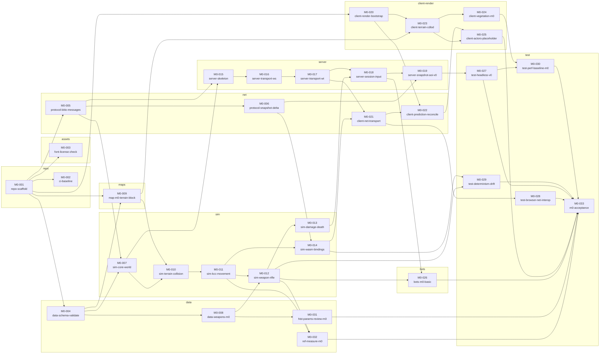
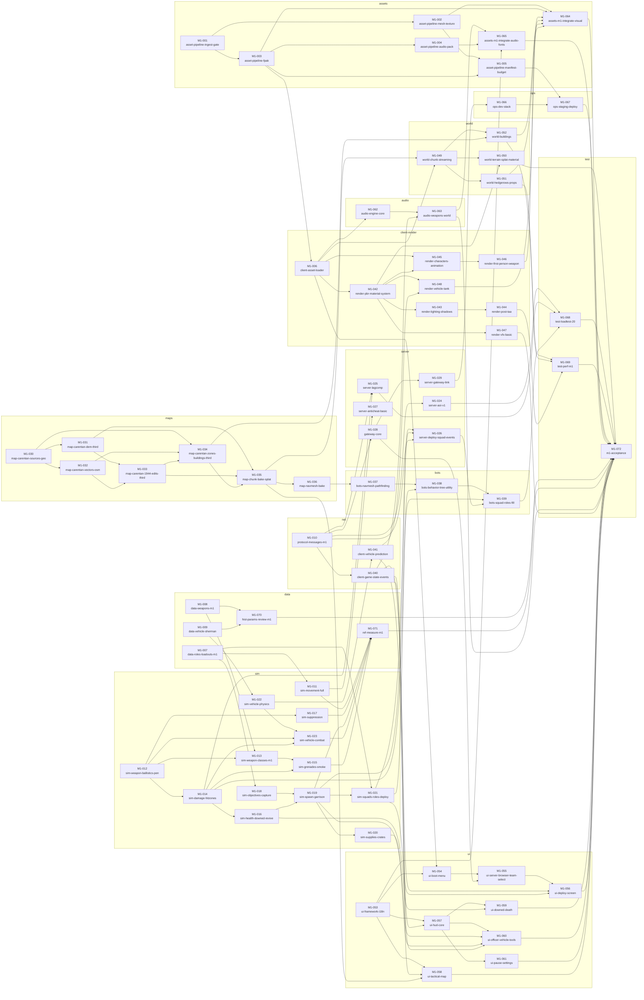
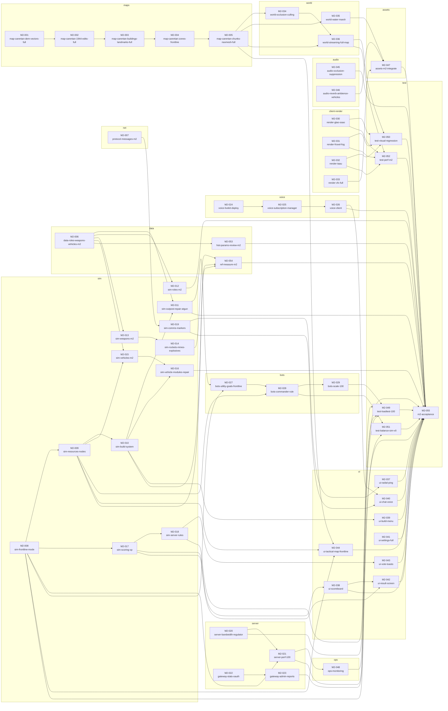
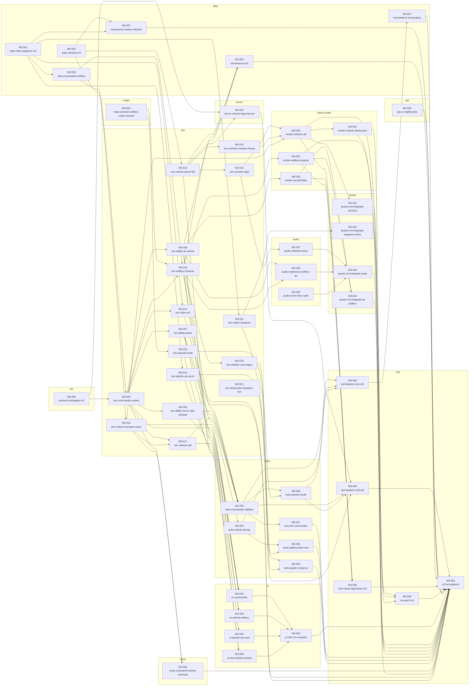
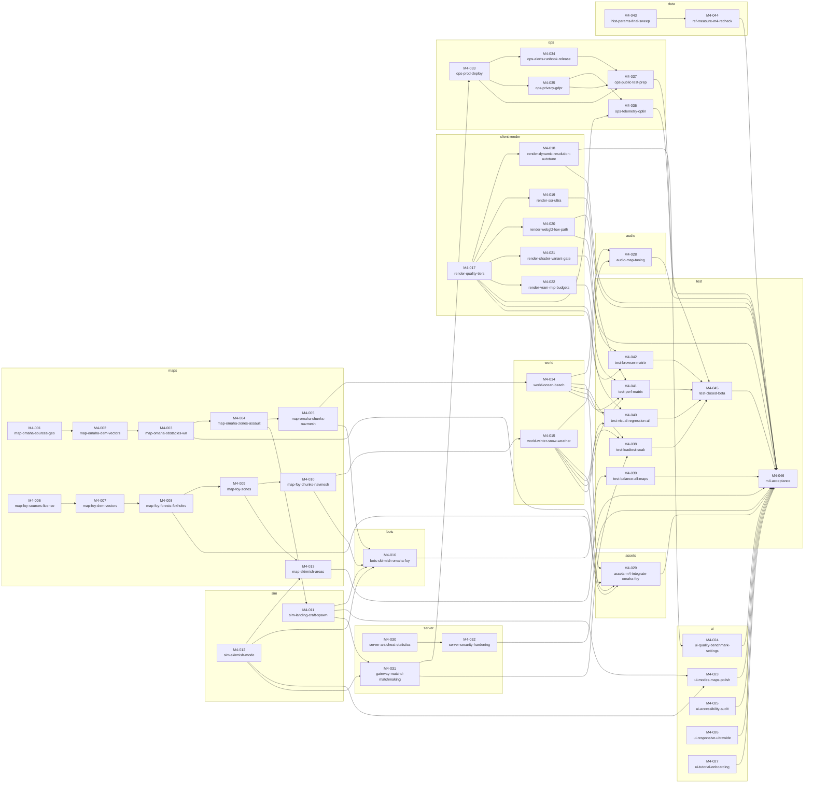

# Frontline 里程碑计划（MILESTONES.md）

> 版本：v1.0（规划阶段）　日期：2026-11-17　状态：约束性文档。章节编号稳定（`## 1.` = M0 … `## 5.` = M4，`## 6.` = 公开测试与 Backlog），任务文件与 `tasks/INDEX.md` 按 "MILESTONES §n" 引用，**不得重排**。
> 读者：人类负责人、Fable（总控/审阅者）、执行任务的 Sonnet。
> 依据：`docs/ARCHITECTURE.md`（预算数字的唯一来源）、`docs/GAMEDESIGN.md`、`docs/UI_SPEC.md`、`docs/MAPS.md`、`docs/REFERENCE_MEASUREMENTS.md`、`docs/ASSET_SHOPPING_LIST.md`、`docs/ASSET_GAPS.md`、`tasks/INDEX.md`。

---

## 0. 阅读说明

### 0.1 本文的用途与边界

- 本文回答"每个里程碑**做什么、不做什么、怎样算做完、怎样演示、需要谁提供什么**"。逐任务的细节在 `tasks/INDEX.md`，执行状态在 `tasks/STATUS.md`。
- **不承诺日历日期**。顺序用"相对先后"和依赖图表达；工期取决于人类负责人的响应速度（采购、录像、数据下载）和执行者会话数，二者在规划阶段都无法预估。
- 退出标准里的数字全部引用 `ARCHITECTURE.md` 的预算（§6.9、§6.10、§11.4、§13、§17.2），或为本文**新设**的验收门槛（标注"本文新设"）。数字都是**设计估算的验收线**，M0/M2 实测后若证明不合理，按 §0.4 的流程修订，而不是悄悄放宽。
- 任何里程碑的退出标准必须有**实测数字**写入 `tasks/STATUS.md` 对应验收任务的"实测结果"列。没有数字就没有"done"。

### 0.2 标注约定

- `【待调参】`、`【待测 → REFERENCE_MEASUREMENTS §x】`、"未核实"含义同其它文档。
- 任务编号 `M{n}-{三位序号}`，工作流名见 `tasks/INDEX.md` §0。
- "占位"= `docs/ASSET_GAPS.md` §3 的灰盒占位；"真素材"= `LICENSES.md` 中状态为 `OK` 的素材。**`PENDING` 素材不得进入主分支**。
- "参考机"：High 档 = RTX 3060 + 1080p；Low 档 = Iris Xe 级核显 + WebGL2 + 720p（ARCH §13.1）。性能类退出标准在参考机上测；没有参考机时，对应验收任务标 `partial`，**不得**用其它硬件的数字替代后标 done。

### 0.3 里程碑之间的关系与通用规则

1. **审阅检查点是闸门**：每个里程碑的最后一个任务（`m{n}-acceptance`）做完后，执行者停止领取下一里程碑的任务，直到 Fable 完成该里程碑的审阅并在 `tasks/STATUS.md` 顶部把"当前里程碑"推进。**例外**：不依赖审阅结论的素材采购、地图数据人工工作（人类负责人）可以提前进行。
2. **跨里程碑依赖**：INDEX 中某任务的依赖可以指向更早里程碑的任务，但不会指向更晚的。
3. **素材不阻塞原则**：每个里程碑都能在**全灰盒占位**下完成全部退出标准里的技术指标；真素材接入只影响"视觉与听感"类验收，且由独立的 `assets-m*-integrate-*` 任务承担。素材清单到位情况决定该类任务是 `done` 还是 `partial`。
4. **预算修订流程**：若实测证明某条 ARCH 预算不可达，执行者**不改架构、不放宽数字**，在 `docs/PLAN_ISSUES.md` 写条目（问题/证据/建议方案/受影响任务），由 Fable 在审阅检查点裁决。
5. **知识产权自查**：任何里程碑演示、截图、公告都不得出现参考作品名称/截图/素材（BRIEF §1；ARCH §1.2）。

### 0.4 Fable 审阅检查点的通用流程

每个里程碑结束时，Fable 依次做：

1. 读 `tasks/STATUS.md`：核对本里程碑所有任务状态；`partial`/`blocked` 项逐一给出处理决定（接受并推迟 / 补做 / 取消）。
2. 读 `docs/PLAN_ISSUES.md`：逐条给出裁决（采纳/驳回/部分采纳），采纳的修订写回对应文档（ARCH/GD/UI/MAPS/本文/INDEX），并**在受影响的文档章节旁写明变更与日期**；章节编号不重排。
3. 抽查实测数字与演示：至少复跑一次本里程碑的演示脚本（§x.4）并对照退出标准；对性能/带宽类指标复跑一次基准。
4. 复核下一里程碑的任务清单：按本里程碑实际消耗（会话数、返工率）和新发现的风险，调整下一里程碑任务的粒度、顺序与素材批次，更新 `tasks/INDEX.md` 与 `STATUS.md`。
5. 复核素材与人工事项：对照 `docs/ASSET_SHOPPING_LIST.md` 的下一批次，确认人类负责人的采购、录像、数据下载是否已排期；缺口登记到 NEEDS_HUMAN。
6. 在 `tasks/STATUS.md` 顶部更新"当前里程碑"，记录审阅日期与结论（通过 / 有条件通过 / 不通过）。

---

## 1. M0 —— 技术验证

### 1.1 目标

在最小闭环上验证 `ARCHITECTURE.md` §20.1 列出的五项首要技术风险，并建立后续所有工作依赖的仓库、CI、数据与协议骨架：**单块地形、10 名 bot、步枪射击、网络同步、帧率达标**。M0 不追求好看或好玩，追求"架构站得住"。

### 1.2 范围

**范围内**

- 仓库脚手架、CI 基线与依赖图检查（ARCH §4.5、§17.5）；字体许可证核实（BRIEF R10）。
- `/data` schema 与校验；M0 两把步枪（Kar98k、M1 Garand）数据与史实复核（R8 的第一批）。
- `protocol`（位流/量化/快照增量）、`sim`（确定性底座、Rapier KCC、步枪射击/弹道/死亡）、`sim-wasm`。
- `server`：30 Hz 主循环、WebSocket 与 WebTransport 双传输、输入缓冲与校验、AOI v0 与快照发送。
- 客户端：引擎初始化（WebGPU→WebGL2 回退）、传输与时钟同步、预测/对账/插值、CDLOD 地形 + 植被、灰盒角色与射击反馈。
- `bots`：10 个基础 bot（无 navmesh，高度场网格寻路）；`headless-client` v0。
- 256 m 单块地形数据管线（默认程序化高度图；有 DEM 则走 GDAL 路径）。
- 对标测量工具链与批 M0 回填（依赖人类录像）。

**范围外（明确不做）**

- 小队、部署、兵种、重生网络、补给、载具、据点（M1+）。
- 除调试叠层外的任何 UI 屏幕；音频；语音；gateway；账号。
- 素材管线（M1 起）与真素材（M0 全灰盒）；真实 Carentan 数据（M1）。
- 阴影/后处理等画面效果（M1+，M0 只验证 compute 可行性）。
- 带宽调节器、延迟补偿（M1）。

### 1.3 退出标准（可测量）

全部在参考机/CI 上测，数字写入 `m0-acceptance` 的"实测结果"。

| # | 退出标准 | 数字 | 来源/测量方法 |
|---|---|---|---|
| E0-1 | 10 headless + 10 bot 运行 30 min 的服务器 tick | `tick_ms` P99 ≤ 28 ms；无连续 2 tick 超 33 ms | ARCH §6.10；`/metrics` |
| E0-2 | 下行带宽（上述场景） | 每客户端 P50 ≤ 128 kbps；上行 ≤ 32 kbps | ARCH §6.9.5（本文把压测线提前到 M0） |
| E0-3 | KCC 单次耗时 | ≤ 20 µs；100 个 KCC 一 tick ≤ 3 ms | ARCH §20.1-2；criterion。超出则启用 ARCH §5.3 降级方案并写 PLAN_ISSUES |
| E0-4 | 确定性与漂移 | native/native、wasm/wasm 逐 tick `state_hash` 完全一致；native vs wasm 位置 RMS 漂移 < 2 cm/s（信息性） | ARCH §17.1、§20.1-3、T1；**不得**把"比特一致 native vs wasm"当阻断项（R5） |
| E0-5 | 单块地形+植被帧率 | RTX 3060 / 1080p ≥ 60 fps；Iris Xe / WebGL2 / 720p ≥ 30 fps（P50，叠层导出） | ARCH §20.1-5、§13.5 |
| E0-6 | WebGPU compute 可行性 | Babylon `WebGPUEngine` + `ComputeShader` 冒烟通过；给出 Hi-Z/froxel/TAAU "可行/不可行/需自写封装"结论 | ARCH §20.1-4、T11 |
| E0-7 | 传输 | Chromium：WT 与 WS 均通过；Firefox/WebKit 结果如实登记；WT 被禁用时 ≤ 5 s 内回退 WS | ARCH §5.0、§20.1-1 |
| E0-8 | 预测对账手感 | 100 ms 延迟 + 2% 丢包下，静止时校正 ≤ 1 次/10 s；本地开火表现与枪口焰同帧 | ARCH §6.4（本文新设数字） |
| E0-9 | WASM 体积 | `sim-wasm` ≤ 1.2 MB（br ≤ 400 KB） | ARCH §4.3.3 |
| E0-10 | CI | lint/test-rust/test-ts/wasm-build 全绿；依赖方向违规的 PR 被拒 | ARCH §4.5、§17.5 |
| E0-11 | 数据与史实 | /data 校验通过；两把枪 historical 字段 100% 有出处或"未核实" | R8 |
| E0-12 | 对标测量批 M0 | 每项有记录；回填后我方复测误差在 REF §7.3 容限；若无录像则 `blocked` 并说明 | REF §9.1 |

**判定规则**：E0-1 ~ E0-6 任一不通过 → M0 状态 `partial`，必须写 PLAN_ISSUES 并由 Fable 裁决是否改架构；E0-7 ~ E0-12 不通过可带条件通过（如 E0-12 缺录像），但必须登记为 M1 的前置待办。

### 1.4 演示脚本

1. 在开发机启动 `frontline-server`（`--map m0 --mode sandbox`），Chrome 打开客户端，叠层显示 FPS/GPU ms/RTT/传输类型（WT）。
2. 10 个 bot 在 256 m 地形上巡逻交火；本地玩家（灰盒）走、冲刺、蹲、跳，开火 Kar98k 与 Garand，观察弹道下坠与命中标记；被击杀后 N 秒重生。
3. 用 `tc netem` 注入 100 ms 延迟 + 2% 丢包：展示预测不"拉扯"，叠层显示校正次数。
4. 在浏览器设置里禁用 WebTransport（或用开关强制）：连接自动回退 WebSocket，叠层传输类型变为 WS。
5. 强制 WebGL2 路径重载：同一场景渲染成功，叠层显示帧时间。
6. 启动 `headless-client` 10 个，展示 `/metrics`：tick_ms 直方图、每客户端带宽。
7. 打开 `tasks/STATUS.md`，逐项对照 E0-1 ~ E0-12 的实测数字。

### 1.5 所需素材批次

- 对应 `ASSET_SHOPPING_LIST.md` **§4.1（M0 必买）**。**M0 可以全灰盒完成**（ASSET_GAPS §3）；不采购也不阻塞任何任务。
- 建议（非必须）：CC0 材质与 HDRI（V-NAT-007、V-SKY-001，免费）；Kar98k 与 M1 枪模、Sonniss GDC 免费音效库（仅为后续试听/占位，M0 任务不依赖）。
- 字体：`font-license-check` 只做许可证登记，不需要购买。
- 对应任务：`font-license-check` 之外无 `assets-m*-integrate-*` 任务；占位清单由 `asset-pipeline-ingest-gate`（M1）起自动出报告。

### 1.6 所需人工事项

- **录像（REF §9.2 第 1–4 项）**：合法获取并安装参考作品、确认 EULA 允许录制与内部分析、准备 ≥ 120 fps（目标 240 fps）录制设备、完成 2–3 个录像会话（步枪与移动）。缺失时 `ref-measure-m0` 为 `blocked`，不影响其它任务。
- **参考硬件**：提供 RTX 3060 与 Iris Xe 级机器（或远程可跑 Playwright 采集脚本的方式）。无硬件时 E0-5 标 `partial`。
- 确认 GitHub 仓库与 Actions 可用；确认 NEEDS_HUMAN 中字体/图标原创（D-MOD）的决定。
- （可选）Carentan DEM 数据：M0 可用程序化高度图，不阻塞。

### 1.7 所需对标测量批次

`REFERENCE_MEASUREMENTS.md` **§9.1 批 M0**：步枪射击 W-01–W-09、W-11–W-13、W-15–W-30、W-37；基础移动 M-01–M-06、M-12–M-14、M-17、M-19、M-24–M-26；生存基础 H-01–H-03（精确 ID 以 REF §9.1 为准）。对应任务 `ref-measure-m0`。

### 1.8 主要风险

| 风险 | 影响 | 缓解 |
|---|---|---|
| `wtransport` datagram 在 100 连接 × 20 pkt/s 下不稳 / 浏览器互通问题 | 网络层方案失败 | M0 即有 WS 兜底；`test-browser-net-interop` 记录矩阵；失败写 PLAN_ISSUES |
| Rapier KCC 超 20 µs | 服务器 CPU 预算失守 | 降级方案见 ARCH §5.3；`sim-kcc-movement` 的 criterion 基准是验收项 |
| WASM 与 native 漂移大 | 预测频繁校正 | 对账容限设计（R5/T1）；`test-determinism-drift` 量化 |
| Babylon WebGPU compute 封装不够用 | Hi-Z/froxel/TAAU 路线受阻 | `client-render-bootstrap` 的 compute 冒烟提前暴露；备选自写薄封装（PLAN_ISSUES） |
| 参考机缺失导致性能数字不可信 | 预算无法校准 | 采集脚本可在人类提供的机器上一键跑；无数字则标 partial |
| 人类录像滞后 | 数值全是 `initial` | 不阻塞 M1 开工，但 M1 退出前必须回填批 M0 |

### 1.9 任务数量与工作流分解

共 **33** 个任务（M0-001 – M0-033）。关键路径（按 S=1/M=2/L=3 加权，权重和 28）：

M0-001 repo-scaffold → M0-005 protocol-bitio-messages → M0-007 sim-core-world → M0-010 sim-terrain-collision → M0-011 sim-kcc-movement → M0-012 sim-weapon-rifle → M0-013 sim-damage-death → M0-018 server-session-input → M0-019 server-snapshot-aoi-v0 → M0-027 test-headless-v0 → M0-030 test-perf-baseline-m0 → M0-033 m0-acceptance

| 工作流 | 数量 | 任务 ID |
|---|---|---|
| repo | 2 | M0-001, M0-002 |
| sim | 6 | M0-007, M0-010, M0-011, M0-012, M0-013, M0-014 |
| net | 4 | M0-005, M0-006, M0-021, M0-022 |
| server | 5 | M0-015, M0-016, M0-017, M0-018, M0-019 |
| client-render | 4 | M0-020, M0-023, M0-024, M0-025 |
| assets | 1 | M0-003 |
| bots | 1 | M0-026 |
| test | 5 | M0-027, M0-028, M0-029, M0-030, M0-033 |
| data | 4 | M0-004, M0-008, M0-031, M0-032 |
| maps | 1 | M0-009 |

依赖图（仅里程碑内依赖；跨里程碑依赖见 INDEX）：

### 1.10 Fable 审阅检查点 0

按 §0.4 流程；**M0 额外必审**：

1. ARCH §20.1 五项风险各自的"通过/不通过/带条件"结论与证据，是否需要改架构（尤其 KCC 降级、WT 兜底策略、compute 路线）。
2. 实测的 `tick_ms`、编码耗时、带宽、KCC µs 是否支持 ARCH §6.10 的预算表；若不支持，**重新分配预算**并回写 ARCH（编号不变，加变更说明）。
3. 任务粒度校准：M0 实际每个任务消耗几次会话、有多少超出"一次会话"的任务；据此决定是否拆分 M1 的 L 级任务。
4. 对标测量工具链是否可用；决定 M1 开工前是否必须补录像。
5. 把 M0 发现的新依赖写入 INDEX（先改 INDEX，再改 STATUS）。

---

## 2. M1 —— 垂直切片

### 2.1 目标

用 **Carentan 约 1/3 区域（设计框架 x 380–1560, y 520–1700，MAPS §3.8）** 做出一条"可以被人玩 20 分钟"的完整链路：**20 名真人（每队 10）、5 个兵种、1 辆坦克、Garrison + 补给、完整部署流程**——从启动页、主菜单、服务器浏览器、阵营选择、部署、进入对局、倒地/救起、重生，到占领 3 个活动据点（L1a、L2a、L3a）。

**本计划对 M1 的两项具体化（总纲未给出，属 Fable 需确认的假设）**：

- **5 个兵种 = Officer、Rifleman、Medic、Support、Crewman**（US/GER 各一套）。理由：Officer 放置 Garrison（R1）、Support 提供补给（GD §12）、Medic 验证倒地/救起（GD §7）、Rifleman 是基线、Crewman 驾驶/炮手 Sherman。其余兵种分批：M2 补 Assault/AR/MG/AT/Engineer（共 10），M3 补 Commander/Tank Commander/Spotter/Sniper（共 14）。
- **1 辆坦克 = US M4A1 Sherman (75)**（`data-vehicle-sherman`）。GER 无坦克；为使坦克有对手，GER Rifleman 增加 `m1_only` 的 Panzerfaust 60 loadout 作为反装甲手段（完整 Anti-Tank 兵种在 M2）。

### 2.2 范围

**范围内**

- Carentan 1/3 区域的完整地图管线：许可证与锚点、DEM、OSM 矢量、1944 修正（树篱/洪泛，M1 区域）、关卡标注与建筑足迹（灰盒）、区块烘焙、navmesh（MAPS §7.3 M1 行）。
- 世界：区块流式、地形 splat 材质、树篱与植被/道具、建筑与可进入室内（基础视锥+距离剔除）。
- 渲染：PBR 材质系统（变体 ≤ 60）、CSM/IBL/天空、TAA/曝光/色调映射、骨骼角色与动画状态机、第一人称武器 pass、基础粒子/贴花、坦克渲染。
- 模拟：完整移动与姿态、弹道穿透、冲锋枪/卡宾/手枪/近战、命中区与伤害、手雷与烟雾、倒地/救起、压制、据点占领、HQ 与 Garrison 重生、Supplies 与补给箱、小队/名额/部署校验、载具物理与武器/装甲判定。
- 网络与服务器：M1 全消息集、AOI v1（R3）、延迟补偿、部署/小队/可靠事件、基础反作弊校验、gateway（服务器列表、游客鉴权、join ticket）与注册心跳。
- bots：navmesh 寻路、行为树+效用、小队长 bot、兵种选择与填充。
- UI：框架与 i18n、启动/主菜单、服务器浏览器/阵营选择、部署界面、核心 HUD、战术地图、倒地/阵亡、Officer/载具工具、暂停与基础设置。
- 音频：引擎核心、枪声三层/脚步/命中。
- 素材管线全套：ingest 与许可证闸门、mesh/texture、`.fpak`（D-PAK、R11）、音频打包、manifest 与体积门禁、客户端加载器；M1 素材接入（有真素材则接，无则占位）。
- 运维：本地开发栈、预发布部署。测试：20 客户端联测、M1 性能基准、史实复核与对标测量批 M1。

**范围外（明确不做）**

- Frontline 多战线、战略资源（Manpower/Munitions/Fuel）与资源节点、Engineer 建造、Outpost/Airhead/OP、Commander 与全部指挥官能力、火炮、其余 9 个兵种、其余载具（M2/M3）。
- 语音与 LiveKit（M2）；径向菜单/记分板/聊天/结算/投票/完整设置（M2）。
- Hi-Z 遮挡剔除、GTAO、体积雾、TAAU、水面（M2）；画质四档与动态分辨率（M4）。
- 100 人压测、带宽调节器（M2）。
- 完整 Carentan 地图（M2）。

### 2.3 退出标准（可测量）

| # | 退出标准 | 数字 | 来源/测量方法 |
|---|---|---|---|
| E1-1 | 真人测试局 | 一次连续 ≥ 20 min、**≥ 20 名真人**（每队 10）的完整对局；若人类负责人无法招集，则 ≥ 8 真人 + 其余用 headless 真人等价客户端，验收标 `partial` 并说明 | 本文新设；测试局记录写入 STATUS |
| E1-2 | 服务器 tick | 20 客户端（含 netem：RTT 40–150 ms、2% 丢包）30 min：`tick_ms` P99 ≤ 28 ms，稳态 ≤ 18 ms | ARCH §6.10、§17.2；`test-loadtest-20` |
| E1-3 | 带宽 | 每客户端下行 P50 ≤ 128 kbps、P99 ≤ 400 kbps；上行 ≤ 32 kbps | ARCH §6.9.5 |
| E1-4 | AOI 信息控制 | 审计日志：视锥外且 > 96 m 的敌人下发数 = 0（R3） | ARCH §15.2 |
| E1-5 | 延迟补偿 | 150 ms RTT 下 headless 命中率与 0 延迟基线差 ≤ 5% | ARCH §6.7 |
| E1-6 | 客户端性能（High） | RTX 3060 / 1080p：P95 帧时间 ≤ 16.7 ms（≥ 60 fps），主视图 draw call ≤ 1 200，可见三角形 ≤ 4.0 M | ARCH §13.5；`test-perf-m1` |
| E1-7 | 客户端性能（Low） | Iris Xe / WebGL2 / 720p：≥ 30 fps（P95）；draw call ≤ 900（WebGL2 Medium 预算）/ ≤ 500（Low 预算，若测 Low 设置） | ARCH §13.5.3 |
| E1-8 | 材质变体 | ≤ 60（CI 统计门禁） | ARCH §10.4 |
| E1-9 | 包体积 | 主菜单（JS+WASM+UI，br）≤ 8 MB；首图 Medium 包 ≤ 150 MB（含占位，manifest 门禁） | ARCH §11.4 |
| E1-10 | 部署流程 | 主菜单→进入服务器→选阵营→部署→出生：全程仅鼠标/键盘可达；缓存命中时"点击部署到可操作" ≤ 15 s（本文新设）；部署倒计时内 R_near 预取完成率 ≥ 95%（100 Mbps） | UI §4.3–4.5；ARCH §9.4 |
| E1-11 | Garrison + 补给闭环 | Officer 放置 Garrison → 队友经 Garrison 重生 → Support 放置 Supply/Ammo Crate → 队友补弹；规则与 GD §10.2、§12 一致，单测+演示 | GD §10、§12 |
| E1-12 | 坦克 | 3 座位（驾驶/炮手/车长）可用；AP 命中的穿透判定与 §14.4 手算一致（≥ 12 组）；120 ms RTT 下直线行驶校正 ≤ 1 次/10 s | GD §14 |
| E1-13 | 倒地/救起/压制 | 状态机全转移单测通过；压制参数输出被客户端音画消费 | GD §7、§8 |
| E1-14 | 素材管线 | `.fpak` 往返字节一致；产物目录无独立 .glb/.ktx2/.ogg/.opus；缺失素材报告按需求 ID 汇总 real/placeholder/missing；无 PENDING 素材进主分支 | ARCH §11；R11；LICENSES §1 |
| E1-15 | 基础反作弊 | 注入 1.3× 速度/超射速输入被纠正/拒绝且计数 | ARCH §15.1 |
| E1-16 | 数据与史实 | M1 武器与 Sherman 的 historical 字段 100% 有出处或"未核实"（R8）；批 M1 对标测量回填，我方复测误差在 REF §7.3 容限（缺录像则 blocked 并说明） | REF §9.1 |
| E1-17 | 占位决定 | 本里程碑范围内仍为占位的需求 ID，在 `ASSET_GAPS.md` 有"决定"或明确推迟 | GAPS §3.4 |

### 2.4 演示脚本

1. 打开预发布域名（HTTPS），启动页展示能力探测与分阶段进度；进入主菜单（展示 core 包体积）。
2. 服务器浏览器选 20 人测试服；选 US；部署界面：地图画布选 HQ 出生点，加入小队，选 Officer，倒计时内观察区块预取。
3. 出生后演示：移动/姿态/翻越，Thompson 与 Garand 射击；Officer 放置 Garrison（全息绿/红）；队友经 Garrison 重生。
4. Support 搬运并放置 Supply Crate/Ammo Crate；队友补弹。
5. Medic 救起倒地队友；演示压制效果（音频闪避+屏幕效果）。
6. 3 名玩家乘 Sherman（驾驶/炮手/车长）沿堤道进入老城；AP 对 GER 目标；GER 用 Panzerfaust 击毁坦克。
7. 三个据点（L1a、L2a、L3a）占领拉锯；战术地图显示据点与出生点。
8. 展示 `tasks/STATUS.md` 的 E1-1 ~ E1-17 实测数字、`/metrics` 看板、缺失素材报告。

### 2.5 所需素材批次

- 对应 `ASSET_SHOPPING_LIST.md` **§4.2（M1 垂直切片）**：M1 必须到位的视觉为美军 Thompson/BAR/Garand/M1911 + 德军 Kar98k/MP40/StG44/MG42、美/德夏季步兵各 1、1 辆坦克（Sherman）、Jeep、沙袋/木箱/铁丝、树篱与树、至少 1 套民居（或占位盒体）、枪口焰/烟/爆炸。
- **允许占位**：坦克内饰、第一人称高精度武器（GAP-V06）、建筑模块（GAP-V02 灰盒）、树篱（GAP-V03 替代方案）。
- 需求 ID 前缀：V-BLD、V-NAT、V-PRP、V-CHR、V-WPN、V-ANM、V-VEH-US-003/007、V-FX；A-WPN、C-BUL、D-TNK、E-GER、F-AMB、G-VOX、H-RAD、H-UI、I-MUS、J-IR；字体 V-FNT。
- 对应任务：`assets-m1-integrate-visual`、`assets-m1-integrate-audio-fonts`（素材到位才变 done，否则 partial）。**其它所有 M1 任务均可在占位下完成。**
- 采购前提：D-LIC（付费素材须书面确认，否则 PENDING 不入主分支）、D-MOD 边界与 UI 图标原创由人类确认（NEEDS_HUMAN）。

### 2.6 所需人工事项

- **地图数据（MAPS §7.1）**：T-LIC（数据源许可证核实与存档）、T-GEO（锚点对账，每图 0.5–1 天）、DEM/LiDAR 下载、树篱描摹与洪泛区（M1 区域）、OSM ODbL 衍生层公开策略（R9）。
- **采购**：按 §4.2 采购并登记 LICENSES.md；向 CGTrader/TurboSquid/A Sound Effect 等"慎用"渠道取得书面确认。
- **测试局**：招集 ≥ 20 名真人（含 2 名熟悉操作的内部测试者作"协助者"）；提供预发布主机、域名、云账号、Cloudflare R2（`ops-staging-deploy`）。
- **录像**：批 M1 的对标录像（REF §9.2，含协助者项）。
- **决策**：确认 5 兵种选择与 Sherman/Panzerfaust 假设（§2.1）；确认 D-MOD；确认 OSM ODbL（R9）。

### 2.7 所需对标测量批次

`REFERENCE_MEASUREMENTS.md` **§9.1 批 M1**：剩余移动 M-07–M-11、M-15、M-16、M-18、M-20–M-23、M-27–M-29；5 个兵种所需武器的其余 W 项与 W-31–W-33（近战）；生存 H-04–H-17；压制 U-01–U-11；手雷 G-01–G-08、G-12；1 辆坦克 V-01–V-05、V-08、V-11–V-16、V-19–V-21；建造/补给 B-01–B-03、B-07、B-08、B-10–B-13、B-17；UI 时序 UI-01–UI-08、UI-12；对局 R-01、R-03–R-05、R-08–R-10；音频 AU-01、AU-02、AU-04（精确 ID 以 REF §9.1 为准）。对应任务 `ref-measure-m1`（回填）与各 sim 任务的验收。

### 2.8 主要风险

| 风险 | 影响 | 缓解 |
|---|---|---|
| Carentan 数据获取/许可证不明（瓦隆/IGN 等） | 地图管线卡住 | M0 的程序化高度图可作兜底；许可证 PENDING 的数据不入主分支；`map-carentan-sources-geo` 最先做 |
| 人工描摹（树篱/洪泛）耗时 | 地图质量/进度 | M1 只做 1/3 区域；`partial` 可接受，缺口写 PLAN_ISSUES |
| 招集 20 真人困难 | E1-1 无法达成 | 允许 8 真人 + headless 等价客户端并标 partial；Fable 在检查点决定是否补测 |
| 全灰盒下可读性/手感判断困难 | 玩法评估失真 | 优先采购 M1 主枪、步兵、Sherman 与 M1 枪声；占位着阵营色 |
| 渲染预算在室内/树篱场景超标 | E1-6/E1-7 失败 | 变体门禁、基础剔除、`test-perf-m1` 提前暴露；Hi-Z 在 M2 |
| Hi-Z 之前 WebGL2 draw call 偏高 | Low 档帧率 | M1 区域面积小（≈ 1/3）；合批/冻结材质；M2 再上遮挡剔除 |
| bot 在建筑内多层导航失败 | 20 人填充质量 | off-mesh 链接标注、`bots-navmesh-pathfinding` 含建筑内多层测试 |
| L 级任务一次会话做不完 | 进度 | M0 校准后拆分（Fable 检查点） |

### 2.9 任务数量与工作流分解

共 **72** 个任务（M1-001 – M1-072）。关键路径（权重和 27）：

M1-030 map-carentan-sources-geo → M1-031 map-carentan-dem-third → M1-033 map-carentan-1944-edits-third → M1-034 map-carentan-zones-buildings-third → M1-035 map-chunk-bake-splat → M1-036 map-navmesh-bake → M1-037 bots-navmesh-pathfinding → M1-038 bots-behavior-tree-utility → M1-039 bots-squad-roles-fill → M1-068 test-loadtest-20 → M1-072 m1-acceptance

| 工作流 | 数量 | 任务 ID |
|---|---|---|
| sim | 13 | M1-011, M1-012, M1-013, M1-014, M1-015, M1-016, M1-017, M1-018, M1-019, M1-020, M1-021, M1-022, M1-023 |
| net | 3 | M1-010, M1-040, M1-041 |
| server | 6 | M1-024, M1-025, M1-026, M1-027, M1-028, M1-029 |
| client-render | 8 | M1-006, M1-042, M1-043, M1-044, M1-045, M1-046, M1-047, M1-048 |
| ui | 9 | M1-053, M1-054, M1-055, M1-056, M1-057, M1-058, M1-059, M1-060, M1-061 |
| audio | 2 | M1-062, M1-063 |
| world | 4 | M1-049, M1-050, M1-051, M1-052 |
| assets | 7 | M1-001, M1-002, M1-003, M1-004, M1-005, M1-064, M1-065 |
| bots | 3 | M1-037, M1-038, M1-039 |
| test | 3 | M1-068, M1-069, M1-072 |
| ops | 2 | M1-066, M1-067 |
| data | 5 | M1-007, M1-008, M1-009, M1-070, M1-071 |
| maps | 7 | M1-030, M1-031, M1-032, M1-033, M1-034, M1-035, M1-036 |

依赖图：

### 2.10 Fable 审阅检查点 1

按 §0.4 流程；**M1 额外必审**：

1. 20 真人测试局记录：是否达到 E1-1；手感、可读性与核心循环（占点—补给—重生）的问题清单，决定哪些进 M2 任务、哪些调参。
2. 5 兵种与 Sherman 假设（§2.1）是否合适；决定 M2 补兵种的顺序与 Engineer/资源系统的粒度。
3. 带宽/tick 实测与 ARCH §6.9/§6.10 的偏差；决定是否在 M2 之前先做 `server-perf-100` 的专项。
4. 素材：实际到位的真素材与占位清单；对 GAP-V01/V02/V03/V06 做"M2 决定"（外包与否、替代方案）。
5. 对标测量：批 M1 回填结果与"初值 vs 测量值"偏差，决定首轮调参范围。
6. 重新评估 M2 任务粒度（M1 的返工率、会话数）。

---

## 3. M2 —— 完整 Frontline 模式

### 3.1 目标

**Carentan 完整地图（2048 × 2048 m）上的完整 Frontline 模式（5 条战线拉锯）**，支持 **100 人（真人 + bot）**，通过 100 客户端压测；加入战略资源与建造、LiveKit 语音、其余步兵兵种与基础载具、完整的对局 UI，并完成 GTAO/体积雾/TAAU/遮挡剔除等画面能力。

### 3.2 范围

**范围内**

- Carentan 全图：DEM/矢量/1944 修正（树篱 > 15 km、洪泛）、建筑与地标灰盒、Frontline 关卡标注、全图区块/碰撞/navmesh/遮挡体。
- 规则：Frontline 模式、战略资源与节点（R6）、Engineer 建造全清单（含 Outpost 由 Officer、AT 炮由 AT，R1/R7）、其余步兵兵种（Assault/AR/MG/AT/Engineer，共 10 个）、火箭/地雷/炸药、载具（Jeep/Kübel、卡车、Panzer IV）与刷新、模块损伤与维修、计分/经验、自动平衡/TK/投票/AFK、标记与 Ping。
- 服务器与网络：带宽调节器、100 玩家 CPU 优化、gateway 战绩/OAuth/管理与举报。
- 语音：LiveKit 部署、订阅集管理、客户端空间化。
- bots：Frontline 目标行为、规则指挥官（RuleCommander）、100 bot 规模优化。
- 渲染/世界：GTAO/SSAO、froxel 雾、TAAU、完整粒子与贴花、遮挡剔除（Hi-Z + WebGL2 遮挡体）、水面与沼泽、全图流式与内存预算。
- UI：径向菜单/Ping、记分板、建造菜单、聊天与语音状态、完整设置（含可访问性基础）、结算、投票/举报/换队/提示、Frontline 战术地图叠层。
- 音频：遮挡/压制 AudioWorklet、混响总线、环境与载具声。
- 测试与运维：100 客户端压测（WT 与 WS）、netem 矩阵、视觉回归、balance-sim v0、监控与日志。

**范围外（明确不做）**

- Commander 席位与全部指挥官能力、载具呼叫（M3）；火炮（M3）；Spotter/Sniper/Tank Commander 兵种；M8/M5A1/Puma/Luchs/Panther/Tiger/半履带等其余载具（M3）。
- Assault 模式（M3）、Skirmish（M4）、Omaha/Foy（M4）。
- LLM 指挥官（M3）。
- 四档画质预设与动态分辨率（M4；M2 仅有 High 基准与 WebGL2 对应路径）。
- 语音转写（首发不做，R10）。

### 3.3 退出标准（可测量）

| # | 退出标准 | 数字 | 来源/测量方法 |
|---|---|---|---|
| E2-1 | 100 客户端压测（WT） | 100 headless（含 bot）× 30 min：`tick_ms` P99 ≤ 28 ms；稳态 ≤ 18 ms；无连续 `tick_overrun`；末 10 min RSS 增长 < 2% | ARCH §17.2 |
| E2-2 | 100 客户端压测（WS 兜底） | tick P99 ≤ 40 ms；快照 15 Hz；连接保持 | ARCH §17.2 |
| E2-3 | 带宽 | 每客户端下行 P50 ≤ 128 kbps、P99 ≤ 400 kbps；5% 丢包下典型场景 ≤ 68 kbps；上行 ≤ 32 kbps | ARCH §6.9.5 |
| E2-4 | bot CPU | 60 bot ≤ 3.0 ms/tick；100 bot ≤ 5 ms/tick（压测） | ARCH §16.5 |
| E2-5 | 语音 | 订阅更新延迟 P95 < 300 ms（实测 T8）；100 玩家下 LiveKit API 错误率 < 1%；LiveKit 不可用时游戏不受影响 | ARCH §14、T8 |
| E2-6 | 渲染 pass 预算（High 参考） | Hi-Z ≤ 0.5 ms；GTAO ≤ 0.9 ms；froxel ≤ 0.8 ms；TAAU ≤ 0.8 ms；粒子（1 600）≤ 0.7 ms | ARCH §13.5.2 |
| E2-7 | 客户端帧时间 | RTX 3060 / 1080p 老城/树篱/沼泽/开阔四机位：P95 ≤ 16.7 ms；JS 堆 + WASM ≤ 1.5 GB（Medium ≤ 1.2 GB）；老城机位 draw call 因剔除下降 ≥ 30% | ARCH §13.3、§13.5；`test-perf-m2` |
| E2-8 | 包体积 | core ≤ 8 MB；Carentan Medium 包 ≤ 150 MB（manifest 门禁） | ARCH §11.4 |
| E2-9 | 完整对局 | 至少 1 局完整 Frontline（开局到胜负）在 bot+真人混合下无崩溃；战线拉锯与资源结算与 GD §3.3、§11 一致 | GD §3.3、§11 |
| E2-10 | 建造与资源 | 建造清单全部可放置/被摧毁；位置限制单测 100%；资源整分钟结算精确 | GD §11、§12.4 |
| E2-11 | 平衡模拟基础设施 | `balance-sim`：200 局 ≤ 40 min（nightly），CSV 字段齐全，同 seed 可复现 | ARCH §17.3 |
| E2-12 | 视觉回归 | 12 机位 × 2 路径基线入库；CI 差异阈值 0.1% 像素 | ARCH §17.4 |
| E2-13 | 监控 | ARCH §18.3 全部指标有看板；人为制造 tick 超限能触发告警 | ARCH §18.3 |
| E2-14 | 史实与测量 | M2 新增武器/载具 historical 100% 有出处或"未核实"（R8）；批 M2 对标回填并复测 | REF §9.1 |
| E2-15 | 带宽调节器 | netem 弱网下 `PACKET_BUDGET` 缩放生效，2 Hz 下限不被饿死 | ARCH §6.6.3 |

### 3.4 演示脚本

1. 预发布服开 100 人局（真人 + bot 填充），展示服务器浏览器的人数/模式/地图。
2. 5 条战线拉锯：展示据点相邻锁定、战术地图 Frontline 叠层、资源 HUD。
3. Engineer 建造铁丝/沙袋/MG 巢/资源节点；Officer 放置 Outpost；展示 Supplies 与资源的区别（R6）。
4. 小队语音与近距语音（两台设备）；LiveKit 断开后游戏继续。
5. 载具：Jeep 运兵、Panzer IV 对 Sherman；模块损伤与维修站修理。
6. 展示 GTAO/体积雾/TAAU 开关对比与遮挡剔除的 draw call 对比叠层；沼泽与运河。
7. 运行 `loadtest-100`：展示 Grafana 看板（tick_ms/带宽/RSS）与 WS 兜底结果。
8. 结算界面、记分板、投票/举报流程。
9. 展示 balance-sim 200 局 CSV 与视觉回归报告。

### 3.5 所需素材批次

- `ASSET_SHOPPING_LIST.md` **§4.3（M2 完整 Frontline）**：城镇街道模块与桥梁、废墟、野战无线电/帐篷/散兵坑/电线杆/残骸等道具（V-BLD-004/008/010、V-PRP-005–010）、兵种变体角色（V-CHR-US-003 等，GAP-V18）、M1 Carbine/M1903A4/M18/刺刀与 Panzerfaust（V-WPN-US-002/007/011/012、V-WPN-GE-010）、动画（V-ANM-003/006/007）、MG34/StG44 声（A-WPN-012/013）、战场人声（G-VOX-003/004）、结算曲（I-MUS-002）、远距离炮声 IR（J-IR-002）、血迹贴花（V-FX-005）。
- 缺口：GAP-V12（无线电/帐篷/电线杆）、GAP-V13（桥梁/车站）、GAP-V14（农作物）、GAP-V15（血迹/贴花）、GAP-V17/V18、GAP-A01/A09 等，按 ASSET_GAPS 的默认建议执行；Fable 在检查点 1 做最终决定。
- 对应任务：`assets-m2-integrate`。**其它 M2 任务均可在占位下完成。**

### 3.6 所需人工事项

- Carentan 全图人工项：树篱全图描摹（> 15 km，MAPS §7.1 T-HEDGE）、洪泛区（T-FLOOD）、建筑样式/可进入性/地标标注（T-BLD/T-LAND）。
- 采购 M2 批；`LICENSES.md` 台账校验。
- OAuth 应用注册（Discord/Google）与域名；LiveKit 主机；监控主机。
- 招集多人测试（占点多人规律需 5–10 人场景：REF R-01）。
- 录像：批 M2（对局节奏、资源、建造、UI、音频）。

### 3.7 所需对标测量批次

`REFERENCE_MEASUREMENTS.md` **§9.1 批 M2**：对局 R-02、R-06、R-07、R-11、R-13、R-14；占点多人规律（R-01 的 5/10 人）；资源 R-08、R-09 全人数规模；建造 B-04–B-06、B-09、B-14–B-16、B-18；UI-09–UI-11、UI-13–UI-15；音频 AU-03、AU-05–AU-08；U-12/U-13；G-09–G-11、G-13、G-14。对应任务 `ref-measure-m2`。

### 3.8 主要风险

| 风险 | 影响 | 缓解 |
|---|---|---|
| 100 人 tick/带宽超预算 | 容量与成本 | `server-perf-100` 专项；M1 已有 20 人基线；失败写 PLAN_ISSUES，Fable 可降 `PACKET_BUDGET`/AOI 参数 |
| WebGL2 路径无 Hi-Z，城镇 draw call 高 | Low 档不可玩 | 预计算遮挡体 + CPU 软光栅；M4 的 Low 路径专项 |
| LiveKit 订阅更新延迟 > 300 ms | 近距语音体验 | 增量更新；批量合并；T8 实测后调整 |
| 全图人工描摹（树篱/洪泛）超期 | 地图质量 | `partial` 接受；优先保证战线与据点周边 |
| bot 导航在全图/树篱场景卡死 | 填充质量 | off-mesh 与树篱缺口标注；压测中监控"无进展计数" |
| 资源/建造规则复杂导致 UI/网络返工 | 进度 | `protocol-messages-m2` 先行；建造框架先于具体建筑 |
| 100 人下视觉回归基线不稳 | CI 噪声 | 固定种子/相位；基线按运行器分存 |

### 3.9 任务数量与工作流分解

共 **55** 个任务（M2-001 – M2-055）。关键路径（权重和 24）：

M2-008 sim-frontline-mode → M2-009 sim-resources-nodes → M2-010 sim-build-system → M2-011 sim-outpost-repair-atgun → M2-027 bots-utility-goals-frontline → M2-028 bots-commander-rule → M2-029 bots-scale-100 → M2-049 test-loadtest-100 → M2-055 m2-acceptance

| 工作流 | 数量 | 任务 ID |
|---|---|---|
| sim | 12 | M2-008, M2-009, M2-010, M2-011, M2-012, M2-013, M2-014, M2-015, M2-016, M2-017, M2-018, M2-019 |
| net | 1 | M2-007 |
| server | 4 | M2-020, M2-021, M2-022, M2-023 |
| client-render | 4 | M2-030, M2-031, M2-032, M2-033 |
| ui | 8 | M2-037, M2-038, M2-039, M2-040, M2-041, M2-042, M2-043, M2-044 |
| audio | 2 | M2-045, M2-046 |
| world | 3 | M2-034, M2-035, M2-036 |
| assets | 1 | M2-047 |
| bots | 3 | M2-027, M2-028, M2-029 |
| voice | 3 | M2-024, M2-025, M2-026 |
| test | 5 | M2-049, M2-050, M2-051, M2-052, M2-055 |
| ops | 1 | M2-048 |
| data | 3 | M2-006, M2-053, M2-054 |
| maps | 5 | M2-001, M2-002, M2-003, M2-004, M2-005 |

依赖图：

### 3.10 Fable 审阅检查点 2

按 §0.4 流程；**M2 额外必审**：

1. 100 人压测报告（WT/WS）：与 ARCH §6.9/§6.10 预算逐项对照；决定是否修订预算或 AOI/出包参数；容量估算（每机几局）回写 ARCH §6.10/§18.1。
2. 语音实测（T8）与 LiveKit 容量；是否需要独立主机。
3. 渲染预算：各 pass 实测对 §13.5.2 的偏差；M4 画质分级的参数是否需要预先调整。
4. 玩法节奏：Frontline 一局时长、战线拉锯曲线、资源曲线与 GD §1.3 的偏差；首轮 balance-sim 结果；决定 M3 前是否安排调参任务。
5. 素材：M2 批到位情况；对 M3 的载具/武器采购（GAP-V01/V10/V11）做最终决定（外包预算）。
6. 复核 M3 的大任务（指挥官、火炮、LLM）是否需要再拆分。

---

## 4. M3 —— 全兵种、全载具、Assault、指挥官能力、火炮

### 4.1 目标

补齐**全部 14 个兵种（US/GER）、全部载具（GD §14.3）、Assault 模式、全部 8 项指挥官能力（含载具呼叫）、榴弹炮与反坦克炮、OP/Airhead、Spotter 与狙击**，并加入可选的 **LLM 指挥官**与载具/炮兵/Spotter bot，完成首轮平衡模拟调参与 zh-CN 完整化。

> Assault 的正式地图是 Omaha（M4）。M3 用 **Carentan 数据中的 `assault_stages` 测试配置**（`map-carentan-artillery-routes-assault`）验证模式规则；这是测试配置，不改变 Carentan 的默认模式 Frontline（GD §3.7）。

### 4.2 范围

**范围内**

- 数据：4 个新兵种与全部 loadout（L1–L10）、剩余武器、全部载具、指挥官能力与火炮数据；史实复核（R8：全部载具与剩余武器）。
- 规则：Commander 席位/资源池/指令校验、Supply/Ammo Drop、Bombing/Strafing/Precision、Recon Flight/Rally/Airhead、Spotter 标记与 OP 与暴露规则（R3）、狙击/屏息、全弹种穿深与装甲、轻/中/重载具、运输载具座位、载具呼叫、榴弹炮（地图预设阵地，R7）与反坦克炮、Assault 模式、建筑破坏阶段与动态导航障碍。
- 网络/服务器：M3 消息、载具延迟补偿与 AOI 优先级。
- bots：载具驾驶/乘员、Spotter/Sniper、炮组/车长、指挥官能力使用、LLM 指挥官（默认关闭；R4：60 s 间隔、0.5 美元/局上限、价格走配置）、Assault bot。
- 渲染/UI/音频/语音：全部载具与飞机/炮击/击毁表现、指挥官界面、Spotter/OP 工具、载具与火炮界面、Assault HUD、重武器/炮击/空袭音频、指挥与车组语音频道、zh-CN 完整。
- 测试：全功能 100 客户端压测、平衡模拟与首轮调参、视觉回归扩充、M3 性能基准、夜间作业。

**范围外（明确不做）**

- Omaha、Foy、Skirmish、四档画质与动态分辨率（M4）。
- 苏军/英军（Backlog）；语音转写（R10）。
- 载具内饰高精度（GAP-V01，默认简化内饰盒）。

### 4.3 退出标准（可测量）

| # | 退出标准 | 数字 | 来源/测量方法 |
|---|---|---|---|
| E3-1 | 兵种/载具覆盖 | 14 兵种 × 2 阵营 loadout 全部可选并通过 data-validate；GD §14.3 的全部载具可刷新/驾驶/被击毁 | GD §5、§14 |
| E3-2 | 指挥官能力 | 8 项能力 + 载具呼叫全部可由真人 Commander 下达；非 Commander/资源不足/冷却中的指令 100% 被服务器拒绝（单测+headless 注入） | GD §13 |
| E3-3 | 装甲判定 | ≥ 40 组（弹种×车辆×部位×距离）与手算一致 | GD §14.4 |
| E3-4 | 榴弹炮 | 射表落点散布统计（1 000 发）与 /data 一致；预设阵地操作全流程可玩 | GD §15 |
| E3-5 | Assault（测试配置） | 4 阶段脚本化跑通；bot 攻方阶段完成率在平衡模拟中非 0 且非 100% | GD §3.4 |
| E3-6 | 全功能压测 | 100 客户端 × 30 min（WT 与 WS），含 40 载具+全部能力+Assault：tick_ms P99 ≤ 28 ms；密集场景下行 P99 ≤ 400 kbps；无泄漏 | ARCH §17.2、§6.9.3 |
| E3-7 | 载具渲染 | 同屏 12 载具：draw call ≤ 1 200，可见三角形 ≤ 4.0 M，High P95 ≤ 16.7 ms | ARCH §13.5.3 |
| E3-8 | 平衡模拟 | 200 局 × 两种模式：阵营胜率 40–60%；无单武器击杀占比 > 25% 或 < 0.5%；越界项已调参或登记 | ARCH §17.3 |
| E3-9 | LLM 指挥官 | 默认关闭；开启时每 60 s 决策、成本记账与实际 token 一致、单局 ≤ 0.5 美元（价格按当时官方价格重算并写入配置）；注入超时/非法 JSON/超限均回退 RuleCommander 且 `llm_fallback_total` 增加；LLM 输出 0 次绕过校验 | ARCH §16.4；R4 |
| E3-10 | 延迟补偿（载具） | 150 ms RTT 下载具命中率与 0 延迟基线差 ≤ 5% | ARCH §6.7 |
| E3-11 | 语音频道 | 车内 3 人互通且不泄漏；Command 频道仅 Commander+Officer；8 路上限 | ARCH §14.2 |
| E3-12 | i18n | en 与 zh-CN 键 100% 对齐（CI）；常用 3 500 字覆盖；最长文本不溢出 | A7 |
| E3-13 | 夜间作业 | loadtest/balance/e2e-visual 连续 3 晚成功 | ARCH §17.5 |
| E3-14 | 史实与测量 | 全部载具与武器 historical 100% 有出处或"未核实"；批 M3 对标回填并复测 | R8；REF §9.1 |
| E3-15 | 包体积 | core ≤ 8 MB；Carentan Medium 包 ≤ 150 MB（含新增载具/音频） | ARCH §11.4 |

### 4.4 演示脚本

1. Commander 登录（真人）：资源总览→Supply Drop、Ammo Drop、Recon Flight（敌人图标短暂出现，R3）、Rally、Airhead、Bombing Run、Strafing Run、Precision Strike、载具呼叫。
2. 榴弹炮预设阵地：Spotter 在 OP 标记目标→炮组输入方位/仰角→落点（含散布）；AT 炮与 Engineer 建造的反坦克炮。
3. 载具对抗：Tiger/Panther 与 Sherman/Jumbo 的装甲倾角与穿深演示；M8/Puma 侦察；半履带运兵；击毁残骸与模块损伤。
4. 狙击与屏息；Spotter 暴露规则；Tank Commander 认领载具。
5. Assault 测试配置：4 阶段推进，bot 与真人混合。
6. 开启 LLM 指挥官（演示用 API key）：展示战况 JSON、动作、成本计数；故意断网触发回退 RuleCommander。
7. zh-CN 界面全流程；展示平衡模拟报告与 nightly 作业历史。

### 4.5 所需素材批次

- `ASSET_SHOPPING_LIST.md` **§4.4（M3）**：全部载具（V-VEH-US-001/002/004/005/006、V-VEH-GE-001/002/004/005/006/007）、榴弹炮与反坦克炮（V-VEH-ART-001–004）、飞机（V-VEH-AIR-001–004）、剩余武器（V-WPN-US-004/006/009、V-WPN-GE-002/003/006/009/012–014）、伞兵/坦克兵角色（V-CHR-GE-002/004）、指挥官动画（V-ANM-010）、爆炸/炮击/空袭/载具音频（B-EXP-002/003、B-HVY-001、B-ART-001–003、B-AIR-001/002、D-TNK-005/006、D-VEH-001、D-AIR-001、E-ACT-001）、火车站/云层（V-BLD-009、V-SKY-003）。
- 缺口：GAP-V01（坦克内饰）、GAP-V04（冬季角色，推迟）、GAP-V05（FJR 替代）、GAP-V10（Puma 等）、GAP-V11（M2A1 榴弹炮替代）、GAP-A03/A05/A06/A07/A15，按默认建议。
- 对应任务：`assets-m3-integrate-vehicles`、`assets-m3-integrate-weapons-chars`、`assets-m3-integrate-audio`、`assets-m3-integrate-air-artillery`。**其它 M3 任务均可在占位下完成**（飞机用十字形灰盒，载具用盒体+socket）。

### 4.6 所需人工事项

- 采购 M3 批（金额较大，见 ASSET_SHOPPING_LIST §5 三档预算）；外包决定（GAP-V01/V02 等）。
- LLM 指挥官：Anthropic API key 与**当时官方价格复核**（R4，文档中不固定价格），成本上限确认。
- 录像：批 M3（载具、指挥官能力、火炮、Assault、狙击）。
- 组织含 Commander 的多人测试；平衡调参的取舍决定（Fable/负责人）。

### 4.7 所需对标测量批次

`REFERENCE_MEASUREMENTS.md` **§9.1 批 M3**：全部载具 V-01–V-27；指挥官 C-01–C-15；火炮 A-01–A-13；Assault R-12；狙击/特殊武器补测 W-13、W-27–W-29（狙击专项）、W-36；AU-09–AU-12；U-02、U-13 复核。对应任务 `ref-measure-m3`，以及 `test-balance-tuning-pass` 的调参依据。

### 4.8 主要风险

| 风险 | 影响 | 缓解 |
|---|---|---|
| 载具素材缺口/价格高 | 视觉统一性 | 灰盒可用；GAP 默认替代；Fable 在检查点 2 决定外包 |
| 装甲/穿深数值与手感不符 | 载具战失衡 | R8 复核 + 对标测量 + 平衡模拟；数值全 `initial` 标注 |
| 100 人 + 40 载具 + 全能力的 tick/带宽 | 容量 | `test-loadtest-100-full`；载具 AOI 优先级 |
| LLM 指挥官成本/延迟/可用性 | 体验与成本 | 默认关闭、规则式热备、成本上限、60 s 间隔（R4）、价格实现前复核 |
| Assault 模式缺正式地图 | 验证不充分 | M3 用测试配置；M4 Omaha 做正式验证并预留调整 |
| 动态导航（建筑破坏）破坏确定性 | 预测/回放分歧 | `sim-destruction-dynamic-nav` 的验收含 state_hash 一致 |
| 平衡模拟的 bot ≠ 真人 | 误调参 | 仅用于发现异常（ARCH §17.3）；调参必须附对比并经 Fable 审阅 |

### 4.9 任务数量与工作流分解

共 **54** 个任务（M3-001 – M3-054）。关键路径（权重和 21）：

M3-001 data-roles-weapons-m3 → M3-003 data-commander-artillery → M3-006 sim-commander-orders → M3-008 sim-ability-air-strikes → M3-026 bots-commander-abilities → M3-028 bots-assault-mode → M3-046 test-balance-sim-m3 → M3-047 test-balance-tuning-pass → M3-054 m3-acceptance

| 工作流 | 数量 | 任务 ID |
|---|---|---|
| sim | 16 | M3-006, M3-007, M3-008, M3-009, M3-010, M3-011, M3-012, M3-013, M3-014, M3-015, M3-016, M3-017, M3-018, M3-019, M3-020, M3-021 |
| net | 1 | M3-005 |
| server | 1 | M3-022 |
| client-render | 4 | M3-029, M3-030, M3-031, M3-032 |
| ui | 5 | M3-033, M3-034, M3-035, M3-036, M3-053 |
| audio | 3 | M3-037, M3-038, M3-039 |
| assets | 4 | M3-041, M3-042, M3-043, M3-044 |
| bots | 6 | M3-023, M3-024, M3-025, M3-026, M3-027, M3-028 |
| voice | 1 | M3-040 |
| test | 5 | M3-045, M3-046, M3-048, M3-049, M3-054 |
| ops | 1 | M3-050 |
| data | 6 | M3-001, M3-002, M3-003, M3-047, M3-051, M3-052 |
| maps | 1 | M3-004 |

依赖图：

### 4.10 Fable 审阅检查点 3

按 §0.4 流程；**M3 额外必审**：

1. 平衡报告与首轮调参：哪些数值被改、依据、前后对比；是否需要追加对标测量。
2. LLM 指挥官：成本实测、回退触发率、是否保留为可选功能；官方价格复核记录。
3. Assault 模式在 Carentan 测试配置下的暴露问题，对 M4 Omaha 关卡设计的影响。
4. 素材：M3 批到位率与 GAP 最终决定；M4 的冬季/海滩素材（GAP-V04）采购与外包。
5. 容量与成本：全功能压测数据回写 ARCH §18.1 的容量估算；公开测试的服务器规模建议。
6. 复核 M4 的"公开测试"准备项是否需要提前（隐私/GDPR 需法务时间）。

---

## 5. M4 —— Omaha Beach、Foy、Skirmish、画质与优化、公开测试

### 5.1 目标

交付**三张首发地图（Carentan、Omaha Beach、Foy）× 三种模式（Frontline、Assault、Skirmish）**，完成**四档画质（Low/Medium/High/Ultra）与动态分辨率、WebGL2/Low 路径优化**，完成安全加固、生产部署、监控与合规，达到**公开测试 Go/No-Go**。

### 5.2 范围

**范围内**

- Omaha：数据源与锚点、海岸高度图与矢量、障碍/WN 摆放（史料校对）、Assault 关卡标注（含登陆艇出生）、区块与导航；海洋/滩头渲染。
- Foy：数据源与许可证（瓦隆）、高度图与矢量、森林与散兵坑、Frontline+Assault 标注、区块与导航；冬季雪地与天气。
- Skirmish 模式与子区；登陆艇出生规则；新地图/模式 bot 适配。
- 画质：四档预设、动态分辨率与自动推荐、Ultra SSR、Low/WebGL2 路径、变体与预热门禁、显存与 mip 预算。
- UI：模式/地图选择与加载界面、画质设置与基准向导、可访问性审计、缩放/超宽屏测试、新手引导。
- 音频与素材：分地图混响与环境、M4 素材接入。
- 服务器/运维：统计异常检测与回放、对局编排（matchd）、安全加固、生产部署、告警与运行手册与发布回滚、隐私与 GDPR 端点、匿名遥测、公开测试准备。
- 测试：三图 60 min 浸泡、三图三模式平衡、全图视觉回归、四档性能矩阵（参考硬件）、浏览器矩阵、封闭测试；史实参数最终清扫与对标复测。

**范围外（明确不做）**

- 苏军/英军、Stalingrad、Kursk 等（Backlog，§6.2）。
- 语音转写（R10）；付费内容、库存系统（A1/A8）；移动端与手柄（A4）；内核级反作弊（诚实声明，ARCH §20）。
- 对局迁移/断线续局（ARCH §3.3）。

### 5.3 退出标准（可测量）

| # | 退出标准 | 数字 | 来源/测量方法 |
|---|---|---|---|
| E4-1 | 画质档性能（P95） | Low：Iris Xe 720p ≥ 30 fps；Medium：GTX 1650/1060 1080p 输出 45–60 fps；High：RTX 3060 1080p ≥ 60 fps；Ultra：RTX 4070+ 1440p ≥ 60 fps；缺硬件的档标 `partial` 并写明 | ARCH §13.1；`test-perf-matrix` |
| E4-2 | 内存 | JS 堆+WASM：Low ≤ 0.9 / Medium ≤ 1.2 / High、Ultra ≤ 1.5 GB；显存估计：Low ≤ 1.5 / Med ≤ 2.5 / High ≤ 4 / Ultra ≤ 6 GB | ARCH §13.3 |
| E4-3 | 包体积 | core ≤ 8 MB；三图 Medium ≤ 150 MB、High ≤ 350 MB、Ultra ≤ 600 MB（每图，manifest 门禁） | ARCH §11.4 |
| E4-4 | 浸泡压测 | 100 headless × 60 min × 三图（WT 与 WS）：tick_ms P99 ≤ 28 ms；无连续 overrun；末 10 min RSS 增长 < 2%；连接保持率 ≥ 99% | ARCH §17.2 |
| E4-5 | 平衡 | 三图×可用模式各 200 局：Frontline/Skirmish 阵营胜率 40–60%；Assault 攻方胜率 35–65%（须说明理由）；越界项已调参或登记 | ARCH §17.3 |
| E4-6 | 变体门禁 | 材质变体 ≤ 60（Low ≤ 40）；预热覆盖率 100% | ARCH §10.4 |
| E4-7 | 动态分辨率 | 压力场景帧时间回到目标 ≤ 3 s；不自动降档 | ARCH §13.2 |
| E4-8 | 反作弊统计 | 注入合成自瞄输入被评分排入前 1%；正常 bot 误报率 < 1% | ARCH §15.3 |
| E4-9 | 安全 | 解码 fuzz 累计 ≥ 1 h 无 panic；CSP 无 unsafe-inline；依赖审计无高危未处理 | ARCH §19 |
| E4-10 | 运维 | 告警规则均有触发演练；回滚演练 ≤ 10 min；证书续期演练通过；无人工干预连续 8 局 | ARCH §18 |
| E4-11 | 合规 | 数据导出/删除端点端到端通过；遥测默认关闭（抓包验证未同意时零上报） | ARCH §19.4 |
| E4-12 | 浏览器矩阵 | Chromium/Edge 全功能通过；Firefox/Safari 结果与问题分级登记 | ARCH §5.0、§20-6 |
| E4-13 | 封闭测试 | ≥ 3 局、每局 ≥ 60 人；缺陷分级入 PLAN_ISSUES | MILESTONES §6 |
| E4-14 | 可访问性与布局 | UI 文本对比度 ≥ 4.5:1；UI §6.5 矩阵全部通过；全部交互键盘可达 | UI §6、§7 |
| E4-15 | 史实与测量 | /data 中无状态为 `initial` 的 historical 字段（或有 PLAN_ISSUES 编号）；locked 项抽样复测通过 | R8；REF §7.6 |
| E4-16 | 视觉回归 | 三图×12 机位×3 时段×四档子集基线入库，CI 阈值生效 | ARCH §17.4 |

### 5.4 演示脚本

1. 主菜单→服务器浏览器按模式/地图过滤：展示三图三模式；用基准向导自动推荐画质档。
2. Omaha Assault：登陆艇出生→滩头→崖顶推进；展示海面/潮线与障碍。
3. Foy：冬季雪地，Frontline 与德军 Assault；展示天气与云杉林。
4. Skirmish（Carentan 子区）：小规模快节奏对局。
5. 四档画质切换：展示性能叠层与截图；强制 WebGL2 的 Low 档运行。
6. 运维：Grafana 看板、告警演练、回滚演练；matchd 自动开局；管理员复核队列。
7. 隐私：数据导出/删除；遥测同意流程。
8. 展示 `tasks/STATUS.md` 的 E4 实测数字与公开测试 Go/No-Go 清单。

### 5.5 所需素材批次

- `ASSET_SHOPPING_LIST.md` **§4.5（M4）**：阿登村舍与冬季云杉（V-BLD-005、V-NAT-003）、大西洋壁垒碉堡与滩头障碍（V-BLD-006/007）、海滩/水材质（V-NAT-006/008）、冬季天空（V-SKY-002）、冬季美/德角色（V-CHR-US-004、V-CHR-GE-003，GAP-V04）、海滩/冬季森林环境声（F-AMB-002/004）、公共领域录音（I-PD-001）。
- 对应任务：`assets-m4-integrate-omaha-foy`。**其它 M4 任务均可在占位下完成。**

### 5.6 所需人工事项

- Omaha/Foy 数据：许可证核实（尤其瓦隆 LiDAR）、DEM/测深下载、潮位与 WN 位置史料校对（MAPS §4.4/§7.2）、森林布置；采购 M4 批与冬季角色决定。
- **参考硬件**：Iris Xe、GTX 1650/1060、RTX 3060、RTX 4070 级机器的实测。
- **生产环境**：主机、域名、Cloudflare、LiveKit、监控；法务审阅隐私政策与 GDPR 流程（本文不构成法律意见）。
- 封闭测试招募与反馈渠道；公开测试公告审阅（知识产权自查）。
- 参考作品新版本抽样录像（复测）。

### 5.7 所需对标测量批次

无新增批次（批 M0–M3 已覆盖）；`ref-measure-m4-recheck` 做 **locked 项抽样复测与版本漂移处理**（REF §7.4、§7.6），`hist-params-final-sweep` 做史实字段最终清扫。

### 5.8 主要风险

| 风险 | 影响 | 缓解 |
|---|---|---|
| Omaha 的潮位/WN 史料不确定 | 史实性与关卡 | 标"未核实"、设计以拓扑为准（MAPS §0.4）；人工校对任务 |
| Foy 数据许可证 PENDING | 地图无法入库 | 许可证未 OK 不入主分支；备选 Copernicus 低精度+手工修正（PLAN_ISSUES） |
| 参考硬件不足 | E4-1 不能全测 | 对应档标 partial；封闭测试用遥测补充（需同意） |
| 公开测试流量与成本不可控 | 运维 | 容量方案、对局上限、matchd 限流；价格未核实，按实时报价重算 |
| 隐私/合规（GDPR） | 上线阻塞 | 提前启动 `ops-privacy-gdpr`；法务审阅 |
| 冬季/海滩素材缺口（GAP-V04） | 视觉 | 替代方案或外包；灰盒可用 |
| 反作弊误报 | 玩家流失 | 首发只进复核队列、不自动封禁（ARCH §15.3） |
| 浏览器兼容问题（Safari/Firefox） | 覆盖面 | 优先级低于 Chromium；矩阵公开说明 |

### 5.9 任务数量与工作流分解

共 **46** 个任务（M4-001 – M4-046）。关键路径（权重和 24）：

M4-001 map-omaha-sources-geo → M4-002 map-omaha-dem-vectors → M4-003 map-omaha-obstacles-wn → M4-004 map-omaha-zones-assault → M4-011 sim-landing-craft-spawn → M4-031 gateway-matchd-matchmaking → M4-033 ops-prod-deploy → M4-034 ops-alerts-runbook-release → M4-037 ops-public-test-prep → M4-045 test-closed-beta → M4-046 m4-acceptance

| 工作流 | 数量 | 任务 ID |
|---|---|---|
| sim | 2 | M4-011, M4-012 |
| server | 3 | M4-030, M4-031, M4-032 |
| client-render | 6 | M4-017, M4-018, M4-019, M4-020, M4-021, M4-022 |
| ui | 5 | M4-023, M4-024, M4-025, M4-026, M4-027 |
| audio | 1 | M4-028 |
| world | 2 | M4-014, M4-015 |
| assets | 1 | M4-029 |
| bots | 1 | M4-016 |
| test | 7 | M4-038, M4-039, M4-040, M4-041, M4-042, M4-045, M4-046 |
| ops | 5 | M4-033, M4-034, M4-035, M4-036, M4-037 |
| data | 2 | M4-043, M4-044 |
| maps | 11 | M4-001, M4-002, M4-003, M4-004, M4-005, M4-006, M4-007, M4-008, M4-009, M4-010, M4-013 |

依赖图：

### 5.10 Fable 审阅检查点 4（公开测试 Go/No-Go）

按 §0.4 流程；**M4 额外必审**（Go/No-Go 清单，每项须有证据）：

1. 性能：四档矩阵实测与缺硬件项；是否对外标注"最低/推荐配置"。
2. 稳定性：浸泡压测、崩溃率、回滚演练。
3. 安全与合规：加固报告、隐私政策与数据端点、遥测同意、日志保留期。
4. 反作弊：统计检测的误报/漏报数据与复核流程是否就绪（诚实对外说明浏览器端局限）。
5. 内容：三图三模式可玩性、平衡报告、已知问题清单。
6. 素材与许可证：`LICENSES.md` 台账校验（无 PENDING 入主分支）、署名页（含 OSM ODbL 署名、R9）、对外材料不含参考作品名称/截图。
7. 成本：容量与月度成本方案；公开测试规模上限与降级策略。
8. 结论：Go / 有条件 Go（列条件）/ No-Go（列阻塞项与回退到哪个里程碑的任务）。

---

## 6. 公开测试与 M4 之后的 Backlog

### 6.1 封闭/公开测试的组织

- **封闭测试**（`test-closed-beta`，M4 内）：邀请制；≥ 3 局、每局 ≥ 60 人；收集问卷、崩溃与性能遥测（需同意）；缺陷分级（阻塞/严重/一般/建议）进入 PLAN_ISSUES，阻塞与严重级必须在公开测试前清零或有明确豁免。
- **公开测试**：不在本计划的任务范围内；由 Fable 在检查点 4 给出 Go/No-Go 后，由人类负责人决定时机与规模。公开测试期间的数值与缺陷处理沿用同一套任务体系（新任务进入 INDEX 的"M5"之前的补丁序列，由 Fable 创建）。
- **对外沟通**：不得出现参考作品名称/截图（BRIEF §1）；对外承诺必须与 ARCH §20 的诚实限制一致。

### 6.2 Backlog（M4 之后，不进入当前任务体系）

| 项 | 内容 | 前置条件 | 备注/风险 |
|---|---|---|---|
| 苏军与英军阵营 | 新阵营数据（兵种/武器/载具/语音/UI 名称）；A3 要求 schema 允许加阵营而不改代码 | M4 完成；素材采购（苏/英角色、武器、载具）；对标/史实复核批次 | 素材量接近首发的 US/GER 全套；ASSET_GAPS 需新增苏/英缺口 |
| Stalingrad（1942） | 城市废墟地图；苏军 vs 德军 | 苏军阵营；废墟素材；MAPS §8 的资料可得性调研（现为"中/高成本"，**未核实**） | 现代城区与 1942 差异极大，建筑重建工作量最大 |
| Kursk（1943） | 开阔草原装甲战；反坦克壕/雷区/村庄 | 苏军阵营；Panther/Tiger/T-34 素材；MAPS §8 调研 | 地形平缓，设计简单，装甲素材需求大 |
| 其它战役（Hürtgen、Remagen、Kasserine 等） | 新地图 | MAPS §8 提到"暂不评估" | 需立项前补做数据可得性调研 |
| 动态昼夜与更多天气 | 目前每图 2–3 个固定时段（ARCH §20-1） | 烘焙探针/天空管线扩展；预算评估 | 动态 GI 成本高，非首发 |
| 观战与回放系统 | 观战、对局回放、导出 | 反作弊回放记录（M4）可复用 | 非首发 |
| 战绩/排行扩展与赛季 | 基础战绩之外的统计 | gateway 存储扩展；隐私评估 | A8 首发只存基础战绩 |
| 语音转写/字幕 | 语音转写（R10 首发不做） | 隐私与合规评估；供应商/模型选择 | 与 ARCH §19.4（语音不录制）冲突，需重新评估 |
| 对局迁移/断线续局 | 进程崩溃不丢局 | 状态序列化与热备方案 | ARCH §3.3 首发不做 |
| 多区域/合服 | 多区域部署与匹配 | 运营规模验证 | A5 首发单区域 |
| 载具内饰与高精度第一人称 | GAP-V01、GAP-V06 | 预算/外包 | 视公开测试反馈 |
| 自制/定制美术 | 若人类改变 A2（可雇美术） | 预算与流程变更 | 当前计划不含 |
| 手柄/移动端 | A4 非目标 | 输入层与 UI 重做 | 不在近期 |
| Mod/地图编辑器 | 社区内容 | 数据 schema 稳定后评估 | 版权与审核成本高 |

Backlog 项启动前，必须由 Fable 先做立项评估（目标、范围、素材与数据可得性、预算、对现有架构的影响），再写入 `docs/MILESTONES.md` 新章节与 `tasks/INDEX.md`。
