# Frontline UI 规格（UI_SPEC）

> 版本：v0.1（规划稿）｜日期：2026-11-17｜状态：待执行者逐屏落地
> 适用范围：`/client/src/ui`（Preact + 信号状态的 DOM 覆盖层）与战术地图画布（Canvas2D）。
> 本文不含实现代码；接口、props、数据结构仅为草案示例。
> 引用方式：`UI_SPEC.md §4.6` 等，章节编号稳定，不得重排。

## 0. 阅读须知

### 0.1 知识产权边界（硬约束）

- 参考作品（品类代表：Hell Let Loose，下文简称 "HLL"）只能**黑盒观测**：公开视频、自录视频、官方开发日志、玩家 wiki 公开描述的规则。禁止反编译、拆包、内存读取、协议解析、素材提取。
- 对标的是**规则、流程、信息架构**（"显示什么信息、怎么交互"）。**一切表达层原创**：名称、图标、配色、字体、版式、文案、能力命名、地图布局。
- 本文所有布局均由信息需求推导（每屏 "设计理由" 一栏），不是对任何商业游戏界面的描摹。执行者**不得**把参考作品截图放在手边"照着画"；需要核对规则时只读 `docs/REFERENCE_MEASUREMENTS.md`（黑盒测量的文字记录）。
- 游戏内任何对外文本不得出现参考作品名称或商标。
- 原创命名（全项目统一）：模式 **Frontline / Assault / Skirmish**；重生点 **Garrison / Outpost / Airhead**，侦察组 **Observation Post (OP)**；资源 **Manpower / Munitions / Fuel**；指挥官能力 **Supply Drop / Ammo Drop / Bombing Run / Strafing Run / Precision Strike / Recon Flight / Rally / Airhead**；兵种 Commander、Officer、Rifleman、Assault、Automatic Rifleman、Medic、Support、Machine Gunner、Anti-Tank、Engineer、Tank Commander、Crewman、Spotter、Sniper。
- 武器、载具、战役地点使用真实历史名称与史实参数；首发只有 US / GER 两个阵营。

### 0.2 标注约定

- 凡游戏性初值标注 `【待调参】`；凡需黑盒测量校准的标注 `【待测 → REFERENCE_MEASUREMENTS §x】`。
- 色值对比度数字为"设计目标"，实现任务必须用脚本（见 §2.2.4）实测并写入 CI；本文不声称已实测。
- 外部事实（字体许可证、浏览器 API 行为）凡未在本次联网核实者，一律标注"未核实"，执行者在引入时必须到上游仓库/MDN 核对并写入 `LICENSES.md`。

### 0.3 技术背景（摘要）

- UI = HTML/CSS DOM 覆盖层 + Preact + 信号状态；战术地图 = Canvas2D（小画布，不进 3D 管线）。
- 语言：英文（`en`）+ 简体中文（`zh-Hans`），文案全部走 i18n key，禁止硬编码字符串。
- 输入：键鼠，桌面浏览器；基准 1920×1080，适配 1280×720 至 3440×1440；不支持手机/平板/手柄。
- 数据通路约定（本文"数据来源"列使用以下缩写）：
  - `SNAP`：主快照通道（20 Hz 基准，本地玩家权威状态，经预测对账后写入信号）。
  - `TEAM`：团队低频通道（1 Hz，友军位置/地图图标/资源）。
  - `EVT`：可靠事件流（击杀、占点、聊天、命令、重生点状态）。
  - `RPC`：可靠请求/应答（部署、换队、创建小队、投票）。
  - `GW`：gateway HTTP（服务器列表、鉴权、LiveKit token）。
  - `LK`：LiveKit 房间事件（谁在说话、频道）。
  - `LOCAL`：纯客户端状态（设置、本地计时器）。

---

## 1. 设计原则与信息层级总则

### 1.1 设计原则

1. **战场优先，界面退让。** 战斗中屏幕中央 60% 区域不放常驻元素；所有常驻信息贴边，且可在设置中单独调不透明度。
2. **信息分层，按"生死相关度"排序**（见 §1.2）。越靠前的层级越大、越稳定、越不允许被其它层遮挡。
3. **位置即语义。** 同类信息永远在同一位置（弹药永远右下，指南针永远顶部居中），肌肉记忆优先于美观。
4. **不靠单一通道传达。** 颜色必须同时配形状/纹理/文字/声音之一（色盲友好，§7）。
5. **一手能关、一键能回。** 任何全屏界面（地图、记分板、径向菜单）都能用同一个键或 Esc 退出且不丢失战斗上下文。
6. **服务器权威，UI 诚实。** 预测值与服务器值不一致时，以服务器为准并平滑回写；UI 不显示未经确认的"成功"（例如部署按钮点击后显示"请求中"，而非直接切入战场）。
7. **高致死率品类的节奏适配。** 死亡/重生循环占时长的 15–25% 量级【待测 → REFERENCE_MEASUREMENTS §ui-flow】，所以倒地、阵亡、部署三屏必须"一次到位、零冗余点击"。
8. **文案克制。** 战斗中只出现 ≤ 3 个词的短语；解释性文字只进部署界面、设置与教程。

### 1.2 信息层级（L0–L4）

| 层级 | 含义 | 举例 | 常驻性 | 视觉权重 | 允许遮挡 |
|---|---|---|---|---|---|
| L0 生命线 | 立刻影响生死/操作 | 准星、受击方向、倒地状态、弹匣余量、换弹进度 | 常驻/事件 | 最高：高对比、不可关闭 | 否 |
| L1 战术态势 | 影响接下来 5–20 s 决策 | 指南针、小队成员、交互提示、据点进度、击杀播报、语音说话者 | 常驻 | 高 | 仅 L0 可压 |
| L2 任务上下文 | 影响 1–5 min 决策 | 战线状态、计时器、命令标记、建造提示、补给提示 | 常驻低对比 + 事件放大 | 中 | L0/L1 可压 |
| L3 战略/管理 | 需要主动调出 | 战术地图、记分板、指挥官面板、小队管理 | 按需 | 全屏/面板 | 压住 L1/L2，保留 L0 的倒地与受击 |
| L4 元信息 | 与对局无关 | 设置、服务器浏览器、举报、更新日志 | 菜单内 | 常规 | 仅在暂停/菜单态 |

规则：
- 新增任何 HUD 元素必须先声明它属于哪一层，并写明"被谁遮挡 / 遮挡谁"。
- L3 全屏界面打开时：HUD 的 L0 子集（受击方向环、流血/压制暗角）继续显示；声音不静音；玩家角色保持可被攻击（地图不是暂停）。
- 同一时刻 L1 事件文本最多 3 条（击杀播报）+ 1 条横幅；超出排队，不堆叠。

### 1.3 屏幕分区（逻辑安全框，1920×1080 基准）

```
+----------------------------------------------------------------------------+
| TL 战况区: 计时/战线      T 指南针(顶部居中)        TR 通知区: 事件/语音   |
|                                                                            |
| ML 小队列表(左中)                                    MR 命令/补给提示(右中) |
|                                                                            |
|                          屏幕中心 60% 留白(准星/视野)                       |
|                                                                            |
| BL 小地图/聊天(左下)        B 交互提示/字幕(底中)    BR 武器/弹药/姿态/体力  |
+----------------------------------------------------------------------------+
边距：左右 48 px、上下 32 px（安全框，见 §6）。
```

设计理由：玩家视线 90% 时间集中在屏中心偏上，周边视觉对"位置稳定的大块数字"最敏感，因此高频读数（弹药）放右下大字，低频读数（计时）放左上小字。

---

## 2. 原创视觉风格指南：Plotline（制图线）

### 2.1 风格命名与概念

- **名称：Plotline（制图线）**。
- **概念：** "作战室里的绘图台"。界面像一张被反复标注的参谋图：深靛墨底（作战室夜间灯下的蓝图纸）、米白"描图纸"文字、细线框与刻度尺、倒角（chamfer）切角面板、边角处的"套准十字"（registration tick）。图形语言来自**制图/测绘/排版工艺**而非枪械/金属/磨损质感——这是与常见"军事 HUD"（橄榄绿+等宽字+磨损）刻意拉开的方向。
- **Plotline 的五个识别特征（任何一屏都应能看到至少三个）：**
  1. 切角面板：面板左上与右下为 45° 切角，其余直角（见 §2.6）。
  2. 套准十字与刻度：面板四角的 6 px 细十字，边缘的 0/5/10 刻度尺（指南针、体力条、地图边框复用同一刻度语法）。
  3. 虚线引线（dash 4/3）：把数据元素连到地图/世界对象（命令标记、重生点选中）。
  4. 双层描边符号：符号 = 2 px 色线 + 外侧 1 px 深色衬边，保证在任意背景可读。
  5. 纸张偏移阴影：无模糊阴影；使用 0×2 px 的硬阴影，像叠放的纸片（§2.6）。

### 2.2 配色

#### 2.2.1 色值 token（暗色界面，唯一主题；高对比为辅助功能变体）

CSS 变量前缀 `--pl-`（Plotline）。

| Token | 值 | 用途 |
|---|---|---|
| `--pl-bg-0` | `#0A1018` | 最底层背景（菜单、全屏遮罩基色） |
| `--pl-bg-1` | `#101A25` | 页面背景 |
| `--pl-surface-1` | `#16222F` | 卡片/面板 |
| `--pl-surface-2` | `#1D2E3F` | 抬升面板、悬停行 |
| `--pl-surface-3` | `#274058` | 选中行、按下态 |
| `--pl-hud-scrim` | `rgba(8,14,22,0.55)` | HUD 半透明底（可调 0.2–0.85） |
| `--pl-border` | `#3A5268` | 常规 1 px 边线 |
| `--pl-border-hi` | `#6C8AA3` | 聚焦/强调边线 |
| `--pl-text-hi` | `#EEE8D8` | 主文字（"描图纸"米白） |
| `--pl-text-mid` | `#B4BEC6` | 次级文字 |
| `--pl-text-lo` | `#7C8B98` | 辅助/禁用文字（仅用于非必需信息） |
| `--pl-accent` | `#E4CC8A` | 强调/选中/主按钮（暖沙金，低饱和，避免与警告冲突） |
| `--pl-accent-ink` | `#1A1608` | 主按钮上的文字 |
| `--pl-friend` | `#3DA5FF` | 友军（蓝） |
| `--pl-enemy` | `#FF7A2F` | 敌军（橙） |
| `--pl-squad` | `#B58CFF` | 本小队（紫罗兰） |
| `--pl-neutral` | `#A3ADB5` | 中立/未占领/未知 |
| `--pl-warn` | `#FFD33D` | 警告（亮黄，必配 ⚠ 形符号与图案边框） |
| `--pl-danger` | `#E5326E` | 危险/致命（品红红；与敌军橙在亮度与色相上都拉开） |
| `--pl-ok` | `#52D6A0` | 成功/可用（必配勾形符号） |
| `--pl-cmd` | `#7FE0E8` | 指挥官专属强调（青；仅指挥层元素使用） |

说明：
- **友敌用"蓝 vs 橙"**，这对色相在红绿色盲（P/D 型）下仍可分；再叠加形状冗余：友军=切角矩形框，敌军=菱形框，中立=方框，未知=四瓣形（几何化自 APP-6 框形约定，见 §2.5）。**绝不单靠颜色区分友敌。**
- 小队=紫罗兰，且小队成员符号额外带"外环"（圆环），不依赖色相。
- `--pl-danger` 与 `--pl-enemy` 在色盲模拟下可能接近 → 受击/流血等"危险"信号统一使用**位置+动态**（方向楔形、脉动暗角）而非色相。
- 阵营徽色（US/GER）不用于友敌判定。US/GER 只用于菜单中的阵营识别，使用各自的**图形纹样 + 文字**，色值 `--pl-faction-us: #6F9BC4`，`--pl-faction-ger: #B8A98A`（刻意低饱和，不与友敌色冲突，且仅出现在阵营选择与结算）。

#### 2.2.2 色彩使用规则

1. 友敌色只表达"关系"（相对玩家所属阵营），不表达阵营本身：玩家无论 US 还是 GER，自己一方永远蓝、对方永远橙。
2. 同一屏内强调色（`accent`）面积 ≤ 8%。
3. 文字最小对比度目标：`text-hi` / `text-mid` 在 `surface-1` 上 ≥ 7:1 / 4.5:1；`text-lo` 仅用于装饰性元数据。HUD 文字在任意背景上依赖 `hud-scrim` 与 1 px 外描边保证 ≥ 4.5:1（实测见 §2.2.4）。
4. 状态色必须配形：warn=三角、danger=八边形感叹、ok=勾、info=圆 i。
5. 禁止使用纯红(#FF0000)/纯绿(#00FF00)作为 UI 元素色。

#### 2.2.3 色盲变体（运行时替换 token，详见 §7.1）

| 模式 | `friend` | `enemy` | `squad` | 额外措施 |
|---|---|---|---|---|
| 默认 | `#3DA5FF` | `#FF7A2F` | `#B58CFF` | — |
| 红绿色盲（P/D）优化 | `#4FA8FF` | `#FFB000` | `#D6B6FF` | 敌军符号加粗描边 3 px |
| 蓝黄色盲（T）优化 | `#2EC4B6` | `#E5326E` | `#F2F2F2` | 小队用"白+外环" |
| 高对比 | 友军 `#00B7FF` / 敌军 `#FF8A00` | 面板背景纯 `#000`，边线加粗到 2 px | | 禁用 `hud-scrim` 透明，改实底 |
| 自定义 | 玩家在 3 个预设色盘（各 8 色）里挑，系统校验两色亮度差 ≥ 30% 与色相差 ≥ 60° | | | |

#### 2.2.4 对比度与色盲自动校验（执行要求）

- 在 `/client/tools/` 提供脚本：对 `--pl-*` token 计算 WCAG 对比度，并用 Machado 等公开的色盲模拟矩阵验证友/敌/小队两两 ΔE ≥ 25（CIEDE2000）。CI 失败即阻止合并。（脚本属后续任务，本文只定要求。）

### 2.3 字体

原则：只用可免费商用、可网页嵌入的开源字体；全部自托管（不外链 CDN）；WOFF2；`font-display: swap`；中文字体按 unicode-range 分片并子集化。

| 角色 | 字体 | 许可证 | 用途 |
|---|---|---|---|
| 标题/标签（拉丁） | **Barlow Semi Condensed**（Medium 500 / SemiBold 600） | SIL OFL 1.1（未核实，执行者引入时到上游仓库核对） | 面板标题、按钮、小写字母间距 +0.04em 的"图例体" |
| 正文/界面（拉丁） | **IBM Plex Sans**（Regular 400 / Medium 500 / SemiBold 600） | SIL OFL 1.1（未核实） | 列表、设置、聊天 |
| 数字/坐标（等宽） | **IBM Plex Mono**（Medium 500） | SIL OFL 1.1（未核实） | 弹药、计时、网格坐标、ping 值（启用 `font-variant-numeric: tabular-nums`） |
| 简体中文 | **Noto Sans SC**（Regular 400 / Medium 500 / Bold 700） | SIL OFL 1.1（未核实） | 全部中文；可变字体或 3 个字重静态子集 |

要点：
- Noto Sans SC 全量文件很大（量级数 MB，未核实具体字节数）。必须：①子集化到"GB2312 一级二级 + 游戏词表 + 常用标点"（词表由 i18n 文件自动抽取字符集，构建期生成）；②按 unicode-range 分 ≥ 4 片；③首屏（启动页）只加载启动页词表那一片；④进入主菜单前总字体预算 ≤ 400 KB（br 后）【待调参】。
- **字体许可证（R10）**：上表字体的许可证均未核实，须在 **M0 任务中逐一核实**（许可证文本、可网页嵌入/子集化的条款、当前版本）后登记 `LICENSES.md`，未登记不得入库（见附录 B-1）。
- 混排：CSS `font-family: "Barlow Semi Condensed", "Noto Sans SC", sans-serif`（标题）；`"IBM Plex Sans", "Noto Sans SC", sans-serif`（正文）。中文环境下不使用字间距 `letter-spacing` 大写技巧；`text-transform: uppercase` 对中文无效，不得依赖它做层级。
- 字号阶梯（px，基准 1080p；实际 = 值 × `--pl-ui-scale`，见 §6）：

| Token | 值 | 用途 |
|---|---|---|
| `--pl-fs-xs` | 12 | 元数据、刻度标签（最小可读） |
| `--pl-fs-sm` | 14 | 表格、聊天 |
| `--pl-fs-md` | 16 | 正文、按钮 |
| `--pl-fs-lg` | 20 | 面板标题 |
| `--pl-fs-xl` | 28 | 屏标题、倒计时 |
| `--pl-fs-hud-ammo` | 44 | 弹匣数字（Mono） |
| `--pl-fs-hero` | 64 | 结算大字、重生倒计时 |

- 行高：拉丁 1.35，中文 1.5。最小触达字号 12 px（中文 13 px）。
- 禁用：系统默认字体回退用于正文（避免度量跳动）。仅在字体加载失败时回退，并在 `<html>` 加 `data-font-fallback` 以调整行高。

### 2.4 网格、间距与尺寸 token

- 基础单位 4 px。间距 token：

| Token | px | Token | px |
|---|---|---|---|
| `--pl-s1` | 4 | `--pl-s6` | 24 |
| `--pl-s2` | 8 | `--pl-s7` | 32 |
| `--pl-s3` | 12 | `--pl-s8` | 48 |
| `--pl-s4` | 16 | `--pl-s9` | 64 |
| `--pl-s5` | 20 | `--pl-s10` | 96 |

- 菜单布局网格：12 列，列宽 = (容器 − 11×16 gutter) / 12，最大容器 1600 px 居中。
- 菜单行高：紧凑 32 / 常规 40 / 宽松 48 px。点击目标最小 32×32 px（辅助模式 40×40）。
- HUD 对齐网格：8 px 吸附；元素锚点用"角+偏移"（`anchor: 'br'`, `x: 48`, `y: 32`），不使用绝对坐标。
- 层级 z-index 约定：`world(0) < hud(10) < hud-fx(20) < map(30) < panel(40) < modal(50) < toast(60) < tooltip(70) < pointer-lock-overlay(80)`。

### 2.5 图标与符号设计规范

#### 2.5.1 原创性保障

- **来源声明：** 战术符号以 **NATO APP-6（及其前身 STANAG 2019）** 的公开框形体系为语义骨架——"框形表示关系、框内表示兵种/职能"——但框形与框内图形全部**按 Plotline 几何语法重新设计**：45° 切角友军框、菱形敌军框、方形中立框、四瓣未知框；框内图形由 2–4 条直线/一段圆弧构成，不使用任何商业游戏的图标造型。（APP-6 是公开标准；其语义约定可用，但本项目不嵌入其官方图样文件，由自己重新绘制并在 `LICENSES.md` 注明"概念参照公开标准，图形自绘"。具体 APP-6 版本细节未核实。）
- **绘制流程（强制）：** 每个图标先在 24×24 网格上用文字写出"构成规则"（见 §2.5.4 表），再绘制；不允许"先看某游戏图标再改"。绘制者在图标源文件元数据写入 `origin: original`。
- **防近似检查：** 图标集完成后做一次"盲对照"：把图标与参考作品的公开截图并排，若任何一枚在**轮廓+内部构成**上被一眼认为相同，则按 §2.5.3 的变形规则重画。

#### 2.5.2 网格与线宽

| 尺寸档 | 画板 | 线宽 | 安全边距 | 用途 |
|---|---|---|---|---|
| S | 16×16 | 1.5 px | 1 px | 列表行内、聊天 |
| M | 24×24 | 2 px | 2 px | HUD、菜单、小队列表 |
| L | 32×32 | 2 px | 2 px | 战术地图单位符号 |
| XL | 48×48 | 2.5 px | 3 px | 径向菜单、部署界面大图标 |

- 角度集：仅 0°/45°/90°（外加半径固定的圆弧）；端点 `butt`，拐角 `miter`（限制 miter 比 2），不使用圆头。
- 单色：图标本体单色（`currentColor`）；状态色由 CSS 控制；双层描边（深色 1 px 衬边）在渲染时由 CSS `paint-order` 或 Canvas 先描深色底线完成，不烘焙进 SVG。
- 填充规则：描边为主，实心块只用于"活动/选中"状态，且实心块面积 ≤ 画板 30%。
- 格式：SVG 源 → 构建期合成 SVG sprite（DOM 用）+ 同源路径数据（地图 Canvas 用 `Path2D`）。禁止位图图标。

#### 2.5.3 形状语言（识别规则）

| 语义 | 外框 | 说明 |
|---|---|---|
| 友军单位 | 切角矩形（左上右下 45° 切角） | 蓝（`friend`） |
| 本小队 | 友军框 + 外圆环 | 紫（`squad`） |
| 敌方单位/标记 | 菱形（旋转 45° 的正方形，四角微切） | 橙（`enemy`） |
| 中立/据点 | 正方形（直角） | 灰/占领方色 |
| 未知 | 四瓣（四个 90° 缺口的圆） | 灰，虚线 |
| 命令/路标 | 竖旗形（三角旗 + 旗杆） | 按命令类型 |
| 建造物 | 外框 + 底部"地基线" | 蓝/灰 |
| 载具 | 友军/敌军框内加"履带/轮"底座线 | |
| 医疗相关 | **不使用红十字**；使用切角菱形内"加号" + 白色描边 | 避免与日内瓦标志混淆；颜色用 `ok` 青绿 |

#### 2.5.4 框内图形（兵种/职能）构成规则表（M 档 24 grid，节选，完整清单由图标任务补全）

| 符号 | 构成规则（自绘语法，非复刻） | 备注 |
|---|---|---|
| Rifleman | 框内一条自左下到右上的 45° 斜线 + 线上一个小圆点 | 通用步兵 |
| Assault | 框内两条平行 45° 斜线 | 冲锋 |
| Automatic Rifleman | 框内三条平行 45° 斜线（短） | |
| Machine Gunner | 框内一条水平线 + 其上两个小方点 | |
| Support | 框内"倒 U"（拱门）+ 中心点 | 补给/支援 |
| Medic | 框内"加号"，臂端平切 | 色 `ok` |
| Anti-Tank | 框内向右的实心三角 + 前置短横 | |
| Engineer | 框内两条垂直短线接一条横线（"H"变体，上缘切角） | |
| Officer | 框顶 1 根横杠 | 叠加在兵种符号之上，表示"指挥级" |
| Commander | 框顶 2 根横杠 + 框外星形标记（五角星仅用于 Commander 的地图图层） | 星形为通用几何 |
| Spotter | 框内同心圆弧（两段）+ 中心点 | 观察 |
| Sniper | 框内细竖线 + 细横线（十字）+ 空心小圆 | |
| Tank Commander | 履带底座 + 框内炮塔小圆 + 向右炮管线 | |
| Crewman | 履带底座 + 框内圆 | |
| Armor（载具图） | 履带底座（两短横）+ 顶部炮管 | 依载具类型改炮管长度/底座 |
| Truck/Halftrack | 轮子两圈 + 框 | |
| Garrison | 方框内"门洞"（倒 U）+ 底座线 | 重生点 |
| Outpost | 小方框 + 旗杆 | |
| Airhead | 向下箭头（三条 45° 线收束）+ 横线 | 伞降，几何化 |
| Observation Post | 方框内眼形（两段弧）+ 点 | |
| Supply/Munitions/Fuel | 箱形/弹形/滴形 + 底线 | 资源 |

#### 2.5.5 图标交付清单与检查

- 每枚图标交付：`id`、`size`、`construction note`（一句话构成规则）、`origin: original`、`a11y-label i18n key`。
- 视觉检查：缩到 16 px 仍能区分任意两枚兵种图标（盲测 8 人以上 90% 准确率为目标，可自测）【待调参】。
- 每枚图标必须有文字替代（`aria-label` / 地图悬停提示 / 色盲模式的缩写字母）。

### 2.6 边框、转角、阴影规则

- **面板：** 1 px `--pl-border` 描边；左上与右下 45° 切角，切角边长 8 px（HUD 小面板 6 px，模态框 12 px）。用 `clip-path: polygon(...)` + 内层描边伪元素实现；必须有 `@supports not (clip-path)` 的直角回退。
- **套准十字：** 面板四角外侧 4 px 的 6×6 px 细十字（`--pl-border-hi`，1 px），仅用于屏幕级面板与模态框；HUD 小元件不加（性能与视觉噪音）。
- **分隔线：** 1 px 实线（常规）；虚线（4/3）仅表示"引线/关联"；点线（1/3）仅表示"预测/未确认"。
- **阴影：** 仅 `0 2px 0 rgba(0,0,0,0.5)` 硬阴影（面板抬升）；模态框额外在其后加 `--pl-bg-0` 70% 遮罩。**不使用模糊阴影/发光**（节省 GPU，且保持"纸面"质感）。
- **圆角：** 不使用圆角矩形；仅圆形（头像/外环/ping 光圈）与切角。
- **聚焦环：** 2 px `--pl-accent` 外描边 + 2 px 间隙（`outline-offset: 2px`）。必须可见于所有背景。
- **按钮：** 主按钮 = `accent` 底 + `accent-ink` 字；次按钮 = 透明底 + 1 px `border-hi`；危险按钮 = `danger` 描边 + 文字，二次确认。禁用 = 60% 不透明度 + 删除虚线边（不仅靠颜色）。
- **表格行：** 偶数行不做斑马；用 1 px 底线 + 悬停 `surface-2`、选中 `surface-3` + 左侧 3 px `accent` 竖条。

### 2.7 动效规范

| Token | 值 | 用途 |
|---|---|---|
| `--pl-dur-fast` | 80 ms | 悬停、按下、数字跳变 |
| `--pl-dur-base` | 160 ms | 面板淡入、列表项进出 |
| `--pl-dur-slow` | 240 ms | 全屏界面切换（地图、记分板） |
| `--pl-dur-emph` | 400 ms | 重要事件横幅、据点易主 |
| `--pl-ease-out` | `cubic-bezier(0.2, 0, 0, 1)` | 进入 |
| `--pl-ease-in` | `cubic-bezier(0.4, 0, 1, 1)` | 退出 |
| `--pl-ease-snap` | `steps(4, end)` | "指针/刻度"跳进（制图风特色，用于指南针标签、倒计时） |

规则：
1. 只动画 `transform` 与 `opacity`（避免布局抖动）；Canvas 内动画不超过 30 fps 重绘（§8）。
2. 战斗中 HUD 元素变化必须 ≤ 160 ms；不允许 > 240 ms 的缓动阻碍读数。
3. 事件强调用"**描线绘制**"（stroke-dashoffset 从满到 0，160–240 ms）而非弹跳/缩放——符合制图风；每次最多同时 2 个强调动画。
4. 减少晃动模式（§7.4）：关闭相机/屏幕震动、关闭脉动、关闭描线绘制，改为瞬时切换 + 静态加粗边框。
5. 所有循环动画（脉动暗角、倒计时圈）可被"减少动态"关闭，并提供静态等价（例如静态粗边）。

### 2.8 音效反馈点（UI 层）

音效素材来源遵循 A2：只用现成、可商用、可网页分发的授权素材，登记到 `LICENSES.md`；本节只规定"何时发声、什么性格"，不规定具体素材。所有 UI 音效走独立 `ui` 总线，音量单独可调，且不被战场混响影响。

| 事件 | 声音性格 | 时长目标 | 优先级 |
|---|---|---|---|
| 按钮悬停 | 极轻的纸面"点"声 | < 60 ms | 低（可关） |
| 按钮确认 | 短促机械"咔" | < 120 ms | 中 |
| 错误/不可用 | 低沉双音 | < 180 ms | 中 |
| 打开/关闭地图 | 纸张展开/折叠 | 200 ms | 中 |
| 部署成功 | 上升的三音短句 | 400 ms | 高 |
| 重生倒计时 3-2-1 | 滴答（每秒），最后 3 秒提升音高 | 每秒 | 高 |
| 被击倒/需要医疗 | 低频心跳 + 失真环境（压制） | 循环至结束 | 最高 |
| 医疗兵靠近 | 柔和上行提示 | 300 ms | 高 |
| 命令到达（Officer/Commander） | 无线电"喀+短鸣" | 300 ms | 高 |
| 小队消息/被拉入小队 | 双音提示 | 250 ms | 中 |
| 击杀确认（本人） | 清脆"叮"（短促，非夸张） | 150 ms | 中（可关/调音量） |
| 据点易主/占领完成 | 低音鼓点 + 上/下行和弦（按我方得/失） | 600 ms | 高 |
| 补给到达/弹药补满 | 金属"咔哒" | 200 ms | 中 |
| 建造进度完成 | 锤击收尾 | 300 ms | 中 |
| 对局即将结束（≤ 60 s） | 低调的节拍器 | 循环 | 中 |
| PTT 开/关 | 电台"嗒" | 80 ms | 高（必须，避免误以为在说话） |
| 语音频道切换 | 单次高/低音区别频道 | 120 ms | 高 |

规则：①音效可被"字幕/视觉提示"完整替代（辅助功能 §7.2）；②同类音效 200 ms 内去重；③ UI 音效总线限幅，避免盖住脚步/枪声（脚步/枪声是玩法信息）。

---

## 3. 全局流程图

### 3.1 主流程

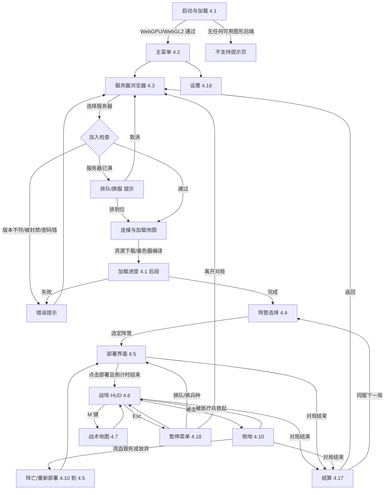

### 3.2 异常分支（任一时刻均可能发生）

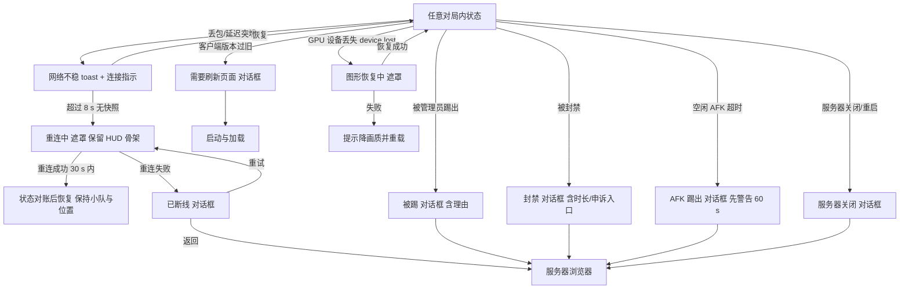

### 3.3 全局约定

- 任何"错误"对话框必须提供：①原因（一句话）；②可执行的下一步按钮；③错误码（i18n key + 数字，便于报错）。
- 重连成功窗口 30 s【待调参】，与服务器"保留席位"时长一致（见 NETWORK 文档）；窗口内 UI 保持 HUD 骨架并显示"重连中"计时。
- 从暂停菜单"离开对局"需要二次确认（因为有战绩丢失/小队脱离）。

---

## 4. 逐屏规格

通用说明：
- 所有屏的 i18n key 前缀统一 `ui.<screen>.`，子键命名 `ui.<screen>.<element>.<attr>`（如 `ui.deploy.button.confirm`）。
- 每屏的"状态机"描述的是屏内主要状态；错误/空/加载见每屏末尾。
- "交互"列使用 键位 默认值（见 §5）；鼠标交互始终有等价键盘路径（Tab 循环 + Enter/Space + 方向键）。
- 所有可交互元素必须有 `:focus-visible` 样式（§2.6）。

### 4.1 启动与加载

**用途：** 检测图形能力、选择后端、下载与缓存资源、显示进度；首次访问与二次访问路径不同。

**设计理由：** 浏览器游戏最大的流失点在首次加载。因此将启动分为三段：A) ≤ 8 MB 的"壳"（JS+WASM+UI，目标见总纲）极速进入主菜单；B) 进入服务器后再下载地图资源（Medium ≤ 150 MB 等档位）；C) 缓存（Cache API/OPFS）使二次进入近似秒开。每段都给出可见进度与可取消。

#### 4.1.1 信息元素

| 元素 | 数据来源 | 更新频率 | 交互 |
|---|---|---|---|
| 品牌标题与版本号 | 构建常量 | 静态 | 无 |
| 图形后端检测结果（WebGPU / WebGL2 / 不支持） | `navigator.gpu.requestAdapter()` 结果、`WebGL2RenderingContext` 探测（LOCAL） | 一次 | 无 |
| 降级提示（WebGL2 降级效果列表：无体积雾/无 TAAU/高度雾等） | LOCAL | 一次 | "了解详情"展开；"不再提示"勾选 |
| 画质自动推荐档（Low/Medium/High/Ultra）与依据（GPU 名称、显存估计、是否核显） | LOCAL（`adapter.info` 与限额；GPU 信息可能被浏览器隐藏，未核实各浏览器行为） | 一次 | 可手动改 |
| 壳资源进度条（字节数/百分比/剩余时间估计） | `fetch` 进度（LOCAL） | 10 Hz | 无 |
| 地图资源进度（分项：地形、纹理、模型、音频、着色器编译） | LOCAL | 5 Hz | "后台下载"开关、取消 |
| 缓存状态（首次/已缓存 N MB/需更新 M MB） | Cache API/OPFS 清单比对（LOCAL） | 一次 | "清除缓存"按钮（在设置内） |
| 磁盘配额提示（`navigator.storage.estimate`） | LOCAL | 一次 | 配额不足时显示"选低一档资源包" |
| 提示轮播（游戏提示，来自 i18n） | LOCAL | 每 8 s | 左右箭头 |
| 错误/重试面板 | LOCAL | 事件 | 重试、复制诊断信息 |

#### 4.1.2 线框图（1920×1080）

```
+--------------------------------------------------------------------------+
|                                                                          |
|                                                                          |
|                      F R O N T L I N E            v0.x.y                 |
|                      ───────────────────                                 |
|                                                                          |
|        图形后端  [ WebGPU  ✓ ]     画质建议 [ High ▾ ]                   |
|        ┌──────────────────────────────────────────────────────┐          |
|        │▓▓▓▓▓▓▓▓▓▓▓▓▓▓▓▓▓▓▓▓▓▓░░░░░░░░░░░░░░░░░░░░░░░░░░  46%   │          |
|        └──────────────────────────────────────────────────────┘          |
|        正在下载 地形 (62/134 MB)   剩余约 38 s     [ 后台继续 ]          |
|                                                                          |
|        ┌─ 提示 ─────────────────────────────────────────────┐           |
|        │ 提示文本……                                    ‹  ›  │           |
|        └─────────────────────────────────────────────────────┘           |
|                                                                          |
+--------------------------------------------------------------------------+
降级时：后端行变为 [ WebGL2 ⚠ ]，下方展开一块 warn 面板：
  "当前浏览器未启用 WebGPU，已切换兼容模式。以下效果将被简化：……  [了解更多]"
```

#### 4.1.3 状态机

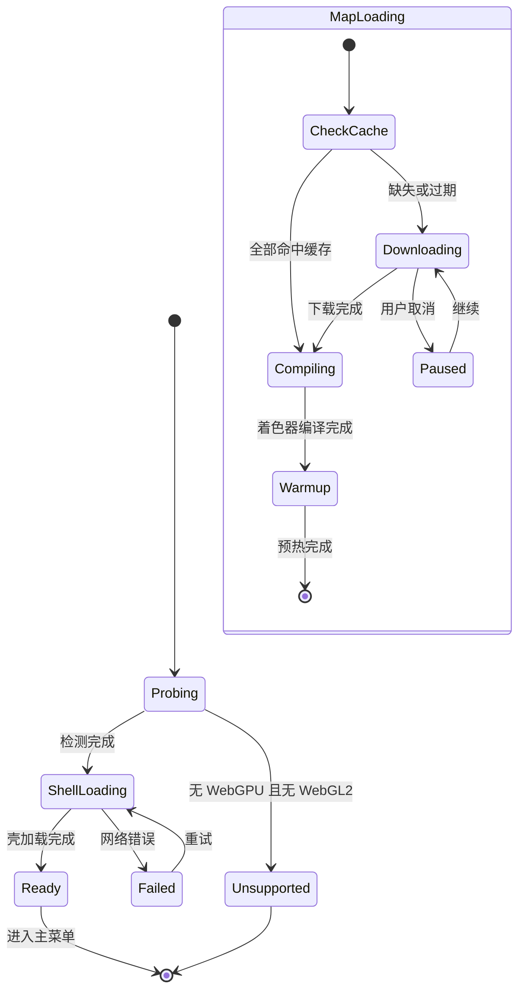

#### 4.1.4 交互

- 壳加载阶段无输入；进度条可 Tab 聚焦以便读屏播报（`role="progressbar"`，`aria-valuenow`）。
- 地图加载阶段：`Esc` = 取消并返回服务器浏览器（需确认）；点击"后台继续"：返回主菜单浏览，但下载继续（顶栏常驻小进度）。
- 用户首次交互（点击）用于解锁 WebAudio 与后续 Pointer Lock：启动页必须有一个"点击继续"的触发点（若壳加载太快，自动出现"点击进入"按钮，不要静默跳过）。

#### 4.1.5 空/加载/错误状态

| 状态 | 表现 |
|---|---|
| 无 WebGPU 但有 WebGL2 | 显示降级面板；默认画质建议最多 Medium；列出被禁用特性（体积雾→高度雾、TAAU→空间放大、SSR 关闭等，见总纲） |
| 无 WebGPU 且无 WebGL2 | 全屏"不支持"页：说明、推荐浏览器（Chrome/Edge 最新版）、复制诊断；不提供"强行继续" |
| 网络失败 | 重试按钮 + 自动退避重试（1/2/4/8 s）+ 显示失败的资源名 |
| 存储配额不足 | 提示"无法缓存，本次将直连下载"；允许继续 |
| 缓存损坏（哈希不符） | 自动清除该包并重下，toast 提示 |
| 版本更新（缓存清单与服务器不符） | 显示"需要更新 N MB"，进度条文案变为"更新" |
| 内存/显存不足（device lost / OOM） | 提示降一档并重新加载 |
| 浏览器不在支持列表（如手机） | "本游戏仅支持桌面浏览器"页 |

**i18n 前缀：** `ui.boot.*`（`ui.boot.backend.webgpu`、`ui.boot.degraded.title` …）

### 4.2 主菜单

**用途：** 进入游戏的枢纽：快速加入、选服、设置、教程、账号、退出。

**设计理由：** 主菜单是"低压力决策"页，布局采用**左侧垂直命令栏 + 右侧大面积状态面板**：左栏是 5–6 个稳定入口；右侧显示"此刻你能做什么"（推荐服务器、好友/小队、公告）。避免把所有入口排成大卡片墙，保证 1280×720 下不换行。

#### 4.2.1 信息元素

| 元素 | 数据来源 | 更新频率 | 交互 |
|---|---|---|---|
| 昵称 + 账号状态（游客/已登录） | `GW`/LOCAL | 登录时 | 点击→账号面板（改昵称、OAuth 登录/登出） |
| 快速加入按钮（Quick Join） | `GW` 推荐接口 | 30 s | `Enter`/点击→按延迟与人数推荐 |
| 服务器浏览器入口 | — | — | → §4.3 |
| 教程/训练场入口 | LOCAL | — | → 教程（首次登录高亮） |
| 设置入口 | — | — | → §4.16 |
| 推荐服务器卡片（≤ 3：名称、地图、模式、人数、ping） | `GW` | 15 s | 点击→加入 |
| 公告/更新日志（滚动，只读） | `GW` | 加载时 | 展开阅读 |
| 当前下载/缓存状态（若后台下载） | LOCAL | 5 Hz | 点击→详情 |
| 战绩摘要（基础战绩：场次、K/D、胜场）— 仅登录用户 | `GW` | 加载时 | 点击→详情 |
| 语言切换（EN / 简体中文） | LOCAL | — | 立即生效，无需刷新 |
| 版本号、反馈/Discord 链接、捐赠入口 | 构建常量 | 静态 | 外链（新标签页，`rel=noopener`） |

#### 4.2.2 线框图

```
+--------------------------------------------------------------------------+
|  FRONTLINE                                    [ EN | 中 ]  昵称▾  v0.x   |
|--------------------------------------------------------------------------|
|  ┌────────────┐   ┌─ 此刻 ─────────────────────────────────────────────┐ |
|  │▶ 快速加入   │   │  推荐服务器                                         │ |
|  │  服务器浏览 │   │  ┌──────────────┐┌──────────────┐┌──────────────┐ │ |
|  │  训练场     │   │  │Carentan  Fron││Omaha  Assault││Foy  Skirmish │ │ |
|  │  设置       │   │  │ 74/100  38ms ││ 61/100  52ms ││ 38/100  41ms │ │ |
|  │  账号       │   │  └──────────────┘└──────────────┘└──────────────┘ │ |
|  │  退出到网站 │   │  公告                                              │ |
|  └────────────┘   │  · 0.3.1 平衡调整 …                                │ |
|                    │  · 周末活动 …                                      │ |
|  [下载 62%]        └────────────────────────────────────────────────────┘ |
|  反馈  Discord  捐赠                                                      |
+--------------------------------------------------------------------------+
```

#### 4.2.3 状态机

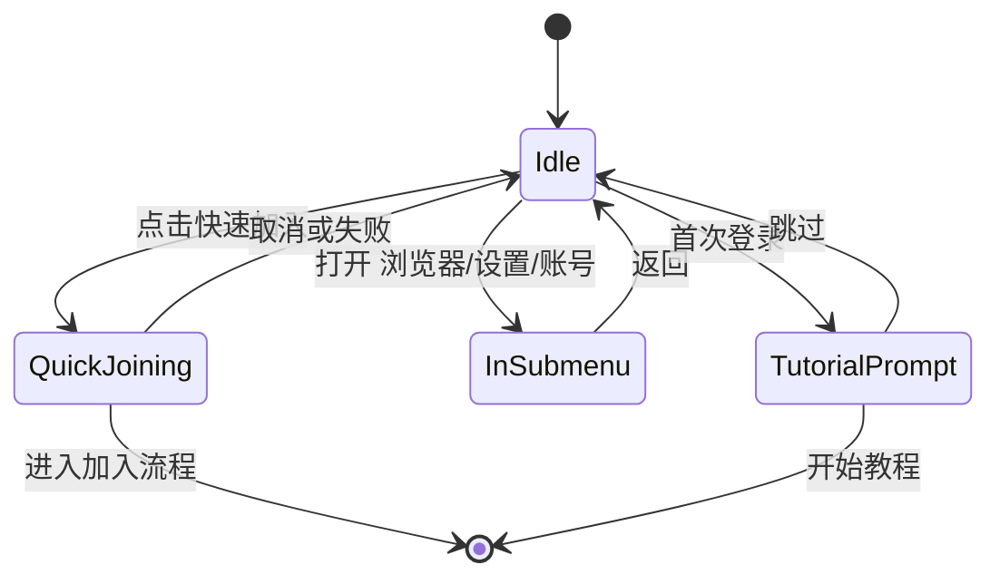

#### 4.2.4 交互

- 键盘：`↑/↓` 在左栏移动，`Enter` 激活，`Esc` 无操作（主菜单没有上一级）。
- 鼠标：悬停有 80 ms 的描线高亮；右侧卡片整体可点击。
- 首次访问：`TutorialPrompt` 为非阻断面板（可关闭、可"下次再说"）。

#### 4.2.5 空/加载/错误

- 推荐服务器加载中：3 张骨架卡（灰条脉动，减少动态时静态灰块）。
- `GW` 失败：右栏显示"无法获取服务器列表"+ 重试；仍可打开设置与训练场。
- 无服务器（空列表）：显示"目前没有可加入的服务器"+ 订阅/Discord 入口。

**i18n 前缀：** `ui.menu.*`

### 4.3 服务器浏览器

**用途：** 浏览、筛选、排序并加入对局服务器；显示排队。

**设计理由：** 列表是主体（信息密度高），左侧是筛选栏（可折叠），右侧是选中服务器的详情抽屉（地图缩略图、当前战况、玩家构成），避免弹窗。1280 宽时详情抽屉改为底部面板。

#### 4.3.1 信息元素

| 元素 | 数据来源 | 更新频率 | 交互 |
|---|---|---|---|
| 服务器名 | `GW` | 10 s | 单击选中，双击加入 |
| 地图名（Carentan/Omaha Beach/Foy）+ 缩略图 | `GW` | 10 s | — |
| 模式（Frontline/Assault/Skirmish） | `GW` | 10 s | — |
| 人数 `当前/上限`（真人 + bot 分开显示：`72+18/100`） | `GW` | 5 s | 悬停→tooltip 显示 US/GER 各自人数 |
| 对局阶段（准备中/进行中/即将结束；剩余时间） | `GW` | 5 s | — |
| Ping（ms）+ 信号图标（≤ 60 好/≤ 120 中/> 120 差，【待调参】） | 客户端对各区域端点测量（LOCAL，HTTP 往返或 WebTransport 探测；方法未核实） | 首屏 + 30 s | 手动刷新 |
| 区域（EU/NA…） | `GW` | 静态 | 筛选 |
| 版本/兼容性标记 | `GW` | 静态 | 不兼容则禁用加入 |
| 密码标记（锁） | `GW` | 静态 | 加入时弹密码框 |
| Bot 填充标记 | `GW` | 静态 | 筛选 |
| 排队人数/预计等待 | `GW` | 3 s | — |
| 管理员/社区服标记 | `GW` | 静态 | 筛选 |
| 筛选栏（见下） | LOCAL | — | — |
| 排序（点击表头切换升/降） | LOCAL | — | `Shift+点击`多列排序（可选） |
| 刷新按钮 + 上次刷新时间 | LOCAL | — | `F5`（拦截 `preventDefault`，只刷新列表）/ 按钮 |
| 加入/排队/观战（若支持）按钮 | `RPC` | — | 见状态机 |

**筛选项：** 地图（多选）、模式（多选）、区域、ping 上限滑块、人数范围（隐藏已满/隐藏空服）、含 bot / 纯真人、有密码/无密码、仅官方/仅社区、版本兼容、关键字搜索。筛选条件保存在 `localStorage`（每个浏览器）。

**排序键：** 默认"推荐"（综合 ping、人数 60–90% 优先、阶段）；可选 ping、人数、名称、地图、剩余时间。

#### 4.3.2 线框图

```
+--------------------------------------------------------------------------+
| ‹ 返回        服务器浏览器                    [搜索…………]  [刷新 ⟳ 12:04]   |
|--------------------------------------------------------------------------|
| 筛选                 | 服务器              地图      模式    人数    ping |
| ─────────            |▌Frontline #1 EU      Carentan  Fron   72+18/100 38 |
| 地图  [x]Carentan    |  Frontline #2 EU     Omaha     Assa   61/100    52 |
|       [ ]Omaha       |  社区服 Alpha 🔒     Foy       Skir   38/100    41 |
|       [ ]Foy         |  ...                                              |
| 模式  ...            |--------------------------------------------------|
| ping ≤ [—●———] 120   | ┌ 详情 ─────────────────────────────────────┐   |
| ☐ 隐藏已满           | │ [缩略图]  Frontline #1 EU                   │   |
| ☐ 仅真人             | │  阶段：进行中 · 剩余 42:10   US 38 | GER 34  │   |
| [重置筛选]           | │                       [ 加入 ]  [ 加入小队… ] │   |
|                      | └──────────────────────────────────────────────┘   |
+--------------------------------------------------------------------------+
```

#### 4.3.3 状态机

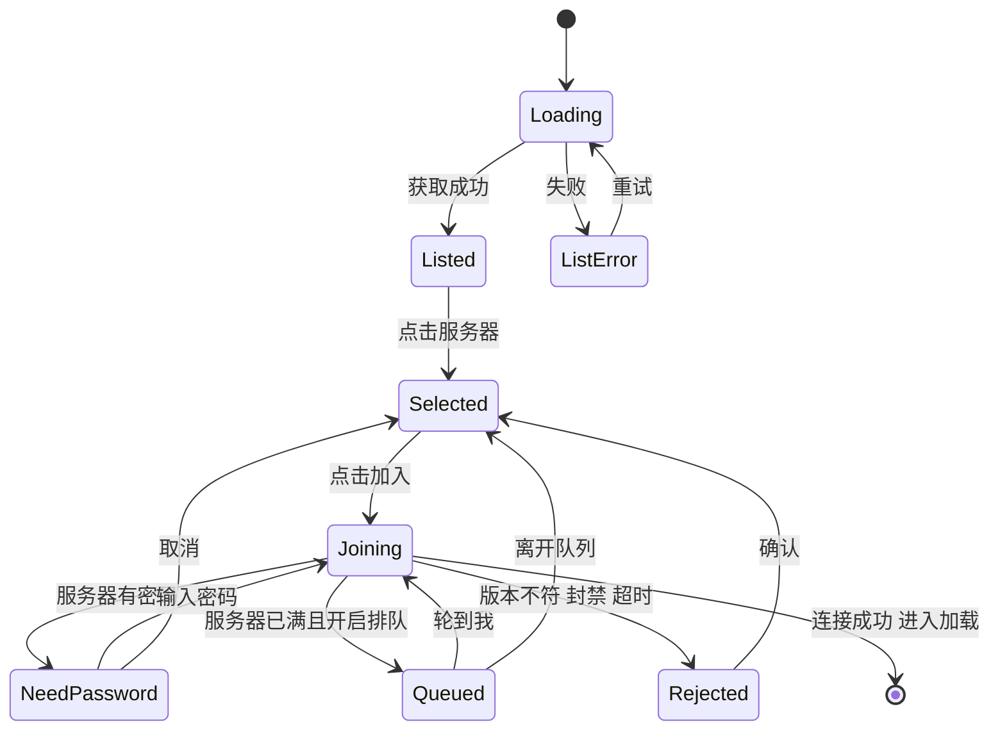

#### 4.3.4 交互

- 键盘：`↑/↓` 选行，`Enter` 加入，`/` 聚焦搜索；刷新用 `F5`（仅在本屏拦截）与按钮；不使用 Alt 组合键。
- 排队：队列面板为模态外的底部条（"排队中 第 7 位 · 预计 2 分钟 · 离开"）；排到时 10 s 内必须点击确认，否则让位（防占位）；有声音提示。
- 复制服务器链接（`https://…/join/<id>`）用于邀请好友（Clipboard API，可能需要用户手势）。

#### 4.3.5 空/加载/错误

| 状态 | 表现 |
|---|---|
| 加载 | 8 行骨架 |
| 空（无服务器） | 插画（线稿地图）+ "没有符合筛选条件的服务器" + 重置筛选；若完全无服务器显示"服务器维护中"与状态页链接 |
| 错误 | "无法获取服务器列表"+ 重试 + 错误码 |
| 单个服务器 ping 超时 | 显示 `—`，仍可加入（带警告） |
| 已满且无排队 | 加入按钮灰，显示"已满（等待名额）"，可点"通知我"（页面内提示，不用系统通知） |

**i18n 前缀：** `ui.browser.*`

### 4.4 阵营选择

**用途：** 在 US / GER 之间选择（受人数平衡与锁定规则限制）。

**设计理由：** 左右对分，各占一半（天然对应"两队对抗"的心智）；中间纵贯"平衡条"。把规则（为何不能选）直接内嵌在被禁用的一侧，而不是弹窗解释。布局不使用"海报式人物立绘"（避免素材负担，且与 A2 一致）。

#### 4.4.1 信息元素

| 元素 | 数据来源 | 更新频率 | 交互 |
|---|---|---|---|
| 阵营名称 + 阵营纹样（几何图案，自绘）+ 简述（≤ 40 字） | 静态 | — | — |
| 各阵营人数（真人/bot）与上限 | `EVT`/`RPC` | 1 Hz | — |
| 平衡条（双向条，中点=均衡；超过阈值时一侧变 warn） | 同上 | 1 Hz | — |
| 可选状态：可选 / 因人数不平衡不可选（+ 原因文案）/ 已满 / 被锁定（自己刚离开队伍的冷却） | `RPC` | 1 Hz | 禁用态显示原因 |
| 冷却计时（换队后 N 秒内不可再换） | `RPC` | 1 Hz | — |
| 加入好友/小队同阵营提示（若通过邀请进入，则自动高亮对应阵营） | `RPC` | 一次 | — |
| 自动分配按钮（Auto-assign） | `RPC` | — | 点击→服务器按平衡分配 |
| 当前地图/战况摘要（进度、控制点数） | `EVT` | 5 s | — |

**规则（须与 GAMEDESIGN 对齐，数值待调）：**
- 允许差（GAMEDESIGN §2.4）：新玩家只能加入使「该队真人数 − 另一队真人数 ≤ 2」成立的队伍；差 ≥ 3 时人多一方不可选（bot 不计）【待调参】。
- 换队规则（GAMEDESIGN §2.4）：加入后 3 min 内不得换队；两次换队间隔 ≥ 600 s（`team_switch_cooldown`）；须满足上面的平衡规则。冷却与限制文案以服务器下发的剩余秒数为准。
- 小队邀请进入者优先放到邀请者阵营，并占用该阵营名额；若满则进入排队。

#### 4.4.2 线框图

```
+--------------------------------------------------------------------------+
|                         选择你的阵营    Carentan · Frontline             |
|--------------------------------------------------------------------------|
|  ┌────────────────────────────┐ ││ ┌────────────────────────────┐        |
|  │    [US 纹样]                │ ││ │    [GER 纹样]               │        |
|  │    United States            │ ││ │    Germany                  │        |
|  │    人数 38 / 50              │ ││ │    人数 34 / 50              │        |
|  │    ─────────────────         │ ││ │    ─────────────────        │        |
|  │    [  加入  ]                │ ││ │    [  加入  ]               │        |
|  └────────────────────────────┘ ││ └────────────────────────────┘        |
|         平衡  ◄━━━━━━━●━━━━━━━►   (中点=均衡)                             |
|                       [ 自动分配 ]                                         |
+--------------------------------------------------------------------------+
被禁用侧：整块 60% 不透明 + 虚线外框 + 文案"人数过多，请加入另一方（差 > 3）"
```

#### 4.4.3 状态机

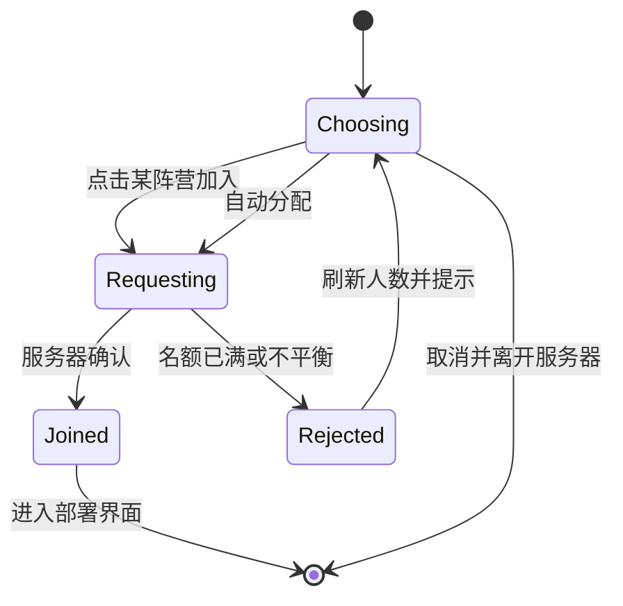

#### 4.4.4 交互

- `←/→` 切换焦点阵营，`Enter` 确认，`A` 自动分配，`Esc` 返回（需确认离开服务器）。
- 请求期间按钮显示"请求中…"并禁用；服务器应答超时 5 s 给错误。

#### 4.4.5 空/加载/错误

- 人数加载中：数字位置骨架。
- 在选择期间人数变化导致被禁：实时刷新并 toast"该阵营已不可选"。
- 双方皆不可选（极少）：显示"服务器暂时已满"，提供排队。

**i18n 前缀：** `ui.faction.*`

### 4.5 部署界面（Deploy）

**用途：** 玩家（首次进入、阵亡后、换兵种后）决定"在哪里出生、与谁一起、以什么兵种/装备"，并确认部署。是信息密度最高的菜单屏。

**设计理由（原创布局）：** 部署决策有三个因果顺序——**位置 → 编组 → 装备**。位置由空间信息决定，因此战术地图占据**中央偏左的最大面积**（约 56%）；编组是列表型信息，放**右上**（与地图并排，便于边看小队位置边选）；装备是"选择+预览"，放**右下**；最关键的"部署"按钮与重生倒计时固定在**底部贯穿条**，永不被任何面板遮挡。顶部一条"态势条"显示对局上下文。这与"左地图/右列表/底部按钮"的通用信息拆分相近，但具体比例、分区命名、底部倒计时环、重生点状态编码等均为 Plotline 自行设计。

#### 4.5.1 信息元素

| 元素 | 数据来源 | 更新频率 | 交互 |
|---|---|---|---|
| 态势条：地图名、模式、战线进度、我方/敌方人数、剩余时间 | `EVT`/`SNAP` | 1 Hz | 无 |
| 战术地图（Canvas，复用 §4.7 渲染器的"部署子集"：战线着色、网格、据点、友军小队位置、可用重生点） | `TEAM` + `EVT` | 1 Hz 数据 / 渲染 ≤ 30 fps | 点击重生点选中；滚轮缩放；拖拽平移；`Space` 回到推荐点 |
| 重生点列表（与地图联动，含状态） | `EVT` | 1 Hz | 点击选中；`↑/↓` |
| 重生点状态：**可用 / 封锁 / 冷却 / 被摧毁**（+ 额外：已满、未解锁） | `EVT` | 事件 | 非可用点点击→显示原因 |
| 小队列表（名称、类型：步兵/装甲/侦察、成员数/上限、Officer 名、是否锁定、语音在用） | `EVT` | 1 Hz | 加入、创建、锁定、踢人（Officer） |
| 创建小队（名称下拉：预设代号库，不允许自由文本以避免辱骂；类型选择） | `RPC` | — | 创建→成为 Officer |
| 兵种列表（图标、名称、名额 `已用/上限`、不可用原因） | `EVT` | 1 Hz | 点击选中；名额满灰置 |
| Loadout 选择（主武器、副武器、投掷物/工具、特殊物品；每槽候选与真实武器名称及弹容量） | `data/loadouts` + 解锁 | 静态 | 点击切换；预览面板显示数据（射速、弹匣、重量等史实参数） |
| 装备预览（3D 预览不做；使用线稿剖面图 + 数据行） | 静态 | — | — |
| 重生倒计时（秒）与冷却环 | `SNAP`（服务器给出可部署时间戳） | 4 Hz | 无 |
| 部署按钮（含当前选择摘要：重生点+小队+兵种） | `RPC` | — | `Enter` / 点击 |
| 部署请求状态（"请求中…/已确认/被拒绝：原因"） | `RPC` | 事件 | — |
| 指挥官提示（Commander 的 Rally/Airhead 等，如有） | `EVT` | 事件 | — |
| 聊天/语音状态（精简） | `EVT`/`LK` | — | 复用 §4.15 小组件 |

**重生点状态编码（形状+颜色+文字）：**

| 状态 | 视觉 | 条件（示意） | 备注 |
|---|---|---|---|
| 可用 | 实心符号 + `ok` 勾角标，边线实线 | 未被敌近、非冷却、未满 | 可选中 |
| 封锁（Blocked） | 符号上叠"断线斜杠" + `warn` 三角 + 虚线边 | 敌军在其半径内或所在据点被围 | 文案"附近有敌军"；点击显示原因 |
| 冷却（Cooldown） | 符号灰化 + 圆环倒计时 | 本小队/全队使用节流 | 显示剩余秒数 |
| 被摧毁（Destroyed） | 符号破损（缺口）+ `danger` 叉，持续显示 10 s 后移除【待调参】 | Garrison/Outpost 被摧毁 | 点击无效；音效提示一次 |
| 已满 | 符号半透明 + 人数徽标 | 容量到达 | 与封锁区分：非敌因素 |
| 未解锁 | 锁形角标 | 如 Airhead 次数用完 | — |

**友方重生点种类（地图上的符号，见 §4.7）：** HQ（基线）、Garrison（团队级）、Outpost（小队级）、Airhead（指挥官能力，一次性）。Squad-only 的 Outpost 仅对该小队成员可选。

**名额规则显示：** 兵种名额 `已用/上限` 来自 `data/roles`；Officer 仅在"创建/拥有小队"时可选；Commander 仅一名，需满足条件（例如先担任 Officer 过一定时长或由投票/指派，规则见 GAMEDESIGN，不在本文规定）。

#### 4.5.2 线框图（1920×1080）

```
+------------------------------------------------------------------------------------+
| Carentan · Frontline   战线 ███░░ 3/5   我方 38 | 敌方 34   剩余 42:10    [Esc 菜单]  |
|------------------------------------------------------------------------------------|
| ┌ 战术地图 ─────────────────────────────────────────┐ ┌ 小队 ────────────────────┐ |
| │ A B C D E F G H I J                               │ │ [+ 创建小队]             │ |
| │1 · · ┌┐ · · · · · ·                               │ │ ▌Able     步兵 5/6  🔒?   │ |
| │2 · ◆ │◇│ · ▣ · · ·       ▣=据点                  │ │  Baker    步兵 6/6  🔒    │ |
| │3 · · └┘ · · ◈ ·  ·       ◈=Garrison             │ │  Charlie  装甲 2/3（≤3）  │ |
| │4 ... (战线着色:蓝/橙/灰)  ⬡=Outpost ▽=Airhead      │ │  ──── 无小队(自由) ────   │ |
| │                                                   │ │  已选: Able               │ |
| │  [已选重生点: Garrison-03 (可用)  距前线 180 m]   │ │ ┌ 兵种 ───────────────┐ │ |
| └───────────────────────────────────────────────────┘ │ │ Rifleman  4/6   ●    │ │ |
| ┌ 重生点列表 ───────────┐                             │ │ Assault   1/2        │ │ |
| │ HQ              可用  │                             │ │ Medic     1/1  满 ✕  │ │ |
| │ Garrison-03     可用  │                             │ │ Support   0/1        │ │ |
| │ Outpost-Able    冷却 8s│                            │ │ Anti-Tank 1/1  满 ✕  │ │ |
| │ Garrison-07     封锁  │                             │ └────────────────────┘ │ |
| └───────────────────────┘                             │ ┌ Loadout ───────────┐ │ |
|                                                       │ │ 主: M1 Garand ▾     │ │ |
|                                                       │ │ 副: M1911 ▾         │ │ |
|                                                       │ │ 投: Mk 2 Frag ▾     │ │ |
|                                                       │ └────────────────────┘ │ |
|------------------------------------------------------------------------------------|
| [倒计时环 7s]   Garrison-03 · Able · Rifleman · M1 Garand           [  部 署  ]    |
+------------------------------------------------------------------------------------+
```

#### 4.5.3 状态机

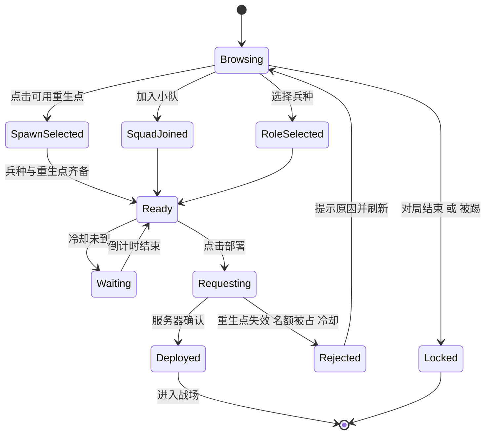

- "自动修复"规则：若所选重生点在 `Requesting` 期间失效，客户端不自动换点，而是回到 `Browsing` 并高亮推荐点（避免玩家被投到意外位置）。
- 若所选兵种名额被占，自动选择"相近兵种"并提示（可关闭），否则回 `Browsing`。

#### 4.5.4 键鼠交互

| 操作 | 输入 |
|---|---|
| 选重生点 | 左键点击地图符号 / 列表行；`1–9` 选择列表第 N 项 |
| 平移/缩放地图 | 左键拖拽 / 滚轮；`+/-`；`Space` 回到推荐点；`Home` 回全图 |
| 加入/创建小队 | 点击行 `Enter`；`C` 创建；`L`（Officer）锁定/解锁 |
| 选兵种 | `Q/E` 在兵种列表上下切换；点击 |
| 选 loadout | 点击槽位，弹出候选（`↑/↓`，`Enter`）；`R` 重置默认 |
| 部署 | `Enter` 或点击部署按钮（倒计时结束前禁用，显示剩余秒数） |
| 打开暂停 | `Esc` |
| 聊天 | `Enter` 打开聊天输入（见 §4.15） |

#### 4.5.5 空/加载/错误

| 状态 | 表现 |
|---|---|
| 无可用重生点 | 地图中心提示"正在重新部署网络…"，自动选中 HQ；若 HQ 也不可用（极少，如阶段间）显示等待 |
| 无小队 | 小队区显示"还没有小队。创建一个或以自由兵身份部署"；自由兵（无小队）功能受限，只能选 Rifleman，并只能在 HQ/据点重生点部署，不能使用 Garrison/Outpost（GAMEDESIGN §2.5、R2） |
| 兵种全满 | 兵种条显示"名额已满"，推荐"自由兵种" |
| 部署被拒 | 底部红线条（danger）+ 原因 + 重选 |
| 网络抖动 | 部署按钮显示"连接不稳"，不允许发送（防止重复请求） |
| 地图数据加载中 | 地图区骨架（网格线） |

**i18n 前缀：** `ui.deploy.*`（子：`ui.deploy.spawn.*`、`ui.deploy.squad.*`、`ui.deploy.role.*`、`ui.deploy.loadout.*`）

### 4.6 HUD

**用途：** 战斗中常驻信息层。所有元素可单独开关、调节不透明度与缩放（§4.16）。

**设计理由：** 将信息按 §1.3 的分区贴边放置；中间留白。每个元素独立组件，独立订阅各自信号，避免整屏重渲（§8）。

#### 4.6.1 信息元素总表

| 元素 | 位置 | 数据来源 | 更新频率 | 交互/备注 |
|---|---|---|---|---|
| 准星（含散布扩张、命中确认、爆头提示） | 中心 | `SNAP` 武器散布 | 每帧（CSS transform） | 可选样式 4 种；命中提示=准星四角短暂外展 80 ms |
| 指南针与方位刻度（0–360°，每 10° 小刻度，每 30°/45° 标 N/NE/…；中文环境显示 北/东北…） | 顶部居中 | 相机朝向（LOCAL） | 每帧 | 刻度带内显示：命令标记、据点、小队成员方向（最多 8 个） |
| 弹匣/弹药（当前弹匣 / 备弹；匣数式武器显示"弹匣数"） | 右下 | `SNAP` | 事件 | 低弹 ≤ 25%：数字变 `warn` + ⚠ 形；空匣：闪描边 |
| 换弹进度（环形/横条） | 准星下方 | `SNAP` | 30 Hz | 可被中断，中断时条回退 |
| 武器槽与当前武器名、射击模式（Semi/Auto/Burst，机枪的"卧射架设"状态） | 右下 | `SNAP` | 事件 | `1–5` 切换、`X` 射击模式（见 §5） |
| 投掷物/工具数量 | 右下（武器槽旁） | `SNAP` | 事件 | — |
| 姿态图标（站/蹲/卧、探身 L/R、冲刺、泳） | 右下，弹药左侧 | `SNAP` | 事件 | 与实际碰撞姿态同步（服务器权威）；切换时 80 ms 描线动画 |
| 体力条（冲刺/负重；0–100%） | 姿态图标下 | `SNAP` | 10 Hz | 低体力 ≤ 20% `warn`；耗尽时显示"喘息"提示（文字+声音） |
| 生命状态（不显示数值，只显示"状态带"：受伤程度、流血） | 屏幕边缘（暗角）+ 小图标 | `SNAP` | 事件 | 见屏幕效果；不显示精确血量（品类特点：以状态而非数字呈现）【待测 → REFERENCE_MEASUREMENTS §hud-health】 |
| 小队成员列表（图标、名字、兵种、状态：存活/倒地/阵亡、距离、语音说话指示） | 左中 | `TEAM` 1 Hz + `SNAP` 近距精确 | 1–10 Hz | 点击（需解锁指针，仅在地图/菜单状态可点）；战斗中仅显示不交互 |
| 据点占领进度（所处据点的三段环：我方/中立/敌方占比） | 屏幕上部偏左，进入占领圈时淡入 | `EVT`/`SNAP` | 4 Hz | 离开圈淡出 |
| 对局计时与战线状态（剩余时间、各战线据点控制：5 条战线缩略条） | 左上 | `EVT` | 1 Hz | 悬停无；按 `M` 看详情 |
| 击杀/事件播报（击杀、占点、建造、被击倒） | 右上 | `EVT` | 事件 | 最多 3 条，每条 5 s；"我击杀/击倒我"高亮 |
| 语音指示（谁在说话、频道图标：小队/指挥/近距/车组；自己 PTT 状态） | 左下（成员名旁）+ 屏幕右上小区域 | `LK` | 10 Hz | 自己按下 PTT 时显示频道色标与"发送中" |
| 交互提示（"按 F 拾取/修理/部署…"，含按键帽图形；长按进度环） | 底部居中 | `SNAP` 射线结果（LOCAL） | 每帧检测，文案事件 | 按键帽文字随重绑定变化 |
| 受击方向指示（楔形，指向伤害来源方向，按相机相对角度） | 以准星为圆心的外环 | `SNAP`/`EVT` | 事件 | 持续 600 ms 淡出；强度映射伤害；颜色用 `danger` + 形状（楔形） |
| 压制效果（暗角收缩 + 轻微模糊/色散 + 音频低通）、流血效果（边缘脉动暗红→Plotline 用"斜线纹"覆盖层） | 全屏边缘 | `SNAP` | 30 Hz | 减少晃动模式替换为静态斜线纹边框 |
| 建造/补给提示（附近可建造蓝图、补给箱可用、弹药来源距离） | 底部居中偏右 | `SNAP` | 事件 | 见 §4.13 |
| 载具 HUD（载具名、座位列表、弹种与余量、模块损伤图、车组、速度/档位、发动机状态） | 载具内：左下座位+右下弹药+中左损伤 | `SNAP` | 10 Hz | 见 §4.14 |
| 火炮 HUD（方位角/仰角、装填、观察手目标） | 火炮操作态 | `SNAP`/`EVT` | 10 Hz | 见 §4.14 |
| 连接与性能指示（ping、丢包、帧率，可选） | 右上角小字 | LOCAL | 1 Hz | 设置开关；丢包高时自动显示警告 |
| 指挥/小队命令提示（当前命令的方向条 + 距离） | 屏幕侧边 + 指南针 | `EVT` | 事件 | 命令 30 s 内显示强，之后弱 |
| 倒地/死亡提示 | 全屏覆盖 | `SNAP` | 事件 | → §4.10 |

#### 4.6.2 线框图（战斗态，1920×1080）

```
+-----------------------------------------------------------------------------------+
| 42:10  ▮▮▮▯▯ 3/5                 N    NE        ▲命令 120m     击杀播报:           |
| 战线                  ─┬──┬──┬──┬──╋──┬──┬──┬──                 You ▸ GER Rifl    |
|                         ◈ 据点 B 160m                              ● Able-2 说话     |
|                                                                                   |
| ┌小队 Able─────┐                                                                  |
| │✚ Medic  Kurt ◂│     ‹ 受击楔形                                                  |
| │▲ Offcr  Max   │                                                                  |
| │… Rifl   Lena  │                    ╋ (准星)                                      |
| │✖ Asst   Tom   │                                                                  |
| └───────────────┘                                                                  |
|                                                                                   |
| [语音:小队 ●TX]                      「F 修理 履带」                姿态▌ 站  Q E   |
| 聊天(淡)…                                                           ⌐ 1:M1 Garand  |
|                                                                      8 / 64 ▮ 自动 |
|                                                                      体力 ▓▓▓▓░░    |
+-----------------------------------------------------------------------------------+
```

#### 4.6.3 HUD 子元素状态机

**弹药/换弹：**

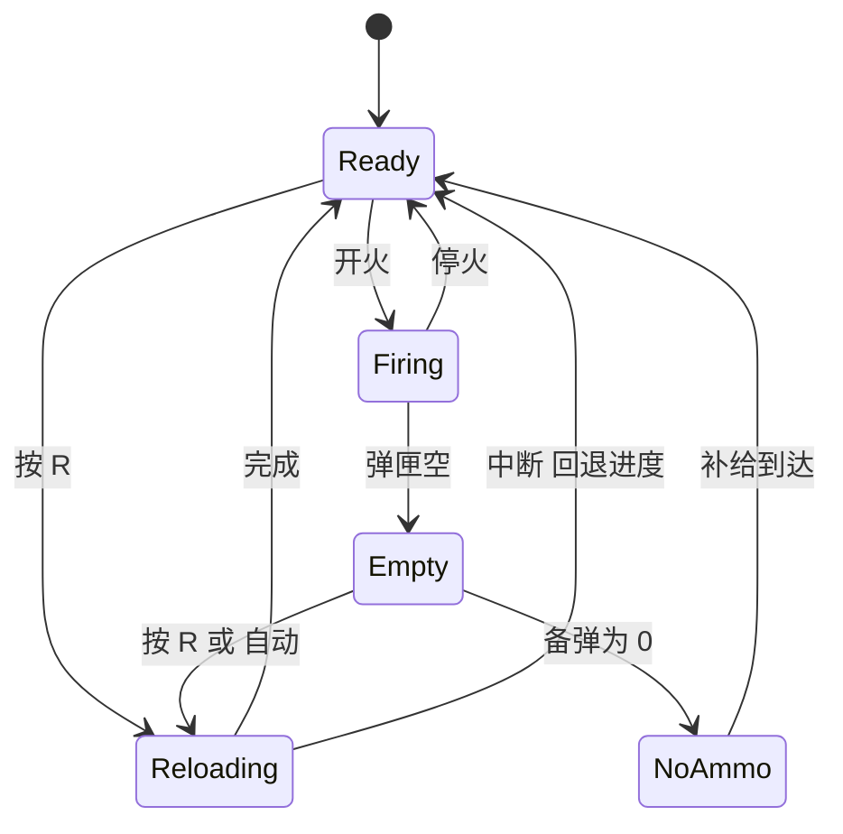

**据点占领环：**

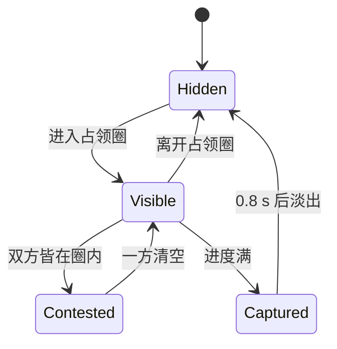

**受击/压制/流血屏幕效果（统一 FX 控制器）：**

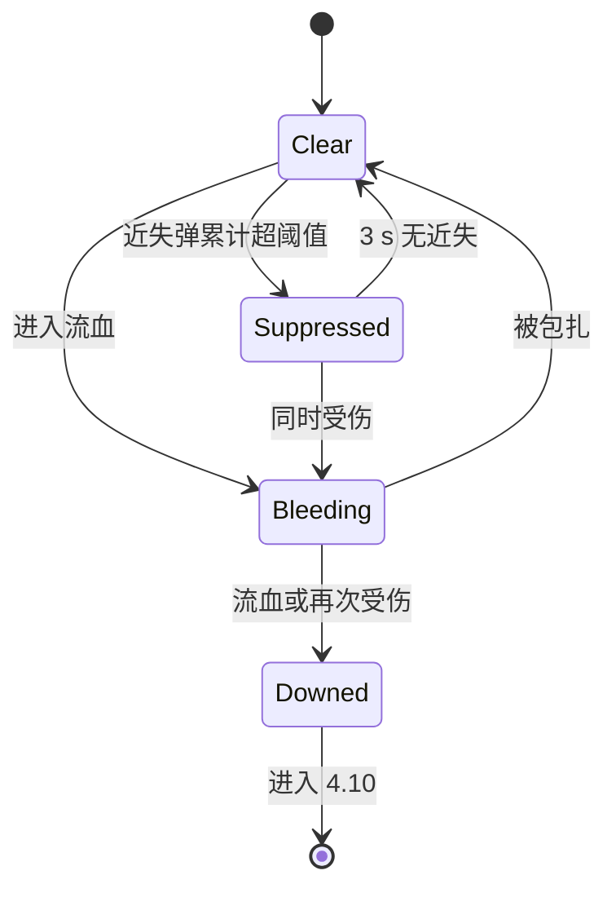

#### 4.6.4 交互

- 战斗态下鼠标被 Pointer Lock，HUD 无点击交互；需要交互的元素（小队管理等）仅在 §4.7/§4.5/§4.18 等解锁态下可点。
- HUD 没有"显示全部提示"键：需要更多信息时用 `Tab`（记分板）与 `M`（地图），以避开与浏览器/操作系统冲突的修饰键（见 §5.5）。
- 所有按键提示文字取自当前绑定；若绑定为空显示"未绑定"。

#### 4.6.5 空/加载/错误

- 数据缺失（如 `TEAM` 通道延迟）：对应元素半透明 + "过时"小点；超过 5 s 未更新则隐藏精确距离，仅显示方向。
- 观战/无角色（等待部署）：HUD 隐藏，仅显示重生提示。
- 在 WebGL2 降级模式：HUD 不变（DOM 与渲染后端无关）。

**i18n 前缀：** `ui.hud.*`（子：`ui.hud.ammo.*`、`ui.hud.compass.*`、`ui.hud.squad.*`、`ui.hud.capture.*`、`ui.hud.feed.*`、`ui.hud.voice.*`、`ui.hud.prompt.*`、`ui.hud.fx.*`）

### 4.7 战术地图（全屏，M 键）

**用途：** 战场全局态势、标记与命令、小队协同、指挥官操作的主舞台。

**设计理由：** 地图占满画面；所有图层控制放右侧窄栏；底部为当前选中对象/命令的上下文条；顶部为坐标与图例简条。采用 Canvas2D：底图（地形着色栅格）一次性烘焙为离屏 `ImageBitmap`，动态图层（单位、标记）分层重绘，满足 §8 预算。

#### 4.7.1 图层

| 图层 | 内容 | 默认 | 备注 |
|---|---|---|---|
| L-Base 底图 | 地形等高线/着色、道路、水域、建筑轮廓（离线烘焙，1 张/缩放层级） | 开 | 静态；缓存 |
| L-Grid 网格 | A1–J10 大格 + 缩放后小键盘 3×3 细分 | 开 | 坐标标签位于边缘 |
| L-Front 战线与区域着色 | 据点所属着色、前线、可部署区域（非战斗区灰化） | 开 | 蓝（我）/橙（敌）/灰（中立）+ 斜纹图案区分（色盲） |
| L-Points 据点 | 据点方框、名称、占领环 | 开 | — |
| L-Spawn 重生点 | HQ/Garrison/Outpost/Airhead（友方）；敌方 Garrison/OP 仅在被发现/标记后显示 | 开 | 状态编码同 §4.5 |
| L-Units 单位 | 友军小队/兵种、载具、指挥官（见 §4.7.2） | 开 | 来自 `TEAM` 1 Hz |
| L-Markers 标记 | ping、命令、敌情标记（§4.7.3） | 开 | 有过期时间 |
| L-Build 建造/补给 | 友方建造物（防御、补给箱、反坦克障碍）、补给点 | 开 | — |
| L-Cmd 指挥官层 | 能力目标、资源、冷却、载具调度（§4.11） | 仅 Commander | — |
| L-Arty 火炮层 | 火炮射程圈、已校准目标 | 仅相关兵种 | — |

图层栏可单选显隐；设置内可记忆"每次打开地图的图层预设"。

#### 4.7.2 单位符号类型（友军可见；敌军仅通过标记/观察）

| 类别 | 符号规则（Plotline） | 显示条件 | 颜色/形 |
|---|---|---|---|
| 己身 | 带方向指示的实心三角+外环 | 总是 | `squad` 外环 |
| 友军小队成员 | 切角矩形框 + 兵种框内图形 | 全队可见（小队 1 Hz；非小队成员仅显示小队聚合点，精度降低）【待调参】 | `friend`；本小队 `squad` + 外环 |
| 友军 Officer | 兵种符号 + 顶部 1 根横杠 | 同上 | — |
| 友军 Commander | 框顶 2 横杠 + 星形（仅该单位使用） | 仅对友军 | — |
| 友军载具 | 框 + 履带/轮底座；车组满员度小徽标；方向箭头 | 全队可见 | — |
| 友军 Spotter/OP | 框内同心弧；OP 为地面符号 | 友军可见 | — |
| 己方重生点（三类） | **Garrison** 方框门洞；**Outpost** 小方框+旗杆；**Airhead** 向下箭头；HQ 为较大切角方框 | 友军可见，状态编码 | 状态见 §4.5 |
| 补给 | 资源图标 + 余量条 | 友军可见 | — |
| 据点（节点） | 正方形 + 名称 + 所属色填充（斜纹区分） | 总是 | 蓝/橙/灰 |
| 建造物 | 外框 + 地基线；类型内标（防御/补给/障碍） | 友军可见 | — |
| 倒地友军 | 单位符号加"下沉"线 + `warn` 点；请求医疗时脉动环 | 全队可见 | — |
| 敌方（经标记） | 菱形框 + 兵种/载具内标 + 剩余时间环 | 被 ping/观察时 | `enemy` |

#### 4.7.3 标记类型与角色权限

**标记的类型、谁能放、谁可见、持续时间、数量上限一律以 GAMEDESIGN.md §16.3/§16.4 为准（规则/权限/计时归 GAMEDESIGN）；本节只定义这些标记在地图与 HUD 上的呈现。** 数值不在本文重复，避免两处漂移。

| GAMEDESIGN §16.3/§16.4 标记 | 呈现（Plotline） | 颜色/强调 |
|---|---|---|
| Ping：Attention（此处） | 旗形 + 距离标签；剩余时间环 | `squad` |
| Ping：Enemy（自动识别敌步兵/载具/建筑） | 菱形框 + 目标类别内标（步兵/载具/建筑）+ 剩余时间环 | `enemy` |
| Ping：Need Medic / Need Ammo / Need Engineer / Need AT / Need Supplies | 旗形 + 对应兵种/物资图标；对应兵种玩家处图标闪烁 | `friend`（请求类） |
| Ping：Thanks | 短暂（1.5 s）勾形气泡 | `ok` |
| Squad Order：Move / Attack / Defend / Hold / Build | 小队色旗形 + 命令符号；地图上带箭头线（Attack/Move） | `squad` |
| Team Mark（敌步兵/载具/火炮/AT 炮/Garrison） | 菱形框 + 剩余时间环；被 Spotter 确认者加粗外框 | `enemy` |
| Command Order：Attack / Defend | 全队可见的大箭头线 + 命令符号 | `cmd` |
| Fire Request / Fire Mission | 同心圆靶标；Fire Mission 对炮手显示网格坐标 | `warn`（炮火） |
| Rally Marker | 旗形 + 倒计时环 | `cmd` |
| Garrison Request / Supply Request | 方框门洞/箱形图标 + 请求者名 | `friend` |

标记渲染：旗形/菱形图标 + 距离标签；世界内同步显示"指南针刻度 + 地面标柱"（HUD 层，见 §4.6）。

#### 4.7.4 坐标系统

- **大格：** 2048 m 可玩区 / 10 = 204.8 m。列 A–J（西→东），行 1–10（北→南）。例：`C4`。
- **细分：** 键盘数字小键盘布局 `7 8 9 / 4 5 6 / 1 2 3`，每级细分 3×3；一级细分格≈ 68.3 m，二级≈ 22.8 m。例：`C4-7-3` 表示大格 C4 的左上格内右下的子格。语音快捷短语与聊天使用此格式。
- **读法：** 地图缩放到一级细分时自动显示细分格线（淡虚线）与标签；二级细分在最高缩放时出现。
- **本地化：** 行列字母/数字不翻译；中文提示"C4 小键盘 7 区"。

#### 4.7.5 线框图

```
+-----------------------------------------------------------------------------------+
| [C4-7]  光标:C4  缩放 2×   图例▾                                     图层 ▤       |
|  A    B    C    D    E    F    G    H    I    J                      ┌─────────┐ |
|1 ┌────┬────┬────┬────┬────┬────┬────┬────┬────┬────┐                  │☑ 战线   │ |
|2 │    │ ▣  │    │ ◇  │    │    │    │    │    │    │                  │☑ 据点   │ |
|3 │ ◈  │    │ ⌐  │    │ ▲  │    │    │    │    │    │                  │☑ 重生点 │ |
|4 │    │ ⬡  │ ✚  │    │    │ ◆  │    │    │    │    │                  │☑ 单位   │ |
|5 │    │    │    │    │    │    │    │    │    │    │                  │☑ 标记   │ |
| ...                                                                    │☑ 建造   │ |
|                                                                         │☐ 指挥层  │ |
| ┌ 选中: Garrison-03  可用  距前线 180 m   [在此部署?仅部署态] ─────────┐│☐ 火炮层  │ |
| │ 命令: [进攻][防御][移动][观察]  (Officer)   标记: Ping ▾                │└─────────┘ |
| └────────────────────────────────────────────────────────────────────────┘          |
+-----------------------------------------------------------------------------------+
```

#### 4.7.6 状态机

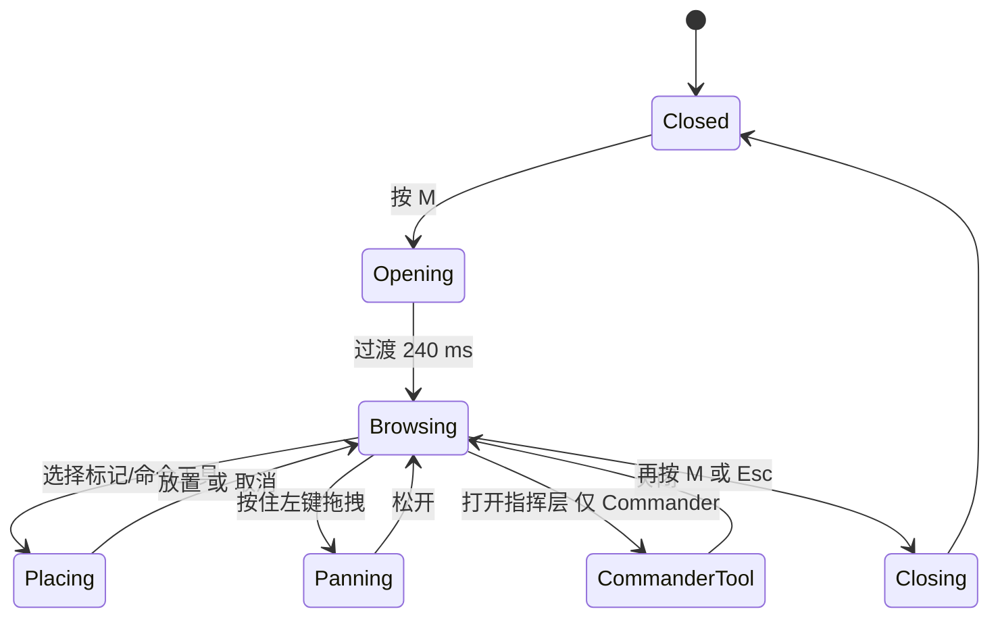

#### 4.7.7 键鼠交互

| 操作 | 输入 |
|---|---|
| 打开/关闭 | `M`（关闭也可 `Esc`；`Esc` 先关地图，再次才开暂停） |
| 平移 | 左键拖拽 / `W A S D` / 方向键 |
| 缩放 | 滚轮（以光标为中心）/ `+ -`；双击=放大到该点；`Home` 回全图 |
| 回到自己 | `Space` |
| 放置 Ping | 中键点击（等同世界内 ping）；`Q` 打开标记轮盘后点击位置 |
| 放置命令 | 选择命令（轮盘或右侧条）后左键点击 |
| 撤销标记 | 选中标记后 `Delete`；或右键标记→移除 |
| 测距 | 按住 `Shift` 拖拽显示 距离/方位（可用于火炮） |
| 图层切换 | 点击右侧栏；`1–9` 对应图层 |

注意：地图打开时鼠标解锁（退出 Pointer Lock）；关闭地图后需重新锁定——在 `Esc` 之外，用"按 M 关闭"属于用户手势，允许重新 `requestPointerLock`（见 §5.5）。

#### 4.7.8 空/加载/错误

- 底图未就绪：显示等高线占位（低分辨率）+ 进度。
- `TEAM` 数据过期：单位符号变为"外框虚线"，右上显示"态势数据 N 秒前"。
- 无权限操作（如非 Officer 点击命令）：工具灰置并 tooltip 说明所需角色。

**i18n 前缀：** `ui.map.*`（`ui.map.layer.*`、`ui.map.marker.*`、`ui.map.order.*`、`ui.map.grid.*`）

### 4.8 径向菜单与快捷指令

**用途：** 战斗中无需打开地图即可发出 ping、建造、语音短语。

**设计理由：** 采用**扇区式轮盘**，但扇区使用 Plotline 的"刻度尺弧"（外缘带刻度）与切角扇形；中心为"取消/当前选项说明"。轮盘按住键呼出（保持 Pointer Lock，鼠标移动用虚拟光标，不依赖真实指针；松键即确认）。

#### 4.8.1 轮盘定义

| 轮盘 | 呼出键 | 可用角色 | 扇区（8 或 6，顺时针自顶部） |
|---|---|---|---|
| Ping 轮盘 | 按住 `Mouse3`（中键）≥ 180 ms；短按=Attention | 所有 | 8 扇区，类型与权限以 GAMEDESIGN §16.4 为准：Attention / Enemy / Need Medic / Need Ammo / Need Engineer / Need AT / Need Supplies / Thanks（取消 = 松键于中心死区或 `Esc`）；持续时间与数量限制见 GAMEDESIGN §16.3 |
| 语音快捷短语轮盘 | 按住 `T` | 所有（语音关闭时仍可用文字短语） | Yes / No / Thanks / Need Help / Moving / Covering / Reloading / Sorry |
| 建造轮盘 | 按住 `Y`（需装备工具/可建造状态） | Engineer / Officer / Spotter / Commander / Support / Anti-Tank（按权限显示不同扇区） | 防御工事（Engineer）/ 补给箱（Support）/ 障碍（Engineer）/ AT 炮阵地（仅 Anti-Tank）/ Garrison*（仅 Officer、Spotter、Commander；**不是 Engineer**，R1）/ Outpost*（仅 Officer）/ 取消 |
| 指挥官快捷 | 按住 `K` | Commander | 打开指挥层 / 常用能力 1–4 / Rally / 取消 |

#### 4.8.2 信息元素

| 元素 | 数据来源 | 更新频率 | 交互 |
|---|---|---|---|
| 扇区图标+短标签 | i18n + 角色权限 | 呼出时 | 鼠标方向选择（死区 20%） |
| 禁用扇区（无权限/冷却/超上限）+ 原因 | `SNAP`/`EVT` | 呼出时 | 选择无效并发"错误"音 |
| 冷却/剩余数量 | `EVT` | 呼出时 | — |
| 中心说明 | LOCAL | 每帧 | 显示当前扇区名称与说明一行 |

#### 4.8.3 线框图

```
            Enemy
        ╱──────────────╲
Attention │              │ Need Medic
  (顶)    │   [  中心  ] │
Thanks    │   当前选项   │ Need Ammo
        ╲──────────────╱
   Need Supplies / Need AT / Need Engineer（其余扇区）
(8 扇区，扇区间 2 px 缝；外缘 0/5/10 刻度；屏幕中心偏上 8%)
```

#### 4.8.4 状态机

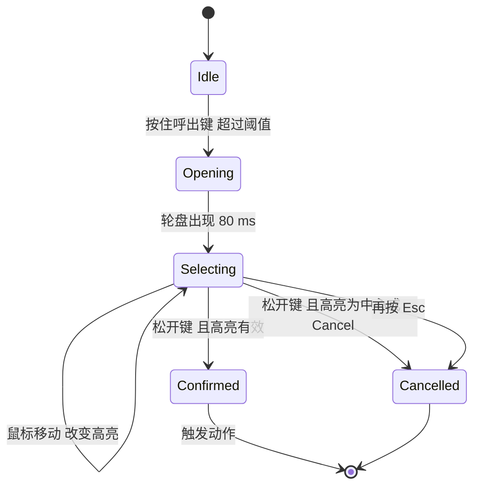

#### 4.8.5 交互与降级

- 呼出后游戏时间不暂停；摄像机视角锁定（鼠标改控轮盘光标），视角在松开后恢复，避免"转头失控"。可选设置：呼出时允许 30% 灵敏度的视角移动。
- 不支持滚轮选择；键盘替代：呼出后 `1–8` 直接选扇区。
- 空/错误：无可用扇区时轮盘不呼出，toast"当前无可用快捷指令"。
- 减少动态：无缩放动画，仅 `opacity`。

**i18n 前缀：** `ui.radial.*`

### 4.9 记分板（Tab）

**用途：** 查看双方玩家得分、状态与小队构成；管理员/举报入口。

**设计理由：** 左右对分，我方居左、敌方居右；按"小队"分组（符合队形组织），组内按兵种顺序。避免一张长表：用折叠组。Tab 按住显示、松开隐藏；按住时鼠标不解锁，如需点击举报则按 `Shift+Tab` 锁定面板（见 §4.9.4）。

#### 4.9.1 信息元素

| 元素 | 数据来源 | 更新频率 | 交互 |
|---|---|---|---|
| 对局头：地图/模式/剩余时间/战线进度/双方票数或进度 | `EVT` | 1 Hz | — |
| 玩家行：昵称、小队、兵种图标、击杀、阵亡、助攻/支援分、战斗分、防守分、进攻分、补给分、ping | `EVT`（队内完整；对方仅显示 昵称/兵种/击杀/阵亡/ping；对方信息按规则限制）【待测 → REFERENCE_MEASUREMENTS §scoreboard】 | 2 s | 点击昵称→打开玩家菜单（锁定态） |
| 小队分组头：名称、人数、总分、是否锁定 | `EVT` | 2 s | 折叠/展开 |
| 自己行高亮（`squad` 外环色条） | LOCAL | — | — |
| Bot 标识（小机器人图标） | `EVT` | — | 悬停提示"AI 控制" |
| 语音在说话指示 | `LK` | 4 Hz | — |
| 玩家菜单：静音/取消静音、举报、加好友、投票踢（若开启） | `RPC` | — | 见 §4.18 |
| 排序：按分数/击杀/名称/小队 | LOCAL | — | 点击表头 |
| 观战者/未部署玩家（折叠区） | `EVT` | 5 s | — |

#### 4.9.2 线框图

```
+-----------------------------------------------------------------------------------+
| Carentan · Frontline     剩余 42:10        战线 我方 3 : 2 敌方                    |
|-----------------------------------------------------------------------------------|
| 我方 (US) 38                                 | 敌方 (GER) 34                      |
| ▾ Able  步兵 5/6 总分 4120  🔒                | ▾ Squad 3 …                        |
|   ✚ Kurt    K 12  D 4  支援 220 战斗 480  38ms |   ▲ Hans   K 9  D 5               |
|   ▲ Max     K  8  D 6  …                      |   ...                              |
| ▸ Baker  装甲 ...                              | ▸ ...                              |
| ──── 无小队 ────                               |                                    |
|  …                                             |                                    |
| [Shift+Tab 锁定后可点击玩家]                                                        |
+-----------------------------------------------------------------------------------+
```

#### 4.9.3 状态机

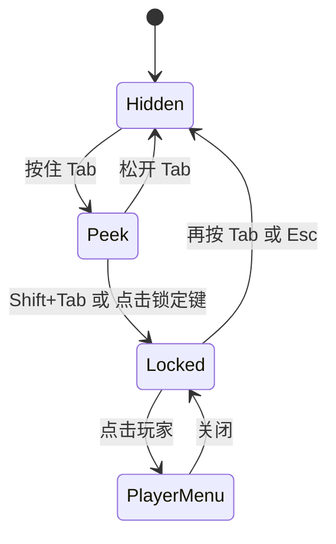

#### 4.9.4 交互、空/错误

- Peek 态不解锁指针；Locked 态解锁指针（需 `exitPointerLock`），关闭后"点击继续/按 M 或 Tab 返回"重新锁定。
- 数据延迟：显示"更新于 N s 前"小字；空对局（刚开）：显示"暂无数据"。
- 超过 100 行：虚拟滚动（只渲染可视行 ± 10）。

**i18n 前缀：** `ui.score.*`

### 4.10 倒地 / 阵亡界面

**用途：** 玩家被击倒（可被救起）或死亡后，提供等待医疗、放弃、重新部署的路径，并以克制方式告知击杀信息。

**设计理由：** 高致死率品类中，倒地等待是一个"社交时刻"（请求医疗、看着医疗兵靠近）。UI 重点不是惩罚，而是**让玩家知道还有希望、有多近、怎么放弃**。镜头在倒地时保持第一人称（降低、模糊）；阵亡后切到"死亡视角"（第三人称环绕击杀者可选）。信息屏占据下 1/3，避免遮挡世界。

#### 4.10.1 信息元素

| 元素 | 数据来源 | 更新频率 | 交互 |
|---|---|---|---|
| 状态标题（"被击倒 / 阵亡"） | `SNAP` | 事件 | — |
| 流血倒计时环（剩余秒数）+ 声音/视觉脉动 | `SNAP` | 10 Hz | — |
| 附近医疗兵（最近一名的距离、方向箭头、是否在途） | `TEAM`/`SNAP`（仅小队或近距 AOI） | 2 Hz | 点击无；按键"呼叫医疗" |
| 呼叫医疗（发出 Need Medic 标记+语音短语） | `RPC` | — | `F`/`Mouse3`；冷却 5 s【待调参】 |
| 放弃按钮（立即死亡并进入重新部署）— 倒地 5 s 后才可用（此前灰显并显示倒计时），按住 3 s（GAMEDESIGN §7.2） | `RPC` | — | 按住 `Space` 3 s 或点击后按住 3 s |
| 击杀者信息（击杀者昵称、武器、距离；是否显示由规则决定） | `EVT` | 事件 | — |
| 回放/死亡摄像机提示（可选） | LOCAL | — | `Space` 切换观察角度 |
| 重新部署入口（阵亡后）→ §4.5 | — | — | `Enter` |
| 友军观察视角（队友视角切换，倒地时不可，阵亡后可） | `SNAP` | — | `A/D` 切换队友 |

**击杀者信息显示规则（防止"鬼影/复仇"和作弊辅助）：**
1. 倒地阶段：**不显示击杀者昵称与位置**（避免传达敌人位置信息）；仅显示"来自 方向"的受击楔形（已有）。
2. 阵亡后立即显示击杀者昵称、武器、距离（M），但**不显示击杀者当前位置或标记**。
3. 若击杀者为 bot：显示"AI 控制"标记。
4. 若设置开启"隐藏击杀者昵称"（防主播狙击；§4.16 隐私项）：只显示武器与距离。
5. 友军误杀：显示"友军误伤"并提示惩罚规则（若有）。

#### 4.10.2 线框图

```
+-----------------------------------------------------------------------------------+
|                         （世界画面，降饱和 + 轻模糊 + 斜线纹边框）                 |
|                                                                                   |
|         ┌───────────────────────────────────────────────────────────┐            |
|         │  被击倒                                    ◔ 18 s         │            |
|         │  最近医疗兵  Kurt  42 m  ↗ 在途                           │            |
|         │  [ 呼叫医疗 (F) ]                    [ 放弃 (5 s 后按住 Space 3 s) ] │            |
|         └───────────────────────────────────────────────────────────┘            |
+-----------------------------------------------------------------------------------+
阵亡态：标题变为"阵亡"，下方一行：被 Hans 的 Kar98k 击杀 · 63 m；按钮 [重新部署 (Enter)]
```

#### 4.10.3 状态机

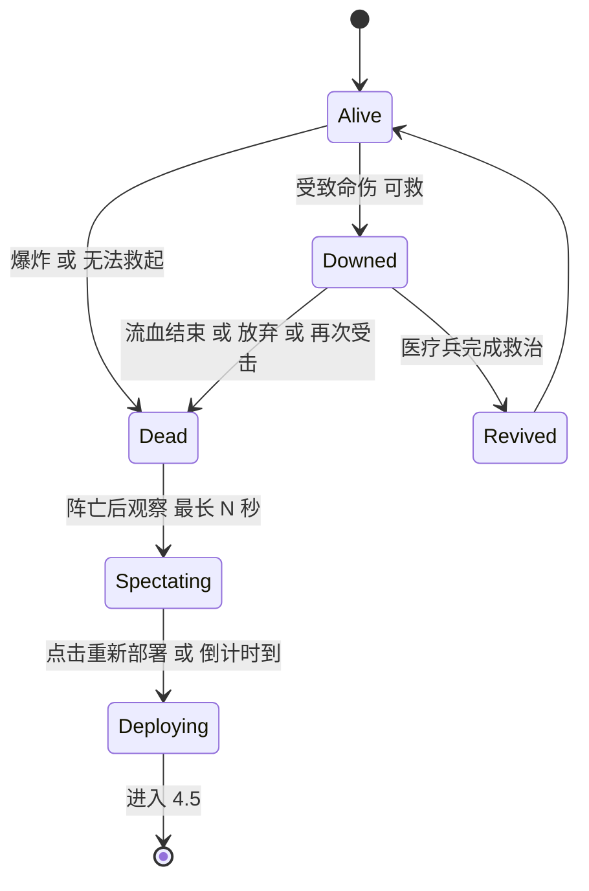

#### 4.10.4 交互、空/错误

- 无医疗兵：显示"附近没有医疗兵"，仍可呼叫（标记发给全队医疗兵）。
- 呼叫冷却中：按钮显示剩余秒数。
- 网络断线时的倒地：显示"重连中，状态可能不同步"，不允许放弃（避免误操作）。
- 屏幕效果遵守减少晃动（§7.4）：倒地时以静态斜线纹 + 低饱和代替抖动。

**i18n 前缀：** `ui.down.*`


### 4.11 指挥官界面

**用途：** Commander 管理资源（Manpower/Munitions/Fuel）、投放能力、调度载具、发布全队命令。

**设计理由：** 指挥官不"打仗"，而是"读图+点选"。因此界面是**地图的指挥层叠加**（§4.7 L-Cmd）而非独立屏：左侧一条资源与冷却的"账本条"，底部是能力"弹仓"（4–8 个能力槽），地图上直接放置目标。呼出键 `K`，期间玩家角色仍可被攻击，因此默认使用"半屏模式"（地图 70% 透明度背景，世界仍可见）并有"受击自动收起"选项。

#### 4.11.1 信息元素

| 元素 | 数据来源 | 更新频率 | 交互 |
|---|---|---|---|
| 资源账本：Manpower / Munitions / Fuel（当前值、每分钟增量、上限） | `EVT` | 1 Hz | 悬停显示明细（来源：据点收益） |
| 能力槽：Supply Drop、Ammo Drop、Bombing Run、Strafing Run、Precision Strike、Recon Flight、Rally、Airhead（图标、名称、消耗、冷却、可用次数） | `EVT`+`data` | 1 Hz | 点选→进入放置；`1–8` |
| 能力放置预览（落点半径、航向箭头、预警时间、友军误伤风险高亮） | LOCAL | 每帧 | 左键放置、右键/`Esc` 取消、滚轮/`Q E` 旋转航向 |
| 冷却环/资源不足提示 | `EVT` | 1 Hz | 不足时槽位灰置+缺口文字（如"缺 Fuel 20"） |
| 载具调度（可生产/待命列表：类型、消耗、产能队列、生成点选择） | `EVT` | 1 Hz | 选择类型→选重生点→确认 |
| 全队命令（Attack/Defend/Move/Observe 于据点/区域） | `EVT` | 事件 | 地图点击放置 |
| 战况简报：各战线推进、友军分布热度、敌情标记数量 | `TEAM` | 1 Hz | 点击跳转 |
| 指挥官语音/频道状态 | `LK` | 4 Hz | `N` 指挥频道 PTT |
| 禁用提示（无可用能力/被击倒/死亡） | `SNAP` | 事件 | — |

所有数值（消耗、冷却、次数）取自 `data/commander/*.json`，UI 不硬编码；初值【待调参】，校准来源【待测 → REFERENCE_MEASUREMENTS §commander】。

#### 4.11.2 线框图

```
+-----------------------------------------------------------------------------------+
| ┌ 账本 ──────┐                                                    [半屏 ◐] [关闭] |
| │ Manpower 120 +8/min │      （战术地图，70% 透明，叠加能力落点预览）              |
| │ Munitions 85 +5     │                                                            |
| │ Fuel 40 +3          │            ◎ Bombing Run 预览 (半径 60 m)  ⚠ 友军 3 人    |
| └─────────────┘                                                                     |
| ┌ 载具调度 ──┐                                                                      |
| │ Sherman ×1 (待命) │                                                              |
| │ Jeep   ×2 生产中 │                                                              |
| └─────────────┘                                                                     |
|-----------------------------------------------------------------------------------|
| [1 Supply] [2 Ammo] [3 Bombing 85s] [4 Strafing] [5 Precision] [6 Recon] [7 Rally] [8 Airhead] |
+-----------------------------------------------------------------------------------+
```

#### 4.11.3 状态机

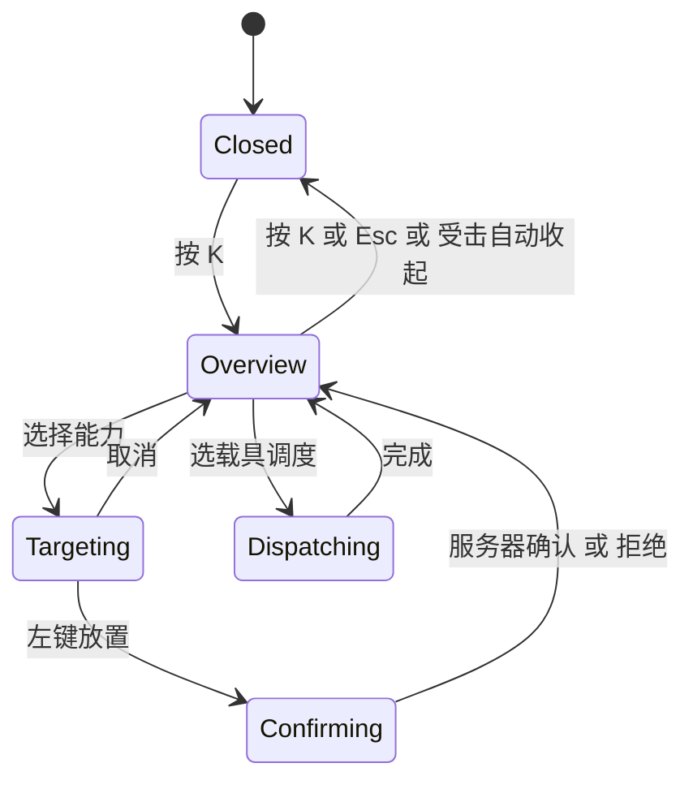

#### 4.11.4 空/错误

- 资源不足：槽位灰置并显示缺口；放置时被拒：显示原因（冷却/资源/落点无效/预警禁区）。
- 能力落点过近友军：预览出现 `warn` 误伤提示（不阻止，Commander 自负）。
- 指挥官断线：界面关闭，其他 Officer 可见"指挥官离线"提示。

**i18n 前缀：** `ui.cmdr.*`

### 4.12 小队长 / Officer 工具

**用途：** 放置 Outpost/Garrison、下达小队命令、管理小队（锁定、踢人、改名/类型）。**放置者规则（R1）**：Garrison 可由 Officer、Spotter、Commander 放置（Spotter/Commander 复用同一放置工具，仅无小队管理部分）；Outpost 仅 Officer；OP 仅 Spotter；**Engineer 不放置 Garrison**（只建资源节点与防御工事）。

**设计理由：** Officer 的核心动作是"在世界里点一下"。放置采用**虚影预览 + 合法性色编码**（类似建造，复用 §4.13 的预览组件）；命令走轮盘与地图；小队管理走 `U` 小面板（解锁态）。

#### 4.12.1 信息元素

| 元素 | 数据来源 | 更新频率 | 交互 |
|---|---|---|---|
| 当前小队面板（成员、状态、Officer 转交、锁定开关、类型） | `EVT` | 1 Hz | `U` 打开；点击成员→踢/提升/静音 |
| Outpost/Garrison 放置工具（虚影、合法性：距敌/距己方据点/与其他重生点最小间距/地形合法） | `SNAP`+`data` | 每帧 | 左键放置，右键取消 |
| 放置资源/冷却显示（Garrison 数量上限、Outpost 冷却；Garrison 的 Supplies 消耗：己方/中立区 50、敌方区 100【待调参】，并显示附近可用 Supplies 余量） | `EVT` | 1 Hz | — |
| 合法性文案（"离敌军过近 / 地面不平 / 附近已有重生点 / 超过数量上限 / 在禁建区"） | LOCAL | 每帧 | — |
| 命令轮盘入口 | — | — | 见 §4.8（Officer 的 Ping 轮盘多出 Order 扇区） |
| 命令历史与活动命令 | `EVT` | 事件 | 点击撤销 |
| 重生点健康（Garrison/Outpost 血量条）与被摧毁警报 | `EVT` | 事件 | — |

#### 4.12.2 线框图

```
世界视图（放置模式）
+-----------------------------------------------------------------------+
|                    ╔═══════╗  ← 虚影(蓝=合法 / warn 斜纹=不合法)       |
|                    ║ Out-  ║                                           |
|                    ║ post  ║   距最近敌军 92 m ✓   与其他重生点 40 m ✓ |
|                    ╚═══════╝   剩余次数 1/2     [左键放置] [右键取消]   |
+-----------------------------------------------------------------------+
```

#### 4.12.3 状态机

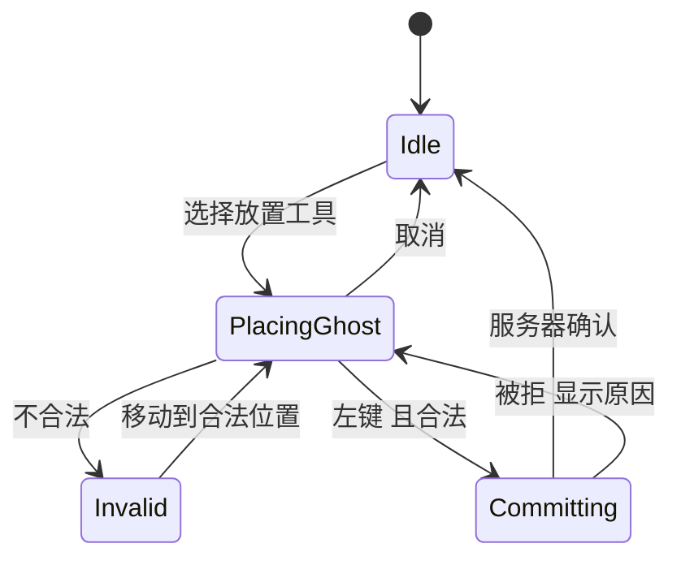

#### 4.12.4 空/错误

- 不满足条件（非 Officer、小队人数不足、阶段不允许）：工具不可选，tooltip 说明条件。
- 放置被拒：显示服务器原因 i18n key（`ui.officer.err.*`）。

**i18n 前缀：** `ui.officer.*`

### 4.13 建造界面（Engineer 等）

**用途：** 选择蓝图、放置、显示进度、合法性与资源消耗。

**设计理由：** 建造是持续过程：放置（虚影）→ 施工（进度环）→ 完成。UI 把"放置合法性"和"进度"放在目标物旁（世界内标签）而不是 HUD 角落，保证视线不离开工地；附近可用 **Supplies**（建造货币，补给箱承载）在底部居中显示；Supplies 与指挥官资源池 Manpower/Munitions/Fuel 是两套独立系统（R6），此处不得与 Munitions 混用。

#### 4.13.1 信息元素

| 元素 | 数据来源 | 更新频率 | 交互 |
|---|---|---|---|
| 建造轮盘（防御工事、补给箱、障碍、反坦克物…按兵种权限） | `data/build` | 呼出时 | `Y` 按住 |
| 蓝图虚影 + 合法性色（蓝=合法 / 斜纹+warn=不合法 / 灰=资源不足） | `SNAP`+LOCAL | 每帧 | 滚轮/`Q E` 旋转；左键放置 |
| 合法性原因文案 | LOCAL | 每帧 | — |
| 资源消耗与剩余（附近可用 Supplies / 来源补给箱与车载补给，R6） | `SNAP`/`EVT` | 事件 | — |
| 世界内进度环与剩余时间；参与施工人数（多人加速） | `EVT` | 4 Hz | 按住 `F`/左键施工 |
| 可拆除/升级提示 | `SNAP` | 事件 | 长按 `F` 拆除 |
| 完成/被摧毁事件播报 | `EVT` | 事件 | — |

#### 4.13.2 状态机

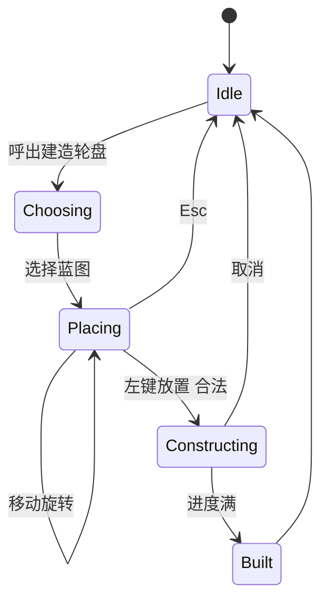

#### 4.13.3 线框图

```
        ╔══ 沙袋工事 ══╗   进度 ◔ 62%   2 人施工
        ║ 虚影/施工体  ║   剩余 8 s
        ╚═════════════╝
                   [按住 F 施工]        Supplies 40 / 100
```

#### 4.13.4 空/错误

- 附近 Supplies 不足：轮盘扇区灰置"需要补给"；靠近补给箱/资源点时提示。
- 不合法位置：虚影整体变斜纹，原因置于虚影上方一行。

**i18n 前缀：** `ui.build.*`

### 4.14 载具进入 / 换座 与 火炮操作

**用途：** 进入/退出载具、车内座位与武器切换、模块损伤与弹种显示；火炮的瞄准与装填。

**设计理由：** 载具是"多人岗位"，信息核心是"谁在哪个座位、我的武器还剩多少、车哪里坏了"。因此载具 HUD 用**座位竖列**（顶视车体示意）+**损伤示意（车体线稿，模块着色）**，而非自然拟真仪表盘（减少素材需求且信息更直）。

#### 4.14.1 信息元素（载具）

| 元素 | 数据来源 | 更新频率 | 交互 |
|---|---|---|---|
| 进入提示（"F 进入 驾驶位 / 按 1–5 选座位"），座位占用情况预览 | `SNAP`+`EVT` | 每帧检测 | `F` 进入最近空座；按住 `F` 弹出座位选择 |
| 座位列表（驾驶、车长/炮长、装填、机枪、乘员；占用者名字；空位） | `EVT` | 2 Hz | 车内 `1–5` 切换到空座；换座有 1–2 s 过渡【待调参】 |
| 车组频道状态（Crew voice 指示） | `LK` | 4 Hz | `N` 车组 PTT |
| 弹种与弹量（AP/HE/Smoke…；主炮、同轴机枪、车体机枪） | `SNAP` | 事件 | `R` 切换弹种（按载具规则） |
| 装填进度环（主炮） | `SNAP` | 30 Hz | — |
| 模块损伤示意图（履带 L/R、发动机、炮塔转向、炮管、弹药架、乘员）：正常/受损/失效，`warn`/`danger` + 形状角标 | `SNAP` | 事件 | — |
| 载具耐久（分段，不显示精确数值） | `SNAP` | 事件 | — |
| 速度/档位/发动机状态/燃油（或 "Fuel" 资源占位） | `SNAP` | 10 Hz | — |
| 视角（第一人称观瞄/第三人称）与观瞄倍率 | LOCAL | — | `C` 切视角，右键观瞄 |
| 友方载具信息（接近时显示，车组名单） | `TEAM` | 1 Hz | — |
| 离车/被击毁提示（"弃车"倒计时、乘员弹出） | `SNAP`/`EVT` | 事件 | 长按 `F` 离车 |
| 维修提示（Engineer 靠近显示可修模块） | `SNAP` | 事件 | 长按 `F` 修理 |

#### 4.14.2 线框图（坦克炮长/车长）

```
+-----------------------------------------------------------------------------------+
| 座位 ┌──────┐                                                  AP  HE  SM        |
| 1 驾驶 Hans  │ 车体示意    中 = 观瞄十字(含测距刻度)           [2] 8 / 12         |
| 2 车长 你 ◂ │ ▫履带L ✕ ▫炮塔 ▫发动机 ⚠                          装填 ◔ 3.2 s        |
| 3 炮长 —     │                                                  同轴 MG  180      |
| 4 装填 Kurt  │                                                                     |
| └──────┘                                                     速度 18 km/h  档 3  |
+-----------------------------------------------------------------------------------+
```

#### 4.14.3 状态机（载具）

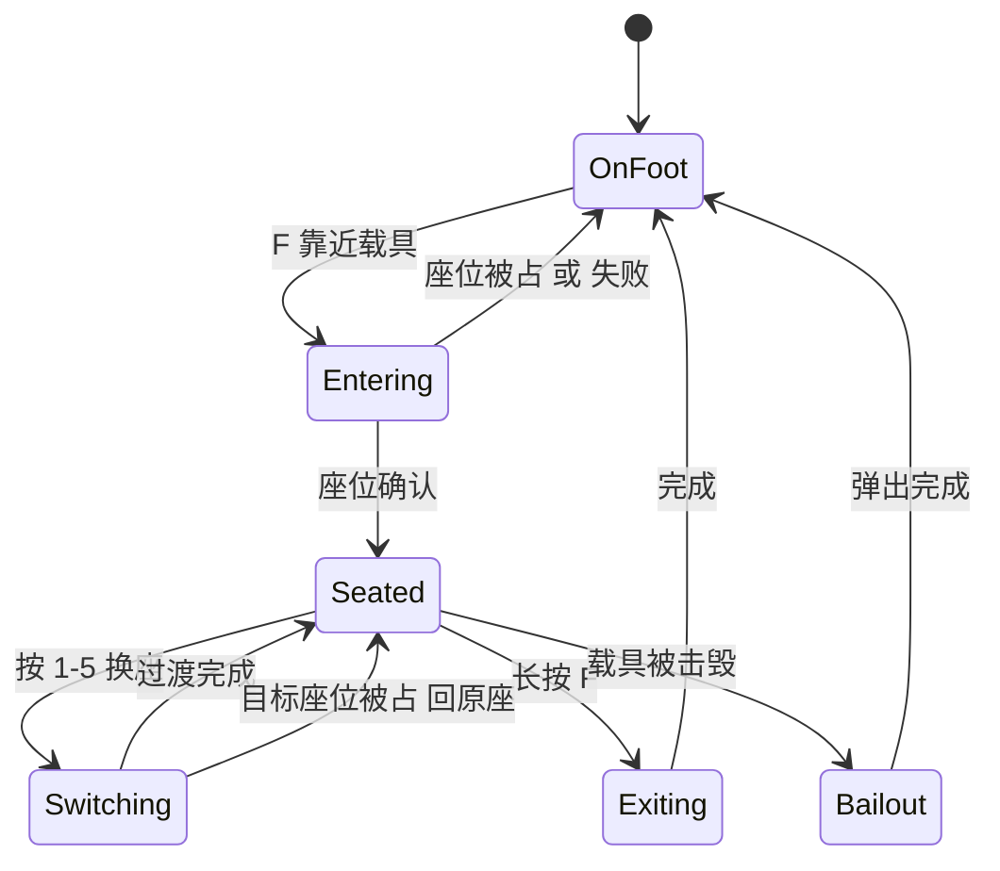

#### 4.14.4 火炮操作界面

**用途：** 炮兵（Support/Officer 配属的火炮）按观察手的目标校准，装填并发射。榴弹炮是 HQ 附近地图预设阵地上的固定火炮（开局即存在，玩家进入操作；**无建造流程，建造轮盘/建造菜单中没有榴弹炮**，R7）；反坦克炮由 Anti-Tank 兵种通过建造轮盘放置。

| 元素 | 数据来源 | 更新频率 | 交互 |
|---|---|---|---|
| 方位角/仰角刻度（制图刻度风格：双刻度尺）与目标值 | `SNAP` | 10 Hz | 鼠标微调；`Shift` 精调 |
| 射程圈与目标距离、预计飞行时间 | LOCAL | 每帧 | — |
| 观察手目标（Artillery Target，网格坐标）与"采用"按钮 | `EVT` | 事件 | 点击采用→自动对准 |
| 装填进度（循环时间）、弹药余量（火炮无过热机制，GAMEDESIGN §15.3） | `SNAP` | 10 Hz | `R` 装填，左键开火 |
| 修正量（偏左/右/远/近，由观察手发送） | `EVT` | 事件 | 自动应用/手动 |
| 友军危险区预警（目标附近友军数） | `TEAM` | 1 Hz | 显示 `warn` |

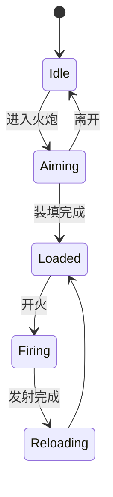

**空/错误：** 无目标：提示"等待观察手目标"；目标超射程：`warn` + 箭头指示；友军进入危险区：发射键二次确认。

**i18n 前缀：** `ui.veh.*`（含 `ui.veh.arty.*`）

### 4.15 文字聊天与语音状态

**用途：** 文字消息、频道切换、语音（PTT）状态与设备异常提示。

#### 4.15.1 频道定义

| 频道 | 谁可听/看 | 默认 PTT | 颜色/形（Plotline） |
|---|---|---|---|
| Proximity（近距） | ≤ 50 m 的所有人（含敌方，空间化） | `B` | 空心圆 `neutral` |
| Squad（小队） | 本小队 | `V` | 实心圆 + `squad` |
| Command（指挥） | Commander + Officer + Spotter（侦察组长）+ Tank Commander（GAMEDESIGN §16.1） | `N` | 六边形 + `cmd` |
| Crew（车组，车内自动） | 同车乘员 | `N`（车内优先） | 方形 + `friend` |
| Team（文字） | 全队 | — | — |
| All（文字，可选） | 全服 | — | 默认关闭（避免敌我辱骂/泄露）【待调参】 |

#### 4.15.2 信息元素

| 元素 | 数据来源 | 更新频率 | 交互 |
|---|---|---|---|
| 聊天窗口（最近 N 条，渐隐；展开显示 100 条） | `EVT` | 事件 | `Enter` 打开输入；`Tab`（输入态内）循环频道；`Esc` 关闭 |
| 频道标签（颜色+形+文字缩写） | LOCAL | — | 点击切换（解锁态） |
| 消息条（发送者、阵营关系色、小队名、时间） | `EVT` | 事件 | 点击昵称→静音/举报（解锁态） |
| 自己 PTT 指示（频道图标 + "发送中"，输入电平条） | `LK` | 10 Hz | — |
| 说话者列表（谁在说话，对应频道） | `LK` | 10 Hz | — |
| 设备状态（无麦克风/权限被拒/设备断开/服务器连接失败） | LOCAL/`LK` | 事件 | 按钮→打开语音设置 |
| 静音/屏蔽名单管理 | LOCAL | — | 在记分板玩家菜单或设置 |
| 文字过滤（粗俗词过滤开关）与速率限制提示（"发送过快"） | `EVT` | 事件 | — |
| 系统消息（据点、事件，可过滤） | `EVT` | 事件 | 过滤开关 |

#### 4.15.3 线框图

```
聊天（左下，战斗态淡出）                         PTT 指示（准星下方右侧）
┌────────────────────────────────────┐          ● [小队] 发送中 ▂▄▆
│ [小队] Kurt: 医疗兵就位 C4-7        │
│ [指挥] Cmdr: 进攻 B 点              │          说话者（右上）
│ [系统] 据点 B 被我方占领            │          ▸ Able-2 (小队)  ▸ Max (近距)
└────────────────────────────────────┘
输入: [小队 ▾] ________________________ [Enter 发送]
```

#### 4.15.4 状态机

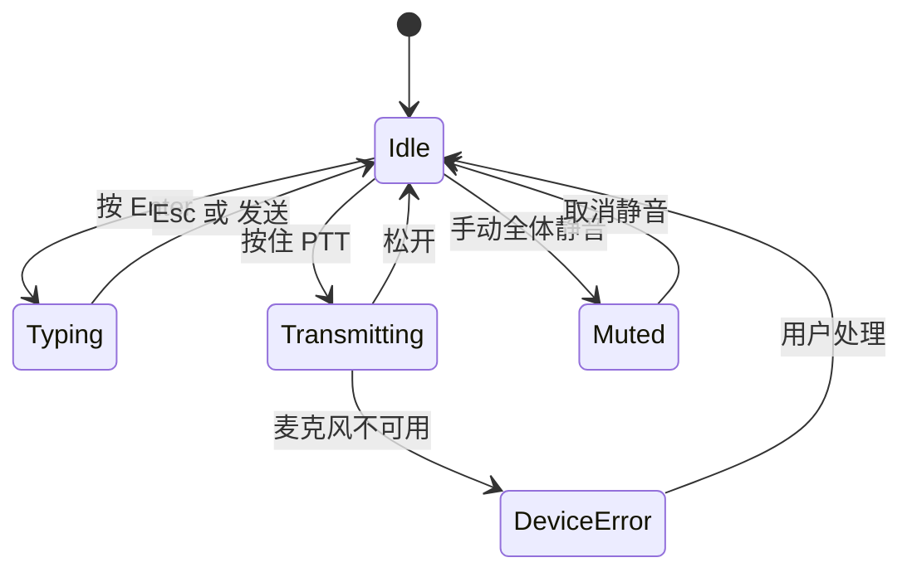

#### 4.15.5 交互、空/错误

- 打开输入时：暂停游戏键位（WASD 不再移动），失焦自动关闭，发送成功后 Pointer Lock 保持（`Enter` 已是用户手势）。
- 麦克风权限：首次使用 PTT 时请求（需用户手势），拒绝则显示"麦克风被禁用"并降级为只听；语音默认**不开启自动检测**，只有 PTT（减少噪声与隐私问题）。
- 语音连接失败：状态点变红（+ 叉形）并 toast；重试按钮。
- 文本安全：所有玩家文本在 DOM 中用文本节点渲染，禁止 `innerHTML`（防 XSS）。

**i18n 前缀：** `ui.chat.*`、`ui.voice.*`

### 4.16 设置

**用途：** 画质、音频、控制、语音、辅助功能、语言。所有变更即时预览（画质需"应用/还原 10 s"防止误选无法恢复）。

**设计理由：** 左侧分类栏 + 右侧表单；每项含"默认值/还原"小按钮；顶部搜索框（设置项多）。键位页采用"动作-主键-副键"三列表，冲突实时提示。

#### 4.16.1 分类与项

| 分类 | 项 | 说明 |
|---|---|---|
| 画质 | **预设：Low / Medium / High / Ultra**；渲染分辨率（内部渲染比例 50–100%）；超分（TAAU/空间放大/关）；帧率上限（30/60/120/无）；垂直同步；视野 FOV（60–100°，默认 80°）【待调参】 | 与总纲四档对应；预设显示预计显存占用 |
| 画质细项 | 阴影质量（级联数/分辨率）、植被密度/距离、体积雾（WebGPU：froxel / WebGL2：高度雾）、反走样（TAA/FXAA/关）、SSAO/GTAO（关/低/高）、屏幕空间反射（仅 Ultra）、纹理分辨率（受流式内存预算）、后处理（运动模糊 关/低、景深、胶片颗粒）、地表细节、特效质量、粒子数 | 修改后预设变"自定义"；不可用项显示原因（"WebGL2 不支持"） |
| 音频 | 主音量、音效、语音、UI、音乐；远近声层平衡；耳机模式（HRTF 空间化）；动态范围（夜间/标准/完整）；静音失焦；字幕开关 | — |
| 控制 | 鼠标灵敏度（水平/垂直、ADS 倍率分别）、反转 Y、鼠标加速关闭（`unadjustedMovement`，若浏览器支持，未核实）；按键重绑定（§5）；蹲伏/冲刺/探身/ADS 的"按住/切换"；双击规则；滚轮行为 | 键位冲突实时提示 |
| 语音 | 输入设备选择、输出设备、麦克风测试（电平条）、输入增益、噪声抑制/回声消除（浏览器内置）开关、PTT 键绑定（3 个）、语音激活（实验）、近距语音开关、频道音量、屏蔽名单 | 设备列表来自 `enumerateDevices`（需权限，未核实各浏览器策略） |
| 界面 | HUD 元素显隐、各元素不透明度、UI 缩放（75–200%）、安全区边距、准星样式/颜色、小地图、击杀播报行数、聊天字号 | 实时预览 |
| 辅助功能 | 见 §7（色盲模式、字幕、字号、减少晃动、高对比、按住/切换、闪光限制） | — |
| 语言 | English / 简体中文（运行时切换，无需重载）；语音/文本用语言偏好 | 字体分片按需加载 |
| 隐私 | 隐藏击杀者昵称（主播模式）、屏蔽陌生人邀请、允许收集诊断信息 | — |
| 网络/诊断 | 区域偏好、显示 ping/丢包/帧率、复制诊断包、清除缓存 | — |

#### 4.16.2 线框图

```
+-----------------------------------------------------------------------------------+
| 设置                                                   [搜索设置…]    [恢复默认]  |
|--------------|-----------------------------------------------------------------|
| 画质         | 画质预设  ( Low ) ( Medium ) (●High ) ( Ultra ) ( 自定义 )       |
| 音频         | 预计显存 3.6 / 4.0 GB   预计帧率(参考) 60 fps @1080p                    |
| 控制         | ─────────────────────────────────────────────────                        |
| 语音         | 渲染比例         [───────●──] 100%        超分  [ TAAU ▾ ]              |
| 界面         | 阴影质量         [ 高 ▾ ]                  体积雾 [ 开 ▾ ]              |
| 辅助功能     | ...                                                                      |
| 语言         |                                       [应用]  [还原]  (10 s 内无操作自动还原) |
+-----------------------------------------------------------------------------------+
```

#### 4.16.3 状态机

```mermaid
stateDiagram-v2
    [*] --> Viewing
    Viewing --> Editing: 修改任一项
    Editing --> Previewing: 画质类变更需确认
    Previewing --> Applied: 点击应用
    Previewing --> Reverted: 10 s 超时 或 还原
    Applied --> Viewing
    Reverted --> Viewing
    Editing --> Rebinding: 点击键位
    Rebinding --> Editing: 按键确认 或 Esc 取消
    Editing --> Viewing: 立即生效项(如音量)
```

#### 4.16.4 空/错误

- 不可用选项（硬件/后端不支持）：灰置 + 原因文案，不隐藏（让玩家知道存在）。
- 设置同步失败（登录用户）：toast，本地仍生效。
- 本地存储不可用：设置仅会话内有效并提示（包装 try/catch）。

**i18n 前缀：** `ui.settings.*`（`ui.settings.gfx.*`、`ui.settings.audio.*`、`ui.settings.controls.*`、`ui.settings.voice.*`、`ui.settings.a11y.*`、`ui.settings.lang.*`）

### 4.17 结算界面

**用途：** 对局结束后显示胜负、个人表现、全队战果，并引导"下一局/返回"。

**设计理由：** 先给结论（大字胜负+一句原因），再给个人，再给全队，最后给动作；避免第一屏信息过载。进度（若有）按基础战绩，不做付费/库存。

#### 4.17.1 信息元素

| 元素 | 数据来源 | 更新频率 | 交互 |
|---|---|---|---|
| 胜负标题（胜利/失败/平局）+ 原因（"夺取全部据点/时间到按战线"） | `EVT` | 一次 | — |
| 战线终态图（5 条战线或 Assault 段位示意） | `EVT` | 一次 | — |
| 个人统计：击杀、阵亡、助攻、战斗/进攻/防守/支援分、治疗/救起数、建造数、补给数、命中率（可选）、最远击杀 | `EVT` | 一次 | 展开详情 |
| 小队贡献（本小队总分、MVP 标记） | `EVT` | 一次 | — |
| 全队排行榜（Top 5 各类别：击杀/支援/建造/治疗） | `EVT` | 一次 | — |
| 本局时间线（据点易主时间线，Canvas 小图） | `EVT` | 一次 | 悬停看时间 |
| 地图投票/下一局（若服务器轮换）：下一张地图+倒计时 | `EVT` | 1 Hz | 投票 |
| 操作：同服下一局 / 返回服务器浏览器 / 主菜单 / 举报玩家 | — | — | 按钮 |
| 反馈（好评/差评快速问卷，可选） | `RPC` | — | 可关闭 |

#### 4.17.2 线框图

```
+-----------------------------------------------------------------------------------+
|                      胜 利  VICTORY            夺取全部据点                        |
|  战线 ■■■■■ 5:0           持续 41:12                                              |
|-----------------------------------------------------------------------------------|
|  你的表现                  | 全队榜                           | 本局时间线      |
|  击杀 14  阵亡 5  助攻 7   | 击杀  Kurt 22 / Max 19 …        | ─●──●───●──     |
|  战斗 520 支援 310 ...     | 治疗  Lena 38 …                  |                 |
|-----------------------------------------------------------------------------------|
|  下一局: Omaha Beach (Assault) 00:28  [投票]      [同服下一局] [返回浏览器] [主菜单] |
+-----------------------------------------------------------------------------------+
```

#### 4.17.3 状态机

```mermaid
stateDiagram-v2
    [*] --> Summary
    Summary --> Detail: 展开个人详情
    Detail --> Summary: 收起
    Summary --> Voting: 下一局投票开启
    Voting --> Summary: 结束
    Summary --> Leaving: 返回/下一局
    Leaving --> [*]
```

#### 4.17.4 空/错误

- 数据延迟：先显示胜负与已有数据，其余骨架；超时 10 s 显示"统计暂不可用"但仍可离开。
- 匿名游客：提示"登录以保存战绩"（可关闭，不阻断）。
- 断线重连落在结算：直接显示结算。

**i18n 前缀：** `ui.result.*`

### 4.18 暂停 / ESC 菜单、换队/换兵种、举报与投票

**用途：** Esc 打开的游戏内菜单（**不暂停多人对局**，只解锁指针并叠加面板）；换队/换兵种、举报、发起/参与投票、离开。

**设计理由：** 浏览器中 Esc 会强制退出 Pointer Lock，因此 Esc 菜单必然与"解锁指针"耦合；把它设计为"战术间歇面板"，并明示"游戏仍在进行"。

#### 4.18.1 信息元素

| 元素 | 数据来源 | 更新频率 | 交互 |
|---|---|---|---|
| 继续（重新锁定指针） | — | — | 点击/`Esc`/`Enter` |
| 部署界面（重新部署：自杀并重新选择，需确认） | `RPC` | — | → §4.5 |
| 换兵种 | `RPC` | — | 打开 §4.5 兵种页（需死亡/在 HQ 才生效；规则见 GAMEDESIGN） |
| 换队（受冷却/平衡规则限制） | `RPC` | 1 Hz | → §4.4；显示冷却 |
| 小队管理入口（`U`） | — | — | 打开面板 |
| 设置 | — | — | → §4.16 |
| 举报玩家（列表选择+原因：作弊/辱骂/捣乱/AFK/其他；可附上近 N 秒上下文） | `RPC` | — | 提交后 toast；防刷限频 |
| 投票（踢人/换图/跳过等：发起、进行中的投票、赞成/反对计票与倒计时） | `EVT`/`RPC` | 1 Hz | `F1`=赞成 `F2`=反对（仅在投票横幅可见时；或点击） |
| 离开对局（二次确认） | — | — | → 服务器浏览器 |
| 版本/服务器信息/ping | LOCAL | 1 Hz | — |

#### 4.18.2 线框图

```
+-----------------------------------------------------------------------------------+
|  （世界继续，已降低对比 30%，战斗中仍可能被攻击）                                    |
|            ┌──────────────────────────────┐                                       |
|            │  对局进行中 — 你的角色仍在战场  │                                       |
|            │  ▶ 继续                       │                                       |
|            │    重新部署 / 换兵种           │                                       |
|            │    换队 (冷却 00:45)          │                                       |
|            │    设置                        │                                       |
|            │    举报玩家 / 发起投票         │                                       |
|            │    离开对局                    │                                       |
|            └──────────────────────────────┘                                       |
+-----------------------------------------------------------------------------------+
```

#### 4.18.3 状态机

```mermaid
stateDiagram-v2
    [*] --> Closed
    Closed --> Open: Esc
    Open --> Closed: 继续
    Open --> Report: 举报
    Report --> Open: 提交或取消
    Open --> Vote: 投票
    Vote --> Open: 提交或取消
    Open --> ConfirmLeave: 离开对局
    ConfirmLeave --> Open: 取消
    ConfirmLeave --> [*]: 确认
```

#### 4.18.4 空/错误

- 举报无合适对象：显示"最近 5 分钟交互过的玩家"；提交失败：保留表单。
- 投票被限频：显示冷却；非投票资格（新进玩家/游客）：禁用并说明。
- 若对局已结束，Esc 菜单只保留"离开"。

**i18n 前缀：** `ui.pause.*`、`ui.report.*`、`ui.vote.*`

### 4.19 系统提示（toast、事件横幅、教程提示）

**用途：** 统一非阻断通知通道，避免各屏自建提示。

#### 4.19.1 类型与规则

| 类型 | 位置 | 持续 | 优先级 | 例 |
|---|---|---|---|---|
| Toast（信息/成功/警告/错误） | 右上，堆叠 ≤ 3 | 3–6 s（错误 8 s，可手动关） | 低/中 | "设置已保存"、"连接不稳" |
| 对局事件横幅（大） | 上部中，指南针下方 | 3 s | 高 | "据点 B 被占领"、"敌方 Garrison 被摧毁"、"指挥官能力：Bombing Run 来袭 30 s" |
| 命令通知 | 屏幕侧边 + 指南针 | 命令存续期（强提示 5 s） | 高 | "Officer 命令：进攻 C4-7" |
| 教程提示（新手） | 底部中，靠近相关元素 | 满足条件前或 8 s | 中 | "按 F 与载具互动" |
| 阻断对话框（错误/确认） | 屏幕中 | 直到处理 | 最高 | 断线、被踢 |

规则：
1. 同一时刻最多 1 个横幅、3 个 toast；超出排队，高优先级可插队。
2. 相同内容 3 s 内合并为 "×N"。
3. 每个提示必有 `severity` 与形符号（信息=圆 i、成功=勾、警告=三角、错误=八边形）。
4. 教程提示每条仅触发一次（记录在 `localStorage`，失败则按会话计）；可在设置中全部关闭，可"重置教程"。
5. 所有提示可由读屏 `aria-live="polite"`（错误用 `assertive`）播报。

#### 4.19.2 数据结构草案

```ts
// 草案，非实现
interface Notice {
  id: string;
  kind: 'toast' | 'banner' | 'order' | 'tutorial' | 'dialog';
  severity: 'info' | 'ok' | 'warn' | 'error';
  i18nKey: string;           // ui.toast.* / ui.banner.* / ui.tutorial.*
  params?: Record<string, string | number>;
  ttlMs?: number;            // 缺省按 kind 取值
  dedupeKey?: string;
  sound?: SoundId;
}
```

#### 4.19.3 状态机

```mermaid
stateDiagram-v2
    [*] --> Queued
    Queued --> Visible: 有空位 或 高优先级插队
    Visible --> Merged: 相同内容合并
    Merged --> Visible
    Visible --> Dismissed: 超时 或 手动关闭
    Dismissed --> [*]
```

**i18n 前缀：** `ui.toast.*`、`ui.banner.*`、`ui.tutorial.*`、`ui.dialog.*`


---

## 5. 默认热键表

### 5.1 设计原则

1. 以左手 WASD 为中心，常用键在 `Shift/C/Z/Q/E/F/R/V/B/N` 范围内可达。
2. **不使用 `Ctrl`、`Alt`、`Win/Cmd`、`F5`/`F11`/`F12` 作为战斗核心键**（与浏览器/操作系统冲突，见 §5.5）。
3. 所有动作可重绑定；"按住/切换"成对提供。
4. 同一键在不同"上下文"可有不同功能（步行/载具/菜单），上下文之间不得冲突（§5.3）。

### 5.2 默认键位

| 分类 | 动作 | 默认键 | 备注 |
|---|---|---|---|
| 移动 | 前/左/后/右 | `W` `A` `S` `D` | |
| 移动 | 冲刺 | `Left Shift`（按住） | 可改为切换 |
| 移动 | 跳跃/翻越 | `Space` | |
| 姿态 | 蹲伏 | `C`（按住/切换可选） | **不使用 Ctrl**（`Ctrl+W` 等无法拦截） |
| 姿态 | 卧倒 | `Z`（切换） | 双击 `C` 亦可（可选） |
| 探身 | 左探/右探 | `Q` / `E` | 按住 |
| 交互 | 交互/拾取/修理/上下车 | `F`（长按触发长动作） | |
| 武器 | 主武器/副武器/投掷物/装备A/装备B | `1` `2` `3` `4` `5` | 4/5 随兵种而异（望远镜/医疗包/弹药箱/锤等） |
| 武器 | 上/下一把 | 滚轮 | 可改为"调整瞄准距离"（机枪/载具） |
| 武器 | 开火 | 鼠标左键 | |
| 武器 | 瞄准 ADS | 鼠标右键（按住/切换可选） | |
| 武器 | 换弹 | `R` | 载具内=切换弹种 |
| 武器 | 射击模式 | `X` | Semi/Auto/Burst，机枪=架设 |
| 武器 | 快速投掷 | `G` | 按住瞄准，松开投出 |
| 武器 | 近战 | `H` | |
| 地图 | 战术地图 | `M` | |
| 界面 | 记分板 | `Tab`（按住） | `Shift+Tab` 锁定 |
| 界面 | 小队面板 | `U` | |
| 界面 | 指挥官面板 | `K` | 仅 Commander |
| 语音 | 小队 PTT | `V`（按住） | |
| 语音 | 近距 PTT | `B`（按住） | |
| 语音 | 指挥/车组 PTT | `N`（按住） | 车内自动为车组 |
| 文字 | 打开聊天 | `Enter` | 输入态内 `Tab` 切换频道 |
| 标记 | Ping | 鼠标中键（短按）；按住=Ping 轮盘 | |
| 轮盘 | 语音短语轮盘 | `T`（按住） | |
| 轮盘 | 建造轮盘 | `Y`（按住） | |
| 载具 | 切换座位 1–5 | `1`–`5`（车内） | 与武器槽共用数字键，上下文区分 |
| 载具 | 视角切换 | `C`（车内） | |
| 载具 | 离车 | `F`（长按） | |
| 通用 | 暂停菜单 | `Esc` | 浏览器强制保留 |
| 通用 | 投票赞成/反对 | `F1` / `F2` | 仅投票横幅可见时生效 |
| 通用 | 截图 | 浏览器/系统默认 | 不拦截 |

### 5.3 上下文与冲突规则

- **上下文集合：** `OnFoot`、`InVehicle`、`Gunner`（火炮/炮塔）、`Downed`、`Map`、`Menu`、`Chat`。同一上下文内不允许两个动作绑定同一键；跨上下文可复用，但"全局动作"（Esc、Tab、M、Enter 聊天）不得被局部上下文覆盖。
- **重绑定冲突：** 设置页实时检测。同上下文冲突 → 红框（`danger`+⚠形）并提示"与 X 冲突"，提供"互换/解除对方/取消"三选项。
- **保留键（不可绑定）：** `Esc`、`F11`、`F12`、`Left/Right Win/Meta`、`Print Screen`、`Ctrl+W/T/N/Q/Tab`（及其 Cmd 版）。绑定界面直接拒绝并说明原因。
- **允许绑定：** 字母、数字、小键盘、`Shift`（独立修饰键）、`Space`、`Enter`、`Tab`（有限）、方向键、鼠标 1–5 键、滚轮上下、`CapsLock`。
- **组合键：** 仅允许 `Shift+x`（部分动作），不允许 `Ctrl+x`/`Alt+x`。
- **键盘布局：** 用 `KeyboardEvent.code`（物理位置）而不是 `key`，保证 AZERTY/QWERTZ 下 WASD 位置不变；界面显示时用 `navigator.keyboard.getLayoutMap()`（Chromium，未核实其他浏览器）取本地化键帽字符，不可用则显示 `code` 名称。

### 5.4 可重绑定范围

- 全部游戏动作（§5.2 全部行）可重绑定，**除** `Esc`、投票键 `F1/F2`（可改但仅限 F 键区）。
- 每个动作支持 **主键 + 副键**；鼠标键与键盘键均可。
- 提供"重置此项/重置全部"与 3 个键位方案槽（本地存储）；可导出/导入 JSON（`ui.settings.controls.export`）。
- 灵敏度与"按住/切换"选项独立于键位。

### 5.5 浏览器限制与规避方案

| 限制 | 现象 | 规避/设计应对 |
|---|---|---|
| **Pointer Lock 需用户手势** | 必须在点击/按键等手势中 `requestPointerLock()`；刚被 `Esc` 退出后立即重锁可能被拒（Chromium 有短暂冷却，具体时长未核实） | 所有"返回战斗"路径都落在用户手势上；若请求失败显示"点击继续"全屏遮罩；不设自动重锁 |
| **`Esc` 退出 Pointer Lock，且不可 `preventDefault`** | 玩家按 `Esc` 会被浏览器先解锁 | 把 `Esc` 设计为"暂停菜单"（§4.18）；`pointerlockchange` 事件触发打开菜单，而不是报错；地图/记分板的关闭用 `M`/`Tab` 自己的键 |
| **Keyboard Lock API** | `navigator.keyboard.lock([...])` 在全屏下可让页面接收通常被系统/浏览器保留的按键，并可用"长按 Esc"退出全屏；仅 Chromium 系，行为未核实 | 提供"进入全屏并锁定键盘"设置项（默认关闭，首次进入游戏时一次性提示）；锁定码列表仅包含游戏需要的键（`Escape`, `KeyW`, …），**不依赖它来保证核心操作** |
| **`Ctrl+W` / `Ctrl+T` / `Ctrl+N` / `Ctrl+Tab` / `Alt+F4` / `Alt+Tab`** | 页面无法拦截（关闭标签/退出）；`Ctrl+W` 可能在对局中误关页面 | 默认键位**完全不用 Ctrl/Alt**；`beforeunload` 对话框（仅对局中）降低误关风险；蹲伏默认 `C` |
| **`F5` / `Ctrl+R`** | 会刷新页面 | 对局中 `preventDefault` + `beforeunload` 提示；服务器浏览器内 F5 仅刷新列表 |
| **`F11`** | 浏览器全屏 | 提供游戏内全屏按钮（`requestFullscreen()` 用户手势） |
| **`Tab` 切换焦点** | 默认移动浏览器焦点 | 对局内全局 `preventDefault`；菜单内保留 Tab 焦点循环 |
| **右键菜单** | 默认弹出 | 对局内 `contextmenu` `preventDefault` |
| **鼠标侧键（后退/前进）** | 浏览器后退 | 绑定时 `preventDefault` 并拦截 `auxclick` 导航；仍可能因浏览器而异（未核实） |
| **滚轮缩放（`Ctrl+滚轮`）** | 页面缩放 | 不使用 Ctrl；若检测到页面缩放 ≠ 100% 显示 `warn`（影响 UI 缩放计算） |
| **失焦/切标签** | 键位"粘住" | `blur`/`visibilitychange` 时清空所有按键状态并打开暂停菜单 |
| **未调整的鼠标移动** | 系统鼠标加速影响瞄准 | 使用 `requestPointerLock({ unadjustedMovement: true })`（Chromium，未核实）；不可用则提示 |

---

## 6. 响应式与缩放规则、安全区、超宽屏

### 6.1 基准与缩放

- **设计基准：1920×1080**。`--pl-ui-scale = clamp(0.667, min(vw/1920, vh/1080), 2.0) × userScale`（`userScale` 来自设置 75%–200%）。HUD 与菜单整体按此缩放，不做逐元素重排（避免 1280×720 下的 reflow 差异）。
- 最小支持窗口 1280×720：在此尺寸 `--pl-ui-scale ≈ 0.667`；`--pl-fs-xs`（12 px）实际 8 px 过小 → **字号下限规则**：计算后字号 `< 11 px`（中文 `< 12 px`）时按下限夹紧，并相应使元素间距允许 reflow（HUD 元素允许变为"紧凑变体"）。
- devicePixelRatio：DOM 以 CSS 像素布局；Canvas（地图）用 `devicePixelRatio` 缩放，上限 2×（防止 4K 屏重绘预算爆炸）。
- 页面缩放（浏览器 Ctrl+±）：检测 `devicePixelRatio` 与 `visualViewport.scale` 异常并提示，不尝试补偿。

### 6.2 断点（以视口宽度/高度比与高度为准）

| 档位 | 视口 | 变化 |
|---|---|---|
| Compact | 高 < 800 或宽 < 1500 | 部署界面详情抽屉改底部面板；服务器浏览器筛选栏折叠为图标；记分板隐藏次要列（助攻/防守分）；HUD 紧凑变体（击杀播报 2 条、小队成员 ≤ 6 行） |
| Standard | 1500 ≤ 宽 < 2560 | 基准布局 |
| Large | 2560 ≤ 宽 < 3440 | 菜单最大容器 1600 px 居中；HUD 缩放继续按 `ui-scale`，但上限 1.5×（避免巨型 HUD） |
| Ultrawide | 宽高比 ≥ 2.1:1（含 3440×1440） | 见 §6.4 |

### 6.3 安全区

- **HUD 安全框：** 左右各 `max(48 px, 2.5% 宽)`，上下各 `max(32 px, 3% 高)`（× `ui-scale`）；设置内"安全区边距"滑块 0–10% 供用户调整（适配大屏电视式显示器/过扫描）。
- 刘海/异形屏：不支持移动端，忽略 `env(safe-area-inset-*)`；但全屏时仍读取这些值作为兜底（0）。
- 模态框与面板必须完全落在安全框内；全屏背景（地图、遮罩）可铺满。

### 6.4 超宽屏（21:9 / 32:9）

- **16:10（如 1920×1200、2560×1600）**：不属超宽屏，沿用 Standard 档；UI 缩放按 `min(vw/1920, vh/1080)`，纵向富余空间不放置额外 HUD 元素（保持安全框内布局一致）。
- **32:9（如 5120×1440）**：按超宽屏处理，视觉回归降为**可选**（见 §6.5）。

- **HUD 锚定到 16:9 中央区域**：设置项"HUD 宽度"默认"16:9 居中"（避免要转头才能看到弹药）；可选"全宽"。
- 3D 视野（水平 FOV）由渲染层处理（Hor+）；UI 不得假设中心偏移。
- 战术地图/记分板等全屏界面：地图保持方形比例居中，两侧空白放置图层栏与信息栏（不拉伸地图）。
- 部署界面：最大容器 2000 px 居中；两侧留白显示背景制图纹理（静态，低成本）。
- 竖屏/窄窗（宽高比 < 1.3）：显示"请使用更宽的窗口"提示并禁用部署界面（可继续主菜单）。

### 6.5 测试矩阵（执行要求）

| 分辨率 | 目的 |
|---|---|
| 1280×720 | 最小；字号下限与紧凑变体 |
| 1366×768 | 常见笔记本；Compact |
| 1920×1080 | 基准；视觉回归主机位 |
| 2560×1440 | Large |
| 1920×1200（16:10） | 16:10 规则：按 1920×1080 基准的 `min(vw/1920, vh/1080)` 缩放，多出的纵向空间留给安全区与上下留白；HUD 锚定安全框，不拉伸 |
| 3440×1440 | Ultrawide |
| 5120×1440（32:9） | 超宽规则同 §6.4（HUD 16:9 居中、地图方形居中）；**可选**项：资源紧张时可只做截图冒烟，不做完整视觉回归 |
| 3840×2160 | DPR 与 Canvas 预算 |

Playwright 视觉回归覆盖每屏 × 以上分辨率 × 两种语言（中文文本最长、英文最宽）。

---

## 7. 辅助功能

### 7.1 色盲模式

- 提供：默认 / 红绿色盲优化 / 蓝黄色盲优化 / 高对比 / 自定义（§2.2.3）。
- 形状冗余始终开启：友军=切角矩形、敌军=菱形、中立=方形、未知=四瓣；不可由设置关闭。
- 地图区域着色在色盲模式下追加图案：我方=横向细纹、敌方=斜纹、中立=点阵。
- 状态色全部配形（§2.2.2 第 4 条）。
- 所有以颜色编码的列表（重生点状态、小队状态）额外有文字或图标标签。

### 7.2 字幕与声音可视化

- **字幕：** 对语音（若 LiveKit 提供转写则显示；首发**不做**语音转写，标注 `未实现`）、关键 UI 音效与游戏事件提供文字/图标等价：命令到达、被击倒、医疗靠近、友军呼叫、爆炸/空袭预警。字幕样式：字号 3 档、背景不透明度 0–100%、说话者名称色标。
- **声音可视化（可选）：** HUD 外环以楔形显示重要声音方向（脚步、枪声、载具、爆炸），强度映射距离；与"受击方向"不同形状（虚线短楔 vs 实心楔）。**注意：** 这会向玩家提供额外情报（与普通玩家的听觉对称），因此默认关闭，并受服务器声音 AOI 限制（只显示听得到的声音）。

### 7.3 字号与布局

- UI 缩放 75–200%；聊天与字幕独立字号（12–24 px）；中文最小 13 px。
- 文本不使用纯图片；全部 DOM 文本，支持系统字体大小（`rem` 基准，由 `--pl-ui-scale` 覆盖）。
- 行高与段落间距在"大字号"模式下增 15%。
- 点击目标：辅助模式下最小 40×40 px；悬停提示的触发区放大。
- 键盘全可达：菜单 100% 可用 Tab/方向键/Enter/Space/Esc 操作；焦点环 §2.6；读屏：`role`/`aria-label`/`aria-live` 规范（菜单类屏有读屏；**战斗 HUD 不保证读屏可用**，诚实标注）。

### 7.4 减少晃动 / 动态

- 总开关"减少动态"（默认遵循系统 `prefers-reduced-motion`）：
  - 关闭：屏幕震动、镜头晃动/呼吸、受击抖动、过渡缩放/弹跳、描线绘制、脉动暗角/倒计时环动画。
  - 保留：状态变化（用静态替代）：受击=静态方向楔 + 静态边框；流血=固定斜线纹边框；压制=固定暗角。
- 单独开关：运动模糊、镜头晃动（头部摆动）、武器后坐视觉强度（0–100%，不影响实际弹道）。
- **闪光/频闪：** 限制任何元素每秒闪烁 > 3 次（WCAG 闪光阈值参考，未逐条核实）；爆炸闪白设"光敏模式"（上限亮度与时长）。

### 7.5 其他

- 按住/切换替代：蹲伏、卧倒、冲刺、ADS、PTT 均可改为切换。
- 单手模式（实验）：提供将"蹲/卧/探身"移到鼠标侧键的预设。
- 计时型操作（长按交互、倒地放弃）可调节"长按时长"系数 ×0.5–×2。

---

## 8. UI 性能预算

### 8.1 总预算

| 指标 | 目标（High 档，RTX 3060，1080p） | 上限（Low 档/核显） | 测量方法 |
|---|---|---|---|
| UI 总 CPU 时间/帧（脚本+样式+布局+绘制，主线程） | ≤ 1.5 ms 均值，≤ 3 ms P95 | ≤ 2.5 ms 均值 | `performance.measure` + Chrome tracing，Playwright 跑 100 人压测录像 |
| 战斗态 HUD DOM 节点数 | ≤ 350 | ≤ 500 | 脚本统计 `document.querySelectorAll('*')` 范围（HUD 根） |
| 菜单/部署界面 DOM 节点数 | ≤ 1500（记分板虚拟化） | ≤ 2500 | 同上 |
| 战术地图 Canvas 重绘 | 静态底图 0 次/帧；动态层 ≤ 15 fps（全屏地图打开时 ≤ 30 fps） | ≤ 10 fps | 帧计时 |
| 地图单次重绘耗时 | ≤ 2 ms（200 个单位+100 个标记） | ≤ 4 ms | `performance.now` |
| 每秒 DOM 写入（属性/文本变更） | ≤ 400 | ≤ 600 | MutationObserver 采样 |
| 布局抖动（强制同步布局次数/帧） | 0 | 0 | tracing 校验 |
| UI 内存（JS 堆，不含资源） | ≤ 60 MB | ≤ 80 MB | `performance.memory`（Chromium） |
| 首次交互延迟（主菜单可点击） | ≤ 2 s（二次访问），≤ 6 s（首次，4G 估算） | — | 实测 |

注：以上均为初值【待调参】，须在 M0/M1 以实测校准；"UI 总预算 ≤ 3 ms/帧"是为 16.6 ms 帧预算中给渲染留足余量的取舍。

### 8.2 更新频率策略

- **信号粒度：** 每个 HUD 元素订阅独立信号（弹药、姿态、体力…），禁止订阅整个游戏状态对象；`TEAM` 通道到来时批量更新到一个 `requestAnimationFrame` 中。
- **数据到视图的节流：** `SNAP`→UI 默认最高 20 Hz；数值型元素（体力条、计时）用 CSS transform/`transition` 插值，不逐帧改文本。
- **每帧更新（允许）：** 准星位置（transform）、指南针带（单个 `transform: translateX`）、受击楔形淡出（`opacity`）。其它元素禁止每帧写 DOM。
- **事件驱动：** 击杀播报、toast、横幅为纯事件，不轮询。
- **列表：** 小队列表常驻视口 ≤ 8 行，**小队数量不设固定上限**（步兵小队数量由每队 50 人总数约束；装甲车组 ≤ 4、侦察组 ≤ 2，R2），超出视口用虚拟滚动；记分板 100 行用虚拟滚动；聊天保留 100 条上限，DOM 回收。
- **后台：** 页面 `visibilityState !== 'visible'` 时暂停所有 UI 动画与 Canvas 重绘。

### 8.3 渲染与样式约束

- 只动画 `transform`/`opacity`；`will-change` 仅用于指南针带、受击楔、血雾覆盖层（≤ 6 个层）。
- **禁止**：大面积 `backdrop-filter`（成本高）、CSS `filter: blur()` 大面积、`box-shadow` 模糊阴影、`clip-path` 动画（切角在静态元素上使用；动画时用遮罩/伪元素）。
- 切角面板：静态 `clip-path`，批量面板少于 30 个；否则用 SVG 背景。
- 图标：SVG sprite `<use>`；地图用 `Path2D` 缓存；位图图集合并绘制。
- 字体：`font-display: swap`；中文分片按需；`font-variant-numeric: tabular-nums` 避免数字抖动。
- DOM 与 3D Canvas 分层：UI 根为独立合成层（`position: fixed; contain: layout paint`），HUD 元素 `contain: layout paint style`。

### 8.4 地图重绘频率

| 层 | 重绘触发 | 频率 |
|---|---|---|
| L-Base（底图） | 缩放/平移结束 | 离屏缓存；拖拽时用 CSS transform 位移缓存位图，松手后重烘焙 |
| L-Grid | 缩放层级变化 | 缓存 |
| L-Front/L-Points | `EVT` 变化 | 事件触发（≤ 1/s） |
| L-Units | `TEAM` 到达 + 插值（5–10 fps 视觉插值） | ≤ 15 fps（打开时 ≤ 30） |
| L-Markers/L-Cmd | 事件 + 倒计时环（≤ 10 fps） | ≤ 10 fps |
| 光标/测距 | 鼠标移动 | `requestAnimationFrame` 合并 |

- 地图关闭时：Canvas 不绘制；小地图（若启用）只绘制动态层 ≤ 10 fps。
- 部署界面地图与战术地图共用同一渲染器实例（避免重复构建缓存）。

### 8.5 性能验收

- CI：Playwright + tracing 对 "HUD 战斗态（模拟 100 单位事件流）" 与 "记分板打开" 两个场景采集 UI 脚本耗时，超过 §8.1 阈值 20% 即失败。
- 开发者开关：`?uiperf=1` 显示 UI 耗时/节点数叠加层。

---

## 9. UI 组件清单（可复用组件与 props 草案）

约定：Preact 函数组件；props 为草案（TypeScript 风格仅示意，非实现）；文案一律通过 `t(key, params)` 获取；所有组件支持 `className`、`data-testid`；状态来自信号（`@preact/signals`），组件内部不直接访问网络层。

### 9.1 基础组件

| 组件 | 用途 | props 草案 |
|---|---|---|
| `Panel` | 切角面板容器 | `{ title?: string; cornerCut?: 'sm'\|'md'\|'lg'; ticks?: boolean; tone?: 'default'\|'friend'\|'enemy'\|'cmd'; children }` |
| `Button` | 按钮 | `{ variant: 'primary'\|'secondary'\|'danger'\|'ghost'; size: 'sm'\|'md'\|'lg'; disabled?: boolean; reason?: string; hotkey?: ActionId; onClick }`（`reason` 显示 tooltip 解释禁用原因） |
| `KeyCap` | 按键帽（随绑定变化） | `{ action: ActionId; size?: 'sm'\|'md' }` |
| `Icon` | 图标（SVG sprite） | `{ id: IconId; size: 'S'\|'M'\|'L'\|'XL'; tone?: Tone; label?: string }`（缺省 `aria-hidden`，有 `label` 则 `aria-label`） |
| `Frame` | 友/敌/中立/未知框形符号 | `{ affiliation: 'friend'\|'enemy'\|'neutral'\|'unknown'; squad?: boolean; glyph: IconId; level?: 0\|1\|2; status?: 'ok'\|'down'\|'dead' }` |
| `ProgressRing` / `ProgressBar` | 进度 | `{ value: number; max: number; tone?: Tone; showText?: boolean; indeterminate?: boolean }` |
| `Gauge` | 刻度条（体力、方位） | `{ value; min; max; ticks: number; tone }` |
| `Tabs` / `SegmentedControl` | 分页/分段 | `{ items: {id; labelKey}[]; value; onChange }` |
| `Select` / `Slider` / `Toggle` / `TextField` | 表单 | 标准 `{ value; onChange; labelKey; hintKey?; error?: string; disabled? }` |
| `Tooltip` | 提示 | `{ contentKey: string; params?; placement; delayMs? }` |
| `Modal` | 模态框 | `{ titleKey; onClose; dismissible?: boolean; severity?: Severity; actions: ActionSpec[] }` |
| `Toast` / `Banner` | 通知 | `Notice`（见 §4.19.2） |
| `VirtualList` | 虚拟滚动列表 | `{ items: T[]; rowHeight: number; renderRow; overscan?: number }` |
| `Skeleton` | 骨架 | `{ shape: 'row'\|'card'\|'text'; count?: number }`（减少动态时静态） |
| `FocusTrap` | 焦点陷阱 | `{ active: boolean; returnFocus?: boolean }` |

### 9.2 游戏业务组件

| 组件 | 用途 | props 草案 |
|---|---|---|
| `Crosshair` | 准星 | `{ style; spread: Signal<number>; hitMarker: Signal<HitKind\|null> }` |
| `Compass` | 指南针刻度带 | `{ heading: Signal<number>; markers: Signal<CompassMarker[]> ; fovDeg: number }` |
| `AmmoCounter` | 弹药 | `{ mag: Signal<number>; reserve: Signal<number>; magCapacity: number; lowThreshold?: number }` |
| `WeaponSlots` | 武器槽 | `{ slots: Signal<SlotInfo[]>; active: Signal<number>; fireMode: Signal<FireMode> }` |
| `StanceIndicator` | 姿态 | `{ stance: Signal<Stance>; lean: Signal<-1\|0\|1>; sprinting: Signal<boolean> }` |
| `StaminaBar` | 体力 | `{ value: Signal<number>; exhausted: Signal<boolean> }` |
| `SquadList` | 小队成员 | `{ members: Signal<SquadMember[]>; compact?: boolean; showDistance?: boolean }` |
| `VoiceIndicator` | 语音说话者 | `{ speakers: Signal<Speaker[]>; self: Signal<PttState> }` |
| `CapturePanel` | 据点占领 | `{ point: Signal<CapturePointState\|null> }` |
| `MatchClock` | 计时+战线条 | `{ remainingSec: Signal<number>; frontline: Signal<FrontlineState> }` |
| `KillFeed` | 击杀播报 | `{ entries: Signal<FeedEntry[]>; maxRows: number }` |
| `InteractPrompt` | 交互提示 | `{ prompt: Signal<InteractPromptState\|null> }` |
| `DamageIndicator` | 受击方向环 | `{ hits: Signal<HitEvent[]> }` |
| `ScreenFx` | 压制/流血/倒地覆盖 | `{ suppression: Signal<number>; bleeding: Signal<boolean>; downed: Signal<boolean>; reducedMotion: boolean }` |
| `VehicleHud` | 载具 HUD | `{ seats: Signal<Seat[]>; ammo: Signal<VehicleAmmo>; modules: Signal<ModuleStatus[]>; speed: Signal<number> }` |
| `ArtyHud` | 火炮 HUD | `{ azimuth; elevation; target: Signal<ArtyTarget\|null>; loadState: Signal<LoadState> }` |
| `RadialMenu` | 径向菜单 | `{ sectors: RadialSector[]; open: Signal<boolean>; onConfirm(id) }` |
| `TacticalMap` | 战术地图（Canvas） | `{ mode: 'full'\|'deploy'\|'mini'; layers: Signal<LayerFlags>; selection: Signal<MapSelection>; tool: Signal<MapTool\|null>; onPlace(marker) }` |
| `SpawnList` | 重生点列表 | `{ spawns: Signal<SpawnPoint[]>; selectedId: Signal<string\|null>; onSelect }`（状态：available/blocked/cooldown/destroyed/full/locked） |
| `RolePicker` | 兵种选择 | `{ roles: Signal<RoleSlot[]>; selected; onSelect }` |
| `LoadoutPicker` | Loadout | `{ role: RoleId; slots: LoadoutSlot[]; onChange }` |
| `SquadPanel` | 小队创建/加入/管理 | `{ squads: Signal<Squad[]>; mySquadId; canCreate: boolean; onJoin; onCreate; onLock; onKick }` |
| `DeployButton` | 部署按钮+倒计时环 | `{ readyAtMs: Signal<number>; summary: DeploySummary; state: DeployState; onDeploy }` |
| `Scoreboard` | 记分板 | `{ teams: Signal<TeamScore[]>; mode: 'peek'\|'locked'; sort: SortKey }` |
| `ChatBox` / `ChatInput` | 聊天 | `{ lines: Signal<ChatLine[]>; channels: Channel[]; active: Signal<Channel> }` |
| `ServerRow` / `ServerFilters` | 服务器浏览器 | `{ server: ServerInfo; selected: boolean; onSelect; onJoin }` / `{ value: Filters; onChange }` |
| `FactionCard` | 阵营选择卡 | `{ faction: 'us'\|'ger'; count: number; cap: number; state: 'open'\|'full'\|'unbalanced'\|'cooldown'; reason?: string }` |
| `CommanderBar` | 指挥官能力槽/资源 | `{ resources: Signal<Resources>; abilities: Signal<AbilitySlot[]>; onSelect }` |
| `PlacementGhost` | 放置虚影合法性标签 | `{ legal: boolean; reasonKey?: string; cost?: Cost }` |
| `SettingsForm` | 设置表单生成器（schema 驱动） | `{ schema: SettingSchema[]; values; onChange; onApplyPreview }` |
| `KeyBindingRow` | 键位行 | `{ action: ActionId; bindings: [Key?, Key?]; conflict?: ActionId; onRebind }` |
| `ReportDialog` / `VoteBanner` | 举报/投票 | `{ candidates: Player[]; onSubmit }` / `{ vote: Signal<VoteState>; onCast }` |

### 9.3 横向约定

- **i18n：** `t(key, params)` 返回字符串；复数/性别用 ICU MessageFormat；key 命名见各屏末尾前缀；所有 key 在 `en` 与 `zh-Hans` 同步，CI 校验缺失键。长度预留：德文无关（不支持），但英文比中文宽，英文以 +30% 预留；中文以行高 1.5 预留。
- **ActionId：** 取自键位表（§5.2）的稳定枚举，用于 `KeyCap`/`Button.hotkey`。
- **错误边界：** 每个顶层屏一个 `ErrorBoundary`；崩溃不影响战斗核心（HUD 组件互相隔离），并上报诊断包。
- **测试：** 每个组件有视觉回归快照（两种语言 × 两种缩放）与一次键盘可达性测试。

---

## 10. 原创性自查清单

执行者**每完成一屏/一组图标**，逐项自检并在 PR 描述中粘贴勾选结果。任何一项为"否"则不得合并。

### 10.1 来源与流程

- [ ] 我没有打开、对照、描摹任何商业游戏截图/素材来设计此屏（核对规则只读 `docs/REFERENCE_MEASUREMENTS.md`）。
- [ ] 此屏的版式由"信息需求 → 分区 → 比例"推导，且在本文该屏的"设计理由"之外没有未记录的借鉴来源。
- [ ] 若我曾在参考过程中见过相似布局，已改为不同的信息分区或比例，并在 PR 描述写明差异。
- [ ] 所有字体、图标、音效、图片都登记在 `LICENSES.md`（来源、许可证、是否允许商用与网页分发、链接与核实日期）。

### 10.2 命名与文案

- [ ] 所有名称使用总纲原创命名（Frontline/Assault/Skirmish、Garrison/Outpost/Airhead/OP、Supply Drop 等能力名）。
- [ ] 界面文案没有出现参考作品的名称、商标、独有词汇或其 wiki 原句。
- [ ] 文案全部走 i18n key，`en` 与 `zh-Hans` 均已提供，且不是对参考作品文案的翻译/改写。

### 10.3 视觉

- [ ] 仅使用 `--pl-*` token 色值，无硬编码色；友敌不只靠颜色区分（形状冗余已落实）。
- [ ] 面板使用 Plotline 特征（切角、套准十字、刻度、描线）至少 3 项；无圆角卡片+渐变+发光这类通用"游戏 HUD"套路。
- [ ] 无模糊阴影、无外发光；字体仅为 §2.3 所列。
- [ ] 图标遵循 §2.5：网格/线宽/角度集；每枚有构成规则说明与 `origin: original`；完成"盲对照"防近似检查并记录结果。
- [ ] 医疗相关图形不使用红十字（日内瓦标志混淆风险）。
- [ ] 重生点、命令、能力的符号与参考作品并排对照时轮廓+内部构成不会被一眼认作相同。

### 10.4 功能与可用性

- [ ] 信息元素表、线框、状态机、交互、空/加载/错误状态与 i18n 前缀均已覆盖本文对应小节。
- [ ] 键鼠全路径可达；焦点环可见；Pointer Lock 与 Esc 行为符合 §5.5。
- [ ] 色盲三模式下截图验收；减少动态模式下无动画残留。
- [ ] 在 1280×720、1920×1080、3440×1440 下截图验收；中英文均不溢出。
- [ ] 性能：节点数、每帧耗时、地图重绘频率不超过 §8.1 预算。
- [ ] 游戏性数值未硬编码在 UI 中（来自 `/data`），初值已标注 `【待调参】`。

### 10.5 合规

- [ ] 无反编译/拆包/内存读取/协议解析/素材提取行为参与本屏制作。
- [ ] 文本中无第三方受保护文字的整段照抄。
- [ ] 对外名称、域名、社交账号与任何商业游戏无混淆可能。

---

## 附录 A：i18n key 前缀一览

| 前缀 | 屏 | | 前缀 | 屏 |
|---|---|---|---|---|
| `ui.boot.*` | 4.1 | | `ui.build.*` | 4.13 |
| `ui.menu.*` | 4.2 | | `ui.veh.*` | 4.14 |
| `ui.browser.*` | 4.3 | | `ui.chat.*` `ui.voice.*` | 4.15 |
| `ui.faction.*` | 4.4 | | `ui.settings.*` | 4.16 |
| `ui.deploy.*` | 4.5 | | `ui.result.*` | 4.17 |
| `ui.hud.*` | 4.6 | | `ui.pause.*` `ui.report.*` `ui.vote.*` | 4.18 |
| `ui.map.*` | 4.7 | | `ui.toast.*` `ui.banner.*` `ui.tutorial.*` `ui.dialog.*` | 4.19 |
| `ui.radial.*` | 4.8 | | `ui.cmdr.*` | 4.11 |
| `ui.score.*` | 4.9 | | `ui.officer.*` | 4.12 |
| `ui.down.*` | 4.10 | | `ui.common.*`（按钮/单位/错误码） | 全局 |

## 附录 B：未核实事项（执行者引入前必须核对）

1. Barlow Semi Condensed / IBM Plex Sans / IBM Plex Mono / Noto Sans SC 的许可证（认为是 SIL OFL 1.1，**未核实**）及各字体当前发布版本与可网页嵌入条款。
2. 各浏览器对 Pointer Lock 重锁冷却、`unadjustedMovement`、Keyboard Lock API、`navigator.keyboard.getLayoutMap()`、`adapter.info` 的支持与行为。
3. 鼠标侧键后退拦截在各浏览器的可行性。
4. APP-6 具体版本的框形约定与"仅借语义、图形自绘"的合规表述（法务/许可层面未核实）。
5. Noto Sans SC 子集化后的实际体积与预算 ≤ 400 KB 的可达性。
6. WCAG 闪光阈值的具体条款引用。
